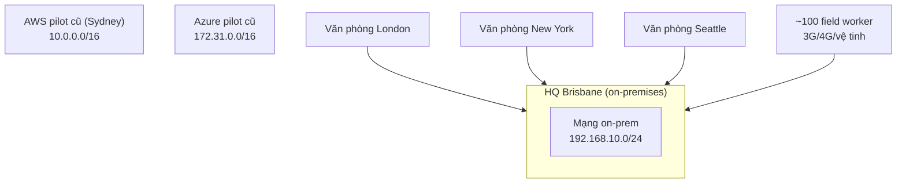

# Animals4life Scenario

> **TL;DR:** Animals4life (A4L) là tổ chức cứu hộ động vật **giả định** mà Adrian dùng xuyên suốt khóa học. Mọi kiến trúc và demo đều được đặt trong bối cảnh của A4L để người học thấy *vì sao* chọn một giải pháp. Đề thi AWS cũng luôn dựa trên tình huống doanh nghiệp, nên luyện đọc kịch bản ở đây là luyện kỹ năng làm bài.

## 🖼️ Sơ đồ
![[Animals4life Scenario.excalidraw]]
*Mở bằng plugin Excalidraw để chỉnh sửa · ảnh tĩnh: [[Animals4life Scenario.svg]]*

![[Animals4life Scenario - needs.excalidraw]]
*Mở bằng plugin Excalidraw để chỉnh sửa · ảnh tĩnh: [[Animals4life Scenario - needs.svg]]*

## Khái niệm cốt lõi

### Hồ sơ tổ chức
- Tổ chức cứu hộ và nâng cao nhận thức về động vật. Tùy khu vực, họ cứu hộ, chăm sóc y tế và tìm nhà mới cho động vật nuôi, hoặc bảo vệ môi trường sống của động vật hoang dã.
- Làm nhiều việc giám sát (di cư của động vật, tình trạng phá hủy môi trường sống) nên có **IoT** và **dataset lớn**.
- **HQ ở Brisbane, Úc**, khoảng 100 nhân viên làm các mảng dùng chung: call center, hành chính, IT, marketing, pháp lý, kế toán.
- Khoảng **100 field worker** ở vùng xa nước Úc và nhiều nơi trên thế giới: nhân viên chăm sóc động vật, bác sĩ thú y, nhà khoa học thu thập dữ liệu, chuyên viên ML/big data/IoT. Ngoài ra có nhóm vận động chính sách.
- Văn phòng lớn ngoài Úc: **London** (phụ trách EU), **New York** và **Seattle** (bờ Đông và bờ Tây Mỹ).
- Field worker dùng laptop chuyên dụng kết nối **3G/4G/vệ tinh**, cần tải lên/tải xuống từ email, file, chat, phần mềm lập kế hoạch đến các research dataset lớn.
- Người dùng nằm ở nhiều múi giờ nên hệ thống phải **chạy 24/7**. Sự cố ảnh hưởng trực tiếp đến công việc bảo vệ động vật.

### Hạ tầng hiện tại và các dải IP cần nhớ

- Một data center on-prem nhỏ ở Brisbane cùng vài colo facility, thuê tổng cộng **5 rack**. Data center đã cũ; đơn vị quản lý muốn khách hàng chuyển đi càng sớm càng tốt.
- Một nhà cung cấp từng làm **AWS pilot ở region Sydney** nhưng triển khai kém, không có resilience và khả năng scale như doanh nghiệp cần. Nhà cung cấp đó cũng làm vài pilot Azure và Google Cloud rời rạc, đều không đạt yêu cầu.
- Dải địa chỉ:
  - On-prem Brisbane: `192.168.10.0/24` (class C, xem [[Subnetting]])
  - AWS pilot: `10.0.0.0/16`
  - Azure pilot: `172.31.0.0/16` (nằm trong vùng class B private)
- Các dải này sẽ quan trọng khi thiết kế VPC: dải của VPC mới **không được trùng (overlap)** với mạng nào cần kết nối sau này. Bài [[VPC Sizing and Structure]] chọn dải cho VPC của A4L dựa trên điều kiện này.
- **Mọi văn phòng và field worker đều dùng dịch vụ IT đặt ở Brisbane** → hiệu năng kém do khoảng cách.

## Vấn đề doanh nghiệp đang gặp
| Vấn đề | Chi tiết |
|---|---|
| Phần cứng hết vòng đời | Thiết bị đang hỏng dần; data center sẽ đóng cửa trong **18 tháng**. Doanh nghiệp phải chọn giữa đầu tư thêm on-prem, Azure hay AWS |
| Pilot cloud thất bại | Không giảm được chi phí, độ tin cậy không hơn on-prem, không theo best practice |
| Hiệu năng cho người dùng ở xa | Truy cập về Brisbane chậm. Tệ nhất là bảo trì vào tối/sáng sớm giờ Brisbane, đúng giờ làm việc ở các nơi khác |
| Không có HA, không scale được | Hệ thống được cấp phát vừa khít; chịu không nổi lúc cao điểm hoặc khi phần cứng hỏng. Điều này từng chặn các dự án mới và chiến dịch mạng xã hội lớn |
| Đội IT nhỏ | Có kinh nghiệm on-prem nhưng yếu về automation và cloud. Vendor thuê ngoài từng chọn sai |
| Khó mở rộng toàn cầu | Thuê chỗ trong data center và mua thiết bị ở nước ngoài quá đắt |

## Kết quả mong muốn (Ideal Outcomes)
- **Hiệu năng nhanh cho mọi field worker**, vì họ là người trực tiếp thực hiện sứ mệnh của tổ chức.
- **Triển khai vào region mới nhanh chóng** khi cần, tự động và trả tiền theo mức dùng. Khi có thiên tai, có thể cần năng lực tại chỗ vài tuần hoặc vài tháng, sau đó dỡ bỏ.
- **Chi phí nền thấp và scale được**: chi phí cơ sở gần bằng 0, nhưng tăng nhanh khi cần. Khối lượng công việc theo mùa và theo sự kiện thiên tai, nên hạ tầng phải co giãn theo.
- **Agility**: dựng chiến dịch marketing hoặc ứng dụng mới trong vòng **48 giờ**, scale nhanh theo nhu cầu; hỗ trợ IoT, big data, machine learning, analytics.
- **Automation**: giữ tối thiểu nhân sự IT, tài chính, pháp lý (chức năng hỗ trợ) để dồn tiền cho nhân sự cốt lõi.

## Ánh xạ nhu cầu → dịch vụ AWS sẽ học
| Nhu cầu A4L | Hướng giải quyết trong khóa |
|---|---|
| Không overlap IP, kết nối on-prem với cloud | [[VPC Sizing and Structure]], [[Site-to-Site VPN]], [[Direct Connect]] |
| Hiệu năng toàn cầu cho người dùng ở xa | [[AWS Global Infrastructure]], [[CloudFront Architecture]], [[Regional and Global Architecture]] |
| HA và co giãn theo tải | [[Auto Scaling Groups]], [[Elastic Load Balancer]], [[HA vs FT vs DR]] |
| Chi phí nền ~0, pay-as-you-go | [[Serverless Architecture]], [[Lambda]] |
| Dựng/dỡ hạ tầng nhanh bằng automation | [[CloudFormation Basics]] |
| Nhiều account cho nhiều môi trường | [[AWS Accounts]], [[AWS Organizations]] |

Bảng ánh xạ này là gợi ý của note để định hướng; bài 0005 chỉ mô tả nhu cầu.

## 🎯 Mẹo thi SAA-C03
- Kịch bản cố ý **thiếu thông tin ở vài chỗ**. Trong thực tế, kỹ năng quan trọng là biết chỗ nào thiếu và cần hỏi câu gì. Trong phòng thi, kỹ năng tương ứng là tách phần nào của câu hỏi liên quan đến đáp án và phần nào là "fluff" (xem [[Exam Technique]]).
- Các từ khóa trong kịch bản A4L cũng là từ khóa hay gặp trong đề: *cost-conscious* → ưu tiên giải pháp rẻ; *deploy within 48 hours* → loại giải pháp mất nhiều tuần (ví dụ Direct Connect); *global users / performance* → CDN, multi-region; *small IT team / automation* → managed service, IaC.
- Khi thiết kế mạng, luôn kiểm tra overlap CIDR với on-prem và các cloud khác. Dải trùng sẽ chặn VPN, Direct Connect và VPC peering sau này.

## Liên kết
- Tiên quyết: [[SAA-C03 Exam Overview]]
- Liên quan: [[Exam Technique]], [[Subnetting]], [[Custom VPC]], [[Lab - Architecture Evolution]]
- Mục lục: [[_MOC 00 Course and Exam]]
