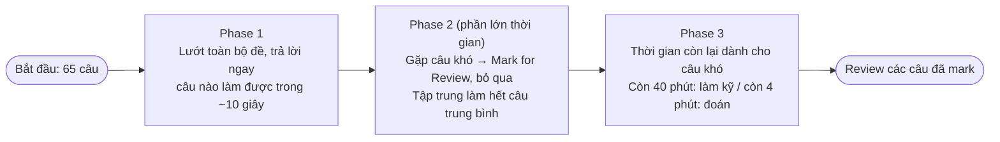
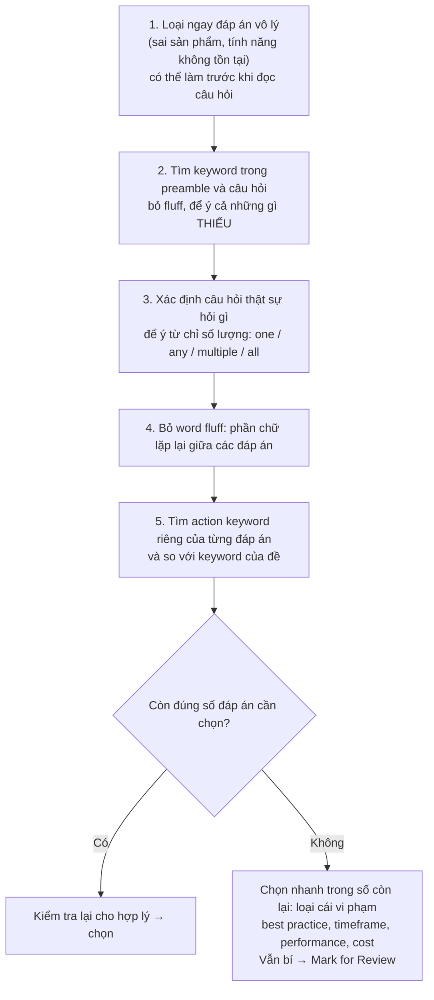

# Exam Technique

> **TL;DR:** Có hai lớp kỹ thuật. (1) **Exam technique**: chia bài thi thành 3 phase (câu dễ → câu trung bình → câu khó) để không bị câu khó ăn hết thời gian. (2) **Question technique**: loại đáp án vô lý, tìm keyword trong preamble và câu hỏi, bỏ phần chữ lặp giữa các đáp án ("word fluff"), so keyword đáp án với yêu cầu đề. Theo Adrian, phần lớn người trượt là do kỹ thuật làm bài, không phải do thiếu kiến thức.

## 🖼️ Sơ đồ
![[Exam Technique.excalidraw]]
*Mở bằng plugin Excalidraw để chỉnh sửa · ảnh tĩnh: [[Exam Technique.svg]]*

![[Exam Technique - question.excalidraw]]
*Mở bằng plugin Excalidraw để chỉnh sửa · ảnh tĩnh: [[Exam Technique - question.svg]]*

## Khái niệm cốt lõi

### Phân bố độ khó (cảm nhận)
- Nếu đã chuẩn bị tốt và không có lỗ hổng lớn, đề AWS thường cho cảm giác **25% dễ, 50% trung bình, 25% rất khó**. Độ khó cũng phụ thuộc điểm mạnh/yếu của từng người.
- Thứ tự câu dễ/khó **ngẫu nhiên**: có thể gặp toàn câu khó ngay đầu. Không có quy trình thì gặp câu khó sớm sẽ phá nhịp làm bài.

### Exam technique: phương pháp 3 phase

| Phase | Làm gì | Vì sao |
|---|---|---|
| 1. Easy (xanh) | Đi qua cả 65 câu, trả lời câu biết ngay (≤ ~10 giây hoặc chỉ cần nghĩ thêm vài giây) | Tốn rất ít thời gian, xác suất sai thấp, gom điểm chắc chắn |
| 2. Medium (vàng) | Đi qua các câu còn lại, nhận diện câu khó → **Mark for Review** rồi bỏ qua; dồn sức vào câu trung bình | Câu trung bình chiếm phần lớn đề và quyết định đậu/trượt. Câu cần suy nghĩ nhưng không đáng sợ |
| 3. Hard (đỏ) | Dùng thời gian còn lại cho câu khó; hết giờ thì đoán | Lúc này phần lớn điểm đã nằm trong tay, câu khó là "điểm thưởng" và không làm hỏng các câu trước |

Không theo quy trình, người ta thường sa vào câu khó ở đầu bài và hết giờ ở cuối, bỏ lỡ cả câu dễ lẫn câu trung bình.

### Các lời khuyên chung (slide)
- Nếu đây là bài thi AWS đầu tiên, **hãy giả định bạn sẽ hết giờ**. Phần lớn người thi lần đầu, kể cả Adrian, đều hết giờ.
- Cách thắng là **hiệu quả** và có quy trình. Quỹ thời gian mặc định là khoảng **2 phút/câu** cho cả việc đọc câu hỏi, đọc đáp án và quyết định (130 phút / 65 câu).
- **Không đoán cho đến cuối.** Câu phải đoán thì thuộc nhóm khó, để sang phase 3. Câu hỏi phía sau có thể gợi lại kiến thức giúp trả lời câu phía trước.
- Dùng triệt để **Mark for Review**: đánh dấu câu còn nghi ngờ, cuối giờ (hoặc bất cứ lúc nào) xem lại danh sách các câu đã đánh dấu.
- Làm **tất cả practice test** có thể, nhắm **trên 90%** trước khi thi thật.

### Quy trình ôn đề Adrian gợi ý
1. Học hết khóa → làm practice test đi kèm khóa học.
2. Làm practice test của Tutorials Dojo (tutorialsdojo.com). Adrian đánh giá đề của họ **khó hơn đề thật**, nên vào phòng thi sẽ thấy nhẹ hơn.
3. Câu nào sai → xác định mảng cần học thêm → học lại → làm lại test.
4. Lặp lại đến khi điểm thường xuyên trên 90% thì đi thi.

## Question technique

### Cấu trúc một câu hỏi AWS
- **Preamble**: 1–2 dòng mô tả tình huống (ví dụ "một website chia sẻ ảnh", có khi đặt tên công ty). Phần lớn **không quan trọng**; chỉ giữ lại keyword kỹ thuật.
- **Câu hỏi** thật sự.
- **4–5 đáp án.** Có hai dạng:
  - *Multiple choice*: chọn 1 đáp án đúng giữa các đáp án sai hoặc kém đúng hơn.
  - *Multi-select*: chọn nhiều đáp án, có thể là nhiều phần của một giải pháp hoặc nhiều cách đúng khác nhau. Ở cấp associate, đề **luôn ghi rõ số lượng** ("choose two/three"). Dạng "choose all that apply" chủ yếu xuất hiện ở cấp Pro.
- Ở associate, đáp án thường **đúng hoặc sai rõ ràng**. Dạng "chọn đáp án phù hợp nhất" là ngoại lệ (phổ biến hơn nhiều ở Pro).
- Câu associate thường có **ít nhất một đáp án loại được ngay**.

### Tiêu chí/ràng buộc chủ đạo của câu hỏi
Hầu hết câu hỏi có một **criteria** hoặc **restriction** quyết định đáp án:
| Từ khóa trong đề | Cách hiểu | Ví dụ |
|---|---|---|
| *Cost-effective*, công ty *cash-strapped/cost-conscious* | Nếu hai đáp án đều khả thi, chọn đáp án rẻ hơn rõ rệt | — |
| *Best practice* (ví dụ *best practice security*) | "Làm đúng như AWS muốn" | Cấp quyền cho ứng dụng trên EC2 bằng instance role ([[EC2 Instance Roles]]), không nhúng access key ([[IAM Access Keys and AWS CLI]]) |
| *Highest performance* | Thường ngược với cost: chọn phương án hiệu năng cao nhất | [[Instance Store]] so với [[EBS]] ([[Compare - EBS vs Instance Store]]); [[Direct Connect]] so với [[Site-to-Site VPN]] |
| *Timeframe* (ví dụ "trong 1 tuần") | Ước lượng thời gian triển khai từng đáp án, loại đáp án không kịp | Direct Connect thường mất nhiều tuần → loại; VPN dựng được nhanh ([[Compare - VPN vs Direct Connect]]) |

### Quy trình xử lý một câu hỏi

- **Word fluff**: nếu nhiều đáp án có cùng phần đầu hoặc phần cuối, phần đó vô nghĩa khi so sánh giữa chúng, không cần đọc. Ở associate tiết kiệm được ít; ở Pro (đáp án dài 2–4 dòng) tiết kiệm được rất nhiều. Nếu chỉ *một số* đáp án có cụm chữ đó, bản thân cụm chữ có thể là lý do để giữ hoặc loại nhóm đáp án ấy.
- Có hai hướng tiếp cận: **tìm đáp án đúng** hoặc **loại đáp án sai**. Trên thực tế thường kết hợp cả hai. Chọn cách hợp với bạn và áp dụng nhất quán cho mọi câu.
- Được phép giữ một đáp án ở trạng thái "nghi ngờ": nếu các đáp án còn lại đã đủ số lượng cần chọn thì không cần xét nó nữa.

## Ví dụ minh họa

### Ví dụ 1: multiple choice (sample question chính thức của AWS)
*CRM app chạy trên nhiều EC2 instance ở nhiều AZ sau một ALB. Nếu một instance hỏng thì sao?*
A) LB ngừng gửi request tới instance hỏng · B) LB terminate instance hỏng · C) LB tự động thay thế instance hỏng · D) LB trả lỗi 504 Gateway Timeout cho tới khi instance được thay.
- Bước 1: không có đáp án nào vô lý rõ ràng.
- Keyword: *EC2 instances*, *multiple AZs*, *ALB*. Thứ **còn thiếu**: không có Auto Scaling Group.
- Câu hỏi: *one* instance *fails*, *what occurs*.
- Word fluff: "The load balancer will..." lặp ở cả 4 đáp án → bỏ qua.
- Không có ASG thì không có gì terminate hay thay thế instance. Load balancer **không** tự terminate/provision; đó là việc của [[Auto Scaling Groups]] → loại B và C.
- Chỉ *một* instance hỏng, các instance khác vẫn healthy. Chỉ cần còn ít nhất một target healthy thì LB vẫn phục vụ được → không có 504 → loại D.
- **Đáp án: A.** LB dựa vào health check, ngừng định tuyến tới instance hỏng ([[Elastic Load Balancer]]).

### Ví dụ 2: multi-select, chọn 2
*Yêu cầu: (1) mọi dữ liệu trên cloud phải được encrypt at rest; (2) encryption key phải lưu on-premises.* Đáp án: A) SSE-S3 · B) SSE-KMS · C) SSE-C · D) client-side encryption · E) một phương án dùng Lambda kèm encryption.
- E trông lạ (Lambda đi cùng encryption hiếm thấy) → để ở trạng thái nghi ngờ, chỉ xét nếu thiếu đáp án.
- Word fluff: A, B, C đều có "server-side encryption". Bản thân SSE không quyết định đúng hay sai (tùy loại SSE mà S3 hay khách hàng giữ key), nên phải nhìn keyword riêng.
- Cả A–D đều encrypt at rest (thỏa yêu cầu 1).
- Yêu cầu 2: SSE-S3 và SSE-KMS → AWS quản lý key → key không nằm on-prem → loại A, B.
- SSE-C: S3 thực hiện mã hóa bằng key khách hàng cung cấp mỗi request → đạt. Client-side encryption: dữ liệu mã hóa xong mới gửi lên S3 → đạt.
- Đã đủ 2 đáp án nên không cần xét E. **Đáp án: C và D.** (Chi tiết ở [[S3 Encryption]], [[KMS]].)

## 🎯 Mẹo thi SAA-C03
- **DON'T PANIC.** Ai cũng cảm thấy mình sắp hết giờ. Bí thì Mark for Review và quay lại sau. Luôn theo dõi thời gian còn lại.
- Thứ tự ưu tiên: câu dễ → câu trung bình → câu khó. Không đoán ở phase 1 và 2.
- Thấy ELB mà không thấy ASG → không có khả năng tự thay thế instance. LB chỉ ngừng gửi traffic tới target unhealthy.
- "Key phải nằm on-premises/do khách hàng kiểm soát hoàn toàn" → SSE-C hoặc client-side encryption, không phải SSE-S3/SSE-KMS.
- "Best practice" → chọn cách AWS khuyến nghị (role thay vì access key, managed service, least privilege...).
- "Trong X ngày/tuần" → loại giải pháp cần thời gian dài (Direct Connect); "highest performance" → Direct Connect, Instance Store...; "cost-effective" → đáp án rẻ nhất mà vẫn đúng.
- Để ý từ chỉ số lượng (*one*, *any*, *all*), vì nó thay đổi đáp án (như ví dụ 504).

## Liên kết
- Tiên quyết: [[SAA-C03 Exam Overview]]
- Áp dụng cho ví dụ: [[Elastic Load Balancer]], [[Auto Scaling Groups]], [[S3 Encryption]], [[KMS]]
- Liên quan: [[Animals4life Scenario]], [[Exam Cheat Sheet]], [[_MOC 00 Course and Exam]]
