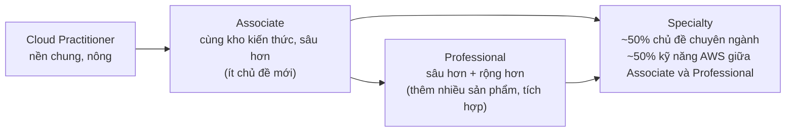
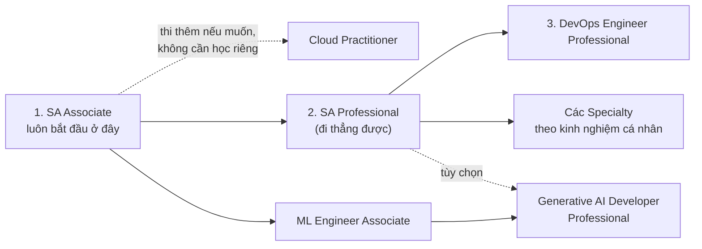

# SAA-C03 Exam Overview

> **TL;DR:** AWS Certified Solutions Architect – Associate (SAA-C03) là chứng chỉ "cửa vào" mà giảng viên khuyên **bắt đầu trước tiên**, kể cả với người mới hoàn toàn: nó bao trùm kiến thức Cloud Practitioner và là nền cho mọi chứng chỉ role-based khác. Note này gom lại: format đề, danh mục và lộ trình chứng chỉ AWS, cấu trúc khóa học và cộng đồng học tập.

## 🖼️ Sơ đồ
![[SAA-C03 Exam Overview.excalidraw]]
*Mở bằng plugin Excalidraw để chỉnh sửa · ảnh tĩnh: [[SAA-C03 Exam Overview.svg]]*

![[SAA-C03 Exam Overview - format.excalidraw]]
*Mở bằng plugin Excalidraw để chỉnh sửa · ảnh tĩnh: [[SAA-C03 Exam Overview - format.svg]]*

## Khái niệm cốt lõi

### Format kỳ thi SAA-C03
| Mục | Giá trị |
|---|---|
| Dạng câu hỏi | Multiple choice (chọn 1) và multiple response (chọn N, đề ghi rõ "choose two/three") |
| Số câu | 65 câu (50 câu tính điểm + 15 câu thử nghiệm không tính điểm, không biết câu nào) |
| Thời gian | 130 phút → trung bình **~2 phút/câu** |
| Lệ phí | 150 USD |
| Điểm đậu | 720 / 1000 (thang điểm scaled 100–1000, chấm kiểu compensatory: không cần đậu từng domain) |
| Độ dài câu hỏi | Câu hỏi 1 dòng đến 2–3 dòng; thường 4–5 đáp án, mỗi đáp án khoảng 1 dòng |
| Hiệu lực | 3 năm |

Bài giảng nêu format (multiple choice/multiple response), 65 câu, 130 phút và 150 USD; các dòng còn lại lấy từ exam guide chính thức của AWS.

### 4 domain của SAA-C03 (theo exam guide)
| Domain | Tỷ trọng | Nối với phần nào của vault |
|---|---|---|
| Design Secure Architectures | 30% | [[IAM Basics]], [[KMS]], [[Security Groups]], [[NACL]], [[AWS Organizations]] |
| Design Resilient Architectures | 26% | [[HA vs FT vs DR]], [[Auto Scaling Groups]], [[RDS Multi-AZ]], [[SQS]] |
| Design High-Performing Architectures | 24% | [[EBS Volume Types]], [[CloudFront Architecture]], [[ElastiCache]] |
| Design Cost-Optimized Architectures | 20% | [[EC2 Purchase Options]], [[S3 Storage Classes]], [[AWS Budgets]] |

Bốn domain này cũng chính là bốn "tiêu chí" hay xuất hiện trong câu hỏi (bảo mật/best practice, resilient, performance, cost). Xem cách khai thác chúng ở [[Exam Technique]].

## Lộ trình chứng chỉ AWS

### Danh mục chứng chỉ hiện nay (slide)
Bài mở đầu bằng sơ đồ chứng chỉ cũ rồi thay bằng bản cập nhật, và nói rõ AWS còn thêm chứng chỉ thường xuyên; cách chọn lộ trình thì không đổi theo danh mục.
- **Foundational**: Cloud Practitioner, **AI Practitioner**. Gợi ý khoảng 6 tháng kiến thức cloud và ngành.
- **Associate**: Solutions Architect, **CloudOps Engineer** (tên mới của SysOps Administrator), Developer, **Data Engineer**, **Machine Learning Engineer**. Gợi ý khoảng 1 năm kinh nghiệm giải quyết vấn đề trên AWS.
- **Professional**: Solutions Architect Professional, DevOps Engineer Professional, **Generative AI Developer Professional**. Gợi ý khoảng 2 năm kinh nghiệm thiết kế, vận hành và xử lý sự cố.
- **Specialty**: nhóm riêng, hẹp nhưng sâu (ví dụ Advanced Networking).

Có thể chia thành hai nhóm:
- **Role-based** (Practitioner, Associate, Professional): kiến thức rộng theo vai trò (kiến trúc, vận hành, phát triển, data, AI/ML). Thường làm nhóm này trước.
- **Specialty**: hẹp nhưng sâu hơn nhiều, dành cho vai trò chuyên gia (ví dụ Data Scientist, Senior Network Engineer). Nên để sau cùng, trừ khi bạn đã rất mạnh ở mảng đó.

### Mô hình "kho kiến thức" (slide)

- Practitioner chủ yếu là **giải thích, mô tả** khái niệm và dịch vụ. Associate dùng **chung một kho kiến thức** nhưng đòi hỏi biết sâu hơn và **làm được** (thiết kế, vận hành, triển khai); rất ít chủ đề mới.
- Professional = Associate + sâu hơn **và** rộng hơn: hiểu thêm nhiều sản phẩm, kiến trúc, tính năng và cách tích hợp chúng.
- Specialty sâu hơn Professional nhưng hẹp: làm Advanced Networking thì không cần biết các sản phẩm ML, nhưng phải hiểu networking AWS rất sâu. SA Professional được coi là nền cho các Specialty, giống như SA Associate là nền cho các chứng chỉ role-based.

### Lộ trình khuyến nghị

- **Đừng học riêng cho Cloud Practitioner.** AWS gợi ý bắt đầu bằng CLF, nhưng học SAA đã đủ để thi đậu cả CLF (muốn thì thi luôn CLF); học CLF trước rồi học SAA là học trùng, phí thời gian và tiền mua hai khóa. Bài giảng tách hai phần: phần *học* (tạo ra kỹ năng làm việc thật) và phần *đi thi* (lấy kết quả). Trên thị trường, SAA cũng được đánh giá cao hơn CLF nhiều.
- **Luôn bắt đầu bằng SA Associate**, kể cả khi bạn thiên về vận hành, AI hay machine learning: nó cho bức tranh tổng thể (AWS là gì, dùng thế nào, các phần ghép với nhau ra sao). Cấp associate cũng là lúc nhà tuyển dụng bắt đầu chú ý.
- Lý do (so study guide chính thức): study guide SAA dùng các động từ *designing, determining*; study guide ML Engineer Associate dùng *extracting, ingesting, merging, chọn data format*. Nhưng danh sách **in-scope services trùng nhau rất nhiều** (analytics, application integration, cost/financial management, compute, containers, databases, machine learning). Học SAA trước thì khi sang chứng chỉ khác chỉ cần tập trung vào góc nhìn riêng của vai trò đó.
- **Sau SAA**: trước đây lộ trình phổ biến là SAA → Developer Associate → CloudOps (SysOps) Associate rồi mới tới SA Pro. Khóa học hiện nay được thiết kế để **đi thẳng SAA → SA Pro**, chỉ cần chuẩn bị cho cú nhảy độ khó rất lớn.
- **Professional**: thứ tự còn gây tranh cãi, nhưng khuyến nghị làm **SA Pro trước**, rồi DevOps Engineer Pro, vì có phần trùng và cần hiểu AWS chi tiết.
- **Hướng AI**: với Generative AI Developer Professional, đi SAA → **Machine Learning Engineer Associate** → GenAI Developer Pro; SA Pro có thể làm hoặc bỏ qua.
- **Specialty**: thường làm sau SA Associate và SA Pro, chọn theo kinh nghiệm của bạn. Rất hiếm khi nên làm Specialty trước khi có SA Pro, trừ khi bạn đã giỏi sẵn mảng đó.

### So sánh các cấp (theo bài giảng)
| | Associate | Professional | Specialty |
|---|---|---|---|
| Thời gian | 130 phút | 180 phút | 170 phút |
| Số câu | 65 (multiple choice/response) | 75 (multiple choice/response) | — |
| Lệ phí | 150 USD | 300 USD | 300 USD |
| Câu hỏi | 2–3 dòng | vài câu, có khi cả đoạn | tương tự Pro, kiến thức hẹp nhưng sâu |
| Đáp án | 4–5, mỗi đáp án ~1 dòng | mỗi đáp án 2–3 dòng | tương tự Pro |
| Độ khó cảm nhận | 3/10 | 10/10 | Pro còn khó hơn Specialty vì độ rộng kiến thức |

Bài mở trang sample questions chính thức của AWS cho cả hai cấp để thấy độ dài câu hỏi khác nhau. Pro đắt (300 USD) và khó hơn hẳn, nên càng nhiều kinh nghiệm thực hành và chứng chỉ trước đó thì càng dễ đậu ngay lần đầu.

> **Bổ sung (bài không nói):** các Specialty Alexa Skill Builder, Data Analytics và Database đã bị khai tử; Machine Learning Specialty đã/đang ngừng (công bố là 03/2026). Kiểm tra danh sách hiện hành trên trang AWS Certification trước khi lên kế hoạch.

## Cấu trúc khóa học
- Khóa học không chỉ nhắm tới việc thi đậu mà để bạn có **kiến thức, kỹ năng và kinh nghiệm** làm Solutions Architect tự tin ngoài thực tế.
- Nhiều **hình động minh họa** giúp hiểu dịch vụ AWS từ cơ bản tới nâng cao.
- **Demo** từ cấu hình một dịch vụ đơn giản tới giải pháp nhiều dịch vụ, có cả các demo **biến đổi giải pháp qua nhiều giai đoạn**: dựng một giải pháp rồi cải thiện từng bước theo best practice (ví dụ web app của Aus-E-Mart: tạo AMI, bootstrap bằng user data, tách database khỏi EC2 monolith rồi chuyển sang RDS…).
- Kịch bản công ty mẫu trong các demo là **Aus-E-Mart (AEM)** và **RooTube**, thay cho [[Animals4life Scenario|Animals4life]] của bản khóa cũ.
- Có bài về **exam technique** ([[Exam Technique]]). Video giới thiệu còn nhắc tới question technique và các câu hỏi mô phỏng, nhưng mục Exam Prep của bản khóa hiện tại chỉ có bài phương pháp 3 phase.
- Học viên được mời vào **cộng đồng học tập** với hàng nghìn thành viên (xem mục Cộng đồng và liên hệ bên dưới).
- Thứ tự nội dung: AWS Fundamentals ([[_MOC 03 AWS Fundamentals]]) → IAM, account và Organizations ([[_MOC 04 IAM Accounts and Organizations]]) → S3, VPC, EC2 ([[_MOC 05 S3]], [[_MOC 06 VPC Basics]], [[_MOC 07 EC2]]) → containers, advanced EC2, Route 53, RDS, EFS ([[_MOC 08 Containers]], [[_MOC 09 Advanced EC2]], [[_MOC 10 Route 53]], [[_MOC 11 Databases]], [[_MOC 12 Network Storage and Backup]]) → HA và scaling, serverless, CloudFront ([[_MOC 13 HA and Scaling]], [[_MOC 14 Serverless and Application Services]], [[_MOC 15 Global Content Delivery]]) → advanced VPC, hybrid, security và vận hành ([[_MOC 16 Advanced VPC Networking]], [[_MOC 17 Hybrid and Migration]], [[_MOC 18 Security Deployment and Operations]]) → CloudFormation, DynamoDB và analytics ([[_MOC 19 CloudFormation]], [[_MOC 20 NoSQL and Analytics]]) → Systems Manager, Elastic Beanstalk, Machine Learning ([[_MOC 22 Systems Manager]], [[_MOC 23 Elastic Beanstalk]], [[_MOC 21 Machine Learning]]) → Exam Prep.
- Bản khóa mới **không còn** phần Tech Fundamentals (networking, DNS, mã hóa, YAML/JSON…) và hai lab Pet-Cuddle-o-Tron, Architecture Evolution; các ghi chú đó vẫn giữ trên web để tham khảo ([[_MOC 02 Tech Fundamentals]]).

## Tài nguyên khóa học (bài 0002, 0003, 0006)
- **GitHub repo của khóa học** chứa study notes, file và script của từng bài, bộ demo. Mỗi khóa một repo riêng.
  - Có thể *Download ZIP*, nhưng đó chỉ là bản chụp tại một thời điểm. AWS đổi console và sản phẩm liên tục nên demo hay bị lỗi; Adrian cập nhật repo theo.
  - Nên cài Git và dùng `git clone <HTTPS URL>`, sau đó định kỳ chạy `git pull` để lấy cập nhật. Hướng dẫn có cho Windows 10, macOS (cài Command Line Developer Tools) và Ubuntu (`sudo apt install git`).
- **Code editor**: khuyên dùng Visual Studio Code để có syntax highlighting khi đọc JSON, YAML, script trong demo. Không cần biết code.
- **Nền tảng learn.cantrill.io**: phụ đề do người làm (có tiếng Anh, đang làm tiếng Tây Ban Nha), chỉnh tốc độ 1x–2x, tùy chọn *autoplay* và *autocomplete*. Mặc định bài **không tự đánh dấu hoàn thành**: phải bấm "Complete and continue" hoặc bật autocomplete. Có roadmap nội dung và hệ thống ticket hỗ trợ.
- **Cộng đồng**: Tech Study Slack (kênh `#general`, `#aws`, `#developer-study-group`; có cả hiring manager trong đó), Discourse forums cho thảo luận dài, và mục Labs với các mini project miễn phí (BGP VPN động, hybrid Active Directory, hybrid DNS, Systems Manager, Web Identity Federation...).
- Adrian khuyến khích **social learning**: học cùng người khác để có bạn thảo luận và người giữ kỷ luật cho mình. Có thể liên hệ ông qua Twitter, LinkedIn, email.

## Cộng đồng và liên hệ
- Vì sao nên kết nối: networking với người cùng ngành giúp tìm việc, được giới thiệu vào dự án hay hợp đồng tư vấn, và quan trọng hơn là cập nhật kiến thức, giữ liên lạc với đồng nghiệp.
- **Tech Study Discord**: cộng đồng kỹ thuật miễn phí, gần **50.000 thành viên**, từ người mới bắt đầu tới chuyên gia; có người hỗ trợ tìm việc, người đang ôn chứng chỉ, người làm AI, AWS, Azure… (thay cho Tech Study Slack và Discourse forums nói ở bản khóa cũ).
- Liên hệ giảng viên qua **LinkedIn**, email (link dưới video); thư viện tài nguyên trên **GitHub**; các khóa **Getting Started miễn phí trên YouTube**.

## Lời kết khóa học (bài 0379)
- Chứng chỉ có giá trị, nhưng thứ giúp bạn nổi bật khi phỏng vấn là **kỹ năng**: lý thuyết cộng kinh nghiệm thực hành từ các demo và advanced demo.
- Adrian là người làm khóa học độc lập và nhờ học viên chia sẻ phản hồi thật (subreddit AWS Certification, LinkedIn, Twitter, Facebook). Ông phản đối review giả.

## 🎯 Mẹo thi SAA-C03
- Quỹ thời gian là ~2 phút/câu cho cả việc đọc câu hỏi, đọc đáp án và quyết định. Lần thi đầu hầu như ai cũng hết giờ, nên cần một quy trình (xem [[Exam Technique]]).
- Câu hỏi associate thường đúng/sai rõ ràng; dạng "chọn đáp án phù hợp nhất" hiếm hơn nhiều so với Pro. Multi-select ở associate luôn ghi rõ số đáp án cần chọn.
- Không học riêng Cloud Practitioner nếu mục tiêu là SAA: nội dung SAA đã bao trùm CLF.
- Đọc sample questions chính thức của AWS để làm quen độ dài và độ khó: câu hỏi associate thường 2–3 dòng, mỗi đáp án không quá khoảng một dòng; câu hỏi Pro dài vài câu tới cả đoạn, mỗi đáp án 2–3 dòng. Practice test chính thức của AWS cũng có ích.
- Trước khi thi thật, làm practice test đến khi đều đặn đạt trên 90%.

## Liên kết
- Bước tiếp theo: [[Animals4life Scenario]] → [[AWS Accounts]] → [[IAM Basics]]
- Liên quan: [[Exam Technique]], [[Exam Cheat Sheet]], [[_MOC 00 Course and Exam]], [[00 Home]]
- Kiến thức nền: [[Cloud Computing Definition]], [[AWS Global Infrastructure]], [[Shared Responsibility Model]]
