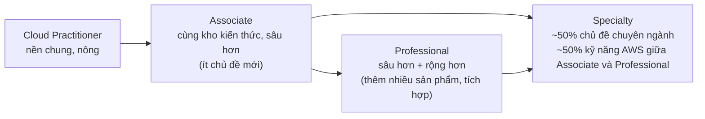
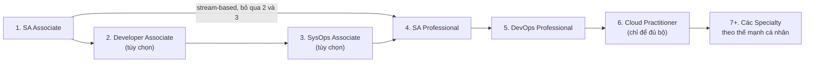

# SAA-C03 Exam Overview

> **TL;DR:** AWS Certified Solutions Architect – Associate (SAA-C03) là chứng chỉ "cửa vào" mà Adrian khuyên **bắt đầu trước tiên**, kể cả với người mới hoàn toàn: nó bao trùm kiến thức Cloud Practitioner và là nền cho mọi chứng chỉ role-based khác. Note này gom lại: format đề, lộ trình chứng chỉ AWS, cấu trúc khóa học và cách dùng tài nguyên học.

## 🖼️ Sơ đồ
![[SAA-C03 Exam Overview.excalidraw]]
*Mở bằng plugin Excalidraw để chỉnh sửa · ảnh tĩnh: [[SAA-C03 Exam Overview.svg]]*

![[SAA-C03 Exam Overview - format.excalidraw]]
*Mở bằng plugin Excalidraw để chỉnh sửa · ảnh tĩnh: [[SAA-C03 Exam Overview - format.svg]]*

## Khái niệm cốt lõi

### Format kỳ thi SAA-C03
| Mục | Giá trị |
|---|---|
| Dạng câu hỏi | Multiple choice (chọn 1) và multiple response (chọn N, đề ghi rõ "choose two/three") |
| Số câu | 65 câu (50 câu tính điểm + 15 câu thử nghiệm không tính điểm, không biết câu nào) |
| Thời gian | 130 phút → trung bình **~2 phút/câu** |
| Lệ phí | 150 USD |
| Điểm đậu | 720 / 1000 (thang điểm scaled 100–1000, chấm kiểu compensatory: không cần đậu từng domain) |
| Độ dài câu hỏi | Câu hỏi 1 dòng đến 2–3 dòng; thường 4–5 đáp án, mỗi đáp án khoảng 1 dòng |
| Hiệu lực | 3 năm |

Bài giảng chỉ nêu format, 130 phút và 150 USD; các dòng còn lại lấy từ exam guide chính thức của AWS (số câu 65 cũng được nhắc ở bài [[Exam Technique]]).

### 4 domain của SAA-C03 (theo exam guide)
| Domain | Tỷ trọng | Nối với phần nào của vault |
|---|---|---|
| Design Secure Architectures | 30% | [[IAM Basics]], [[KMS]], [[Security Groups]], [[NACL]], [[AWS Organizations]] |
| Design Resilient Architectures | 26% | [[HA vs FT vs DR]], [[Auto Scaling Groups]], [[RDS Multi-AZ]], [[SQS]] |
| Design High-Performing Architectures | 24% | [[EBS Volume Types]], [[CloudFront Architecture]], [[ElastiCache]] |
| Design Cost-Optimized Architectures | 20% | [[EC2 Purchase Options]], [[S3 Storage Classes]], [[AWS Budgets]] |

Bốn domain này cũng chính là bốn "tiêu chí" hay xuất hiện trong câu hỏi (bảo mật/best practice, resilient, performance, cost). Xem cách khai thác chúng ở [[Exam Technique]].

## Lộ trình chứng chỉ AWS (bài 0004)

### Bốn cấp độ
Slide khóa học xếp chứng chỉ theo độ khó tăng dần:
- **Foundational**: Cloud Practitioner. AWS gợi ý khoảng 6 tháng kiến thức cloud và ngành.
- **Associate**: Solutions Architect, SysOps Administrator, Developer. Gợi ý khoảng 1 năm kinh nghiệm giải quyết vấn đề trên AWS.
- **Professional**: Solutions Architect Professional, DevOps Engineer Professional. Gợi ý khoảng 2 năm kinh nghiệm thiết kế, vận hành và xử lý sự cố.
- **Specialty**: thời điểm quay khóa học gồm Advanced Networking, Security, Machine Learning, Alexa Skill Builder, Data Analytics, Database.

Có thể chia thành hai nhóm:
- **Role-based** (Practitioner, Associate, Professional): kiến thức rộng theo vai trò (kiến trúc, vận hành, phát triển). Khoảng 90% người học nên làm nhóm này trước.
- **Specialty**: hẹp nhưng sâu hơn nhiều. Nên để sau cùng, trừ khi bạn đã rất mạnh ở mảng đó.

### Mô hình "kho kiến thức" (slide)

- Cloud Practitioner và Associate dùng **chung một kho kiến thức**; Associate chỉ đi sâu hơn, rất ít chủ đề mới.
- Professional = Associate + sâu hơn **và** rộng hơn: hiểu thêm nhiều sản phẩm, kiến trúc, tính năng và cách tích hợp chúng.
- Specialty sâu hơn Professional nhưng hẹp: làm Advanced Networking thì không cần biết các sản phẩm ML, nhưng phải hiểu networking AWS rất sâu. Adrian coi SA Professional là nền cho các Specialty, giống như SA Associate là nền cho các chứng chỉ role-based.

### Lộ trình Adrian khuyến nghị

- **Đừng học riêng cho Cloud Practitioner.** Học SAA đã đủ để thi đậu cả CLF; học CLF trước rồi học SAA là học trùng, phí thời gian. Bài giảng tách hai phần: phần *học* (tạo ra kỹ năng làm việc thật) và phần *đi thi* (lấy kết quả).
- **Luôn bắt đầu bằng SA Associate**, kể cả khi bạn là developer hay làm vận hành: kiến trúc là lõi của mọi thứ, và đây là bài thi associate *dễ nhất*. Cấp associate cũng là lúc nhà tuyển dụng bắt đầu chú ý.
- Sau SAA có hai hướng:
  - **Truyền thống**: Developer Associate (giống SAA, thêm DynamoDB, SQS, Elastic Beanstalk..., không cần biết lập trình) → SysOps Associate (khó nhất trong ba bài associate; cùng phạm vi sản phẩm nhưng thiên về *vận hành và tìm lỗi* thay vì *thiết kế và tích hợp*). Đậu cả ba gọi là "all three".
  - **Stream-based**: đi thẳng SAA → SA Professional, chấp nhận cú nhảy độ khó.
- Professional: làm **SA Pro trước**, rồi DevOps Pro. Đậu 3 associate + 2 professional gọi là "all five". Adrian từng gộp ôn hai bài Pro trong khoảng 3 tháng và thi cách nhau vài tuần.
- Specialty: thứ tự tùy thế mạnh. Advanced Networking được coi là khó nhất; Security (và trước đây Alexa) được coi là dễ nhất.

### So sánh các cấp (theo bài giảng)
| | Associate | Professional | Specialty |
|---|---|---|---|
| Thời gian | 130 phút | 180 phút | 170 phút |
| Lệ phí | 150 USD | 300 USD | 300 USD |
| Câu hỏi | 1 đến 2–3 dòng | 4–5 dòng | tương tự Pro, kiến thức hẹp nhưng sâu |
| Đáp án | 4–5, mỗi đáp án ~1 dòng | 4–5, mỗi đáp án 2–4 dòng | tương tự Pro |
| Độ khó cảm nhận | 3/10 | 10/10 | Adrian thấy Pro còn khó hơn Specialty vì độ rộng kiến thức |

Thi Pro chỉ hơn 50 phút nhưng "cảm giác dài gấp 10", vì phải đọc, hiểu và chọn chính xác liên tục 3 giờ. Pro đắt nên cần chuẩn bị để đậu ngay lần đầu.

> **Cập nhật 2026:** danh mục chứng chỉ đã thay đổi so với lúc quay. Alexa Skill Builder, Data Analytics và Database Specialty đã bị khai tử; AWS thêm AI Practitioner (foundational), Data Engineer Associate, Machine Learning Engineer Associate; SysOps Administrator Associate được đổi thành CloudOps Engineer Associate. Machine Learning Specialty đã/đang ngừng (công bố là 03/2026). Lời khuyên "bắt đầu bằng SAA" vẫn đúng. Kiểm tra danh sách hiện hành trên trang AWS Certification trước khi lên kế hoạch.

## Cấu trúc khóa học (bài 0001)
- Dành cho cả kỹ sư có kinh nghiệm lẫn người chuyển ngành. Thiết kế để học được mà **không cần kiến thức có sẵn** và không cần biết lập trình.
- Hơn 70 giờ lý thuyết, nhiều demo thực hành (giá trị khi phỏng vấn), 2 bài về exam/question technique ([[Exam Technique]]), và 2 bộ practice test mô phỏng đề thật.
- Thứ tự nội dung: nền tảng ([[_MOC 02 Tech Fundamentals]], [[_MOC 03 AWS Fundamentals]]) → dịch vụ cốt lõi VPC/EC2/S3 ([[_MOC 06 VPC Basics]], [[_MOC 07 EC2]], [[_MOC 05 S3]]) → RDS, EFS, containers ([[_MOC 11 Databases]], [[_MOC 12 Network Storage and Backup]], [[_MOC 08 Containers]]) → kiến trúc serverless, event-driven, microservices ([[_MOC 14 Serverless and Application Services]]) → hybrid ([[_MOC 17 Hybrid and Migration]]) → kiến trúc elastic, HA và fault tolerant ([[_MOC 13 HA and Scaling]]).
- Hai lab tiêu biểu: [[Lab - Serverless App Pet-Cuddle-o-Tron]] và [[Lab - Architecture Evolution]] (WordPress từ monolith lên kiến trúc elastic).
- Mọi kiến trúc và demo đều gắn với kịch bản công ty giả định [[Animals4life Scenario]].

## Tài nguyên khóa học (bài 0002, 0003, 0006)
- **GitHub repo của khóa học** chứa study notes, file và script của từng bài, bộ demo. Mỗi khóa một repo riêng.
  - Có thể *Download ZIP*, nhưng đó chỉ là bản chụp tại một thời điểm. AWS đổi console và sản phẩm liên tục nên demo hay bị lỗi; Adrian cập nhật repo theo.
  - Nên cài Git và dùng `git clone <HTTPS URL>`, sau đó định kỳ chạy `git pull` để lấy cập nhật. Hướng dẫn có cho Windows 10, macOS (cài Command Line Developer Tools) và Ubuntu (`sudo apt install git`).
- **Code editor**: khuyên dùng Visual Studio Code để có syntax highlighting khi đọc JSON, YAML, script trong demo. Không cần biết code.
- **Nền tảng learn.cantrill.io**: phụ đề do người làm (có tiếng Anh, đang làm tiếng Tây Ban Nha), chỉnh tốc độ 1x–2x, tùy chọn *autoplay* và *autocomplete*. Mặc định bài **không tự đánh dấu hoàn thành**: phải bấm "Complete and continue" hoặc bật autocomplete. Có roadmap nội dung và hệ thống ticket hỗ trợ.
- **Cộng đồng**: Tech Study Slack (kênh `#general`, `#aws`, `#developer-study-group`; có cả hiring manager trong đó), Discourse forums cho thảo luận dài, và mục Labs với các mini project miễn phí (BGP VPN động, hybrid Active Directory, hybrid DNS, Systems Manager, Web Identity Federation...).
- Adrian khuyến khích **social learning**: học cùng người khác để có bạn thảo luận và người giữ kỷ luật cho mình. Có thể liên hệ ông qua Twitter, LinkedIn, email.

## Lời kết khóa học (bài 0379)
- Chứng chỉ có giá trị, nhưng thứ giúp bạn nổi bật khi phỏng vấn là **kỹ năng**: lý thuyết cộng kinh nghiệm thực hành từ các demo và advanced demo.
- Adrian là người làm khóa học độc lập và nhờ học viên chia sẻ phản hồi thật (subreddit AWS Certification, LinkedIn, Twitter, Facebook). Ông phản đối review giả.

## 🎯 Mẹo thi SAA-C03
- Quỹ thời gian là ~2 phút/câu cho cả việc đọc câu hỏi, đọc đáp án và quyết định. Lần thi đầu hầu như ai cũng hết giờ, nên cần một quy trình (xem [[Exam Technique]]).
- Câu hỏi associate thường đúng/sai rõ ràng; dạng "chọn đáp án phù hợp nhất" hiếm hơn nhiều so với Pro. Multi-select ở associate luôn ghi rõ số đáp án cần chọn.
- Không học riêng Cloud Practitioner nếu mục tiêu là SAA: nội dung SAA đã bao trùm CLF.
- Đọc sample questions chính thức của AWS để làm quen độ khó. Bài 0004 có mở bộ sample SAA (ví dụ câu CRM chạy trên EC2 sau ALB, câu SQS long polling, câu Storage Gateway). Practice test trả phí của AWS cũng có ích.
- Trước khi thi thật, làm practice test đến khi đều đặn đạt trên 90%.

## Liên kết
- Bước tiếp theo: [[Animals4life Scenario]] → [[AWS Accounts]] → [[IAM Basics]]
- Liên quan: [[Exam Technique]], [[Exam Cheat Sheet]], [[_MOC 00 Course and Exam]], [[00 Home]]
- Kiến thức nền: [[Cloud Computing Definition]], [[AWS Global Infrastructure]], [[Shared Responsibility Model]]
