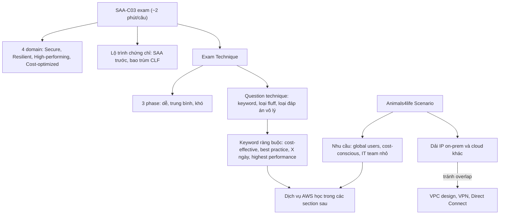

# 00 Course and Exam

Section định hướng của khóa: kỳ thi SAA-C03 trông như thế nào, vì sao nên học chứng chỉ này trước, khóa học được tổ chức ra sao, và kỹ thuật làm bài để không bị hết giờ. Kịch bản Animals4life được giới thiệu ở đây và dùng xuyên suốt các section sau. Nên đọc lướt khi bắt đầu, rồi đọc kỹ lại [[Exam Technique]] trước khi đi thi.

← [[00 Home]] · Section tiếp theo: [[_MOC 01 Accounts and Basics]] →

## Lộ trình học
1. [[SAA-C03 Exam Overview]]: format đề (~2 phút/câu), 4 domain, lộ trình chứng chỉ AWS, cấu trúc và tài nguyên khóa học; SAA bao trùm Cloud Practitioner nên học SAA trước.
2. [[Animals4life Scenario]]: tổ chức giả định A4L với hạ tầng, dải IP và vấn đề kinh doanh; ánh xạ nhu cầu sang các dịch vụ AWS sẽ học, luyện đọc đề dạng tình huống.
3. [[Exam Technique]]: chia bài thi thành 3 phase (dễ → trung bình → khó), loại đáp án vô lý, tìm keyword, bỏ "word fluff" lặp giữa các đáp án.

## Bản đồ khái niệm

## Liên kết sang section khác
- [[Exam Cheat Sheet]]: tổng hợp mẹo thi toàn khóa, ôn song song với note kỹ thuật làm bài.
- [[AWS Accounts]]: cấu trúc account A4L (General, Production) dùng trong mọi demo.
- [[AWS Global Infrastructure]]: nền cho các từ khóa resilience trong đề.
- [[HA vs FT vs DR]]: phân biệt "minimize downtime" với "no interruption".
- [[Subnetting]]: vì sao phải tránh trùng dải IP với mạng của A4L.
- [[Direct Connect]]: ví dụ kinh điển của keyword "trong X ngày" so với "highest performance".
- [[S3 Encryption]]: ví dụ keyword "key do khách hàng kiểm soát" → SSE-C / client-side.
- [[Auto Scaling Groups]]: bẫy "có ELB mà không có ASG".
- [[Lab - Architecture Evolution]]: kiến trúc A4L phát triển qua từng stage.

## 🎯 Top mẹo thi của section
- Quỹ thời gian ~2 phút/câu cho cả đọc đề, đọc đáp án và quyết định; lần đầu hầu như ai cũng hết giờ → cần quy trình ([[SAA-C03 Exam Overview]]).
- Làm theo thứ tự câu dễ → câu trung bình → câu khó; không đoán ở phase 1 và 2, bí thì Mark for Review ([[Exam Technique]]).
- **DON'T PANIC**: luôn theo dõi thời gian còn lại, quay lại câu đã đánh dấu sau ([[Exam Technique]]).
- Multi-select ở associate luôn ghi rõ số đáp án cần chọn; dạng "phù hợp nhất" hiếm hơn đề Pro ([[SAA-C03 Exam Overview]]).
- Thấy ELB mà không thấy ASG → không có khả năng tự thay thế instance; LB chỉ ngừng gửi traffic tới target unhealthy ([[Exam Technique]]).
- "Key phải do khách hàng kiểm soát hoàn toàn / nằm on-prem" → SSE-C hoặc client-side encryption, không phải SSE-S3/SSE-KMS ([[Exam Technique]]).
- "Best practice" → chọn cách AWS khuyến nghị: role thay access key, managed service, least privilege ([[Exam Technique]]).
- "Trong X ngày/tuần" → loại giải pháp triển khai lâu như Direct Connect; "cost-effective" → đáp án rẻ nhất mà vẫn đúng ([[Exam Technique]]).
- Để ý từ chỉ số lượng (*one*, *any*, *all*), chúng thay đổi đáp án ([[Exam Technique]]).
- Keyword trong kịch bản: *cost-conscious* → giải pháp rẻ; *global users* → CDN, multi-region; *small IT team* → managed service, IaC ([[Animals4life Scenario]]).
- Tách phần liên quan đến đáp án khỏi phần "fluff" trong preamble dài ([[Animals4life Scenario]]).
- Luôn kiểm tra overlap CIDR với on-prem và cloud khác; dải trùng chặn VPN, Direct Connect, VPC peering ([[Animals4life Scenario]]).
- Không học riêng Cloud Practitioner nếu mục tiêu là SAA; làm practice test tới khi đều đặn > 90% rồi mới thi ([[SAA-C03 Exam Overview]]).
