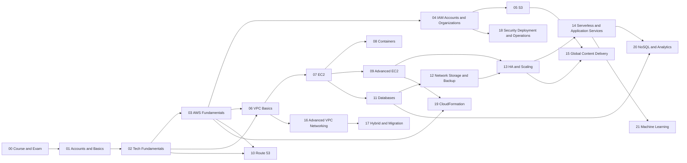

# 00 Home — AWS SAA-C03 Knowledge Graph

> Vault ghi chú học AWS Certified Solutions Architect – Associate (SAA-C03), tổng hợp từ lời giảng và slide của khóa Adrian Cantrill (385 bài, ~70 giờ). Mỗi khái niệm là một note; các note liên kết với nhau bằng `[[...]]` để bạn đi theo quan hệ giữa các dịch vụ.

## Cách dùng vault
- Mở thư mục này bằng **Obsidian** (Open folder as vault). Bật *Graph view* để xem bản đồ tri thức; lọc theo tag `#s05-s3`, `#s06-vpc-basics`… để xem từng chương.
- **Sơ đồ Excalidraw:** mỗi note có mục *🖼️ Sơ đồ* (367 sơ đồ tự vẽ: kiến trúc, luồng, so sánh, cây quyết định). Cài plugin cộng đồng **Excalidraw** (Settings → Community plugins → Browse → "Excalidraw") để xem và chỉnh sửa ngay trong note; file nằm trong thư mục `_diagrams/` của từng chương. Không có plugin vẫn xem được bản ảnh tĩnh `.svg` qua link ngay dưới mỗi sơ đồ. Màu box theo nhóm dịch vụ: cam = compute, xanh lá = storage, xanh dương = database, tím = network, đỏ = security, hồng = management, tím hồng = integration, vàng = ghi chú/mẹo.
- Học theo thứ tự chương bên dưới: mở MOC của chương → đi lần lượt theo "Lộ trình học".
- Mỗi note có: **TL;DR** → khái niệm cốt lõi → cách hoạt động (sơ đồ mermaid) → bảng so sánh → demo/lab → **🎯 Mẹo thi** → liên kết.
- Trước ngày thi: đọc [[Exam Cheat Sheet]] và mục "Top mẹo thi" trong mỗi MOC.
- Ghi chú dạng *"khóa học nói X; hiện nay là Y"* đánh dấu chỗ AWS đã thay đổi sau khi khóa học được quay. Khi làm đề, ưu tiên đáp án theo khóa học/exam guide.

## Lộ trình theo chương

| # | Chương | Nội dung | Số note |
|---|---|---|---|
| 00 | [[_MOC 00 Course and Exam\|Course and Exam]] | Section định hướng của khóa: kỳ thi SAA-C03 trông như thế nào, vì sao nên học chứng chỉ này trước, khóa học được tổ chức ra sao, và kỹ thuật làm bài để không bị hết giờ. Kịch bản Animals4life được giới thiệu ở đây và dùn | 3 |
| 01 | [[_MOC 01 Accounts and Basics\|Accounts and Basics]] | Section mở đầu phần thực hành: hiểu AWS account là container và ranh giới cô lập, rồi dựng hai account (General và Production) theo best practice: MFA cho root, budget và billing alert, IAM admin user có MFA, sau đó là a | 5 |
| 02 | [[_MOC 02 Tech Fundamentals\|Tech Fundamentals]] | Section kiến thức nền không riêng AWS: định nghĩa cloud, YAML/JSON, mật mã (encryption, hashing, chữ ký số, TLS), mạng theo mô hình OSI từ Layer 1 tới Layer 4, NAT, subnetting, DNS/DNSSEC, DDoS và RPO/RTO. Đề không hỏi t | 21 |
| 03 | [[_MOC 03 AWS Fundamentals\|AWS Fundamentals]] | Section giới thiệu "khung xương" của AWS: các network zone (public vs private service), hạ tầng toàn cầu (Region, AZ, Edge, Local Zone) và ba mức resilience, cùng bản xem trước của các dịch vụ cốt lõi (Default VPC, EC2,  | 12 |
| 04 | [[_MOC 04 IAM Accounts and Organizations\|IAM Accounts and Organizations]] | Section đi sâu vào quản lý danh tính và quản trị nhiều account: cách policy được đánh giá (Deny – Allow – Deny), khi nào dùng user, group hay role, cách AWS service nhận quyền (service-linked role, PassRole), rồi mở rộng | 10 |
| 05 | [[_MOC 05 S3\|S3]] | Section đi sâu vào Amazon S3 sau phần nhập môn S3 Basics: phân quyền và Block Public Access, static website, versioning, tối ưu upload, KMS và các kiểu mã hóa, storage class và lifecycle, replication, presigned URL, cùng | 17 |
| 06 | [[_MOC 06 VPC Basics\|VPC Basics]] | Section dựng một custom VPC cho Animals4life từ đầu: lập IP plan, chia subnet theo AZ × tier, cấu hình routing và Internet Gateway, đặt bastion host, lọc traffic bằng NACL và Security Group, rồi cho private subnet ra int | 10 |
| 07 | [[_MOC 07 EC2\|EC2]] | Section đi sâu vào EC2 sau phần nhập môn EC2 Basics. Các chủ đề gồm: ảo hóa và kiến trúc host, instance type, storage (EBS, Instance Store, snapshot, mã hóa), networking (ENI, IP, DNS), AMI, các hình thức mua, status che | 19 |
| 08 | [[_MOC 08 Containers\|Containers]] | Section ngắn giới thiệu container và các dịch vụ chạy container trên AWS. Nội dung gồm: container khác VM thế nào, Docker image và registry, ECS với hai launch type EC2 và Fargate, ECR, Kubernetes và EKS. Câu hỏi thi thư | 6 |
| 09 | [[_MOC 09 Advanced EC2\|Advanced EC2]] | Section này đi tiếp từ EC2 cơ bản: tự động cấu hình instance khi launch (user data), cấp quyền và cấu hình/secret cho ứng dụng đúng cách (instance role, Parameter Store), nhìn vào bên trong OS (CloudWatch Agent), rồi các | 7 |
| 10 | [[_MOC 10 Route 53\|Route 53]] | Section này đi sâu vào Route 53 sau phần giới thiệu ở Route 53 Fundamentals và lý thuyết DNS ở DNS Fundamentals: public và private hosted zone, CNAME so với Alias, health check, bảy routing policy, cách R53 phối hợp với  | 14 |
| 11 | [[_MOC 11 Databases\|Databases]] | Section database quan hệ của khóa học: bắt đầu từ lý thuyết mô hình dữ liệu và ACID/BASE, đi qua lựa chọn tự chạy DB trên EC2, rồi toàn bộ họ RDS (kiến trúc, Multi-AZ, backup, read replica, bảo mật, RDS Custom), họ Auror | 15 |
| 12 | [[_MOC 12 Network Storage and Backup\|Network Storage and Backup]] | Section ngắn gồm hai dịch vụ: EFS, file system mạng NFSv4 dùng chung cho nhiều EC2 Linux, giúp tách dữ liệu khỏi instance để tiến tới kiến trúc stateless; và AWS Backup, nơi quản lý backup tập trung cho nhiều dịch vụ, nh | 2 |
| 13 | [[_MOC 13 HA and Scaling\|HA and Scaling]] | Section này chuyển từ "một EC2 instance chạy tất cả" sang kiến trúc **elastic, self-healing**: load balancer (ALB/NLB/GWLB) để trừu tượng hóa backend, Launch Template + Auto Scaling Group để tự scale và tự thay instance  | 12 |
| 14 | [[_MOC 14 Serverless and Application Services\|Serverless and Application Services]] | Section dài nhất về application services: bắt đầu từ Lambda và EventBridge, ghép thành kiến trúc serverless với API Gateway, Step Functions, SNS, rồi đi qua họ messaging/streaming (SQS, Kinesis) và các dịch vụ tích hợp ( | 20 |
| 15 | [[_MOC 15 Global Content Delivery\|Global Content Delivery]] | Section về cách đưa ứng dụng tới người dùng toàn cầu: CloudFront (CDN, cache ở edge) với behaviors, TTL, origins, HTTPS qua ACM, bảo vệ origin bằng OAI/OAC, private distribution, compute ở edge bằng Lambda@Edge, và cuối  | 10 |
| 16 | [[_MOC 16 Advanced VPC Networking\|Advanced VPC Networking]] | Section nâng cao sau VPC Basics: quan sát traffic bằng VPC Flow Logs, cho IPv6 ra Internet một chiều bằng Egress-Only IGW, truy cập dịch vụ AWS public một cách riêng tư bằng Gateway và Interface VPC Endpoints, và nối hai | 6 |
| 17 | [[_MOC 17 Hybrid and Migration\|Hybrid and Migration]] | Section này nối AWS với thế giới bên ngoài: kết nối mạng hybrid (BGP, IPsec, Site-to-Site VPN, Direct Connect, Transit Gateway) và các cách đưa dữ liệu, file, identity từ on-premises lên AWS (Storage Gateway, Snow Family | 15 |
| 18 | [[_MOC 18 Security Deployment and Operations\|Security Deployment and Operations]] | Section này gom các dịch vụ bảo mật và vận hành mà đề SAA-C03 hay hỏi theo kiểu từ khóa: quản lý secret, firewall Layer 7 và chống DDoS, quản lý key bằng HSM, theo dõi compliance cấu hình, và bộ ba phát hiện (Macie, Insp | 9 |
| 19 | [[_MOC 19 CloudFormation\|CloudFormation]] | Section đi sâu vào CloudFormation sau phần nhập môn ở CloudFormation Basics: cấu trúc template (parameters, mappings, conditions, outputs), intrinsic functions, kiểm soát thứ tự và bootstrapping EC2 (DependsOn, cfn-init, | 17 |
| 20 | [[_MOC 20 NoSQL and Analytics\|NoSQL and Analytics]] | Section này bổ sung mảng dữ liệu phi quan hệ và phân tích sau phần RDS/Aurora ở _MOC 11 Databases: DynamoDB từ kiến trúc, capacity, index, streams, global tables, DAX, TTL; tiếp theo là truy vấn serverless trên S3 bằng A | 10 |
| 21 | [[_MOC 21 Machine Learning\|Machine Learning]] | Section cuối về nội dung kỹ thuật giới thiệu các dịch vụ AI/ML managed của AWS: nhóm ngôn ngữ (Comprehend, Kendra, Lex, Polly, Transcribe, Translate), nhóm thị giác và tài liệu (Rekognition, Textract), nhóm dự báo và gia | 11 |

## Bản đồ tổng quan

## Trang ôn thi
- [[Exam Cheat Sheet]] — từ khóa → dịch vụ, bảng so sánh, số liệu cần nhớ, bẫy thường gặp.
- [[Exam Technique]] — kỹ thuật làm bài 3 vòng và cách đọc câu hỏi.
- [[SAA-C03 Exam Overview]] — format đề, domain, cách khóa học được tổ chức.
- [[Animals4life Scenario]] — kịch bản xuyên suốt khóa học.

## Nguồn
Tổng hợp từ transcript tự động và slide của 385 video trong khóa *AWS Certified Solutions Architect – Associate (SAA-C03)* của Adrian Cantrill. Transcript nhận dạng giọng nói có thể sai thuật ngữ; các note đã được hiệu chỉnh theo kiến thức AWS.
