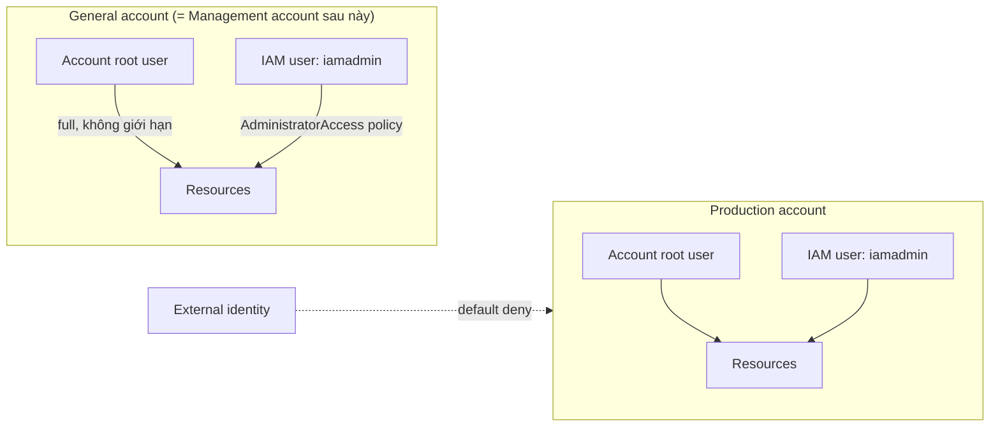

# AWS Accounts

> **TL;DR:** Một AWS account là một **container** chứa *identities* (người/ứng dụng đăng nhập) và *resources* (tài nguyên bạn tạo). Mỗi account có đúng một **account root user** có toàn quyền không thể giới hạn, và account đóng vai trò **ranh giới cô lập** (blast radius) — lỗi hay sự cố bảo mật trong account này mặc định không lan sang account khác.

## 🖼️ Sơ đồ
![[AWS Accounts.excalidraw]]
*Mở bằng plugin Excalidraw để chỉnh sửa · ảnh tĩnh: [[AWS Accounts.svg]]*

## Khái niệm cốt lõi
- **Account ≠ user.** Lỗi hay gặp của người mới là lẫn lộn account với user bên trong nó. Account là cái hộp; user (root user, IAM user...) là identity nằm trong hộp.
- Khi tạo account cần 3 thứ:
  - **Tên account** (để dễ nhận diện, ví dụ `...-general`, `...-production`).
  - **Email duy nhất**: mỗi account cần một email *không trùng* với bất kỳ account AWS nào khác. Email này trở thành định danh đăng nhập của root user.
  - **Payment method** (thường là thẻ tín dụng/ghi nợ). Một thẻ có thể dùng cho nhiều account — chỉ email mới phải duy nhất.
- **Account root user**
  - Được tạo tự động cùng account, là identity duy nhất lúc ban đầu.
  - Có **full control** trên *đúng một* account đó và **không thể bị giới hạn** bởi IAM policy. Không xóa được, không tạo lại được.
  - Root user của account Production chỉ truy cập được Production; root user của account Dev chỉ truy cập Dev.
  - Nếu email + password root bị lộ → kẻ tấn công có thể xóa sạch tài nguyên hoặc tạo tài nguyên đào coin trên tiền của bạn. Vì vậy phải bật [[MFA]] và hầu như không dùng root sau bước setup ban đầu.
- **Billing**: mọi chi phí phát sinh trong account được tính vào payment method của account đó. AWS là mô hình **pay-as-you-go** (dùng 2 phút trả 2 phút). Một số dịch vụ có **Free Tier** (xem [[AWS Budgets]]).
- **IAM identities** (IAM users, groups, roles — xem [[IAM Basics]]) được tạo thêm bên trong account. Khác root user, chúng **bắt đầu với zero permission** và phải được cấp quyền tường minh; chúng có thể bị giới hạn.
- **Default deny với bên ngoài**: mặc định mọi identity bên ngoài account đều bị từ chối. Chỉ khi bạn cấu hình rõ ràng (cross-account access, ví dụ qua [[IAM Roles]] hoặc resource policy) thì external identity mới vào được.

## Cách hoạt động / Kiến trúc

### Account là "bức tường" hai chiều
- **Giữ cái xấu ở bên trong**: admin thiếu kinh nghiệm làm hỏng, hay credential bị lộ → thiệt hại chỉ giới hạn trong account đó.
- **Giữ cái bên ngoài ở bên ngoài**: không ai ngoài account vào được trừ khi được allow.
- Do đó doanh nghiệp thường tách **nhiều account**: dev / test / prod, theo team, theo sản phẩm. Hệ thống lớn có thể dùng hàng chục đến hàng trăm account, quản lý tập trung bằng [[AWS Organizations]] (và [[AWS Control Tower]]).

### Cấu trúc account dùng trong khóa học
- **General account**: account đầu tiên, dùng cho hầu hết demo; về sau trong phần [[AWS Organizations]] nó chính là **Management account**.
- **Production account**: account thứ hai, dùng cho demo cần nhiều account (ví dụ cross-account S3).
- Mỗi account: 1 root user (có MFA) + 1 IAM user `iamadmin` (AdministratorAccess, có MFA) → tổng cộng **4 identity, 4 entry MFA**.
- Region mặc định cho mọi demo: **us-east-1 (N. Virginia)**. Kiểm tra region selector thường xuyên; với dịch vụ global (như IAM) console hiển thị "Global" là bình thường.

## Demo / Lab
**Tạo General account (0008)**
1. Mẹo **Gmail plus addressing**: `user+aws-general@gmail.com`, `user+aws-prod@gmail.com`... đều là địa chỉ khác nhau với AWS nhưng thư đều về một hộp thư → tạo bao nhiêu account cũng được. Adrian khuyên coi account là **disposable**, mỗi khóa học nên tạo bộ account mới, không dùng account cũ/của công ty/sandbox.
2. Nhập email root, tên account, verify email (code có thể mất ~5 phút, kiểm tra spam), đặt password mạnh (dùng password manager).
3. Thông tin liên hệ (Personal), billing (có thể thấy khoản *pending charge* nhỏ để xác minh thẻ, tự biến mất sau vài ngày), xác minh danh tính qua SMS/voice.
4. Chọn **Basic support (free)** — đủ cho vấn đề account/billing. Production thật thì cân nhắc Developer/Business.
5. Nếu báo lỗi billing: đăng nhập root vào Billing console, sửa payment info (hoặc gọi ngân hàng), rồi mở EC2 console để "kích" AWS hoàn tất kích hoạt; activation có thể tức thì hoặc tới ~1 giờ.
6. Trong **Account settings**: (tuỳ chọn) điền *Alternate contacts* (Billing / Operations / Security); **bật "IAM user and role access to Billing information"**. Nếu không bật, kể cả IAM identity có AdministratorAccess cũng **không** vào được Billing console.

**Tạo Production account (0012 — tự làm)**: lặp y hệt: email khác (plus trick), tên `...-production`, cùng thẻ, Basic support, thêm MFA root (entry MFA **riêng**), bật 3 billing preferences, tạo budget, bật IAM access to billing, (tuỳ chọn) alternate contacts.

## Bảng so sánh / số liệu

| | Account root user | IAM identity (user/role) |
|---|---|---|
| Số lượng mỗi account | Đúng 1 | Nhiều (giới hạn theo quota) |
| Quyền ban đầu | Toàn quyền | Không có quyền nào |
| Giới hạn được bằng IAM policy? | Không | Có |
| Đăng nhập console | Email + password (+ MFA) | Account ID/alias + username + password (+ MFA) |
| Dùng hằng ngày? | Không — chỉ setup ban đầu và tác vụ đặc biệt | Có |

Bổ sung (không có trong bài nhưng hay gặp khi thi): một số tác vụ **chỉ root user làm được**, ví dụ đóng account, đổi tên/email/password root và account settings, đổi support plan, khôi phục quyền khi IAM admin tự khóa mình, bật **MFA Delete** cho S3 bucket ([[S3 Versioning and MFA Delete]]). Trong account thành viên của [[AWS Organizations]], [[Service Control Policies]] *có* giới hạn được cả root user của account đó — nhưng không giới hạn được management account.

## 🎯 Mẹo thi SAA-C03
- Account là **ranh giới cô lập/blast radius**: đề hỏi cách "cô lập môi trường dev/test/prod", "giới hạn thiệt hại khi lộ credential" → tách **nhiều AWS account** (+ [[AWS Organizations]]).
- Root user **không thể restrict bằng IAM** → best practice: bật MFA cho root, không tạo access key cho root, dùng IAM admin cho công việc hằng ngày.
- Mặc định **deny** mọi truy cập từ ngoài account; truy cập cross-account cần cấp quyền tường minh.
- Mỗi account cần **email duy nhất**; thẻ thanh toán thì dùng chung được.
- IAM admin không vào được Billing nếu chưa bật **IAM user and role access to Billing information** — câu hỏi kiểu "admin có AdministratorAccess nhưng không xem được hóa đơn".

## Liên kết
- Tiên quyết: [[SAA-C03 Exam Overview]]
- Liên quan: [[MFA]], [[AWS Budgets]], [[IAM Basics]], [[IAM Access Keys and AWS CLI]], [[IAM Users and ARNs]], [[IAM Roles]], [[Shared Responsibility Model]]
- Mở rộng: [[AWS Organizations]], [[Service Control Policies]], [[AWS Control Tower]], [[AWS Global Infrastructure]]
- MOC: [[_MOC 01 Accounts and Basics]]
