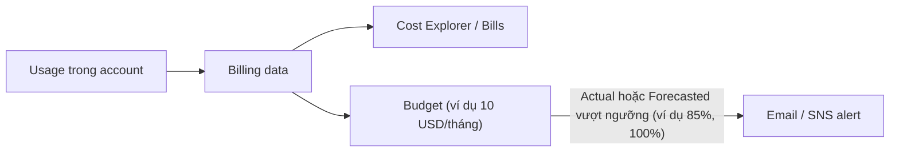

# AWS Budgets

> **TL;DR:** AWS Budgets theo dõi chi tiêu (hoặc mức sử dụng) so với một ngưỡng bạn đặt và **gửi cảnh báo** khi chạm các mốc phần trăm. Kết hợp với Free/Paid plan và credit, Free Tier, billing preferences và Cost Explorer, đây là bộ công cụ cơ bản để tránh "hóa đơn bất ngờ" trong account AWS.

## 🖼️ Sơ đồ
![[AWS Budgets.excalidraw]]
*Mở bằng plugin Excalidraw để chỉnh sửa · ảnh tĩnh: [[AWS Budgets.svg]]*

![[AWS Budgets - compare.excalidraw]]
*Mở bằng plugin Excalidraw để chỉnh sửa · ảnh tĩnh: [[AWS Budgets - compare.svg]]*

## Khái niệm cốt lõi
- **Free plan và Paid plan** (mô hình từ năm 2025, thay cho Free Tier 12 tháng kiểu cũ):
  - Lúc tạo account, AWS dựa vào thông tin đăng ký (tên, địa chỉ, email, payment method) để xét bạn có phải **khách hàng mới** không. Chỉ khách mới được chọn **Free plan**; ai cũng tạo được **Paid plan** (khách mới cũng chọn được Paid).
  - Khách mới, dù chọn plan nào, đều nhận **credit** (khóa học nhắc khoảng $100, có thể đổi), và **kiếm thêm credit** bằng một số hoạt động gợi ý, ví dụ **tạo budget**.
  - **Free plan**: mọi chi phí trừ vào credit. Hết credit (hoặc hết thời hạn 6 tháng) thì account **dừng hẳn**, mọi dịch vụ tắt, **không bao giờ** bị tính tiền vào thẻ. Free plan **không có đủ mọi dịch vụ và tính năng** (ví dụ không dùng được AWS Organizations, EC2 bị giới hạn loại instance). Có thể **nâng lên Paid plan** bất cứ lúc nào.
  - **Paid plan**: credit (nếu có) vẫn bị dùng trước; hết credit thì tính tiền thật vào payment method. Account tồn tại cho tới khi bạn đóng, có đủ mọi dịch vụ và tính năng.
  - Cả hai plan đều có **Always Free** (hạn mức miễn phí theo tháng cho từng dịch vụ, ví dụ một lượng storage và read/write của DynamoDB, một lượng chạy Lambda; dùng trong hạn mức thì không tốn tiền, không trừ credit) và **Free Trials** (dùng thử dịch vụ). Vượt hạn mức hoặc dịch vụ không có free tier thì phát sinh chi phí.
  - **EC2 không còn là dịch vụ Always Free** (trước 2025 từng có giờ miễn phí hằng tháng) → làm demo gần như chắc chắn có chút chi phí.
  - Khuyến nghị của khóa học: tạo Free plan nếu được, **tạo budget ngay**, rồi nâng lên Paid plan để có trải nghiệm giống môi trường thật.
  - Trang tham khảo: `aws.amazon.com/free` (lọc theo plan type: Free, Paid, Always Free; có FAQ và cách kiếm thêm credit).
- **Billing and Cost Management console** (global, không phụ thuộc region): điểm trung tâm cho mọi thứ về billing:
  - **Bills**: chi phí tháng hiện tại (chưa chốt) và các tháng trước, payments.
  - **Credits**: credit đang có và credit kiếm thêm được.
  - **Free Tier**: mức đang dùng so với hạn mức miễn phí của từng dịch vụ (runtime, storage…), có với cả Free plan lẫn Paid plan.
  - **Cost and Usage Reports**, **Cost Explorer**: xem chi phí rất chi tiết (theo service, region, data transfer, dung lượng S3...).
  - Tổng quan: chi phí tháng trước, month-to-date và **forecast** cho tháng hiện tại.
- **Billing preferences** — khóa học khuyên bật cả ba:
  1. **PDF invoices via email** (Invoice delivery preferences): hóa đơn PDF gửi kèm email thông báo hàng tháng; tắt thì vẫn có hóa đơn nhưng phải vào console xem.
  2. **Receive AWS Free Tier alerts** (Alert preferences): báo khi vượt hạn mức miễn phí hằng tháng; mặc định gửi về email root, có thể thêm email khác.
  3. **Receive CloudWatch billing alerts**: cho phép tạo cảnh báo billing (CloudWatch billing alarm).
  - Mỗi nhóm bấm **Edit** rồi **Update** để lưu.
- **Các loại budget**: **Cost budget**, **Usage budget**, **Savings Plans budget**, **Reservation budget** (theo dõi RI). Xem [[Reserved Instances and Savings Plans]].
- **Cost Explorer**: account mới mở lần đầu có thể báo cần khoảng **24 giờ** để chuẩn bị dữ liệu. Xem chi phí theo granularity hourly/daily/monthly, lọc theo service, region…, so sánh tháng này với tháng trước, và **forecast** chi phí tới cuối tháng. Không cần chờ để tạo cost budget.

## Cách hoạt động / Kiến trúc

- Tạo nhanh bằng **template** (ví dụ *Zero spend budget*: báo khi phát sinh bất kỳ chi phí nào, bổ sung, bài không giải thích; *Monthly cost budget*: ngưỡng tiền theo tháng, cảnh báo sẵn ở 85% actual, 100% actual, 100% forecasted) hoặc **Customize** để tự đặt mọi thứ.
- Thiết lập budget: **Period** (Monthly), **Recurring**, **Fixed amount**, rồi thêm **alert threshold** theo % số tiền budget.
- **Trigger**: *Actual* (chi phí thật đã phát sinh) hoặc *Forecasted* (dự báo sẽ vượt).
- Đặt ngưỡng **thấp hơn 100%** để được báo trước, không phải lúc đã tiêu hết.
- Budget cần tới **24 giờ** để có số liệu chi tiêu.

## Demo / Lab
**Nâng Free plan lên Paid plan**
1. Đăng nhập root của General account → menu account → **Billing and Cost Management**.
2. **Credits**: xem credit hiện có. **Free Tier**: xem mức dùng so với hạn mức miễn phí.
3. **Upgrade plan** → xác nhận. Credit còn lại vẫn được dùng; hết credit hoặc vượt free tier thì bắt đầu bị tính tiền → cần budget để theo dõi. (Có thể nâng sau nếu chưa yên tâm.)

**Tạo budget**
1. Billing and Cost Management → **Bills** (hóa đơn từng tháng, tổng ước tính), **Credits**, **Cost Explorer** (xem lướt).
2. **Billing preferences** → bật PDF invoices via email, Receive AWS Free Tier alerts, Receive CloudWatch billing alerts.
3. **Budgets** → Create budget → dùng **template** (không cần Customize).
4. Chọn **Monthly cost budget** (không chọn *Zero spend budget*, vì với free tier mới gần như chắc chắn có chút chi phí) → đặt số tiền, ví dụ **10 USD**, nhập email bạn thật sự theo dõi.
5. Template tự cấu hình 3 cảnh báo: **actual spend chạm 85%**, **actual spend chạm 100%**, và **forecasted spend dự kiến chạm 100%** → Create budget. Budget có thể mất một lúc mới active.
6. Sau một thời gian, xem lại **Credits**: tạo budget thường được cộng thêm credit (nếu AWS còn chương trình này).
7. Làm lại cho Production account. Account dùng thật cho doanh nghiệp thì phải tạo budget thành thói quen.

## 🎯 Mẹo thi SAA-C03
- "Được thông báo khi chi phí **sắp** vượt / **dự báo** vượt mức X" → **AWS Budgets** với alert *Forecasted* (hoặc *Actual* ở mốc %).
- "Phân tích chi phí theo service/thời gian, xem xu hướng" → **Cost Explorer**; báo cáo chi tiết nhất dạng file → **Cost and Usage Report**.
- Theo dõi mức sử dụng/độ phủ của RI hoặc Savings Plans → **Reservation / Savings Plans budget**.
- IAM user muốn xem billing phải được **bật IAM access to billing** trong account settings + có quyền trong policy (xem [[AWS Accounts]]).
- Kiến thức bổ sung: billing metric `EstimatedCharges` của [[CloudWatch Basics|CloudWatch]] chỉ có ở **us-east-1**; muốn tạo billing alarm phải bật *Receive Billing Alerts* trước.
- Budgets có **Budget Actions** (áp IAM policy/SCP hoặc dừng EC2/RDS khi vượt ngưỡng) — hữu ích khi đề hỏi cách "tự động ngăn chi tiêu vượt mức".

## Liên kết
- Tiên quyết: [[AWS Accounts]]
- Liên quan: [[AWS Cost Management]] (Cost Explorer, Data Exports / CUR, cost allocation tags), [[CloudWatch Basics]], [[SNS]], [[AWS Organizations]] (consolidated billing), [[Service Control Policies]], [[EC2 Purchase Options]], [[Reserved Instances and Savings Plans]], [[S3 Storage Classes]]
- MOC: [[_MOC 01 Accounts and Basics]]
