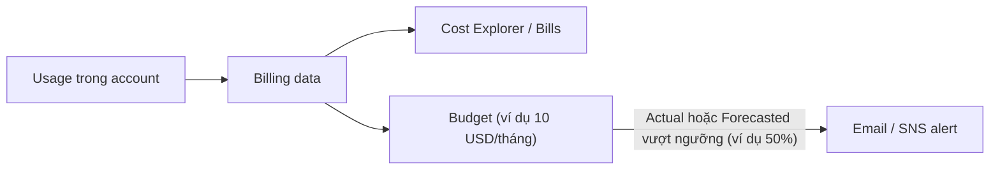

# AWS Budgets

> **TL;DR:** AWS Budgets theo dõi chi tiêu (hoặc mức sử dụng) so với một ngưỡng bạn đặt và **gửi cảnh báo** khi chạm các mốc phần trăm. Kết hợp với Free Tier, billing preferences và Cost Explorer, đây là bộ công cụ cơ bản để tránh "hóa đơn bất ngờ" trong account AWS.

## 🖼️ Sơ đồ
![[AWS Budgets.excalidraw]]
*Mở bằng plugin Excalidraw để chỉnh sửa · ảnh tĩnh: [[AWS Budgets.svg]]*

![[AWS Budgets - compare.excalidraw]]
*Mở bằng plugin Excalidraw để chỉnh sửa · ảnh tĩnh: [[AWS Budgets - compare.svg]]*

## Khái niệm cốt lõi
- **Free Tier** — ba kiểu ưu đãi:
  - **Free trials**: dùng thử ngắn hạn.
  - **12 months free**: ví dụ khóa học nêu 750 giờ/tháng cho một số loại EC2 instance, 750 giờ/tháng cho một số loại RDS instance, 5 GB S3 Standard storage.
  - **Always free**: một hạn mức miễn phí vĩnh viễn mỗi tháng.
  - (Khóa học mô tả mô hình 12 tháng; account tạo từ 15/07/2025 dùng mô hình mới: chọn *Free plan* hoặc *Paid plan*, nhận credit khởi điểm (tới khoảng $200 nếu làm các hoạt động gợi ý), Free plan kéo dài tối đa 6 tháng. Hạn mức always-free vẫn còn.)
- **Billing console / Billing dashboard**: điểm trung tâm cho mọi thứ về billing:
  - **Bills**: chi phí tháng hiện tại (chưa chốt) và các tháng trước, payments, credits.
  - **Cost and Usage Reports**, **Cost Explorer**: xem chi phí rất chi tiết (theo service, region, data transfer, dung lượng S3...).
  - Tổng quan: chi phí tháng trước, month-to-date và **forecast** cho tháng hiện tại.
- **Billing preferences** — Adrian khuyên bật cả ba:
  1. **Receive PDF invoice by email**: hóa đơn gửi kèm email hàng tháng, không phải đăng nhập mới xem được.
  2. **Receive Free Tier usage alerts** (nhập email): báo khi sắp vượt hạn mức free tier.
  3. **Receive Billing Alerts**: cho phép tạo cảnh báo billing (CloudWatch billing alarm) — các bài sau cần cái này.
  - Hay quên bấm **Save preferences** → các bước sau của khóa học bị ảnh hưởng.
- **Các loại budget**: **Cost budget**, **Usage budget**, **Savings Plans budget**, **Reservation budget** (theo dõi RI). Xem [[Reserved Instances and Savings Plans]].
- **Cost Explorer** phải được bật trước; dữ liệu chuẩn bị mất khoảng **24 giờ**. Không cần chờ để tạo cost budget.

## Cách hoạt động / Kiến trúc

- Thiết lập budget: **Period** (Monthly), **Recurring**, **Fixed amount**, rồi thêm **alert threshold** theo % số tiền budget.
- **Trigger**: *Actual* (chi phí thật đã phát sinh) hoặc *Forecasted* (dự báo sẽ vượt).
- Đặt ngưỡng **thấp hơn 100%** để được báo trước, không phải lúc đã tiêu hết.
- Budget cần tới **24 giờ** để có số liệu chi tiêu.

## Demo / Lab
1. Đăng nhập root của General account → **Billing dashboard**.
2. **Billing preferences** → bật 3 checkbox, nhập email → **Save preferences**.
3. **Budgets** → Create budget → (nếu bị yêu cầu) Enable Cost Explorer.
4. Chọn **Cost budget** → Monthly, recurring, fixed **10 USD**, đặt tên kiểu `monthly-10usd-budget`.
5. Thêm alert threshold **50%** of budgeted amount, trigger **Actual**, email recipient → Create.
6. Làm lại y như vậy cho Production account. Account dùng thật cho doanh nghiệp thì phải tạo budget thành thói quen.

## 🎯 Mẹo thi SAA-C03
- "Được thông báo khi chi phí **sắp** vượt / **dự báo** vượt mức X" → **AWS Budgets** với alert *Forecasted* (hoặc *Actual* ở mốc %).
- "Phân tích chi phí theo service/thời gian, xem xu hướng" → **Cost Explorer**; báo cáo chi tiết nhất dạng file → **Cost and Usage Report**.
- Theo dõi mức sử dụng/độ phủ của RI hoặc Savings Plans → **Reservation / Savings Plans budget**.
- IAM user muốn xem billing phải được **bật IAM access to billing** trong account settings + có quyền trong policy (xem [[AWS Accounts]]).
- Kiến thức bổ sung: billing metric `EstimatedCharges` của [[CloudWatch Basics|CloudWatch]] chỉ có ở **us-east-1**; muốn tạo billing alarm phải bật *Receive Billing Alerts* trước.
- Budgets có **Budget Actions** (áp IAM policy/SCP hoặc dừng EC2/RDS khi vượt ngưỡng) — hữu ích khi đề hỏi cách "tự động ngăn chi tiêu vượt mức".

## Liên kết
- Tiên quyết: [[AWS Accounts]]
- Liên quan: [[CloudWatch Basics]], [[SNS]], [[AWS Organizations]] (consolidated billing), [[Service Control Policies]], [[EC2 Purchase Options]], [[Reserved Instances and Savings Plans]], [[S3 Storage Classes]]
- MOC: [[_MOC 01 Accounts and Basics]]
