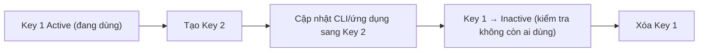

# IAM Access Keys and AWS CLI

> **TL;DR:** Access key là **long-term credential** của IAM user, dùng cho truy cập lập trình (AWS CLI, API, SDK) thay cho username/password/MFA của console. Mỗi IAM user có **tối đa 2 access key**; secret chỉ hiển thị **một lần** lúc tạo. AWS CLI v2 lưu access key theo **named profile** để làm việc với nhiều account.

## 🖼️ Sơ đồ
![[IAM Access Keys and AWS CLI.excalidraw]]
*Mở bằng plugin Excalidraw để chỉnh sửa · ảnh tĩnh: [[IAM Access Keys and AWS CLI.svg]]*

![[IAM Access Keys and AWS CLI - rotation.excalidraw]]
*Mở bằng plugin Excalidraw để chỉnh sửa · ảnh tĩnh: [[IAM Access Keys and AWS CLI - rotation.svg]]*

## Khái niệm cốt lõi
**Long-term credentials**
- Gọi là "long-term" vì **không tự đổi/rotate**; chủ sở hữu phải chủ động thay (như đổi password).
- Đều gắn với **IAM user**: console dùng username + password; CLI/API dùng access key.
- Credential thường có **phần public** và **phần private**: username (public) + password (private). Lộ username không sao, lộ cả cặp = **credential leak**. MFA là thêm một phần private nữa.

**Password vs Access key**

| | Username/Password | Access keys |
|---|---|---|
| Dùng cho | Console UI | CLI, API, SDK |
| Số lượng mỗi IAM user | Tối đa **1** password (có thể đổi) | **0, 1 hoặc 2** cặp key |
| Bắt buộc? | Không — user chỉ dùng CLI/API thì không cần password | Không |
| Trạng thái | — | **Active** (mặc định khi tạo) / **Inactive**; có thể xóa |
| Thành phần | Username (public) + password (private) | **Access Key ID** (public) + **Secret Access Key** (private) |

- **Access Key ID**: giống username, xem lại được bất cứ lúc nào (thường bắt đầu `AKIA...`, 20 ký tự).
- **Secret Access Key**: dài và phức tạp hơn (40 ký tự), AWS chỉ cung cấp **đúng một lần lúc tạo**; sau đó không tải lại được.
- Request CLI cần **cả hai phần**; một phần đơn lẻ vô dụng.
- Mất secret hoặc nghi bị lộ → **không đổi được secret**: phải **xóa cả cặp** rồi tạo cặp mới, sau đó cập nhật mọi CLI/ứng dụng đang dùng. Key bị inactive hoặc xóa → ứng dụng dùng nó ngừng hoạt động ngay.
- Giới hạn **2 cặp** tính cả active lẫn inactive.
- **Root user cũng có thể có access key nhưng không nên**. Ngoài root, **IAM user là identity duy nhất dùng access key** (credential dài hạn). **IAM Role không dùng access key dài hạn** (dùng temporary credentials, xem [[IAM Roles]]).

## Cách hoạt động / Kiến trúc
**Rotation** = tạo cặp mới, cập nhật mọi nơi dùng key, xóa cặp cũ. Đây chính là lý do được phép có 2 cặp.

**AWS CLI v2 và named profiles**
- `aws configure` cấu hình **default profile** (dùng khi không chỉ định profile).
- `aws configure --profile <tên>` tạo **named profile**; nhập 4 giá trị: Access Key ID, Secret Access Key, **default region** (`us-east-1`), default output format (Enter = none).
- Dùng: `aws s3 ls --profile iamadmin-general`. Chạy không có `--profile` khi default chưa cấu hình → lỗi **"Unable to locate credentials"**.
- Thông tin được lưu trong `~/.aws/credentials` và `~/.aws/config` (kiến thức bổ sung); có thể chọn profile bằng biến môi trường `AWS_PROFILE`.
- Kiểm tra cài đặt: `aws --version` phải ra `aws-cli/2.x.x`. CLI v2 có nhiều cải tiến so với v1 và là bản khóa học dùng.

## Demo / Lab
1. Đăng nhập `iamadmin` (General) → **Security credentials** → **Create access key**. Thử: tạo xong đóng hộp thoại là không xem lại secret được; có thể Make inactive / Make active; tạo cặp thứ 2 được, cặp thứ 3 thì không. Xóa hết các cặp thử nghiệm.
2. Tạo cặp thật → **Download CSV**, đổi tên `iamadmin_accesskeys_general.csv`, lưu cục bộ (không đưa lên cloud storage).
3. Sign out → đăng nhập `iamadmin` của Production qua sign-in URL Production + MFA → tạo key → `..._production.csv`.
4. Cài **AWS CLI v2** (Windows/macOS/Linux, cài mặc định) → `aws --version`.
5. `aws configure --profile iamadmin-general` → dán Access Key ID (phần trước dấu phẩy trong CSV), Secret (phần sau dấu phẩy), `us-east-1`, Enter.
6. Kiểm tra `aws s3 ls --profile iamadmin-general` → kết quả rỗng (account mới chưa có bucket) là đúng; lỗi thì thường do copy thiếu ký tự → chạy lại `aws configure --profile ...`.
7. Lặp lại với `iamadmin-production`.
8. **Xóa 2 file CSV** sau khi cấu hình xong. Adrian xóa và tạo lại key ngay sau khi quay vì key đã hiện trên màn hình: ai có cặp key của `iamadmin` là có **toàn quyền admin** trên account.
- (Console hiện nay hỏi use case khi tạo access key và gợi ý phương án tốt hơn như **CloudShell** hoặc `aws configure sso` với **IAM Identity Center** để dùng credential tạm thời.)

## 🎯 Mẹo thi SAA-C03
- Truy cập **CLI/API/SDK** bằng IAM user → **access keys**; console → username/password (+MFA).
- **Tối đa 2 access key/IAM user**, chủ yếu để **rotate không downtime**.
- Secret access key **chỉ thấy một lần**; mất → xóa và tạo mới.
- Đề hỏi ứng dụng **chạy trên EC2/Lambda** cần quyền AWS → **không** nhúng access key vào code/instance; dùng **IAM Role** ([[EC2 Instance Roles]]). Nhúng access key là đáp án sai kinh điển.
- Không tạo access key cho **root user**.
- Key bị lộ → vô hiệu hóa/xóa key ngay, tạo key mới; cân nhắc lưu secret trong [[Secrets Manager]] / [[SSM Parameter Store]] thay vì file cấu hình.

## Liên kết
- Tiên quyết: [[IAM Basics]], [[AWS Accounts]]
- Liên quan: [[IAM Users and ARNs]], [[MFA]], [[CloudTrail]] (ghi lại API call do access key thực hiện), [[S3 Basics]] (lệnh `aws s3 ls`), [[Secrets Manager]], [[SSM Parameter Store]]
- Phân biệt với: [[IAM Roles]] (temporary credentials qua STS), [[EC2 Instance Roles]], [[S3 Presigned URLs]]
- MOC: [[_MOC 01 Accounts and Basics]]
