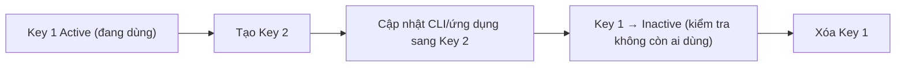

# IAM Access Keys and AWS CLI

> **TL;DR:** Access key là **long-term credential** của IAM user, dùng cho truy cập lập trình (AWS CLI, API, SDK) thay cho username/password/MFA của console. Mỗi IAM user có **tối đa 2 access key**; secret chỉ hiển thị **một lần** lúc tạo. AWS CLI v2 lưu access key theo **named profile** để làm việc với nhiều account. Khóa học coi access key là cách **cũ (legacy)**: với CLI, nên dùng **`aws login`** để đăng nhập qua trình duyệt (có MFA) và chỉ giữ credential tạm thời.

## 🖼️ Sơ đồ
![[IAM Access Keys and AWS CLI.excalidraw]]
*Mở bằng plugin Excalidraw để chỉnh sửa · ảnh tĩnh: [[IAM Access Keys and AWS CLI.svg]]*

![[IAM Access Keys and AWS CLI - rotation.excalidraw]]
*Mở bằng plugin Excalidraw để chỉnh sửa · ảnh tĩnh: [[IAM Access Keys and AWS CLI - rotation.svg]]*

## Khái niệm cốt lõi
**Long-term credentials**
- Gọi là "long-term" vì **không tự đổi/rotate**; chủ sở hữu phải chủ động thay (như đổi password).
- Đều gắn với **IAM user**: console dùng username + password; CLI/API dùng access key.
- Credential thường có **phần public** và **phần private**: username (public) + password (private). Lộ username không sao, lộ cả cặp = **credential leak**. MFA là thêm một phần private nữa.

**Password vs Access key**

| | Username/Password | Access keys |
|---|---|---|
| Dùng cho | Console UI | CLI, API, SDK |
| Số lượng mỗi IAM user | Tối đa **1** password (có thể đổi) | **0, 1 hoặc 2** cặp key |
| Bắt buộc? | Không — user chỉ dùng CLI/API thì không cần password | Không |
| Trạng thái | — | **Active** (mặc định khi tạo) / **Inactive**; có thể xóa |
| Thành phần | Username (public) + password (private) | **Access Key ID** (public) + **Secret Access Key** (private) |

- **Access Key ID**: giống username, xem lại được bất cứ lúc nào (thường bắt đầu `AKIA...`, 20 ký tự).
- **Secret Access Key**: dài và phức tạp hơn (40 ký tự), AWS chỉ cung cấp **đúng một lần lúc tạo**; sau đó không tải lại được.
- Request CLI cần **cả hai phần**; một phần đơn lẻ vô dụng.
- Mất secret hoặc nghi bị lộ → **không đổi được secret**: phải **xóa cả cặp** rồi tạo cặp mới, sau đó cập nhật mọi CLI/ứng dụng đang dùng. Key bị inactive hoặc xóa → ứng dụng dùng nó ngừng hoạt động ngay.
- Giới hạn **2 cặp** tính cả active lẫn inactive.
- **Root user cũng có thể có access key nhưng không nên**. Ngoài root, **IAM user là identity duy nhất dùng access key** (credential dài hạn). **IAM Role không dùng access key dài hạn** (dùng temporary credentials, xem [[IAM Roles]]).

## Cách hoạt động / Kiến trúc
**Rotation** = tạo cặp mới, cập nhật mọi nơi dùng key, xóa cặp cũ. Đây chính là lý do được phép có 2 cặp.

**AWS CLI v2 và named profiles**
- `aws configure` cấu hình **default profile** (dùng khi không chỉ định profile).
- `aws configure --profile <tên>` tạo **named profile**; nhập 4 giá trị: Access Key ID, Secret Access Key, **default region** (`us-east-1`), default output format (Enter = none).
- Dùng: `aws s3 ls --profile iamadmin-general`. Chạy không có `--profile` khi default chưa cấu hình → lỗi **"Unable to locate credentials"**.
- Thông tin được lưu trong `~/.aws/credentials` và `~/.aws/config` (kiến thức bổ sung); có thể chọn profile bằng biến môi trường `AWS_PROFILE`.
- Kiểm tra cài đặt: `aws --version` phải ra `aws-cli/2.x.x`. CLI v2 có nhiều cải tiến so với v1 và là bản khóa học dùng.
- Rủi ro: `aws configure` ghi Access Key ID và Secret **dạng rõ** vào `~/.aws/credentials` (file `config` chỉ có profile và region). Ai đọc được file này là dùng được identity đó với toàn bộ quyền của nó → đây là lý do access key bị coi là kém an toàn.
- CLI ký (sign) mỗi request bằng secret access key; secret không được gửi kèm request.

**`aws login`: đăng nhập CLI không cần access key**
- `aws login --profile <tên>` (AWS CLI v2) mở trình duyệt để đăng nhập bằng chính identity console của bạn (password + MFA hoặc phương thức xác thực khác), rồi **chia sẻ credential tạm thời** cho terminal. Lần đầu hỏi region nếu profile chưa có.
- Sau đó dùng bình thường: `aws s3 ls --profile <tên>`.
- `~/.aws/config` ghi profile có login session; **không có file `credentials`**. Token tạm thời được cache trong `~/.aws/login/cache` (vẫn không nên để lộ), tự quản lý và hết hạn; session hết hạn hoặc logout thì không còn gì nguy hiểm trên máy.
- Màn hình **Create access key** trong console giờ hỏi use case và gợi ý các phương án tốt hơn; với CLI là `aws login` (phải tick "I understand the above recommendation" mới tạo tiếp được access key).

## Demo / Lab
**Access key và CLI profile (cách cũ)**
1. Đăng nhập `iamadmin` (General) → **Security credentials** (lối tắt ở menu account, giống IAM → Users → iamadmin → tab Security credentials: access key gắn với **một IAM user**).
2. **Create access key** → chọn use case **Command Line Interface (CLI)** → đọc phần gợi ý phương án thay thế → tick xác nhận vẫn muốn tạo → tạo.
3. Thử: tạo xong bấm Done (không xem/tải) là không bao giờ xem lại secret được; tạo cặp thứ 2 được, cặp thứ 3 thì không. **Deactivate** một key → CLI dùng key đó ngừng chạy. Muốn **xóa** phải deactivate trước, rồi dán Access Key ID để xác nhận. Xóa hết các cặp thử nghiệm.
4. Tạo cặp thật, đặt tag mô tả (ví dụ `local-cli-iamadmin-general`) → **Download .csv file**.
5. Cài **AWS CLI v2** theo hướng dẫn chính thức cho hệ điều hành của bạn → `aws --version`.
6. `aws configure --profile iamadmin-general` → dán Access Key ID (phần trước dấu phẩy ở dòng 2 của CSV), Secret, `us-east-1`, Enter.
7. `aws s3 ls` (không có `--profile`) → lỗi **"Unable to locate credentials"** vì default profile chưa cấu hình; `aws s3 ls --profile iamadmin-general` → kết quả rỗng (account mới chưa có bucket) là đúng.
8. `cat ~/.aws/credentials` → thấy rõ key và secret. Vì vậy demo **xóa file credentials**, xóa file CSV và **xóa access key** trong console (deactivate → delete). Không còn access key nào thì dù ai có bản sao cũ cũng không dùng được.

**Đăng nhập CLI bằng `aws login` (cách khuyến nghị)**
1. Đảm bảo `iamadmin` không còn access key (nếu có mà không dùng thì xóa). Đang đăng nhập console sẵn thì bước sau nhanh hơn.
2. `aws login --profile iamadmin-general-mfa` (tên profile không trùng profile access key cũ) → nhập region `us-east-1` nếu được hỏi.
3. Trình duyệt mở (hoặc tự dán URL được in ra) → đăng nhập hoặc xác nhận bằng session console có MFA → credential tạm thời được chuyển về terminal.
4. `aws s3 ls --profile iamadmin-general-mfa` chạy được.
5. Kiểm tra `~/.aws`: `config` có profile mới với login session, **không có `credentials`**; token tạm nằm trong `~/.aws/login/cache`.

## 🎯 Mẹo thi SAA-C03
- Truy cập **CLI/API/SDK** bằng IAM user → **access keys**; console → username/password (+MFA).
- **Tối đa 2 access key/IAM user**, chủ yếu để **rotate không downtime**.
- Secret access key **chỉ thấy một lần**; mất → xóa và tạo mới.
- Đề hỏi ứng dụng **chạy trên EC2/Lambda** cần quyền AWS → **không** nhúng access key vào code/instance; dùng **IAM Role** ([[EC2 Instance Roles]]). Nhúng access key là đáp án sai kinh điển.
- Không tạo access key cho **root user**.
- Access key là **long-term credential**, lưu dạng rõ trên máy (`~/.aws/credentials`) → AWS khuyến nghị credential **ngắn hạn** khi có thể: `aws login` cho CLI của người dùng, IAM role cho ứng dụng và dịch vụ AWS.
- Key bị lộ → vô hiệu hóa/xóa key ngay, tạo key mới; cân nhắc lưu secret trong [[Secrets Manager]] / [[SSM Parameter Store]] thay vì file cấu hình.

## Liên kết
- Tiên quyết: [[IAM Basics]], [[AWS Accounts]]
- Liên quan: [[IAM Users and ARNs]], [[MFA]], [[CloudTrail]] (ghi lại API call do access key thực hiện), [[S3 Basics]] (lệnh `aws s3 ls`), [[Secrets Manager]], [[SSM Parameter Store]]
- Phân biệt với: [[IAM Roles]] (temporary credentials qua STS), [[EC2 Instance Roles]], [[S3 Presigned URLs]]
- MOC: [[_MOC 01 Accounts and Basics]]
