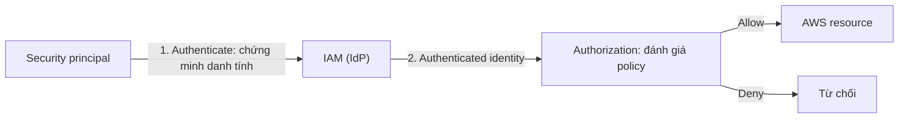

# IAM Basics

> **TL;DR:** IAM (Identity and Access Management) là dịch vụ **global, miễn phí**, mỗi account có một instance riêng. IAM cho phép tạo nhiều identity (users, groups, roles) có thể **giới hạn quyền** bằng policy, để thay thế việc dùng account root user không thể giới hạn. IAM đóng 3 vai: **Identity Provider, Authentication, Authorization**.

## 🖼️ Sơ đồ
![[IAM Basics.excalidraw]]
*Mở bằng plugin Excalidraw để chỉnh sửa · ảnh tĩnh: [[IAM Basics.svg]]*

![[IAM Basics - flow.excalidraw]]
*Mở bằng plugin Excalidraw để chỉnh sửa · ảnh tĩnh: [[IAM Basics - flow.svg]]*

## Khái niệm cốt lõi
**Vì sao cần IAM**
- Root user được account **tin tuyệt đối** và không thể giới hạn; account và root user gần như là một.
- Thực tế cần cho nhiều người/nhóm/ứng dụng truy cập, mỗi đối tượng chỉ với quyền cần thiết → nguyên tắc **least privilege** (chỉ cấp quyền đủ làm việc).
- Chỉ có một identity duy nhất (root) mà lộ credential → mọi region, mọi service trong account đều gặp rủi ro.

**Mô hình tin cậy**
- Mỗi AWS account có **instance IAM riêng** (database riêng), tách biệt hoàn toàn với account khác.
- Account **tin IAM của nó** gần như như tin root user (chỉ khác một số việc như billing và đóng account).
- Khi IAM cho phép một identity làm gì đó → account cũng tin identity đó theo.

**3 loại identity object**

| Identity | Đại diện cho | Khi nào dùng |
|---|---|---|
| **IAM User** | Một người hoặc một ứng dụng cụ thể (Bob kế toán, Jane hạ tầng, ứng dụng backup) | Khi xác định được **chính xác một thực thể** sẽ đăng nhập |
| **IAM Group** | Tập hợp các user liên quan (dev team, finance, HR) | Quản lý quyền cho nhiều user cùng lúc |
| **IAM Role** | Được AWS service hoặc bên ngoài *assume* | Khi số lượng thực thể **không xác định trước**: mọi EC2 instance cần đọc S3, user của account khác, AWS service hành động thay bạn |

- **IAM Policy (policy document)**: object/tài liệu **allow hoặc deny** quyền truy cập dịch vụ AWS. Policy **tự nó không làm gì** — chỉ có hiệu lực khi **attach** vào user, group hoặc role.

**3 nhiệm vụ chính của IAM**
1. **Identity Provider (IdP)**: tạo, sửa, xóa identity (users, roles).
2. **Authenticate**: một *security principal* gửi request phải chứng minh mình là identity đã tự nhận (username/password, access key, MFA...).
3. **Authorize**: sau khi xác thực, cho phép hay từ chối truy cập dựa trên **policy gắn với identity**.

**Các điểm phải nhớ**
- IAM **miễn phí**: tạo users, groups, roles không tốn tiền. Có **quota** số lượng (một số quota quan trọng cho thi, xem [[IAM Users and ARNs]]).
- IAM là **global service**, một database toàn cầu cho account, **globally resilient** (chịu được sự cố của phần lớn hạ tầng AWS). Adrian nhấn mạnh ý này *có thể ra thi*.
- IAM chỉ kiểm soát **identity của chính account đó**; không kiểm soát trực tiếp user ở account ngoài.
- IAM hỗ trợ **Identity Federation** (dùng identity sẵn có như Active Directory của doanh nghiệp hoặc web identity như Google, Facebook để truy cập AWS gián tiếp) và **MFA**.

## Cách hoạt động / Kiến trúc
**Đăng nhập console bằng IAM user**
- Sign-in URL dành cho IAM user: `https://<account-id hoặc alias>.signin.aws.amazon.com/console`.
- **Account alias** thay account ID cho URL dễ nhớ; alias phải **duy nhất toàn cầu** (khóa học dùng mẫu có chữ `general` / `production`).
- Đăng nhập IAM user cần: **sign-in URL (account ID/alias) + username + password + mã MFA**.
- Username IAM chỉ cần duy nhất **trong account** → cả hai account đều có user `iamadmin` được.

## Demo / Lab
**Tạo `iamadmin` trong General account (0014)** và **Production account (0015)**
1. Đăng nhập root, kiểm tra region **us-east-1** → mở IAM console.
2. Tạo **account alias** (Create → nhập alias duy nhất → Save). Ghi lại sign-in URL.
3. Users → Add users → tên `iamadmin`, bật **AWS Management Console access**, custom password, bỏ chọn "require password reset". (Không bật programmatic access ở bước này; access key làm ở [[IAM Access Keys and AWS CLI]].)
4. Permissions → **Attach existing policies directly** → chọn managed policy **AdministratorAccess** (full admin). Có thể thay bằng thêm vào group hoặc copy quyền từ user khác.
5. Mở sign-in URL → đăng nhập `iamadmin` → menu hiển thị "IAM user: iamadmin".
6. Security credentials → **Assign MFA device** → virtual MFA, entry **mới** trong authenticator, nhập 2 mã liên tiếp → sign out và đăng nhập lại để kiểm tra.
7. Lặp lại trong Production (dùng **sign-in URL của Production**, đừng nhầm với General).
- Kết quả: 2 account × (root + `iamadmin`) = **4 identity, tất cả đều có MFA**. Từ đây **không dùng root nữa**; `iamadmin` sẽ dùng để tạo các identity ít quyền hơn khi cần.
- (Giao diện hiện nay khác khóa học: trang tạo user hỏi "Provide user access to the AWS Management Console", access key tạo riêng sau. AWS hiện khuyến nghị dùng **IAM Identity Center** cho người dùng là con người thay vì IAM user với credential dài hạn.)

## 🎯 Mẹo thi SAA-C03
- **IAM là global** và globally resilient — không chọn region cho IAM.
- Policy chỉ có hiệu lực khi **attach** vào identity (user/group/role).
- Chọn **User** khi biết chính xác một người/ứng dụng; chọn **Role** khi số lượng thực thể không xác định hoặc là AWS service/external account (EC2 truy cập S3 → [[EC2 Instance Roles]]).
- Phân biệt **authentication** (bạn là ai) và **authorization** (bạn được làm gì).
- Best practice: bật MFA cho root, tạo IAM admin, **ngừng dùng root**, cấp quyền theo **least privilege**.
- Identity Federation = dùng identity có sẵn bên ngoài (AD, Google...) để vào AWS — chi tiết ở các phần sau ([[Cognito]], [[Directory Service]]).

## Liên kết
- Tiên quyết: [[AWS Accounts]], [[MFA]]
- Đi sâu: [[IAM Identity Policies]], [[IAM Users and ARNs]], [[IAM Groups]], [[IAM Roles]], [[Service-linked Roles and PassRole]]
- Liên quan: [[IAM Access Keys and AWS CLI]], [[EC2 Instance Roles]], [[AWS Organizations]], [[Service Control Policies]], [[CloudTrail]]
- Phân biệt với: [[Cognito]] (identity cho người dùng ứng dụng), [[Directory Service]]
- MOC: [[_MOC 01 Accounts and Basics]]
