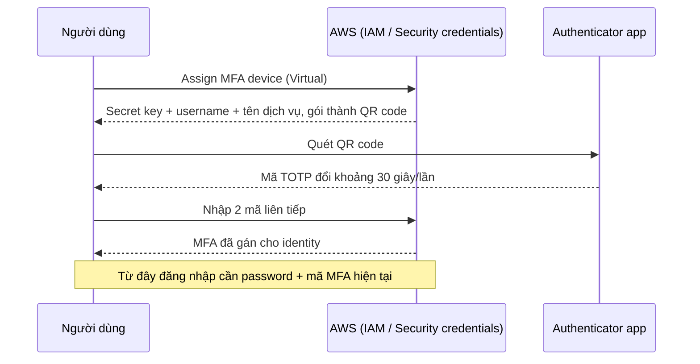

# MFA

> **TL;DR:** Multi-factor authentication buộc người đăng nhập đưa ra bằng chứng thuộc **nhiều loại factor khác nhau** (thường là password + mã một lần từ thiết bị). Lộ username/password thôi là chưa đủ để vào account. Trong AWS, MFA được gán **cho từng identity** (root user, IAM user), không phải cho cả account.

## 🖼️ Sơ đồ
![[MFA.excalidraw]]
*Mở bằng plugin Excalidraw để chỉnh sửa · ảnh tĩnh: [[MFA.svg]]*

![[MFA - flow.excalidraw]]
*Mở bằng plugin Excalidraw để chỉnh sửa · ảnh tĩnh: [[MFA - flow.svg]]*

## Khái niệm cốt lõi
- **Factor** = một loại bằng chứng chứng minh danh tính. Single-factor = chỉ dùng một loại; multi-factor = kết hợp nhiều loại.
- 4 loại factor phổ biến:

| Factor | Ý nghĩa | Ví dụ |
|---|---|---|
| Knowledge | Thứ bạn **biết** | Username, password, PIN |
| Possession | Thứ bạn **có** | Thẻ ngân hàng, MFA device / ứng dụng authenticator |
| Inherence | Thứ bạn **là** | Vân tay, khuôn mặt, giọng nói, mống mắt |
| Location | **Nơi** bạn ở | Tọa độ vật lý, hoặc loại mạng (mạng công ty vs Wi-Fi nhà) |

- Ví dụ đời thường: rút tiền ATM = thẻ (possession) + PIN (knowledge) → 2 factor.
- **Username + password là cùng một loại (knowledge)** → vẫn chỉ là single-factor, dù là hai thứ.
- Càng nhiều factor càng an toàn nhưng càng bất tiện → mục tiêu là **cân bằng security và convenience**.

## Cách hoạt động / Kiến trúc
**Các loại MFA trong AWS**
- **Virtual MFA device**: một entry trong app authenticator (Google Authenticator, 1Password, Authy...) trên điện thoại/máy tính. Một app chứa được nhiều virtual MFA cho nhiều dịch vụ/identity (AWS, Gmail, Azure, GCP...).
- **Hardware TOTP token**: thiết bị dạng key fob sinh mã thay đổi liên tục (ví dụ token Gemalto).
- **Security key / FIDO** (ví dụ YubiKey) nếu trình duyệt hỗ trợ.
- (Hiện nay AWS hỗ trợ cả passkey FIDO2 và cho phép gán **tối đa 8 MFA device cho mỗi root user/IAM user**; khóa học mô tả mỗi identity một MFA.)

**Luồng gán virtual MFA**

- Mã chỉ dùng được **một lần** và chỉ hợp lệ trong cửa sổ thời gian ngắn → kẻ gian có password + một mã cũ vẫn bị chặn.
- Mất điện thoại thì kẻ nhặt được vẫn cần username + password; thêm nữa điện thoại thường được khóa bằng PIN/vân tay/khuôn mặt.

## Demo / Lab
**Bảo vệ root user của General account (0010)**
1. Đăng nhập root → menu account → **Security credentials** (dù là IAM console, vì đăng nhập bằng root nên đang cấu hình credential của root).
2. Multi-factor authentication → Assign/Activate MFA → chọn **Virtual MFA device**.
3. Show QR code → quét bằng app → nhập **hai mã liên tiếp** → thành công.
4. Sign out, đăng nhập lại (chọn Root user, email, password) → bị hỏi mã MFA.
- **Mỗi identity trong mỗi account là một entry MFA riêng**, không dùng lại. Hết section này phải có **4 entry**: root General, root Production, `iamadmin` General, `iamadmin` Production.
- Production thật nên cân nhắc **hardware token** cho root; virtual MFA đủ cho account học tập.

## 🎯 Mẹo thi SAA-C03
- "Tăng bảo mật cho root user / IAM user đăng nhập console" → **bật MFA**. Best practice số 1 sau khi tạo account.
- Nhận diện loại factor: password + câu hỏi bảo mật vẫn là **single-factor** (cùng là knowledge).
- MFA gắn với **identity**, không gắn với account: thêm MFA cho root không bảo vệ IAM user và ngược lại.
- MFA còn xuất hiện ở chỗ khác: **S3 MFA Delete** ([[S3 Versioning and MFA Delete]]), điều kiện `aws:MultiFactorAuthPresent` trong policy ([[IAM Identity Policies]]), MFA khi assume role ([[IAM Roles]]).
- (Thực tế hiện nay) AWS **bắt buộc MFA cho root user** của account standalone và management account trong Organizations.

## Liên kết
- Tiên quyết: [[AWS Accounts]]
- Liên quan: [[IAM Basics]], [[IAM Users and ARNs]], [[IAM Access Keys and AWS CLI]] (CLI dùng access key, không dùng password + MFA), [[IAM Identity Policies]], [[IAM Roles]], [[S3 Versioning and MFA Delete]]
- Phân biệt với: [[Cognito]] (MFA cho người dùng cuối của ứng dụng)
- MOC: [[_MOC 01 Accounts and Basics]]
