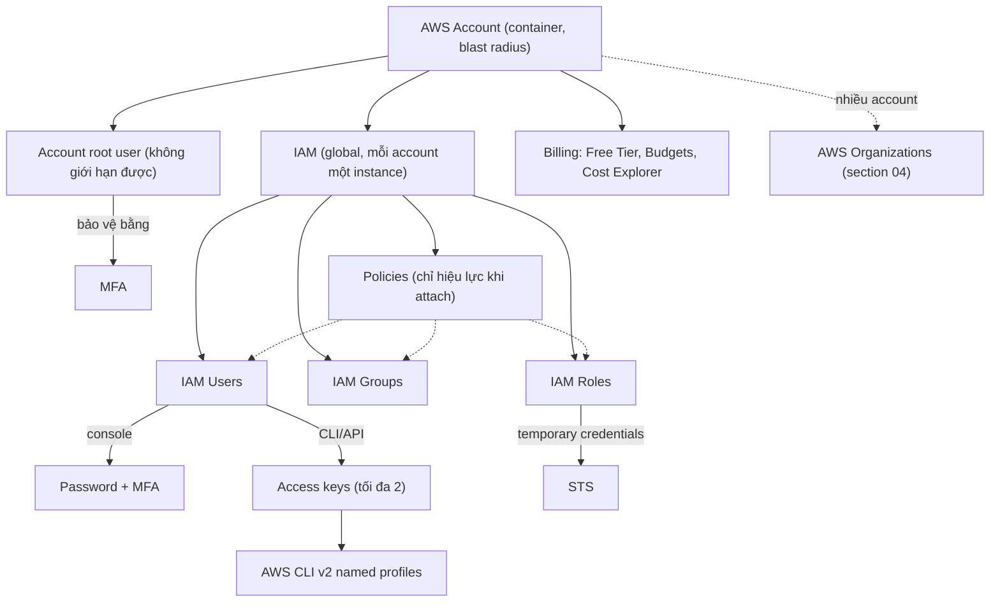

# 01 Accounts and Basics

Section mở đầu phần thực hành: hiểu AWS account là container và ranh giới cô lập, rồi dựng hai account (General và Production) theo best practice: MFA cho root, budget và billing alert, IAM admin user có MFA, sau đó là access key và AWS CLI v2 với named profile. Đây là nền móng cho mọi demo về sau và được đào sâu ở [[_MOC 04 IAM Accounts and Organizations]].

← [[00 Home]] · Section trước: [[_MOC 00 Course and Exam]] · Section tiếp theo: [[_MOC 02 Tech Fundamentals]] →

## Lộ trình học
1. [[AWS Accounts]]: account là container chứa identities và resources, có một root user toàn quyền không giới hạn được, và là ranh giới cô lập (blast radius).
2. [[MFA]]: buộc đăng nhập bằng nhiều loại factor khác nhau; trong AWS, MFA gán cho từng identity (root, IAM user), không phải cho cả account.
3. [[AWS Budgets]]: theo dõi chi tiêu so với ngưỡng và gửi cảnh báo theo mốc %, cùng Free Tier, billing preferences và Cost Explorer để tránh hóa đơn bất ngờ.
4. [[IAM Basics]]: IAM global, miễn phí, mỗi account một instance; users/groups/roles/policies thay cho root; IAM đóng vai IdP, AuthN và AuthZ.
5. [[IAM Access Keys and AWS CLI]]: access key là long-term credential cho CLI/API/SDK, tối đa 2 key/user, secret chỉ thấy một lần; CLI v2 dùng named profile.

## Bản đồ khái niệm

## Liên kết sang section khác
- [[AWS Organizations]]: quản lý nhiều account, consolidated billing.
- [[Service Control Policies]]: cách duy nhất để giới hạn root user của member account.
- [[IAM Identity Policies]]: cấu trúc policy JSON và quy tắc Deny – Allow – Deny.
- [[IAM Roles]]: temporary credentials qua STS, thay thế access key.
- [[EC2 Instance Roles]]: cách đúng để ứng dụng trên EC2 lấy quyền, không nhúng access key.
- [[S3 Versioning and MFA Delete]]: một chỗ khác MFA xuất hiện trong đề.
- [[CloudWatch Basics]]: billing metric và billing alarm (us-east-1).
- [[Secrets Manager]] và [[SSM Parameter Store]]: lưu secret thay cho file cấu hình.
- [[Reserved Instances and Savings Plans]]: theo dõi bằng Reservation / Savings Plans budget.

## 🎯 Top mẹo thi của section
- Account là **ranh giới cô lập**: "cô lập dev/test/prod", "giới hạn thiệt hại khi lộ credential" → nhiều account + [[AWS Organizations]] ([[AWS Accounts]]).
- **Root user không thể bị giới hạn bằng IAM policy** → bật MFA, không tạo access key cho root, dùng IAM admin hằng ngày ([[AWS Accounts]], [[IAM Basics]]).
- Mỗi account cần **email duy nhất**; thẻ thanh toán dùng chung được ([[AWS Accounts]]).
- IAM admin có AdministratorAccess mà không xem được Billing → chưa bật **IAM user and role access to Billing information** ([[AWS Accounts]]).
- "Tăng bảo mật đăng nhập console" → bật **MFA**; password + câu hỏi bảo mật vẫn là single-factor ([[MFA]]).
- MFA gắn với **từng identity**: MFA cho root không bảo vệ IAM user và ngược lại ([[MFA]]).
- "Cảnh báo khi chi phí sắp/dự báo vượt X" → **AWS Budgets** (Forecasted); phân tích xu hướng → **Cost Explorer**; chi tiết nhất → **Cost and Usage Report** ([[AWS Budgets]]).
- "Tự động ngăn chi tiêu vượt mức" → **Budget Actions** (áp IAM policy/SCP, dừng EC2/RDS) ([[AWS Budgets]]).
- **IAM là global, globally resilient, miễn phí**; policy chỉ hiệu lực khi **attach** vào identity ([[IAM Basics]]).
- **User** khi biết chính xác một người/app; **Role** khi số thực thể không xác định, là AWS service hoặc external account ([[IAM Basics]]).
- Phân biệt **authentication** (bạn là ai) và **authorization** (được làm gì) ([[IAM Basics]]).
- IAM user: **tối đa 2 access key** để rotate không downtime; secret chỉ thấy **một lần**, mất thì xóa và tạo mới ([[IAM Access Keys and AWS CLI]]).
- Ứng dụng trên EC2/Lambda cần quyền → **IAM Role**; nhúng access key là đáp án sai kinh điển ([[IAM Access Keys and AWS CLI]]).
