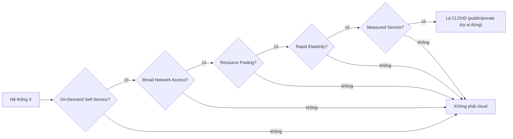

# Cloud Computing Definition

> **TL;DR:** "Cloud" có định nghĩa chính thức trong tài liệu **NIST SP 800-145**: một hệ thống chỉ là cloud khi đáp ứng **đủ 5 đặc tính thiết yếu** — On-Demand Self-Service, Broad Network Access, Resource Pooling, Rapid Elasticity, Measured Service. AWS, Azure, Google Cloud đều thỏa cả 5; thiếu một cái thì không phải cloud.

## 🖼️ Sơ đồ
![[Cloud Computing Definition.excalidraw]]
*Mở bằng plugin Excalidraw để chỉnh sửa · ảnh tĩnh: [[Cloud Computing Definition.svg]]*

## Khái niệm cốt lõi
- **NIST** (National Institute of Standards and Technology, thuộc Bộ Thương mại Mỹ) xuất bản **Special Publication 800-145** — "The NIST Definition of Cloud Computing". Adrian dùng định nghĩa này để tránh mơ hồ, rồi rút gọn mỗi đặc tính về "cốt lõi".
- 5 đặc tính là **mức tối thiểu**: nhà cung cấp có thể có thêm, nhưng không được thiếu.

### 1. On-Demand Self-Service
- Tự **provision và terminate** tài nguyên (VM, storage, database, network...) qua UI / CLI / API **mà không cần tương tác với con người** bên nhà cung cấp.
- "On-demand": không phải báo trước vài ngày/tuần. "Self-service": không phải liên hệ đội support/provisioning.
- Dễ kiểm tra nhất trong 5 đặc tính.

### 2. Broad Network Access
- Dịch vụ truy cập được **qua mạng**, trên **mọi loại thiết bị**, bằng **cơ chế/giao thức chuẩn** (HTTP/HTTPS, SSH, RDP, có thể qua VPN).
- Nếu phải tới tận data center của vendor, hoặc bắt buộc phải có đường private link riêng mới dùng được → nhiều khả năng **không phải cloud**.
- Ngày nay nghe hiển nhiên, nhưng không phải lúc nào cũng vậy.

### 3. Resource Pooling
Hai ý:
- **Location independence**: khách hàng không kiểm soát/không biết vị trí chính xác của tài nguyên, chỉ chọn ở mức trừu tượng cao hơn (ví dụ chọn **region**, AWS tự chọn data center và phần cứng — xem [[AWS Global Infrastructure]]). Rủi ro phần cứng chuyển sang vendor.
- **Multi-tenant**: tài nguyên vật lý được gộp chung phục vụ nhiều khách hàng, gán/thu hồi động theo nhu cầu, nhưng **cách ly** giữa khách hàng (bạn không biết "hàng xóm" cùng phần cứng tồn tại).
- Ý nghĩa: **economies of scale** → dịch vụ rẻ hơn, và **buffer tăng trưởng lớn hơn**. Ví dụ của Adrian: 10% buffer trên pool 10.000 server = 1.000 server dự phòng; nếu mỗi công ty tự giữ 10% của 10 server thì chỉ có 1 server dự phòng → tăng trưởng quá 10% là đụng "capacity wall".
- Tư duy thay đổi: tài sản giá trị không còn là phần cứng mà là **ứng dụng, dữ liệu, dịch vụ**.

### 4. Rapid Elasticity
- Tài nguyên được **cấp phát và giải phóng một cách đàn hồi**, scale **OUT (lên) và IN (xuống)** nhanh, thường **tự động** theo tải.
- Khác "scaling" truyền thống (chỉ tăng theo tăng trưởng hữu cơ): elasticity còn **thu nhỏ** khi tải giảm → chi phí tăng/giảm theo nhu cầu.
- Hệ quả: không cần (và không nên) **over-provision** (lãng phí tiền), cũng tránh **under-provision** (hiệu năng kém). Ví dụ Amazon.com mùa sale, Netflix khi ra tập phim mới.
- Với người dùng, năng lực cung cấp **trông như vô hạn**: cần 100 hay 1.000 VM là có ngay.
- Theo Adrian, đây là **lợi ích quan trọng nhất** của cloud. Trên AWS, ý tưởng này hiện thực qua [[Auto Scaling Groups]], [[Horizontal vs Vertical Scaling|horizontal scaling]], serverless như [[Lambda]].

### 5. Measured Service
- Mức sử dụng được **đo, kiểm soát, báo cáo và tính tiền** → **pay for what you consume**.
- Hạ tầng truyền thống là **CapEx**: mua trước → lúc đầu thừa (lãng phí), sau thiếu (mua chậm → sự cố hiệu năng).
- Cloud: tính theo giây/phút/giờ/ngày (VM) hoặc theo GB-tháng (storage); **không trả trước**. Ví dụ: chạy 1 VM cả tháng, nhưng có 30 phút dùng 100 VM → trả ít cho cả tháng và nhiều hơn chỉ cho 30 phút đó.
- Vendor đòi phí mua/thuê server cố định → không phải cloud.

## Bảng so sánh / số liệu
| # | Đặc tính | Rút gọn | Dấu hiệu "không phải cloud" |
|---|---|---|---|
| 1 | On-Demand Self-Service | Provision/terminate qua UI/CLI/API, không cần người | Phải mở ticket, chờ đội provisioning |
| 2 | Broad Network Access | Mọi mạng, mọi thiết bị, giao thức chuẩn | Phải đến DC, bắt buộc link riêng |
| 3 | Resource Pooling | Economies of scale, multi-tenant, location independence | Mua/thuê phần cứng riêng cho bạn |
| 4 | Rapid Elasticity | Scale OUT/IN tự động theo tải | Muốn thêm năng lực phải đặt mua |
| 5 | Measured Service | Đo lường, trả theo mức dùng | Phí trả trước, phí thuê cố định |

## 🎯 Mẹo thi SAA-C03
- Đây là "exam power-up" đầu tiên của khóa: mỗi khi học một dịch vụ AWS, hãy đối chiếu nó với 5 đặc tính.
- Khi chọn đáp án, **ưu tiên** giải pháp: tự phục vụ/tự động hóa, truy cập được qua mạng chuẩn, tận dụng tài nguyên dùng chung (managed/pooled), **scale tự động theo tải** (elastic, scale in khi tải giảm), và **chi phí theo mức dùng** (measured, low cost).
- Đáp án yêu cầu provision dư thừa cố định, thao tác thủ công, mua trước công suất thường là đáp án kém "cloud-native".
- Cả public cloud lẫn private cloud đều phải thỏa 5 đặc tính → xem [[Cloud Deployment Models]].

## Liên kết
- Tiếp theo: [[Cloud Deployment Models]], [[Cloud Service Models]]
- Hiện thực trên AWS: [[AWS Global Infrastructure]] (pooling/location), [[Auto Scaling Groups]] và [[Horizontal vs Vertical Scaling]] (elasticity), [[AWS Budgets]] (measured service/billing), [[Lambda]] (elastic + pay-per-use)
- Liên quan: [[Virtualization]] (nền tảng của pooling), [[SAA-C03 Exam Overview]]
