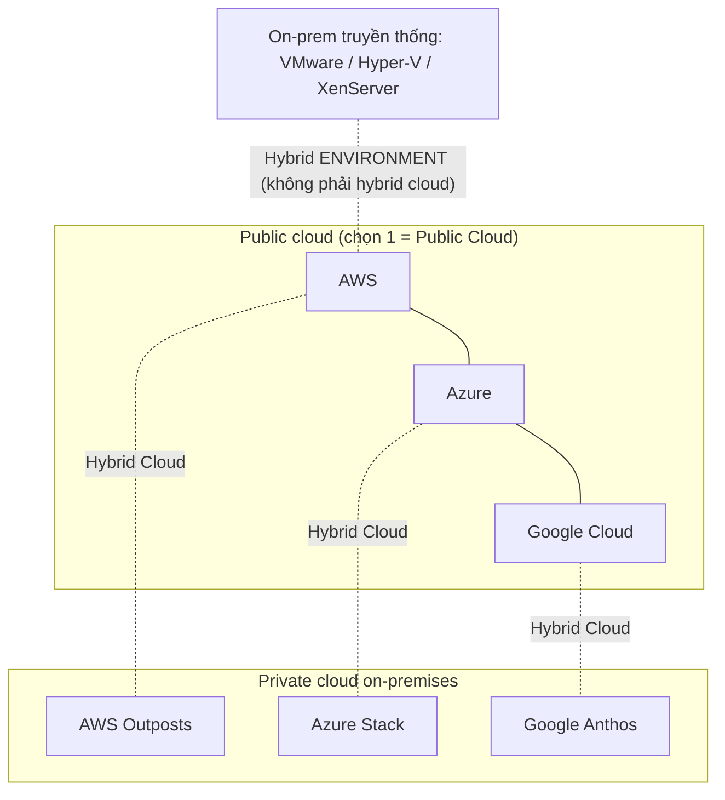

# Cloud Deployment Models

> **TL;DR:** Phân biệt **public cloud** (1 cloud công cộng), **private cloud** (cloud *thật* chạy on-premises, dành riêng cho bạn), **multi-cloud** (nhiều public cloud), **hybrid cloud** (public + private cloud phối hợp như một môi trường). Điểm Adrian nhấn mạnh nhất: **public cloud + hạ tầng on-prem truyền thống KHÔNG phải hybrid cloud** — đó là *hybrid environment / hybrid networking*.

## 🖼️ Sơ đồ
![[Cloud Deployment Models.excalidraw]]
*Mở bằng plugin Excalidraw để chỉnh sửa · ảnh tĩnh: [[Cloud Deployment Models.svg]]*

## Khái niệm cốt lõi
- **Public Cloud**: môi trường thỏa 5 đặc tính trong [[Cloud Computing Definition]] **và** mở cho công chúng. Ví dụ AWS, Microsoft Azure, Google Cloud. "Public cloud" = dùng **một** public cloud.
- **Multi-Cloud**: dùng **nhiều hơn một** public cloud trong một hệ thống (AWS + Azure, hoặc AWS + Azure + Google).
  - Cách đơn giản, hiệu quả: chia hạ tầng — một phần ở AWS, một phần ở Azure (kiểu mirrored) → **resilience ở cấp nhà cung cấp**: một vendor sập thì phần còn lại vẫn chạy.
  - Adrian khuyên **tránh** công cụ bên thứ ba hứa "single pane of glass" quản lý mọi cloud như một: lớp trừu tượng buộc phải dùng **tập tính năng chung thấp nhất (lowest common denominator)** → mất những tính năng riêng làm nên giá trị của từng vendor.
- **Private Cloud**: cloud **dành riêng cho doanh nghiệp, chạy tại cơ sở của doanh nghiệp**, nhưng vẫn phải thỏa đủ **5 đặc tính**.
  - Sản phẩm: **AWS Outposts**, **Azure Stack**, **Google Anthos**.
  - VMware, Hyper-V, XenServer on-prem **không mặc nhiên** là private cloud — đa số hạ tầng ảo hóa truyền thống không thỏa 5 đặc tính (có thể có vài tính năng "giống cloud").
- **Hybrid Cloud**: **public cloud + private cloud** cùng vận hành như **một môi trường thống nhất**, thường của **cùng vendor** (ví dụ AWS + AWS Outposts). Dùng **cùng tooling, cùng giao diện, cùng quy trình** cho cả hai phần.
- **Hybrid Environment / Hybrid Networking**: public cloud kết nối với hạ tầng **on-premises / data center truyền thống** (legacy). Đây là thuật ngữ khác, không phải hybrid cloud. Trên AWS thường là [[Site-to-Site VPN]] hoặc [[Direct Connect]].

## Cách hoạt động / Kiến trúc

- Hàng ngang (nhiều public cloud) = **multi-cloud**. Cột dọc (public + private cùng vendor) = **hybrid cloud**.

## Bảng so sánh / số liệu
| Mô hình | Định nghĩa ngắn | Ví dụ |
|---|---|---|
| Public Cloud | Dùng 1 public cloud | Chỉ AWS |
| Private Cloud | Cloud *thật* on-prem, dành riêng | AWS Outposts |
| Multi-Cloud | > 1 public cloud | AWS + Azure |
| Hybrid Cloud | Public + private cloud, một môi trường | AWS + Outposts |
| Hybrid Environment | Public cloud + on-prem legacy | AWS + VMware DC qua VPN/DX |

> Ghi chú cập nhật: khóa học dùng tên "Azure Stack"; hiện nay Microsoft đã đổi tên dòng sản phẩm (Azure Stack HCI → Azure Local). Không ảnh hưởng nội dung thi AWS.

## 🎯 Mẹo thi SAA-C03
- Adrian "nháy mắt": phân biệt **public / private / multi / hybrid cloud / hybrid environment** rất có thể xuất hiện trong đề — nắm chắc từng định nghĩa.
- Đề nói "chạy dịch vụ AWS ngay tại data center của mình, dùng cùng API/công cụ AWS" → **AWS Outposts** (private cloud / hybrid cloud).
- Đề nói "kết nối VPC với data center on-prem" → đó là **hybrid networking** ([[Site-to-Site VPN]], [[Direct Connect]], [[Storage Gateway]]...), đừng gọi là private cloud.
- Multi-cloud cho mục tiêu HA: đặt mỗi phần hệ thống ở một vendor, tránh lớp trừu tượng mất tính năng.

## Liên kết
- Tiên quyết: [[Cloud Computing Definition]]
- Liên quan: [[Cloud Service Models]], [[AWS Local Zones]], [[AWS Global Infrastructure]]
- Hybrid networking trên AWS: [[Site-to-Site VPN]], [[Direct Connect]], [[Compare - VPN vs Direct Connect]], [[Storage Gateway]]
- Phân biệt với: [[HA vs FT vs DR]] (multi-cloud chỉ là một cách đạt resilience)
