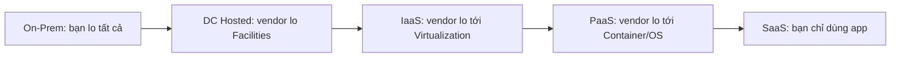

# Cloud Service Models

> **TL;DR:** Mọi ứng dụng chạy trên một **infrastructure stack** (từ Facilities tới Application). Các **service model** (On-prem, DC hosted, IaaS, PaaS, SaaS...) chỉ khác nhau ở chỗ **phần nào vendor quản lý, phần nào bạn quản lý**, ranh giới là **unit of consumption** — thứ bạn trả tiền và từ đó trở lên bạn chịu trách nhiệm.

## 🖼️ Sơ đồ
![[Cloud Service Models.excalidraw]]
*Mở bằng plugin Excalidraw để chỉnh sửa · ảnh tĩnh: [[Cloud Service Models.svg]]*

## Khái niệm cốt lõi
- **Infrastructure stack / application stack** (từ dưới lên): Facilities (tòa nhà, điện, điều hòa, an ninh) → Infrastructure (storage, networking) → Servers → Virtualization → O/S → Container → Runtime → Data → Application.
  - Ví dụ: ngay cả bạn xem khóa học trên laptop cũng có stack: app → OS → laptop (servers) → internet (infrastructure) → nhà/quán cà phê (facilities).
- Với mọi hệ thống: một phần **bạn quản lý**, một phần **người khác quản lý**.
- **Unit of consumption**: thứ bạn mua/tiêu thụ; từ điểm đó **trở lên** là trách nhiệm của bạn. Ví dụ thuê VM → unit là **O/S** (VM = O/S + một lượng tài nguyên). Dùng Netflix → unit là **ứng dụng**.

### Các mô hình
- **On-Premises**: doanh nghiệp tự mua, tự quản lý **toàn bộ** stack, chịu mọi chi phí, nhân sự, rủi ro. Đắt và rủi ro nhưng **linh hoạt nhất** (tùy biến hoàn toàn).
- **Data Center Hosting (DC Hosted)**: đặt thiết bị của mình trong tòa nhà của vendor; vendor lo **Facilities** (tòa nhà, an ninh, điện, điều hòa, nhân sự). Unit of consumption = **rack space**. Mọi mô hình cloud sau này là sự tiến hóa: giao thêm ngày càng nhiều tầng cho vendor.
- **IaaS (Infrastructure as a Service)**: vendor quản lý Facilities, Infrastructure, Servers, Virtualization; bạn tiêu thụ **O/S** và quản lý mọi thứ phía trên (container, runtime, data, app).
  - Trả theo giây/phút/giờ khi VM chạy; không chạy không trả.
  - Mất chút linh hoạt (chỉ dùng được kích cỡ/khả năng VM vendor cho phép) nhưng **giảm mạnh chi phí và rủi ro** → "great compromise".
  - AWS: **EC2** (xem [[EC2 Basics]]).
- **PaaS (Platform as a Service)**: unit = **runtime environment** (ví dụ Python runtime). Bạn chỉ quản lý **app + data**; vendor lo container, OS, virtualization, servers, infrastructure, facilities. Hướng tới **developer**. Ví dụ Adrian dùng **Heroku** để host app mời người vào Slack. (Trên AWS có các dịch vụ dạng PaaS, ví dụ Elastic Beanstalk.)
- **SaaS (Software as a Service)**: unit = **application**; không đụng tới gì khác, trả phí tháng. Ví dụ Netflix, Dropbox, Office 365, Flickr, Gmail. Doanh nghiệp dùng SaaS cho dịch vụ chuẩn hóa ("email là email") → ít kiểm soát cấu hình nhưng gần như không có rủi ro/chi phí phát sinh.
- Còn nhiều mô hình khác: **FaaS** (Function as a Service — ví dụ [[Lambda]]), **CaaS** (Container as a Service), **DBaaS** (Database as a Service — ví dụ RDS, xem [[RDS Architecture]])...

## Bảng so sánh / số liệu
Ký hiệu: **U** = bạn quản lý, **V** = vendor quản lý, **[U]** = unit of consumption.

| Tầng | On-Prem | DC Hosted | IaaS | PaaS | SaaS |
|---|---|---|---|---|---|
| Application | U | U | U | U | **[U]** |
| Data | U | U | U | U | V |
| Runtime | U | U | U | **[U]** | V |
| Container | U | U | U | V | V |
| O/S | U | U | **[U]** | V | V |
| Virtualization | U | U | V | V | V |
| Servers | U | U | V | V | V |
| Infrastructure | U | U | V | V | V |
| Facilities | U | V | V | V | V |
| Unit of consumption | — | Rack space | O/S (VM) | Runtime | Application |
| Ví dụ | DC riêng | Thuê rack | EC2 | Heroku | Netflix, Office 365 |

Càng đi về phải: **ít linh hoạt hơn**, nhưng **ít chi phí vận hành và rủi ro hơn**.

## 🎯 Mẹo thi SAA-C03
- Câu hỏi dạng "giảm operational overhead / không muốn quản lý OS, patching" → chọn dịch vụ **managed** ở tầng cao hơn (PaaS/DBaaS/FaaS như RDS, [[Lambda]], [[ECS Launch Types EC2 vs Fargate|Fargate]]) thay vì tự chạy trên EC2 (IaaS).
- Ranh giới unit of consumption gắn liền với [[Shared Responsibility Model]]: với EC2 bạn chịu trách nhiệm patch OS; với dịch vụ managed thì AWS lo phần đó.
- Ví dụ so sánh hay gặp: tự cài DB trên EC2 ([[Databases on EC2]]) vs RDS — cái trước là IaaS, linh hoạt hơn nhưng nhiều việc quản trị hơn.

## Liên kết
- Tiên quyết: [[Cloud Computing Definition]]
- Liên quan: [[Cloud Deployment Models]], [[Shared Responsibility Model]], [[Virtualization]], [[Containers Fundamentals]]
- Ví dụ dịch vụ AWS: [[EC2 Basics]] (IaaS), [[Lambda]] (FaaS), [[RDS Architecture]] (DBaaS), [[ECS]] (container)
- Phân biệt với: [[Databases on EC2]] (tự quản lý trên IaaS)
