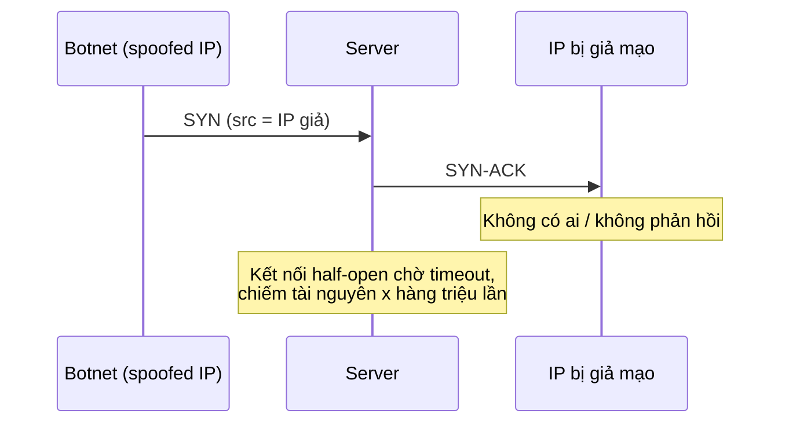
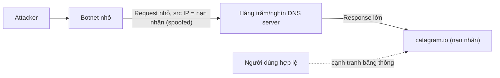

# DDoS

> **TL;DR:** DDoS (Distributed Denial of Service) tạo ra một lượng lớn traffic giả cạnh tranh với kết nối hợp lệ để làm quá tải server, phần mềm hoặc đường truyền của dịch vụ. Ba nhóm chính: **application layer** (HTTP flood), **protocol** (SYN flood) và **volumetric/amplification** (DNS amplification). Vì traffic đến từ hàng triệu IP và trông giống traffic thật, không thể chặn bằng biện pháp mạng thông thường — cần sản phẩm chuyên dụng như [[Shield]], [[WAF]], [[CloudFront Architecture|CloudFront]].

## 🖼️ Sơ đồ
![[DDoS.excalidraw]]
*Mở bằng plugin Excalidraw để chỉnh sửa · ảnh tĩnh: [[DDoS.svg]]*

## Khái niệm cốt lõi
- Mục tiêu: làm **quá tải** website/dịch vụ Internet (phần cứng, phần mềm hoặc kết nối mạng) → người dùng hợp lệ bị chậm hoặc không truy cập được.
- Ví dụ đời thường của Adrian: ngày ra mắt iPhone mới, thêm 100.000 người xếp hàng vô cớ ở Apple Store để chiếm thời gian nhân viên.
- **Khó xử lý vì tính phân tán**: có thể có hàng triệu IP nguồn, traffic giống hệt traffic hợp lệ → không thể chặn từng IP.
- **Botnet**: mạng máy bị nhiễm malware (laptop, desktop... của người dùng bình thường không hề biết), do một hoặc vài kẻ tấn công điều khiển qua một điểm điều khiển (thường ẩn sau VPN).
- Kiến trúc ứng dụng bình thường: server được cấp phát theo **tải danh định + buffer** hoặc **auto scaling**; kết nối Internet của môi trường hosting có giới hạn băng thông và số kết nối. DDoS khai thác chính các giới hạn này.

## Cách hoạt động / Kiến trúc

### 1. Application layer attack — HTTP flood (Layer 7)
- Khai thác **mất cân bằng xử lý** giữa client và server: gửi request rất rẻ (`GET /reallycomplex.php`) nhưng server tốn nhiều tài nguyên để trả lời. "Như ném lựu đạn: ném thì dễ, đỡ thì khó."
- Botnet gửi hàng triệu request → server hoặc kết nối không còn năng lực phục vụ request thật → hiệu năng giảm hoặc sập.

### 2. Protocol attack — SYN flood (Layer 4)
- Khai thác bản chất connection-based của TCP và [[Layer 4 Transport|three-way handshake]].
- Botnet gửi hàng loạt **SYN với source IP giả mạo (spoofed)**. Server trả **SYN-ACK** tới địa chỉ giả → không ai trả lời → kết nối ở trạng thái **treo (half-open)**, chờ hết timeout.
- Handshake được thiết kế để chịu được mạng chậm/kém tin cậy nên server **chờ**; trong lúc đó tài nguyên mạng bị chiếm, kết nối hợp lệ không vào được.

### 3. Volumetric / amplification attack — DNS amplification (Layer 3/4)
- Khai thác giao thức có **response lớn hơn nhiều so với request** (ví dụ DNS).
- Botnet (có thể **nhỏ**) gửi nhiều truy vấn tới rất nhiều DNS server, **source IP giả là IP của ứng dụng nạn nhân**.
- Các DNS server (bản thân không độc hại, chỉ trả lời truy vấn có vẻ hợp lệ) gửi response lớn về nạn nhân → **làm nghẽn đường truyền dữ liệu** của ứng dụng (hơn là bản thân server).
- Tốn rất ít băng thông phía attacker nhưng tiêu thụ băng thông khổng lồ phía nạn nhân → phù hợp để đánh sập website lớn.

## Bảng so sánh / số liệu

| Loại | Ví dụ | Tầng OSI | Khai thác điều gì | Tài nguyên bị cạn |
|---|---|---|---|---|
| Application layer | HTTP flood | L7 | Request rẻ, xử lý đắt | CPU/app server |
| Protocol | SYN flood | L4 | Handshake TCP chờ phản hồi, IP spoofing | Bảng kết nối / tài nguyên mạng |
| Volumetric / amplification | DNS amplification | L3/L4 | Response >> request, spoofing IP nạn nhân | Băng thông đường truyền |

## 🎯 Mẹo thi SAA-C03
- Nhận diện loại tấn công theo từ khóa: "HTTP flood / Layer 7" → [[WAF]] (rate-based rule) + [[Shield]] Advanced; "SYN flood, UDP reflection, Layer 3/4" → [[Shield]] Standard (miễn phí, tự động bật cho mọi khách hàng AWS).
- Không chặn DDoS bằng cách block IP trong [[NACL]]/[[Security Groups]] — quá nhiều IP, và với amplification thì nguồn (DNS server) không độc hại; chặn bừa có thể ảnh hưởng chính ứng dụng.
- Kiến trúc chống DDoS trên AWS hay xuất hiện trong đề: [[CloudFront Architecture|CloudFront]] + [[Route 53 Fundamentals|Route 53]] (edge, hấp thụ traffic) + [[WAF]] + [[Shield]] + [[Auto Scaling Groups]] sau [[Elastic Load Balancer]].
- Bài này chỉ giải thích cơ chế tấn công; sản phẩm phòng chống học ở section 18.

## Liên kết
- Tiên quyết: [[Layer 4 Transport]] (three-way handshake), [[DNS Fundamentals]], [[OSI Model]]
- Phòng chống trên AWS: [[Shield]], [[WAF]], [[CloudFront Architecture]], [[Global Accelerator]], [[Layer 7 Firewall]]
- Liên quan: [[Auto Scaling Groups]], [[Elastic Load Balancer]], [[DNSSEC]] (DNS và spoofing)
