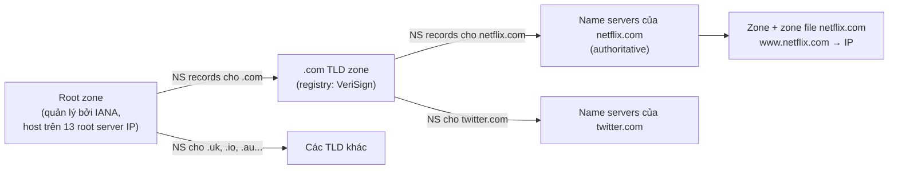
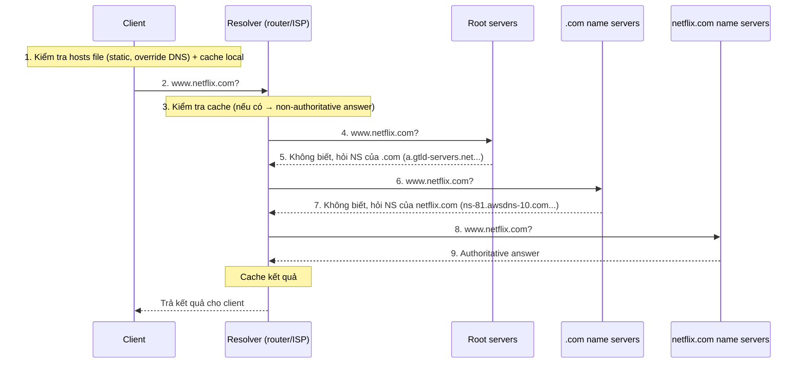
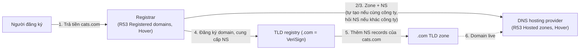

# DNS Fundamentals

> **TL;DR:** DNS là "danh bạ" khổng lồ, phân tán toàn cầu, chuyển **tên miền** (www.netflix.com) thành **IP**. Để chịu tải, giảm rủi ro và cho phép ủy quyền quản lý, DNS được thiết kế **phân cấp**: Root zone → TLD zone (.com) → zone của domain (netflix.com). Resolver "**walk the tree**" từ root xuống để tìm name server **authoritative** cho zone cần hỏi. Đăng ký domain liên quan tới hai vai trò khác nhau: **registrar** và **DNS hosting provider** — chính là hai phần *Registered domains* và *Hosted zones* của [[Route 53 Fundamentals|Route 53]].

## 🖼️ Sơ đồ
![[DNS Fundamentals.excalidraw]]
*Mở bằng plugin Excalidraw để chỉnh sửa · ảnh tĩnh: [[DNS Fundamentals.svg]]*

![[DNS Fundamentals - registration.excalidraw]]
*Mở bằng plugin Excalidraw để chỉnh sửa · ảnh tĩnh: [[DNS Fundamentals - registration.svg]]*

## Khái niệm cốt lõi

### DNS làm gì
- Con người thích tên dễ nhớ; mạng và server cần **IP address**. Trình duyệt hỏi DNS IP của `www.netflix.com`, nhận câu trả lời rồi mới kết nối tới IP đó.
- Về bản chất DNS là một **database liên kết tên ↔ IP** (và nhiều loại bản ghi khác, xem [[DNS Record Types]]).
- DNS là dịch vụ cốt lõi: DNS hỏng hoặc triển khai kém là nguyên nhân của nhiều sự cố lớn trên Internet.

### Vì sao không dùng một (hoặc vài) DNS server
- **Risk**: một nhóm nhỏ kẻ xấu dễ dàng tấn công làm tê liệt (xem [[DDoS]]).
- **Scaling**: gần như mọi người dùng Internet đều dùng DNS → tải khổng lồ, ngày càng tăng.
- **Data volume**: khoảng **341 triệu domain** (ước tính trong khóa học), mỗi domain có hàng chục tới hàng nghìn record, cộng thêm cập nhật và vấn đề nhất quán.
- Nhân bản nhiều server giữ **toàn bộ** dữ liệu giải quyết được risk nhưng không giải quyết scaling (vẫn là một monolith toàn cầu).
- Cần **ủy quyền (delegation)**: tên miền .uk do tổ chức ở UK quản lý, .gov do chính phủ Mỹ, .au do tổ chức Úc... → cần cấu trúc **phân cấp**.

### Thuật ngữ

| Thuật ngữ | Ý nghĩa |
|---|---|
| **DNS zone** | Một "database", ví dụ zone `netflix.com` chứa các record như `www.netflix.com` |
| **Zone file** | File lưu zone đó trên đĩa |
| **Name server (NS)** | DNS server host một hoặc nhiều zone (bằng cách lưu zone file) và trả lời truy vấn cho zone đó |
| **Authoritative** | Nguồn sự thật thật sự ("the boss") của một zone; được layer phía trên trỏ tới |
| **Non-authoritative / cached** | Câu trả lời từ cache (router, ISP resolver...) để tăng tốc; không phải nguồn gốc |
| **Resolver** | DNS server (thường trên router nhà hoặc ở ISP) thực hiện truy vấn thay cho client |
| **TLD** | Top-Level Domain: generic (.com, .org, .io) hoặc country-code (.uk, .au) |
| **Registry** | Tổ chức được IANA ủy quyền quản lý một TLD (VeriSign quản lý .com) |
| **Registrar** | Công ty cho phép bạn **mua/đăng ký** domain (Route 53, Hover, GoDaddy...) |
| **DNS hosting provider** | Công ty vận hành name server **host zone** của bạn và cho bạn quản lý record |

## Cách hoạt động / Kiến trúc

### Cấu trúc phân cấp

- **Root zone**: cũng chỉ là một zone, host trên **root servers**. Đặc biệt ở chỗ mọi DNS client đều biết và tin nó — điểm bắt đầu của mọi truy vấn.
  - Có **13 root server IP**, phân bố địa lý, phần cứng do các tổ chức độc lập vận hành (ICANN, NASA, University of Maryland, VeriSign...). Mỗi IP thực tế là **nhiều server dùng anycast**.
  - **Nội dung** root zone do **IANA** quản lý; vận hành root server là việc khác — quản lý zone ≠ quản lý server.
  - Root zone chỉ lưu ít dữ liệu: thông tin cấp cao về các TLD, cụ thể là **NS record trỏ tới name server của từng TLD registry**.
- **TLD zone** (.com): chỉ chứa thông tin cấp cao về các domain trong TLD — **NS record trỏ tới name server của netflix.com, twitter.com...**, không chứa `www.netflix.com`.
- **Domain zone** (netflix.com): name server được TLD trỏ tới → **authoritative**; zone chứa record chi tiết (`www` → IP).
- Mỗi tầng chỉ lưu một phần nhỏ của database → chia dữ liệu, chia tải, ủy quyền quản lý. Việc tầng trên trỏ xuống tầng dưới tạo thành **chain of trust** trong DNS (nền tảng để hiểu [[DNSSEC]]).

### Một truy vấn DNS — "walking the tree"

- Thứ tự: **hosts file** → cache trên máy/ứng dụng → **resolver** (cache của resolver) → root → TLD → authoritative name server.
- Danh sách IP root server được **hard-code** trong mọi DNS server (do vendor OS duy trì).
- Không name server nào (kể cả root) có mọi thông tin, nhưng **mỗi truy vấn đưa bạn tiến gần hơn một bước**.
- Câu trả lời từ cache của resolver luôn là **non-authoritative** (thường không ai quan tâm, nhưng phải hiểu khác biệt).
- Ví dụ thực tế trên slide: name server của netflix.com là `ns-xx.awsdns-xx...` (tức Netflix dùng **Route 53**), và câu trả lời cho `www.netflix.com` là một **CNAME** (`www.dradis.netflix.com`) → phải lặp lại quy trình để lấy IP. Nhiều lời gọi DNS nối tiếp là một nguyên nhân khiến ứng dụng chậm.

### Đăng ký domain

- **Registrar** chỉ có một chức năng: cho bạn **mua domain**; có quan hệ với registry của nhiều TLD.
- **DNS hosting provider** vận hành name server **host zone** và cho phép quản lý nội dung zone.
- Một số công ty chỉ làm một vai trò; **Route 53** và Hover làm **cả hai**. Trong console Route 53: *Registered domains* = registrar; *Hosted zones* = hosting provider.
- Nếu registrar và hosting là cùng công ty → zone được tạo và host tự động; nếu khác → bạn phải cung cấp thông tin name server đã host zone.
- Domain chỉ **live** khi name server host zone được **TLD zone trỏ tới** (NS records). Nếu chuyển zone sang name server khác → phải **cập nhật NS records** ở TLD (qua registrar).

## 🎯 Mẹo thi SAA-C03
- Phân biệt **registrar** (mua domain) và **DNS hosting** (host zone): đề có thể nói "domain mua ở registrar bên thứ ba, muốn dùng Route 53" → tạo hosted zone trên Route 53 rồi **cập nhật NS records tại registrar** trỏ tới 4 name server của Route 53 (xem [[R53 Interoperability]], [[R53 Public Hosted Zones]]).
- Authoritative answer chỉ đến từ name server được TLD trỏ tới; resolver/cache trả non-authoritative.
- Root → TLD → domain là chuỗi delegation bằng **NS records**; hiểu chuỗi này để hiểu chain of trust của [[DNSSEC]] và [[R53 DNSSEC]].
- CNAME trả về tên khác chứ không phải IP → cần truy vấn tiếp; liên quan tới [[CNAME vs Alias]].
- Trong VPC, resolver là **Route 53 Resolver** tại địa chỉ VPC base +2 (kiến thức ở các section sau).

## Liên kết
- Tiên quyết: [[Layer 3 Network]], [[Layer 4 Transport]]
- AWS: [[Route 53 Fundamentals]], [[DNS Record Types]], [[R53 Public Hosted Zones]], [[R53 Private Hosted Zones]], [[R53 Interoperability]], [[CNAME vs Alias]]
- Tiếp theo: [[DNSSEC]], [[R53 DNSSEC]]
- Liên quan: [[DDoS]] (DNS amplification), [[SSL and TLS]] (DNS name trên certificate)
