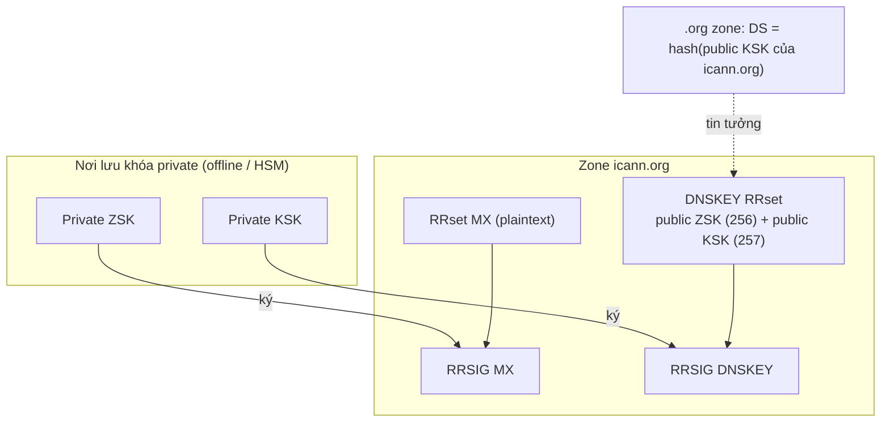
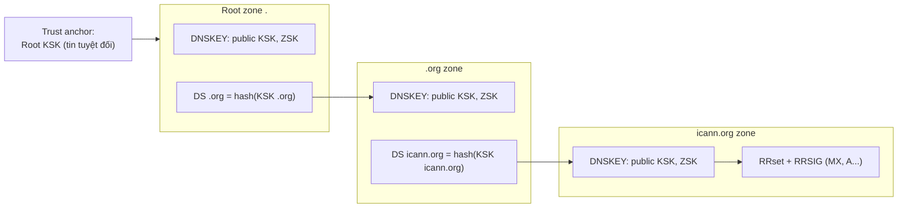

# DNSSEC

> **TL;DR:** DNSSEC là lớp bảo mật **phủ thêm** lên DNS, dùng [[Digital Signatures|chữ ký số]] và [[Hashing]] để cung cấp **data origin authentication** (dữ liệu đúng từ zone bạn nghĩ) và **data integrity protection** (dữ liệu không bị sửa). Trong mỗi zone, **ZSK** ký các RRset (tạo **RRSIG**), **KSK** ký bản ghi **DNSKEY**; zone cha xác nhận tin zone con bằng **DS record** (hash của KSK con). Chuỗi tin cậy đi từ **root KSK** — **trust anchor** được bảo vệ bằng HSM và **root signing ceremony**.

## 🖼️ Sơ đồ
![[DNSSEC.excalidraw]]
*Mở bằng plugin Excalidraw để chỉnh sửa · ảnh tĩnh: [[DNSSEC.svg]]*

![[DNSSEC - chain.excalidraw]]
*Mở bằng plugin Excalidraw để chỉnh sửa · ảnh tĩnh: [[DNSSEC - chain.svg]]*

## Khái niệm cốt lõi

### Vì sao cần DNSSEC
- [[DNS Fundamentals|DNS]] được thiết kế thời Internet còn "thân thiện" → **không có cơ chế xác thực**. Kết quả từ resolver không authoritative (ví dụ hỏi `8.8.8.8`) có thể sai do vô tình hay bị cố ý thao túng.
- Ví dụ tấn công **DNS cache poisoning**:
  1. Evil Bob gửi truy vấn `catagram.io` tới resolver → resolver bắt đầu walk the tree.
  2. Trong lúc đó Evil Bob gửi response giả, giả danh name server authoritative.
  3. Resolver cache kết quả độc → mọi truy vấn `catagram.io` của người dùng thật nhận kết quả bị đầu độc **cho tới khi TTL hết hạn** → bị dẫn tới site giả.
- DNSSEC mang lại 2 cải tiến:
  - **Data origin authentication**: record trả về có thật sự từ zone `netflix.com` không (kể cả khi lấy từ cache)?
  - **Data integrity protection**: dữ liệu có bị sửa kể từ khi admin zone tạo ra không?
- Cách làm: dựng **chain of trust** từ DNS root tới từng record, kiểm chứng được bằng mật mã — tương tự cách HTTPS/certificate bảo vệ HTTP (xem [[SSL and TLS]]).

### Tính chất quan trọng
- **Additive**: DNSSEC bổ sung, không thay thế DNS → **tương thích ngược**. Client chỉ hỗ trợ DNS nhận kết quả DNS bình thường; client DNSSEC-capable nhận thêm kết quả DNSSEC để **validate**.
- Khi không có tấn công, kết quả DNS và DNSSEC như nhau.
- DNSSEC **không sửa lỗi**: chỉ cho biết dữ liệu có đúng nguồn và còn nguyên vẹn hay không, không cho biết giá trị đúng là gì.
- Demo `dig www.icann.org` → CNAME tới `www.vip.icann.org` → A record. Thêm `+dnssec` → mỗi kết quả kèm một **RRSIG** (chữ ký của record tương ứng).

### Các loại record DNSSEC

| Record / khóa | Vai trò |
|---|---|
| **RRset** (Resource Record Set) | Tập các record **cùng tên và cùng type** (ví dụ 4 MX record của `icann.org` = 1 RRset; CNAME, A, AAAA của `www` mỗi cái là một RRset riêng). DNSSEC ký và xác minh theo **RRset**, không theo từng record. |
| **RRSIG** | Chữ ký số của một RRset, lưu cùng tên với RRset nhưng type = RRSIG. Client DNS thường bỏ qua; client DNSSEC dùng để kiểm tra. |
| **ZSK** (Zone Signing Key) | Cặp khóa ký các RRset trong zone. Private ZSK giữ **offline/tách biệt**, không nằm trong zone. |
| **KSK** (Key Signing Key) | Cặp khóa chỉ dùng để **ký RRset DNSKEY** (tức ký các khóa). |
| **DNSKEY** | Record chứa **public key** (ZSK và KSK) để verify RRSIG trong zone. Flag **256 = ZSK**, **257 = KSK**. |
| **DS** (Delegated Signer) | Nằm ở **zone cha**, chứa **hash của public KSK** của zone con → zone cha tuyên bố tin zone con. |

## Cách hoạt động / Kiến trúc

### Trong một zone (data integrity)

1. Lấy RRset (plaintext) → ký bằng **private ZSK** → tạo **RRSIG**, lưu bên cạnh RRset.
2. Nếu RRset bị đổi mà RRSIG không được tạo lại bằng private ZSK → chữ ký **không hợp lệ** → phát hiện thay đổi trái phép.
3. Resolver DNSSEC lấy RRset + RRSIG + **DNSKEY (public ZSK)** → xác minh RRSIG khớp RRset và do private ZSK tạo ra.
4. Nhưng làm sao tin DNSKEY? Kẻ tấn công có thể thay DNSKEY bằng khóa giả, ký lại RRSIG giả và chiếm email của domain. Vì vậy **RRset DNSKEY cũng được ký** — bằng **private KSK** → tạo **RRSIG DNSKEY**.
5. Public KSK được **zone cha tham chiếu** (qua DS) → đó là điểm tin cậy đi vào zone.

**Vì sao cần 2 khóa (ZSK + KSK)?** Nếu chỉ có một khóa thì mỗi lần thay khóa phải cập nhật zone cha. Best practice là xoay khóa thường xuyên → tách vai trò: ZSK dùng nội bộ zone, thay ZSK chỉ cần ký lại RRSIG, cập nhật DNSKEY và ký lại bằng KSK — **không động tới zone cha**. Chỉ KSK được zone cha tham chiếu.

Ví von của Adrian: ID có ảnh chỉ chứng minh danh tính nếu bạn tin thẻ được cấp bởi cơ quan thật; DNSSEC giải quyết vấn đề "thẻ giả" bằng chuỗi tin cậy kiểm chứng được tới tận root.

### Chain of trust giữa các zone

- Delegation DNS thông thường vẫn dùng **NS records** (cùng RRSIG của chúng) — chỉ tích hợp domain vào DNS, chưa đủ cho DNSSEC.
- Zone cha thêm **DS RRset** chứa hash của public KSK zone con. Hash một chiều và duy nhất → cha khẳng định tin KSK của con. DS RRset được ký bằng **private ZSK của zone cha** (có RRSIG).
- Zone cha cũng có DNSKEY riêng (ZSK + KSK) và RRSIG DNSKEY ký bằng KSK của nó; KSK của cha lại được **ông** (root) tin qua DS ở root.
- Luồng validate: Root KSK → ký root ZSK → root ZSK ký DS của .org → khớp KSK .org → KSK .org ký ZSK .org → ZSK .org ký DS của icann.org → khớp KSK icann.org → ... → RRset trong icann.org. Mọi bước đều kiểm chứng bằng mật mã.

### Trust anchor và Root Signing Ceremony
- Root zone **không có zone cha** → không có DS nào để tin. Root KSK phải được **tin tuyệt đối (explicit trust)**: public root KSK được **hard-code** trong mọi client/resolver DNSSEC → gọi là **trust anchor**.
- **Private root KSK** ("chìa khóa của Internet") nằm trong **HSM** dự phòng ở **hai địa điểm an ninh: California và Virginia**. Khóa không bao giờ rời HSM; HSM không bao giờ rời địa điểm; vào địa điểm phải qua quy trình xác minh danh tính nhiều lớp.
- Private root KSK quá quan trọng để dùng hằng ngày → dùng **root ZSK** cho vận hành. Mục đích ceremony: đem root ZSK (thực tế là một **gói** khóa để xoay vòng tới ceremony sau) vào, ký bằng private root KSK, xuất ra **RRSIG DNSKEY của root zone** — record khiến toàn bộ DNSSEC phía dưới đáng tin.
- Người tham gia: ceremony administrator, internal witness, credential safe controller, hardware safe controller và các **crypto officer** — tổng **14** (7 mỗi địa điểm), cần **ít nhất 3** có mặt (thường chọn lịch khi 4–5 người rảnh để dự phòng).
- HSM chỉ thao tác qua **ceremony laptop** nối Ethernet, do ceremony administrator vận hành; laptop **không pin, không ổ lưu trữ** (stateless). HSM chỉ hoạt động khi crypto officer dùng thẻ của họ.
- Ceremony diễn ra **mỗi 3 tháng**, thường được phát sóng, có ghi chép công khai và **audit công khai**; quy trình thiết kế để nhóm người không thể thông đồng phá hoại.

## Bảng so sánh / số liệu

| | DNS | DNS + DNSSEC |
|---|---|---|
| Xác thực nguồn | Không | Có (chain of trust tới root) |
| Phát hiện sửa đổi | Không | Có (RRSIG) |
| Chống cache poisoning | Không | Phát hiện được dữ liệu độc |
| Tương thích client cũ | — | Có (additive) |
| Mã hóa/riêng tư truy vấn | Không | **Không** (DNSSEC không mã hóa) |

| Khóa | Ký cái gì | Ai tin nó |
|---|---|---|
| ZSK | Mọi RRset trong zone (trừ DNSKEY) | KSK của zone (qua RRSIG DNSKEY) |
| KSK | RRset DNSKEY | Zone cha (qua DS) |
| Root KSK | DNSKEY của root | Trust anchor, hard-code trong client |

## 🎯 Mẹo thi SAA-C03
- DNSSEC = **integrity + origin authentication** cho DNS, **không mã hóa** truy vấn. Đề nói "chống DNS spoofing / cache poisoning cho domain trên Route 53" → bật **DNSSEC signing** trên hosted zone (xem [[R53 DNSSEC]]).
- Trên Route 53: **KSK** do bạn quản lý qua **KMS customer managed key** (asymmetric, ở **us-east-1**), **ZSK do Route 53 quản lý**; sau khi bật phải thêm **DS record** vào zone cha (qua registrar/Route 53 Registered domains) để hoàn tất chain of trust. Route 53 Resolver có thể bật **DNSSEC validation** cho VPC.
- Nhớ cặp: **ZSK ký record, KSK ký key, DS ở zone cha chứa hash của KSK con**.
- DNSSEC dựa trên [[Digital Signatures]] + [[Hashing]]; chain of trust giống CA trong [[SSL and TLS]].

## Liên kết
- Tiên quyết: [[DNS Fundamentals]], [[Hashing]], [[Digital Signatures]], [[Encryption Fundamentals]]
- AWS: [[R53 DNSSEC]], [[Route 53 Fundamentals]], [[KMS]], [[CloudHSM]] (khái niệm HSM)
- Liên quan: [[SSL and TLS]], [[DDoS]], [[DNS Record Types]]
