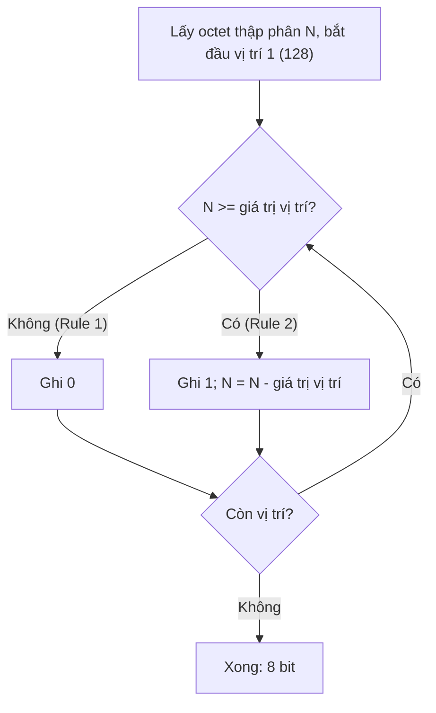

# Decimal and Binary Conversion

> **TL;DR:** Địa chỉ IPv4 người đọc ở dạng **dotted decimal** (`133.33.33.7`), máy thấy là **số nhị phân 32 bit** = 4 **octet** 8 bit. Prefix, subnet mask, CIDR, routing chỉ "có nghĩa" khi nhìn ở dạng nhị phân → đổi qua lại decimal ↔ binary là "siêu năng lực" cho networking.

## 🖼️ Sơ đồ
![[Decimal and Binary Conversion.excalidraw]]
*Mở bằng plugin Excalidraw để chỉnh sửa · ảnh tĩnh: [[Decimal and Binary Conversion.svg]]*

## Khái niệm cốt lõi
- **Dotted decimal notation**: 4 số thập phân **0–255**, cách nhau bằng dấu chấm.
- Mỗi số = **8 bit** = 1 **byte** = 1 **octet**. Tổng **32 bit**. Decimal và binary là **cùng một con số**, chỉ khác cách biểu diễn.
- Bảng giá trị vị trí (8 bit, trái → phải):

| Vị trí | 1 | 2 | 3 | 4 | 5 | 6 | 7 | 8 |
|---|---|---|---|---|---|---|---|---|
| Giá trị | **128** | **64** | **32** | **16** | **8** | **4** | **2** | **1** |

- Bit 1 ở vị trí nào thì cộng giá trị của vị trí đó. Tổng tối đa 128+64+...+1 = **255** (`11111111`).
- Mẹo: làm **từng octet một**, từ trái qua phải.

## Cách hoạt động / Kiến trúc

### Decimal → Binary (chiều khó hơn)
Với mỗi octet, duyệt bảng từ vị trí 1 tới 8, so số còn lại với giá trị vị trí:
- **Rule 1**: số còn lại **< giá trị vị trí** → ghi **0**, sang vị trí kế.
- **Rule 2**: số còn lại **≥ giá trị vị trí** → ghi **1**, **trừ** giá trị vị trí khỏi số còn lại, sang vị trí kế.
- Còn lại 0 → các vị trí sau đều là 0, xong.

Ví dụ **133**:
| Vị trí | Giá trị | Số còn lại | So sánh | Bit | Còn lại sau |
|---|---|---|---|---|---|
| 1 | 128 | 133 | ≥ | 1 | 5 |
| 2 | 64 | 5 | < | 0 | 5 |
| 3 | 32 | 5 | < | 0 | 5 |
| 4 | 16 | 5 | < | 0 | 5 |
| 5 | 8 | 5 | < | 0 | 5 |
| 6 | 4 | 5 | ≥ | 1 | 1 |
| 7 | 2 | 1 | < | 0 | 1 |
| 8 | 1 | 1 | ≥ | 1 | 0 |
→ **133 = `10000101`**

Ví dụ **33**: 128 (0), 64 (0), 32 (1, còn 1), 16/8/4/2 (0), 1 (1) → **`00100001`**.
Ví dụ **7**: chỉ 4+2+1 → **`00000111`**.

→ `133.33.33.7` = `10000101.00100001.00100001.00000111`

### Binary → Decimal (chiều dễ)
- Tách 4 octet; với mỗi octet, bit **1** → cộng giá trị vị trí, bit **0** → cộng 0.
- `10000101` = 128+0+0+0+0+4+0+1 = **133**
- `00100001` = 0+0+32+0+0+0+0+1 = **33**
- `00000111` = 0+0+0+0+0+4+2+1 = **7**

## Bảng so sánh / số liệu
Giá trị hay gặp khi làm subnet mask (bit 1 liên tiếp từ trái):
| Binary | Decimal | Số bit 1 |
|---|---|---|
| `10000000` | 128 | 1 |
| `11000000` | 192 | 2 |
| `11100000` | 224 | 3 |
| `11110000` | 240 | 4 |
| `11111000` | 248 | 5 |
| `11111100` | 252 | 6 |
| `11111110` | 254 | 7 |
| `11111111` | 255 | 8 |

## 🎯 Mẹo thi SAA-C03
- Không có câu hỏi "đổi nhị phân" trực tiếp, nhưng kỹ năng này cần cho: đọc **CIDR** (`/16`, `/24`, `/28`), tính số địa chỉ trong subnet, kiểm tra hai dải VPC có **chồng lấn** không (quan trọng cho [[VPC Peering]], [[Transit Gateway]], VPN).
- Tự luyện: lấy IP ngẫu nhiên → đổi sang binary → đổi ngược lại; khớp là đã hiểu cả hai chiều.

## Liên kết
- Dùng ngay trong: [[Layer 3 Network]] (IP, subnet mask, prefix), [[Subnetting]]
- Liên quan: [[VPC Sizing and Structure]], [[VPC Subnets]], [[OSI Model]]
