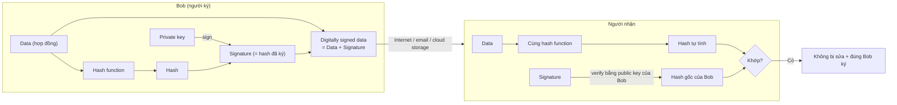

# Digital Signatures

> **TL;DR:** Chữ ký số kết hợp [[Hashing]] với **public key cryptography**: người gửi hash dữ liệu rồi **ký hash bằng private key**; người nhận dùng **public key** để lấy lại hash gốc và so với hash tự tính. Khớp nhau → chứng minh **integrity** (dữ liệu không bị sửa — *what*) và **authenticity** (đúng người ký — *who*). Đây là nền tảng của [[SSL and TLS|SSL certificate]] và [[DNSSEC]].

## 🖼️ Sơ đồ
![[Digital Signatures.excalidraw]]
*Mở bằng plugin Excalidraw để chỉnh sửa · ảnh tĩnh: [[Digital Signatures.svg]]*

## Khái niệm cốt lõi
- **Nhắc lại public key cryptography** (xem [[Encryption Fundamentals]]): một cặp khóa sinh cùng lúc.
  - **Private key**: bí mật, chỉ chủ sở hữu biết.
  - **Public key**: công khai, càng phân phối rộng càng tốt.
  - **Encrypt bằng public key** → chỉ private key tương ứng giải được (kể cả chính public key đó cũng không giải được) → gửi dữ liệu an toàn cho chủ private key.
  - **Sign bằng private key** → ai có public key cũng **verify** được rằng private key đó đã ký → chứng minh bạn kiểm soát private key = một dạng **danh tính số**.
- Hai lợi ích khi kết hợp chữ ký với hash:
  - **Integrity** — *what*: dữ liệu đúng như người tạo đã tạo, chưa bị sửa.
  - **Authenticity** — *who*: dữ liệu đến từ đúng người đó (ví dụ Bob).
- Chữ ký số là **lớp phủ thêm**: dữ liệu gốc vẫn giữ nguyên định dạng (plaintext...). Ai không quan tâm integrity/authenticity vẫn dùng dữ liệu bình thường mà không cần kiểm tra.
- Signing ≠ encryption: cùng dựa trên kiến trúc public key nhưng mục đích khác. Có thể kết hợp: ký xong rồi mã hóa toàn bộ bằng public key của người nhận để đảm bảo cả bí mật.

## Cách hoạt động / Kiến trúc

### Phân phối public key
- Bob giữ private key; đăng public key ở nhiều nơi: website, Twitter, public key directory, link trong mọi email.
- Nếu mọi bản sao khớp nhau → có thể tin là của Bob. Kẻ tấn công phải chiếm **tất cả** các nơi cùng lúc để thay đổi → càng phân phối rộng càng dễ phát hiện giả mạo.

### Ký và xác minh

1. Bob đưa tài liệu qua hash function → hash duy nhất cho tài liệu đó.
2. Chưa chứng minh được Bob tạo hash → Bob **ký hash bằng private key** → tạo **signature**.
3. Gộp signature với tài liệu gốc → **signed document** (data + signature), upload/email/lưu cloud.
4. Đối tác tải về: dùng **public key của Bob** verify signature → thu được **hash gốc của Bob** (biết chắc do Bob tạo, vì chỉ Bob có private key).
5. Tự hash tài liệu bằng **cùng hash function**.
6. Hai hash khớp → tài liệu **chưa bị sửa** và **do Bob ký**. Nếu tài liệu bị sửa, hash sẽ khác; không ai làm giả được signature vì không có private key của Bob.

- Tin public key của Bob → tin mọi thứ ký bằng private key của Bob → hình thành **chain of trust**. Chuỗi tin cậy này là nền tảng của CA trong TLS và của DNSSEC.

## Bảng so sánh / số liệu

| | Encryption (public key) | Digital signature |
|---|---|---|
| Dùng khóa nào để thực hiện | Public key của người nhận | Private key của người gửi |
| Dùng khóa nào để mở/kiểm tra | Private key của người nhận | Public key của người gửi |
| Đảm bảo | Confidentiality | Integrity + Authenticity |
| Dữ liệu gốc | Bị biến đổi (ciphertext) | Giữ nguyên, kèm signature |

## 🎯 Mẹo thi SAA-C03
- "Chứng minh file/log không bị sửa và đến từ nguồn đáng tin" → hash + chữ ký số. Ví dụ AWS: **CloudTrail log file integrity validation** (digest file được ký), **KMS asymmetric keys** dùng để Sign/Verify, **CloudFront signed URL/cookies** dùng cặp khóa (xem [[CloudFront Private Distributions]]).
- Nhớ cặp từ khóa: **integrity = what**, **authenticity = who**.
- Private key ký, public key verify — ngược với mã hóa (public key mã hóa, private key giải mã).

## Liên kết
- Tiên quyết: [[Hashing]], [[Encryption Fundamentals]]
- Dùng trong: [[SSL and TLS]], [[DNSSEC]], [[R53 DNSSEC]]
- Liên quan AWS: [[KMS]], [[CloudTrail]], [[CloudFront Private Distributions]], [[S3 Presigned URLs]]
