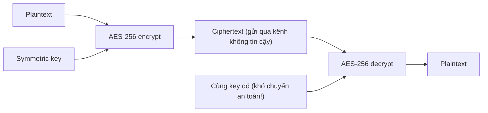
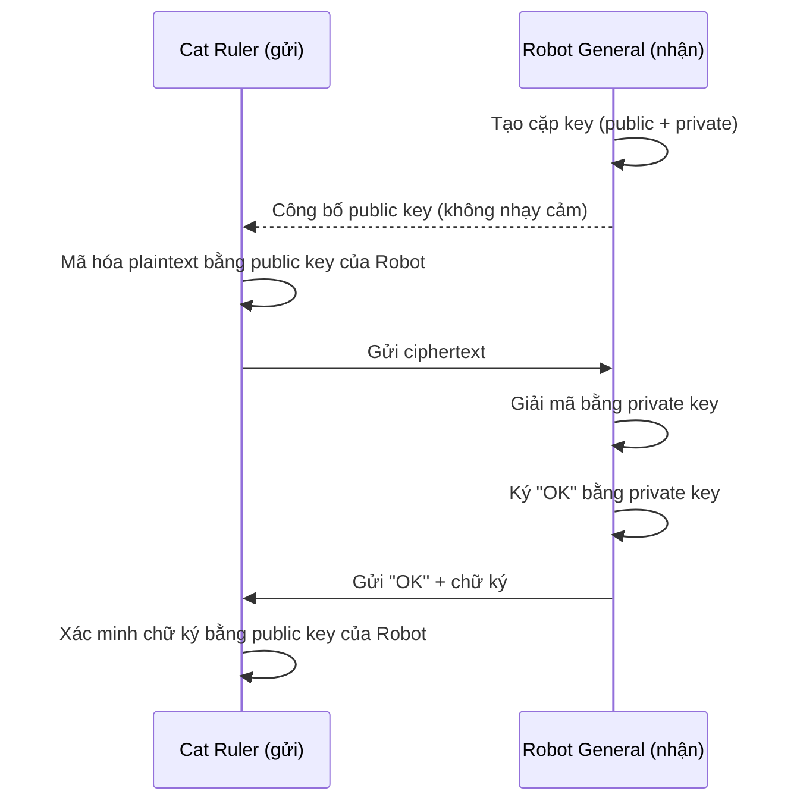

# Encryption Fundamentals

> **TL;DR:** Hai cách tiếp cận mã hóa: **at rest** (chống trộm/can thiệp vật lý, một bên giữ khóa) và **in transit** (bảo vệ dữ liệu khi truyền giữa các bên). **Symmetric** dùng một khóa cho cả mã hóa/giải mã — nhanh nhưng khó trao đổi khóa; **asymmetric** dùng cặp public/private — giải quyết trao đổi khóa nhưng chậm, nên thực tế thường dùng asymmetric để thỏa thuận một symmetric key. Private key còn dùng để **ký (signing)** chứng minh danh tính; **steganography** giấu ciphertext trong dữ liệu khác để có tính chối bỏ.

## 🖼️ Sơ đồ
![[Encryption Fundamentals.excalidraw]]
*Mở bằng plugin Excalidraw để chỉnh sửa · ảnh tĩnh: [[Encryption Fundamentals.svg]]*

![[Encryption Fundamentals - signing.excalidraw]]
*Mở bằng plugin Excalidraw để chỉnh sửa · ảnh tĩnh: [[Encryption Fundamentals - signing.svg]]*

## Khái niệm cốt lõi

### Hai cách tiếp cận
- **Encryption at rest**
  - Bảo vệ dữ liệu **được lưu trữ** khỏi **trộm cắp vật lý / can thiệp vật lý**.
  - Ví dụ: laptop mã hóa ổ đĩa — dữ liệu được mã hóa khi ghi xuống storage, giải mã khi đọc vào RAM. "Secret" là mật khẩu đăng nhập hoặc dữ liệu dẫn xuất từ nó. Mất laptop mà không có passcode → chỉ là đống dữ liệu vô nghĩa.
  - Trong cloud: dữ liệu nằm trên **phần cứng dùng chung** ở dạng mã hóa → dù ai đó lấy được thiết bị lưu trữ gốc cũng không đọc được.
  - Thường chỉ có **một bên** liên quan, và bên đó là người duy nhất biết khóa.
- **Encryption in transit**
  - Bảo vệ dữ liệu **khi truyền** giữa hai nơi (ví dụ internet banking): mã hóa trước khi rời máy, bên nhận giải mã, và ngược lại.
  - Giống như bọc một **"tunnel" / lớp vỏ mã hóa** quanh dữ liệu thô; người nhìn từ ngoài chỉ thấy luồng dữ liệu xáo trộn.
  - Thường có **nhiều bên/hệ thống** liên quan.

### Thuật ngữ
- **Plaintext**: dữ liệu **chưa mã hóa** — không nhất thiết là text (có thể là ảnh, ứng dụng...). Là thứ có thể dùng/đọc ngay.
- **Algorithm**: đoạn code/toán học nhận plaintext + key và tạo ra dữ liệu mã hóa. Ví dụ: **AES**, Blowfish, RC4, DES, RC5, RC6.
- **Key**: đơn giản nhất là một mật khẩu, nhưng có thể phức tạp hơn nhiều.
- **Ciphertext**: dữ liệu **đã mã hóa** (cũng không nhất thiết là text).
- **Encryption**: plaintext + algorithm + key → ciphertext. **Decryption**: ciphertext + key (+ algorithm) → plaintext.

### Symmetric encryption
- **Cùng một key** cho cả mã hóa và giải mã. Ví dụ dùng **AES-256**.
- Ciphertext an toàn để gửi qua kênh không tin cậy — **vấn đề là trao đổi key**:
  - Gửi key điện tử → lộ là hết. Gặp trực tiếp → có thể bị chặn. Mã hóa key bằng key khác → lại cần trao đổi key đó → vòng lặp phức tạp.
  - Với dữ liệu nhạy cảm thời gian, key phải được chuyển **trước**.
- → Rất hợp cho **mã hóa file cục bộ / mã hóa ổ đĩa** (một bên); kém hợp cho trao đổi giữa hai bên ở xa.

### Asymmetric encryption
- Dùng **cặp key**: **public key** và **private key** (muốn hai chiều thì mỗi bên cần một cặp).
- Dữ liệu mã hóa bằng **public key** chỉ giải mã được bằng **private key** tương ứng; public key **không** giải mã được thứ nó đã mã hóa.
- **Private key** phải được bảo vệ cẩn thận. **Public key** công bố thoải mái — tệ nhất ai đó dùng nó để mã hóa dữ liệu chỉ chủ nhân giải mã được → không cần trao đổi key trước.
- Thường dùng khi **hai bên trở lên, chưa từng gặp nhau**. Ứng dụng: **PGP** (email/file), **SSL/TLS** (trình duyệt — xem [[SSL and TLS]]), **SSH** (đăng nhập server bằng key — xem [[EC2 Instance Connect and SSH]]).
- **Tính toán nặng hơn nhiều** so với symmetric → nhiều giao thức dùng asymmetric để **thỏa thuận/trao đổi một symmetric key**, sau đó dùng symmetric cho phần còn lại của phiên (đây chính là cách TLS làm).

### Signing (ký số)
- **Encryption không chứng minh danh tính**: ai có public key của bạn cũng mã hóa gửi bạn được, nên tin nhắn "OK" mã hóa có thể đến từ kẻ giả mạo.
- **Signing** là chiều ngược lại: người gửi **ký bằng private key** của mình; người nhận dùng **public key** của người gửi để **xác minh** chữ ký đó được tạo bởi private key tương ứng. Private key không bao giờ bị lộ.
- Điều kiện: phải tin public key đó thật sự thuộc về người gửi (ví dụ công bố trên website/mạng xã hội/cloud storage của họ).
- Dùng cho **xác minh danh tính** và một số hệ thống đăng nhập. Chi tiết hơn ở [[Digital Signatures]] (kết hợp với [[Hashing]]).

### Steganography
- Vấn đề của encryption: **dùng là lộ là đã dùng** → không có **plausible deniability** (cơ quan có quyền lực có thể ép giải mã).
- Steganography = **giấu dữ liệu bên trong dữ liệu khác** (như mực vô hình). Ví dụ: giấu ciphertext trong một ảnh chó con; người ngoài chỉ thấy ảnh bình thường.
- Ví dụ minh họa đơn giản: giấu "HI" bằng cách chỉnh màu 2 pixel lần lượt **+8** và **+9** (H, I là chữ cái thứ 8 và 9 trong bảng chữ cái); biết vị trí pixel thì trích ra được. File có thể lớn hơn chút, nhìn gần như y hệt. Thuật toán thực tế phức tạp hơn nhiều, cần key/số/pattern mới tìm ra.
- Là **lớp bảo vệ bổ sung**: an toàn tối đa = mã hóa bằng public key người nhận → giấu ciphertext vào ảnh không liên quan → người nhận trích ra rồi giải mã bằng private key; trả lời thì vừa mã hóa vừa **ký**.

## Cách hoạt động / Kiến trúc
Symmetric (một key dùng chung, phải chuyển key cho bên nhận):

Asymmetric (bên nhận công bố public key, giữ private key):

## Bảng so sánh / số liệu
| | Symmetric | Asymmetric |
|---|---|---|
| Số key | 1 key chung | Cặp public + private |
| Tốc độ | Nhanh, nhẹ | Chậm, tính toán nặng |
| Trao đổi key | **Khó** (phải chuyển bí mật trước) | Dễ (public key công khai) |
| Dùng điển hình | Mã hóa ổ đĩa/file, dữ liệu at rest, bulk data | Thiết lập phiên giữa các bên lạ: TLS, SSH, PGP; signing |
| Ví dụ thuật toán | AES (AES-256) | RSA, ECC |

| Thao tác | Key dùng | Key kiểm tra/giải mã | Mục đích |
|---|---|---|---|
| Encrypt (asymmetric) | Public key của **người nhận** | Private key của người nhận | Bí mật |
| Sign | Private key của **người gửi** | Public key của người gửi | Danh tính / toàn vẹn |

## 🎯 Mẹo thi SAA-C03
- Phân biệt yêu cầu **at rest** (EBS, S3, RDS encryption, [[KMS]]) và **in transit** (TLS/HTTPS, [[SSL and TLS]], VPN) — đề hay đòi cả hai.
- Trong AWS: [[KMS]] quản lý chủ yếu **symmetric key** (AES-256) cho at rest; [[S3 Encryption]], [[EBS Encryption]] dùng envelope encryption (data key symmetric). EC2 key pair là **asymmetric** (SSH).
- "Chứng minh tin nhắn/tài liệu đến từ ai, không bị sửa" → **signing/digital signature**, không phải encryption.
- Encryption at rest bảo vệ khỏi truy cập **vật lý** vào thiết bị; không thay thế được kiểm soát quyền truy cập logic (IAM).

## Liên kết
- Tiếp theo: [[Hashing]], [[Digital Signatures]], [[SSL and TLS]]
- Ứng dụng trong AWS: [[KMS]], [[S3 Encryption]], [[EBS Encryption]], [[CloudHSM]], [[ACM]]
- Liên quan: [[EC2 Instance Connect and SSH]] (SSH dùng asymmetric key), [[IPSec VPN]] (mã hóa in transit), [[DNSSEC]] (signing cho DNS)
