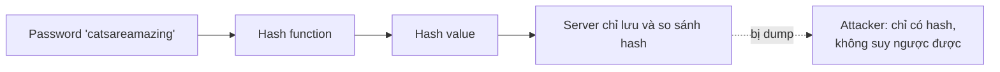

# Hashing

> **TL;DR:** Hashing dùng một hàm (hash function) biến dữ liệu kích thước bất kỳ thành một **giá trị cố định độ dài** (hash). Hash là **một chiều**, cùng dữ liệu luôn cho cùng hash, dữ liệu khác (dù chỉ 1 byte) cho hash khác. Dùng để lưu mật khẩu, kiểm tra tính toàn vẹn khi tải file, và là nền tảng của [[Digital Signatures]], certificate [[SSL and TLS]], [[DNSSEC]].

## 🖼️ Sơ đồ
![[Hashing.excalidraw]]
*Mở bằng plugin Excalidraw để chỉnh sửa · ảnh tĩnh: [[Hashing.svg]]*

## Khái niệm cốt lõi
- **Data + hash function = hash.** Ví dụ hàm: **MD5** (cũ, không còn an toàn), **SHA2-256** (hiện đại, đáng tin).
- Ứng dụng: lưu mật khẩu, chữ ký số, SSL certificate, tìm kiếm dữ liệu, antivirus (lưu định nghĩa mã độc dưới dạng hash thay vì cả file), tiền số như Bitcoin.
- Các tính chất cốt lõi:
  - **Fixed length**: dù là file text, ảnh hay database khổng lồ, hash luôn nhỏ và độ dài cố định theo loại hàm (SHA2-256 dài hơn MD5).
  - **One-way**: không thể lấy lại dữ liệu gốc từ hash. Chỉ có thể brute-force (thử hash mọi khả năng) — với thuật toán hiện đại coi như **bất khả thi** nếu không có lỗ hổng trong hàm.
  - **Deterministic**: cùng dữ liệu + cùng hàm → luôn cùng hash.
  - **Khác dữ liệu → khác hash**: thay đổi nhỏ nhất (1 ký tự, 1 pixel) cũng cho hash hoàn toàn khác.
- Hai điều rất tệ với một hàm hash: (1) suy ngược được dữ liệu từ hash, (2) **collision** — hai dữ liệu khác nhau cho cùng một hash → không còn tin được hàm đó.

## Cách hoạt động / Kiến trúc

### Ví dụ lưu mật khẩu
- **Không hash**: server lưu mật khẩu (dù có mã hóa khi truyền và khi lưu). Nếu server bị khai thác/data dump → kẻ tấn công có mật khẩu hoặc bản mã hóa của nó, khá dễ lấy plaintext → nguy hiểm cho các dịch vụ khác nếu dùng chung mật khẩu.
- **Có hash**: client gửi **hash của mật khẩu**; server chỉ lưu hash và so sánh hash nhận được với hash đã lưu. Server xác minh đúng mật khẩu mà **không bao giờ lưu mật khẩu**.
- Rủi ro còn lại: kẻ tấn công lấy được hash có thể thử lần lượt mọi từ/cụm từ qua cùng thuật toán cho tới khi khớp (dictionary/brute-force) → phải dùng thuật toán **hiện đại, an toàn**.

### Collision — demo MD5 vs SHA2-256
- Adrian chạy `md5` trên hai ảnh khác nhau `plane.jpg` và `ship.jpg` → **cùng hash** = collision. Hai ảnh đã được chỉnh có chủ đích để tạo collision, chứng minh điểm yếu lý thuyết của MD5.
- Chạy **SHA2-256** trên cùng hai file → hai hash **khác nhau** (và dài hơn). Thuật toán hiện đại chống được cả kiểu tạo collision nhân tạo này.
- Kết luận: trong production dùng **SHA2-256** hoặc thuật toán được tin cậy tương đương; không dùng MD5.

### Kiểm tra dữ liệu tải về
- Tác giả công bố file ở một nơi và **hash của file** ở một hệ thống khác. Người dùng tải về, tự hash, so sánh: khớp → file **không bị sửa đổi**.
- Nhưng còn hai câu hỏi: hash công bố có bị sửa không? Có đúng do tác giả tạo ra không? → giải quyết bằng **[[Digital Signatures]]** (ký hash bằng private key).

## Bảng so sánh / số liệu

| | Hashing | Encryption |
|---|---|---|
| Chiều | Một chiều | Hai chiều (mã hóa ↔ giải mã với khóa) |
| Độ dài output | Cố định | Phụ thuộc độ dài dữ liệu |
| Mục đích | Toàn vẹn, so khớp, lưu mật khẩu | Bảo mật nội dung |
| Ví dụ | MD5 (yếu), SHA2-256 | AES, RSA (xem [[Encryption Fundamentals]]) |

## 🎯 Mẹo thi SAA-C03
- Hash = **integrity**, không phải confidentiality. Đề nói "phát hiện file/log bị sửa" → nghĩ tới hash/chữ ký số (ví dụ [[CloudTrail]] log file integrity validation dùng SHA-256 + chữ ký số; S3 dùng checksum/ETag để kiểm tra toàn vẹn upload).
- MD5 = có collision, không dùng cho bảo mật; chọn SHA-256 trở lên.
- Hash một chiều → không "giải mã" được hash; muốn lấy lại dữ liệu thì phải dùng encryption ([[KMS]]).

## Liên kết
- Tiên quyết: [[Encryption Fundamentals]]
- Dùng trong: [[Digital Signatures]], [[SSL and TLS]], [[DNSSEC]]
- Liên quan AWS: [[CloudTrail]], [[KMS]], [[S3 Basics]]
- Phân biệt với: [[Encryption Fundamentals]] (mã hóa hai chiều)
