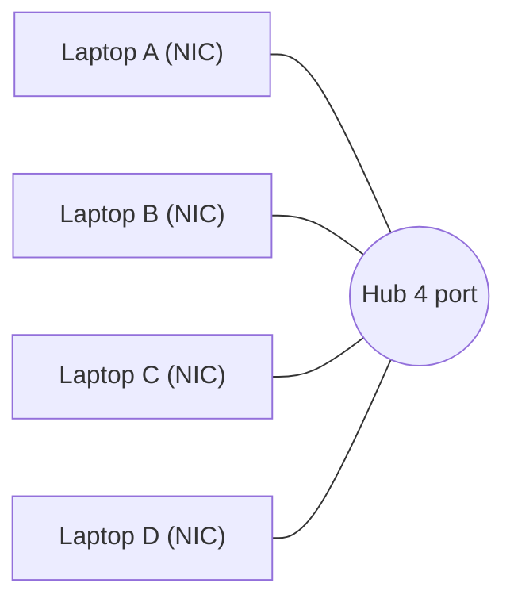

# Layer 1 Physical

> **TL;DR:** Tầng Physical định nghĩa **chuẩn truyền và nhận dòng bit thô** (0 và 1) lên một **môi trường vật lý dùng chung** (cáp đồng, cáp quang, sóng Wi-Fi). Nó "ngu": không có địa chỉ thiết bị, không kiểm soát truy cập môi trường, không phát hiện collision → mọi thứ là broadcast, không scale được. Layer 2 sinh ra để khắc phục.

## 🖼️ Sơ đồ
![[Layer 1 Physical.excalidraw]]
*Mở bằng plugin Excalidraw để chỉnh sửa · ảnh tĩnh: [[Layer 1 Physical.svg]]*

## Khái niệm cốt lõi
- **Môi trường vật lý (physical medium)**:
  - **Copper** → tín hiệu điện.
  - **Fiber** → ánh sáng.
  - **Wi-Fi** → tần số vô tuyến (radio).
- **Layer 1 standard / specification** định nghĩa cách truyền/nhận bit thô giữa thiết bị và môi trường chung: **mức điện áp, timing, tốc độ dữ liệu (data rate), khoảng cách tối đa, phương pháp điều chế (modulation), loại đầu nối (connector)**.
- Ví dụ cáp đồng: quy ước một mức điện áp là bit 1 (ví dụ +1V) và một mức là bit 0 (ví dụ −1V). Hai card mạng dùng **cùng chuẩn** → hiểu nhau → truyền được 0/1.
- Kết nối 2 laptop bằng 1 sợi cáp = **point-to-point link** L1.
- **Quy ước "thiết bị Layer X"**: có chức năng tầng X và mọi tầng dưới. Thiết bị Layer 1 chỉ hiểu L1; thiết bị Layer 3 hiểu L1+L2+L3.

### Hub
- Muốn nối > 2 thiết bị (ví dụ 4 laptop chơi LAN game) → dùng **hub** (ví dụ hub 4 port).
- Hub chỉ có **một việc**: nhận gì trên một port thì **phát lại ra mọi port khác** — kể cả **lỗi và collision**.
- Về khái niệm, hub = **một sợi cáp nhiều đầu nối**, một môi trường vật lý chung cho tất cả.

### Hạn chế của Layer 1
- **Không có địa chỉ thiết bị riêng** → không gửi trực tiếp cho một máy được; mọi thứ là **broadcast** (giống hét vào phòng mà không gọi tên ai).
- **Collision**: hai thiết bị cùng truyền một lúc trên môi trường chung → tín hiệu hỏng, mọi dữ liệu vô dụng. Càng nhiều thiết bị càng dễ collision.
- **Không có media access control** → không có cơ chế quyết định ai được truyền khi nào → với kiến trúc hub, collision gần như chắc chắn.
- **Không phát hiện được collision**: card mạng chỉ thay đổi điện áp trên môi trường; nhiều thiết bị cùng truyền về mặt vật lý vẫn "được", chỉ là không ai hiểu gì.
- Hệ quả: mạng L1 (hub) có **1 broadcast domain và 1 collision domain** → **không scale**.

## Cách hoạt động / Kiến trúc

- A truyền → hub phát lại cho B, C, D. Nếu A và C truyền cùng lúc → collision lan ra toàn mạng.

## Bảng so sánh / số liệu
| Có ở Layer 1 | Không có ở Layer 1 |
|---|---|
| Môi trường vật lý **dùng chung** | Kiểm soát truy cập (access control) |
| Chuẩn **truyền** lên môi trường | Định danh thiết bị duy nhất |
| Chuẩn **nhận** từ môi trường | Giao tiếp thiết bị → thiết bị (unicast) |
| | Phát hiện collision |

## 🎯 Mẹo thi SAA-C03
- SAA-C03 không hỏi trực tiếp về hub/điện áp, nhưng L1 là nền cho các chủ đề vật lý: [[Direct Connect]] là **kết nối vật lý** (cáp quang 1/10/100 Gbps tại DX location) → cần thời gian lắp đặt, không có mã hóa sẵn; khác với VPN chạy logic trên internet.
- Nhớ: mọi thứ trên một môi trường L1 chung = một collision domain; switch (L2) mới tách collision domain theo từng port.

## Liên kết
- Tổng quan: [[OSI Model]]
- Tiếp theo: [[Layer 2 Data Link]] (thêm MAC address, CSMA/CD, switch)
- Liên quan: [[Direct Connect]], [[Compare - VPN vs Direct Connect]]
