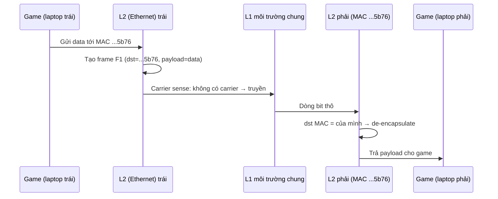
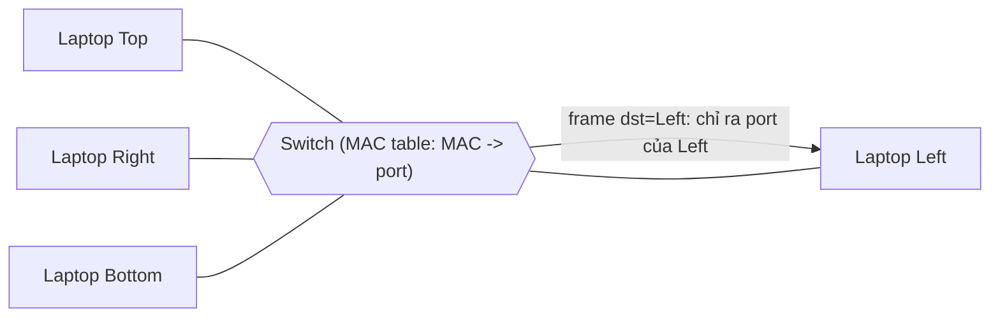

# Layer 2 Data Link

> **TL;DR:** Layer 2 chạy trên Layer 1 và thêm trí thông minh: **frame**, **MAC address** (định danh phần cứng 48-bit), **media access control** (CSMA) và **collision detection** (CD). Nhờ đó có giao tiếp **thiết bị → thiết bị** (unicast) và broadcast. **Switch** (thiết bị L2) học MAC address theo port, chỉ forward frame hợp lệ tới đúng port → mỗi port là một collision domain riêng, mạng scale tốt hơn hub.

## 🖼️ Sơ đồ
![[Layer 2 Data Link.excalidraw]]
*Mở bằng plugin Excalidraw để chỉnh sửa · ảnh tĩnh: [[Layer 2 Data Link.svg]]*

![[Layer 2 Data Link - switch.excalidraw]]
*Mở bằng plugin Excalidraw để chỉnh sửa · ảnh tĩnh: [[Layer 2 Data Link - switch.svg]]*

## Khái niệm cốt lõi
- Là một trong những tầng **quan trọng nhất**: mọi tầng phía trên dựa vào giao tiếp thiết bị-thiết bị mà L2 cung cấp. Internet về bản chất là rất nhiều mạng L2 nối với nhau (inter-net).
- L2 **cần L1 hoạt động** bên dưới; có thể chạy trên nhiều loại L1 (copper, fiber, Wi-Fi) mà vẫn cung cấp cùng khả năng. Giao thức L2 phổ biến cho LAN: **Ethernet**.

### MAC address
- **Hardware address** gán cho mỗi thiết bị/card mạng: **48 bit**, viết dạng **hexadecimal** (ví dụ `3e:22:fb:b9:5b:75`).
- Với mạng vật lý, MAC **không do phần mềm gán** mà gắn với phần cứng cụ thể.
- Gồm 2 phần:
  - **OUI** (Organizationally Unique Identifier) — cấp cho hãng sản xuất thiết bị mạng.
  - Phần **NIC-specific** — do hãng gán cho từng card.
  - → MAC trên một card mạng về nguyên tắc **duy nhất toàn cầu**.

### Ethernet frame
| Trường | Kích thước (chuẩn Ethernet) | Vai trò |
|---|---|---|
| Preamble + SFD | 7 + 1 byte | Báo hiệu **bắt đầu frame** để thiết bị nhận biết vị trí các trường |
| Destination MAC | 6 byte | MAC đích; **toàn F (`ff:ff:ff:ff:ff:ff`) = broadcast** tới mọi thiết bị trong mạng cục bộ |
| Source MAC | 6 byte | MAC của bên gửi → để bên nhận trả lời |
| EtherType (ET) | 2 byte | Cho biết **giao thức L3** nào đặt dữ liệu vào frame (ví dụ IP) |
| Payload | **46–1500 byte** | Dữ liệu (thường là **packet L3**) |
| FCS | 4 byte | Frame Check Sequence — **CRC** để phát hiện frame bị hỏng |
- Ba trường Destination, Source, EtherType gọi chung là **MAC header**.
- L1 khi truyền frame **không hiểu frame**, chỉ coi là dữ liệu thô để biến thành điện áp/ánh sáng/RF.

### Encapsulation
- Dữ liệu (ví dụ IP packet từ L3) được **bọc** vào payload của frame = **encapsulation**; phía nhận bóc ra = **de-encapsulation**, rồi dùng EtherType để chuyển lên đúng giao thức L3.
- Dữ liệu đi xuống OSI được bọc thêm nhiều lớp: Transport bọc, Network bọc, Data Link bọc.
- **Trừu tượng hóa**: tầng nào cũng "thấy" như đang nói chuyện trực tiếp với tầng tương ứng phía bên kia (L2 ↔ L2, trình duyệt L7 ↔ web server L7); mọi thứ bên dưới bị che đi.

### CSMA/CD — media access control và collision detection
- **CSMA (Carrier Sense Multiple Access)**: trước khi gửi frame xuống L1, L2 **lắng nghe carrier** (tín hiệu) trên môi trường. Có carrier (ai đó đang truyền) → **chờ** tới khi hết; không có → giao frame cho L1 truyền.
- **CD (Collision Detection)**: nếu hai bên cùng không thấy carrier và truyền đồng thời → collision. Thiết bị phát hiện sẽ gửi **jam signal**, rồi chờ một khoảng **random backoff** (không ai truyền), sau đó thử lại. Nếu vẫn collision → backoff **dài hơn** → xác suất trùng giảm dần.
- Nhờ đó nhiều thiết bị cùng tồn tại trên một mạng L2.

### Hub vs Switch
- **Hub** là thiết bị **L1** = *multi-port repeater*: lặp lại mọi hoạt động vật lý ra mọi port. Chạy L2 trên hub vẫn được (các máy vẫn làm CSMA, máy không phải đích sẽ **discard** frame), nhưng collision vẫn có thể xảy ra và **bị lặp ra toàn mạng**.
- **Switch** là thiết bị **L2** ("hub có siêu năng lực"):
  - Duy trì **MAC address table**: học MAC nguồn của frame đi vào port nào → ghi (MAC, port).
  - Frame tới: **biết** port của MAC đích → forward ra **đúng port đó**; **chưa biết** → flood ra mọi port khác.
  - **Store-and-forward**: nhận frame, lưu, kiểm tra, forward theo bảng MAC — chỉ forward **frame hợp lệ**, không forward lỗi vật lý/collision.
  - **Mỗi port là một collision domain riêng**: collision chỉ có thể xảy ra giữa thiết bị và port nó cắm vào.

## Cách hoạt động / Kiến trúc

## Bảng so sánh / số liệu
| | Hub (L1) | Switch (L2) |
|---|---|---|
| Hiểu frame/MAC | Không | Có |
| Cách chuyển tiếp | Lặp ra mọi port (kể cả collision/lỗi) | Store-and-forward theo MAC table |
| Collision domain | 1 cho toàn hub | **1 cho mỗi port** |
| Broadcast domain | 1 | 1 (broadcast vẫn tới mọi port) |
| Scale | Kém | Tốt hơn nhiều |

| Layer 2 mang lại | |
|---|---|
| Identifiable devices | MAC address |
| Media access control | CSMA — chia sẻ môi trường "lịch sự" |
| Collision detection | CD — jam + random backoff |
| Unicast 1:1 / Broadcast 1:ALL | dst MAC cụ thể / `ff:ff:ff:ff:ff:ff` |

## 🎯 Mẹo thi SAA-C03
- Trong VPC, AWS **không** cung cấp broadcast/multicast L2 cho khách hàng (trừ multicast qua Transit Gateway) — một lý do các giải pháp cluster dựa vào broadcast không chạy nguyên bản trên VPC.
- Mỗi ENI của EC2 có **MAC address** riêng; khi chuyển ENI sang instance khác thì MAC đi theo ENI (hữu ích cho phần mềm license theo MAC) — xem [[EC2 Network Interfaces IPs and DNS]].
- [[Direct Connect]] dùng **VLAN tagging 802.1Q** (khái niệm L2) để tách các Virtual Interface (VIF) trên cùng một kết nối vật lý.
- Hiểu **encapsulation** giúp hiểu VPN/IPsec, tunnel, GWLB (GENEVE) về sau.

## Liên kết
- Tổng quan: [[OSI Model]]
- Trước: [[Layer 1 Physical]] — Sau: [[Layer 3 Network]] (IP, ARP dùng MAC để giao packet trong LAN)
- Liên quan: [[EC2 Network Interfaces IPs and DNS]], [[Direct Connect]], [[Gateway Load Balancer]], [[IPSec VPN]]
