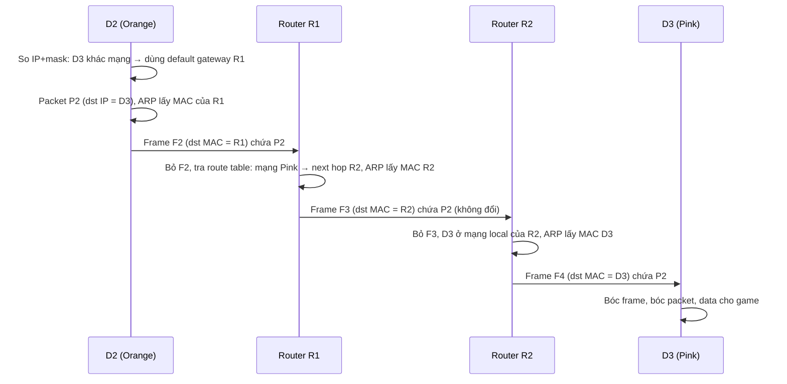

# Layer 3 Network

> **TL;DR:** Layer 2 chỉ chuyển frame **trong một mạng cục bộ**, và các mạng L2 có thể dùng giao thức khác nhau. Layer 3 (IP) là **giao thức chung bắc qua nhiều mạng L2** (inter-networking → "internet"): thêm **IP address** (định danh xuyên mạng), **subnet mask/prefix** (biết đích là local hay remote), **route/route table** và **router** để chuyển **packet** từng hop từ nguồn tới đích; **ARP** nối L3 với L2 (tìm MAC cho một IP). Packet giữ nguyên suốt hành trình, frame thì thay ở mỗi mạng.

## 🖼️ Sơ đồ
![[Layer 3 Network.excalidraw]]
*Mở bằng plugin Excalidraw để chỉnh sửa · ảnh tĩnh: [[Layer 3 Network.svg]]*

![[Layer 3 Network - routing.excalidraw]]
*Mở bằng plugin Excalidraw để chỉnh sửa · ảnh tĩnh: [[Layer 3 Network - routing.svg]]*

## Khái niệm cốt lõi

### Vì sao cần Layer 3
- Hai LAN ở bờ Đông và bờ Tây nước Mỹ là hai mạng L2 **cô lập**. Kéo point-to-point link riêng xuyên lục địa cho mọi doanh nghiệp → đắt, không scale.
- Mạng L2 chỉ nói chuyện được với mạng L2 **cùng giao thức**. Thực tế có nhiều công nghệ L2: **Ethernet** (LAN), và cho link xa: **PPP, MPLS, ATM**, link vệ tinh... — frame khác định dạng.
- → Cần một giao thức chung trên mọi mạng L2: **IP**. L3 cần **một hoặc nhiều mạng L2** hoạt động bên dưới.

### IP packet
- Giống frame về ý tưởng (dữ liệu + địa chỉ nguồn/đích), nhưng nguồn/đích có thể **ở hai đầu Trái Đất** (frame thì thường cục bộ).
- **Packet giữ nguyên** từ nguồn tới đích (ngoại lệ: NAT — xem [[NAT Fundamentals]]); ở mỗi mạng L2 nó được **encapsulate** trong một **frame mới** phù hợp mạng đó → một packet có thể nằm trong hàng chục frame khác nhau trên đường đi.
- Trường quan trọng của **IPv4 packet**:
  - **Source IP**, **Destination IP**.
  - **Protocol**: giao thức L4 bên trong — **ICMP = 1**, **TCP = 6**, **UDP = 17** → stack ở đích biết chuyển dữ liệu cho giao thức L4 nào.
  - **TTL (Time To Live)**: số **hop** tối đa; hết thì packet bị hủy → chống packet lặp vòng mãi.
  - **Data**: phần lớn packet, thường là dữ liệu từ L4.
  - (Các trường khác: Version, Header Length, Type of Service, Total Length, Identification, Flags, Fragment Offset, Header Checksum, Options — không cần đi sâu ở mức này.)
- **IPv6 packet**: tương tự, nhưng **địa chỉ nguồn/đích lớn hơn** (128 bit so với 32 bit) → nhiều địa chỉ hơn; trường tương đương TTL gọi là **Hop Limit**; có Traffic Class, Flow Label, Payload Length, Next Header.

### Địa chỉ IPv4
- Dạng **dotted decimal** (`133.33.3.7`), thực chất là **32 bit** = 4 **octet** 8 bit (đọc trái → phải: octet 1, 2, 3, 4). Cách đổi: [[Decimal and Binary Conversion]].
- Gồm 2 phần: **network part** (thuộc mạng nào) và **host part** (thiết bị nào trong mạng). Với `/16`: `133.33` là network, `3.7` là host.
- **Hai IP cùng network part → cùng mạng (local)**; khác → **remote** (cần routing).
- Gán IP: **static** (người cấu hình) hoặc **tự động qua DHCP** (Dynamic Host Configuration Protocol).
- IP phải **duy nhất** trong mạng cục bộ, và hầu hết trường hợp duy nhất toàn cầu.

### Subnet mask và prefix
- Cấu hình trên interface L3 cùng IP (static hoặc DHCP), kèm **default gateway** — IP trên mạng local mà packet được gửi tới khi đích **không phải local** (ở nhà: router internet).
- Subnet mask là số nhị phân viết dạng dotted decimal: bit **1 = network**, bit **0 = host**. `255.255.0.0` = `11111111.11111111.00000000.00000000`.
- **Prefix** (`/16`) = **số bit 1 tính từ trái** của subnet mask → `/16` ≡ `255.255.0.0`.
- Tính dải mạng:
  - **Địa chỉ đầu mạng** = network part + host part **toàn 0**.
  - **Địa chỉ cuối mạng** = network part + host part **toàn 1**.
  - Ví dụ `133.33.3.7/16` → mạng từ **133.33.0.0** tới **133.33.255.255**.
- Chính subnet mask cho host biết đích là local (gửi thẳng) hay remote (gửi qua gateway). Việc này do networking stack làm tự động.

### Route và route table
- Mỗi router có ≥ 1 route table (có thể gắn theo interface). Mỗi **route** = **Destination** (một dải CIDR) + **Next Hop / Target**.
- Với mỗi packet tới, router so **destination IP** với các route:
  - Có thể nhiều route khớp → chọn route **cụ thể nhất (longest prefix match)**: prefix càng lớn càng cụ thể. **/32** = đúng 1 IP (cụ thể nhất); **/0** = mọi IP (kém cụ thể nhất). **/24** = 24 bit network, 8 bit host → **256 địa chỉ**.
  - **Default route `0.0.0.0/0`**: khớp mọi thứ, chỉ dùng khi không route nào cụ thể hơn khớp. Router ở nhà có default route gửi mọi thứ tới ISP.
  - Packet được forward tới **next hop** → **routing là hop-by-hop**.
- Route table có thể **static** hoặc học động qua giao thức như **[[BGP]]** (Border Gateway Protocol) — cách lõi internet trao đổi các mạng mà mỗi router biết.
- Khi router forward tới next hop, nó làm ở **L2**: bọc packet (không đổi) trong frame có **MAC đích = MAC của next-hop router**.

### ARP (Address Resolution Protocol)
- Chạy **giữa L2 và L3**: cho một IP, tìm **MAC address** tương ứng để dựng frame.
- Cơ chế: gửi **broadcast L2** (MAC đích `ff:ff:ff:ff:ff:ff`) hỏi "Ai có IP 133.33.3.10?" → máy có IP đó trả lời kèm MAC của nó.
- Đích local → ARP lấy MAC của chính máy đích. Đích remote → ARP lấy MAC của **default gateway/next-hop router**, không phải của máy đích.

### Router
- Thiết bị **L3** (hiểu L1, L2, L3), có interface trong mỗi mạng nó nối.
- Máy thường nhận packet không phải của mình → **drop**; router thì **xử lý tiếp**: bỏ frame cũ, tra route table, bọc frame mới, gửi đi.

## Cách hoạt động / Kiến trúc

### Ví dụ route table của ISP (MeowISP)
| Destination | Next Hop / Target | Ghi chú |
|---|---|---|
| 52.217.13.0/24 | 52.217.13.1 | Mạng AWS — cụ thể |
| 0.0.0.0/0 | 52.43.214.1 | Default route → upstream ISP |
| 52.43.215.0/24 | 52.43.215.1 | Mạng Netflix — cụ thể |
- Packet từ nhà (src `1.3.3.7`) tới `52.217.13.37`: khớp cả dòng 1 và default → chọn **52.217.13.0/24** (cụ thể hơn) → forward tới `52.217.13.1`.

### Ví dụ routing đầy đủ qua 3 mạng
Mạng Orange (D1, D2) —R1— mạng Green —R2— mạng Pink (D3).
- **Local (D1 → D2)**: D1 dùng IP + mask của mình và IP của D2 → cùng mạng → không cần router. Tạo packet P1 (dst = IP D2) → ARP lấy MAC D2 → bọc frame → gửi thẳng. D2 bóc frame, bóc packet, đưa data cho game. **Một frame cho một packet.**
- **Remote (D2 → D3)**:

- Điểm mấu chốt: **IP đích của packet luôn là D3**; **MAC đích của frame đổi theo từng chặng** (R1 → R2 → D3).

## Bảng so sánh / số liệu
| | Layer 2 | Layer 3 |
|---|---|---|
| Đơn vị | Frame | Packet |
| Địa chỉ | MAC (48 bit, phần cứng) | IP (IPv4 32 bit / IPv6 128 bit, logic) |
| Phạm vi | Trong một mạng cục bộ | Xuyên nhiều mạng (internet) |
| Thiết bị | Switch | Router |
| Thay đổi trên đường đi | Thay ở mỗi mạng | Giữ nguyên (trừ NAT) |
| Chống lặp | — | TTL / Hop Limit |

| Prefix | Subnet mask | Số địa chỉ |
|---|---|---|
| /0 | 0.0.0.0 | Tất cả (default route) |
| /8 | 255.0.0.0 | 16.777.216 |
| /16 | 255.255.0.0 | 65.536 |
| /24 | 255.255.255.0 | 256 |
| /32 | 255.255.255.255 | 1 |

### Layer 3 cung cấp gì và thiếu gì
- **Có**: IP address (cross-network addressing), ARP, route, route table, router (encapsulate lại ở mỗi chặng L2), giao tiếp thiết bị ↔ thiết bị qua internet.
- **Thiếu**:
  - **Không có "kênh" giao tiếp riêng**: packet chỉ có src IP và dst IP → giữa hai máy chỉ có một luồng, không phân biệt được nhiều ứng dụng cùng lúc.
  - **Có thể giao không theo thứ tự**: mỗi packet có thể đi đường khác nhau tùy điều kiện mạng.
  - → Hai vấn đề này do **Layer 4** (TCP/UDP, port, segment) giải quyết — xem [[Layer 4 Transport]].

## 🎯 Mẹo thi SAA-C03
- **Longest prefix match** áp dụng nguyên xi trong **VPC route table**: route cụ thể hơn thắng (ví dụ route `/24` tới peering connection thắng `0.0.0.0/0` tới IGW). VPC có **local route** cho CIDR của VPC, không xóa được. Xem [[VPC Routing and Internet Gateway]].
- **Default route `0.0.0.0/0`** (IPv4) / `::/0` (IPv6) trỏ tới **Internet Gateway** → subnet public; trỏ tới **NAT Gateway** → private subnet ra internet. Xem [[NAT Gateway]], [[Egress-Only Internet Gateway]].
- **Default gateway** trong mỗi subnet VPC là **VPC Router** tại địa chỉ **network + 1** (một trong 5 IP AWS giữ lại) — xem [[VPC Subnets]].
- Số protocol **ICMP 1 / TCP 6 / UDP 17** xuất hiện khi viết rule [[NACL]] hoặc đọc [[VPC Flow Logs]].
- Hai dải CIDR chồng lấn → không route được với nhau → không peering/VPN được; chọn dải IP VPC cẩn thận ngay từ đầu ([[VPC Sizing and Structure]]).
- Route học động qua **BGP** là nền của [[Direct Connect]] và Site-to-Site VPN dynamic.

## Liên kết
- Tổng quan: [[OSI Model]]
- Trước: [[Layer 2 Data Link]] — Sau: [[Layer 4 Transport]]
- Kỹ năng nền: [[Decimal and Binary Conversion]], [[Subnetting]]
- Mở rộng: [[NAT Fundamentals]], [[BGP]], [[DNS Fundamentals]]
- Ứng dụng AWS: [[VPC Sizing and Structure]], [[VPC Subnets]], [[VPC Routing and Internet Gateway]], [[NAT Gateway]], [[NACL]], [[VPC Flow Logs]], [[Direct Connect]], [[Site-to-Site VPN]]
