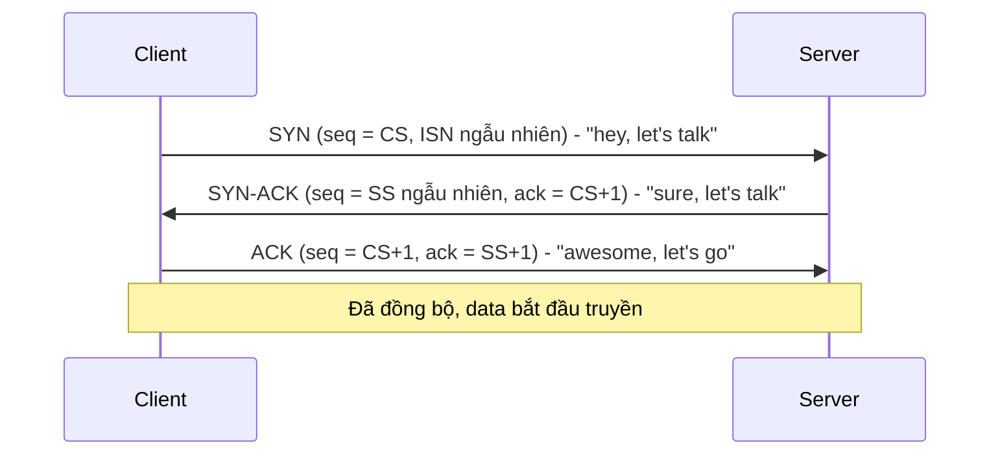
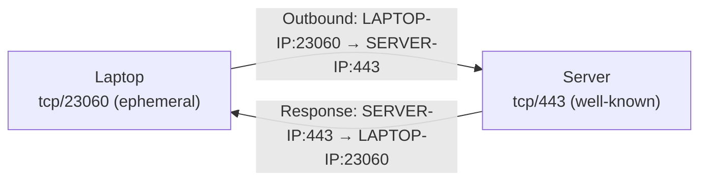

# Layer 4 Transport

> **TL;DR:** Layer 4 (Transport) chạy trên IP và thêm hai giao thức **TCP** (tin cậy, có thứ tự, connection-oriented) và **UDP** (nhanh, không đảm bảo). TCP dùng **segment** có port, sequence number, acknowledgement, window... để biến các IP packet rời rạc thành một kênh truyền hai chiều tin cậy giữa hai ứng dụng. Hiểu port **well-known vs ephemeral** và **stateless vs stateful** là nền tảng để hiểu [[NACL]] và [[Security Groups]] trong AWS.

## 🖼️ Sơ đồ
![[Layer 4 Transport.excalidraw]]
*Mở bằng plugin Excalidraw để chỉnh sửa · ảnh tĩnh: [[Layer 4 Transport.svg]]*

![[Layer 4 Transport - firewall.excalidraw]]
*Mở bằng plugin Excalidraw để chỉnh sửa · ảnh tĩnh: [[Layer 4 Transport - firewall.svg]]*

## Khái niệm cốt lõi

### Vì sao Layer 3 chưa đủ
[[Layer 3 Network]] (IP) chuyển từng packet **độc lập**, mỗi packet có thể đi một đường khác nhau. Hệ quả:
- **Out-of-order**: packet 3 có thể tới trước packet 2; IP không có cơ chế sắp xếp lại.
- **Mất packet**: sự cố mạng, routing loop → TTL về 0 → packet bị drop. IP không đảm bảo giao nhận.
- **Delay/jitter** không đồng đều → ảnh hưởng ứng dụng nhạy cảm độ trễ.
- **Không phân biệt kênh/ứng dụng**: IP header chỉ có source IP và destination IP → không thể chạy nhiều ứng dụng song song giữa hai máy (web, SSH, email...).
- **Không có flow control**: bên gửi nhanh hơn bên nhận → bão hòa đường truyền, mất dữ liệu.

### TCP vs UDP
- Cả hai đều chạy **trên IP** và dùng IP làm phương tiện vận chuyển. "TCP/IP" = TCP chạy trên IP.
- **TCP (Transmission Control Protocol)**: reliable, error correction, ordering; **connection-oriented** — phải thiết lập kết nối trước, sau đó có kênh hai chiều (bidirectional). Dùng cho phần lớn giao thức tầng ứng dụng quan trọng: HTTP, HTTPS, SSH...
- **UDP (User Datagram Protocol)**: không có overhead của cơ chế tin cậy → **nhanh hơn nhưng kém tin cậy**. Đánh đổi đơn giản: độ tin cậy vs hiệu năng.
- Layer 5 (Session) chồng lấn nhiều với Layer 4; Adrian gom chung vì [[OSI Model]] chỉ là mô hình khái niệm. Khái niệm "session/state" (một cuộc hội thoại liên tục) về lý thuyết thuộc Layer 5.

### Cấu trúc TCP segment
Segment là container dữ liệu của TCP, được **encapsulate bên trong IP packet**. Segment **không có source/destination IP** — địa chỉ thiết bị do packet ở Layer 3 cung cấp.

| Trường | Ý nghĩa |
|---|---|
| **Source port / Destination port** | Cho phép nhiều luồng hội thoại cùng lúc giữa hai thiết bị. Bộ 4 giá trị *(src IP, dst IP, src port, dst port)* xác định duy nhất một kết nối. |
| **Sequence number** | Tăng dần, duy nhất trong một kết nối; dùng để sắp xếp lại segment và để retransmit khi lỗi. |
| **Acknowledgement** | Bên nhận báo đã nhận "tới và gồm" một sequence number nào đó. Mọi segment đều phải được ack. |
| **Flags 'n' things** | 9 bit flags (SYN, ACK, FIN...) + data offset, reserved. Dùng để mở/đóng kết nối, đồng bộ sequence. |
| **Window** | Số byte bên nhận sẵn sàng nhận giữa hai lần ack → cơ chế **flow control**. Window nhỏ = kiểm soát chặt hơn nhưng tốn nhiều header hơn; window lớn = hiệu quả hơn. |
| **Checksum** | Phát hiện lỗi để yêu cầu truyền lại. |
| **Urgent pointer** | Đánh dấu traffic điều khiển để ưu tiên xử lý (ví dụ FTP, Telnet: data chiếm 99%, control 1%). |
| Options / Padding | Bỏ qua trong bài. |
| **Data** | Phần còn lại của segment chứa dữ liệu. |

Các trường trên (trừ data) gọi chung là **TCP header**.

## Cách hoạt động / Kiến trúc

### Kết nối TCP: well-known port và ephemeral port
- Layer 4 nhận dữ liệu từ tầng trên, **cắt thành segment**, đóng vào IP packet. Nhờ sequence number, segment đến sai thứ tự vẫn sắp lại được; segment mất thì được truyền lại → TCP cung cấp chuỗi segment **đảm bảo, có thứ tự**.
- Client kết nối từ một **ephemeral port** (port tạm, thường thuộc dải cao, ví dụ `tcp/23060`) tới **well-known port** trên server (ví dụ `tcp/443` = HTTPS).
- Chiều phản hồi **đảo ngược port**: source = 443, destination = 23060.
- "Kênh" hay "connection" thực chất không tồn tại vật lý — chỉ là tập hợp segment hai chiều được ghép lại.
- Nhờ port, một [[EC2 Basics|EC2 instance]] có thể chạy cả SSH và HTTPS, và có thể mở nhiều phiên SSH cùng lúc tới cùng một instance.

### Three-way handshake
Trước khi gửi data, hai bên phải thỏa thuận sequence number ban đầu.

- **SYN**: client gửi Initial Sequence Number (ISN) ngẫu nhiên `CS`.
- **SYN-ACK**: server chọn sequence ngẫu nhiên `SS` của riêng nó và ack `CS+1` (nghĩa là "đã nhận hết tới CS, gửi tiếp phần CS+1").
- **ACK**: client ack `SS+1`, tăng sequence của mình lên `CS+1`.
- Từ đó mỗi lần gửi data, sequence tăng và bên kia ack giá trị +1 → cho phép phát hiện mất mát và retransmit.
- Flag **FIN** dùng để đóng kết nối.

### Sessions & State: stateless vs stateful firewall
Mỗi kết nối TCP luôn có **initiating traffic** (chiều khởi tạo) và **response traffic** (chiều phản hồi). Ví dụ laptop (ephemeral 23060) → server (443):

- **Stateless firewall**: không hiểu trạng thái kết nối → thấy **hai luồng riêng biệt** → cần **hai rule** (một OUT cho chiều khởi tạo, một IN cho chiều phản hồi). Trong AWS: **Network ACL** ([[NACL]]).
- **Stateful firewall**: hiểu trạng thái, coi khởi tạo + phản hồi là **một thứ** → chỉ cần allow chiều khởi tạo, response **tự động được phép**. Trong AWS: **[[Security Groups]]**.
- Phải hiểu **hướng** của traffic: client đi ra ngoài thì initiating = outbound; nếu bảo vệ web server nhận kết nối vào thì initiating = inbound, response = outbound.
- Với stateless firewall, chiều response đi tới ephemeral port của client → thường phải mở **toàn bộ dải ephemeral port** (high ports).

## Bảng so sánh / số liệu

| | TCP | UDP |
|---|---|---|
| Kết nối | Connection-oriented (3-way handshake) | Connectionless |
| Độ tin cậy | Có: ordering, ack, retransmit, checksum | Không đảm bảo |
| Flow control | Có (window) | Không |
| Tốc độ / overhead | Chậm hơn, header lớn hơn | Nhanh, ít overhead |
| Dùng cho | HTTP, HTTPS, SSH... | Ứng dụng ưu tiên hiệu năng/độ trễ |

| | Stateless firewall | Stateful firewall |
|---|---|---|
| Hiểu state kết nối | Không | Có |
| Số rule cho 1 kết nối TCP | 2 (IN + OUT) | 1 (chiều khởi tạo) |
| Ví dụ AWS | [[NACL]] | [[Security Groups]] |

## 🎯 Mẹo thi SAA-C03
- **NACL = stateless** → cần rule cả hai chiều, nhớ mở **ephemeral ports** cho traffic phản hồi. **Security Group = stateful** → allow chiều vào là response tự đi ra. Đây là điểm hay bị hỏi (xem [[Compare - Security Groups vs NACL]], [[Stateful vs Stateless Firewalls]]).
- Một kết nối = bộ 4 *(src IP, src port, dst IP, dst port)*; chiều phản hồi đảo port.
- Port cần nhớ trong bài: 443 = HTTPS (TCP). SSH (22) và HTTPS có thể cùng chạy trên một instance nhờ port.
- TCP khi đề nhấn mạnh tin cậy/thứ tự; UDP khi nhấn mạnh tốc độ/độ trễ thấp. Ở AWS, [[Compare - ALB vs NLB|NLB]] hoạt động ở Layer 4 (TCP/UDP), ALB ở Layer 7.

## Liên kết
- Tiên quyết: [[OSI Model]], [[Layer 3 Network]], [[Layer 2 Data Link]]
- Liên quan: [[NAT Fundamentals]] (dùng port để ghép nhiều thiết bị), [[SSL and TLS]] (chạy trên TCP), [[Stateful vs Stateless Firewalls]], [[DDoS]] (SYN flood lạm dụng handshake)
- Ứng dụng AWS: [[NACL]], [[Security Groups]], [[Elastic Load Balancer]], [[Compare - ALB vs NLB]]
- Phân biệt với: [[Compare - Security Groups vs NACL]], [[Layer 7 Firewall]]
