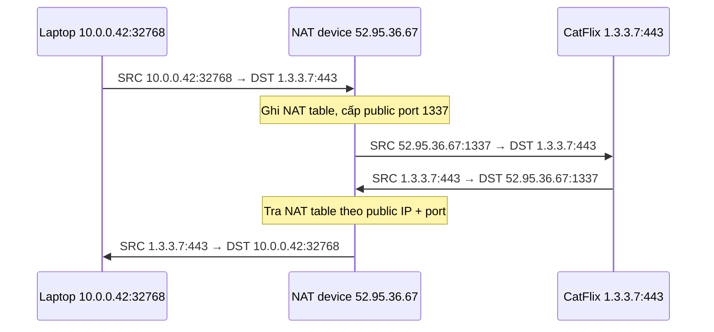

# NAT Fundamentals

> **TL;DR:** NAT (Network Address Translation) dịch địa chỉ IPv4 private sang public (và ngược lại) để thiết bị chỉ có IP private vẫn ra được Internet, đồng thời giúp tiết kiệm IPv4 public đang khan hiếm. Có 3 kiểu: **Static NAT** (1:1, cách [[VPC Routing and Internet Gateway|Internet Gateway]] hoạt động), **Dynamic NAT** (pool, cấp tạm thời) và **PAT** (many:1 dùng port, cách [[NAT Gateway]] hoạt động).

## 🖼️ Sơ đồ
![[NAT Fundamentals.excalidraw]]
*Mở bằng plugin Excalidraw để chỉnh sửa · ảnh tĩnh: [[NAT Fundamentals.svg]]*

![[NAT Fundamentals - types.excalidraw]]
*Mở bằng plugin Excalidraw để chỉnh sửa · ảnh tĩnh: [[NAT Fundamentals - types.svg]]*

## Khái niệm cốt lõi
- IPv4 có hai loại địa chỉ (xem [[Layer 3 Network]]):
  - **Public**: được cấp phát qua cơ quan trung ương → cơ quan khu vực → ISP → người dùng; phải **duy nhất** toàn cầu, route được trên Internet.
  - **Private** (ví dụ dải `10.0.0.0/8`): dùng lặp lại ở nhiều nơi nhưng **không route được trên Internet**.
- NAT ra đời để giải quyết tình trạng **thiếu IPv4**: cho thiết bị private truy cập Internet qua IP public, rồi dịch ngược lại cho traffic phản hồi.
- Lợi ích phụ: bảo mật — với PAT, bên ngoài không thể chủ động khởi tạo kết nối tới thiết bị private.
- Thiết bị private **không bao giờ được cấu hình IP public** trên chính nó; IP public chỉ là một mapping trong **NAT table** của router/NAT device.
- **NAT chỉ có ý nghĩa với IPv4.** IPv6 có không gian địa chỉ khổng lồ, không cần private addressing → nói chung **không cần NAT** cho IPv6.

## Cách hoạt động / Kiến trúc
Router/NAT device đứng giữa mạng private và Internet, là **default gateway** cho mọi đích không thuộc mạng local.

### 1. Static NAT (1:1)
- NAT table lưu mapping cố định **một private IP ↔ một public IP** (ví dụ `10.0.0.42 ↔ 52.95.36.67`, `10.0.0.10 ↔ 52.95.36.68`).
- **Outbound**: packet đi qua NAT device → **source IP** đổi từ private sang public được cấp.
- **Inbound**: packet tới public IP → tra NAT table → **destination IP** đổi về private IP tương ứng rồi forward vào.
- Truy cập Internet **hai chiều**, IP public **nhất quán** → dùng khi một số thiết bị cụ thể cần IP public cố định.
- Trong AWS: **Internet Gateway (IGW)** thực hiện static NAT 1:1 cho instance có public IPv4 / Elastic IP. Instance trong VPC chỉ thấy IP private của nó (xem [[EC2 Network Interfaces IPs and DNS]]).

### 2. Dynamic NAT (pool)
- Có một **pool** IP public (ví dụ 2 IP: `52.95.36.66`, `.67`) nhưng nhiều thiết bị private hơn (ví dụ 4).
- Khi thiết bị private cần ra Internet, NAT device kiểm tra: nếu chưa có allocation và pool còn IP → cấp **tạm thời** một IP public.
- Nhiều thiết bị có thể dùng chung một IP public **miễn là không trùng thời điểm**.
- Nếu pool hết IP → truy cập của thiết bị kế tiếp **thất bại**.
- Dùng khi số IP public < số IP private, nhưng mọi thiết bị đều cần truy cập public hai chiều vào lúc nào đó.

### 3. Port Address Translation — PAT (many:1, "overloading")
- Nhiều IP private dùng chung **một IP public duy nhất** của NAT device. Đây là cách router gia đình và **AWS NAT Gateway / NAT instance** hoạt động.
- Mấu chốt: mỗi kết nối TCP có source/destination IP + source/destination port (xem [[Layer 4 Transport]]). Source port do client chọn ngẫu nhiên (ephemeral), nên hai client có thể trùng source port → NAT device phải **cấp source port public mới, duy nhất**.

Ví dụ (NAT public IP `52.95.36.67`, đích CatFlix `1.3.3.7:443`):

| Private IP | Private port | Public IP | Public port |
|---|---|---|---|
| 10.0.0.42 | 32768 | 52.95.36.67 | 1337 |
| 10.0.0.43 | 32769 | 52.95.36.67 | 1338 |
| 10.0.0.44 | 32768 | 52.95.36.67 | 1339 |

- Traffic phản hồi: NAT device tra bảng theo *(public IP, public port)* và dịch ngược về *(private IP, private port)*.
- **Không thể khởi tạo traffic từ Internet vào thiết bị private** sau PAT: không có entry trong NAT table thì NAT device không biết forward cho ai.

## Bảng so sánh / số liệu

| | Static NAT | Dynamic NAT | PAT |
|---|---|---|---|
| Mapping | 1 private : 1 public (cố định) | private : public từ pool (tạm thời) | Many private : 1 public (phân biệt bằng port) |
| Chiều kết nối | Hai chiều | Hai chiều (khi có allocation) | Chỉ outbound-initiated + response |
| Khi nào dùng | Thiết bị cần IP public cố định | Ít IP public hơn private, ai cũng cần public lúc nào đó | Nhiều thiết bị chỉ cần ra Internet |
| Rủi ro | Tốn IP public | Hết pool → truy cập fail | — |
| Ví dụ AWS | Internet Gateway | — | NAT Gateway, NAT instance |

## 🎯 Mẹo thi SAA-C03
- **IGW = static NAT 1:1** cho public IPv4; **NAT Gateway = PAT many:1** → cho subnet private ra Internet mà Internet **không khởi tạo vào được**. Đề hỏi "private instance cần tải update từ Internet nhưng không được nhận kết nối vào" → [[NAT Gateway]].
- **IPv6 không dùng NAT**. Muốn IPv6 outbound-only trong VPC → [[Egress-Only Internet Gateway]], không phải NAT Gateway.
- Instance trong AWS không bao giờ thấy public IPv4 trên OS của nó — mapping nằm ở IGW.
- NAT dựa vào port nên liên quan trực tiếp đến ephemeral port và rule của [[NACL]].

## Liên kết
- Tiên quyết: [[Layer 3 Network]], [[Layer 4 Transport]], [[Subnetting]]
- Ứng dụng AWS: [[VPC Routing and Internet Gateway]], [[NAT Gateway]], [[Egress-Only Internet Gateway]], [[EC2 Network Interfaces IPs and DNS]]
- Liên quan: [[VPC Sizing and Structure]], [[Bastion Host]]
- Phân biệt với: [[Egress-Only Internet Gateway]] (IPv6, không dịch địa chỉ)
