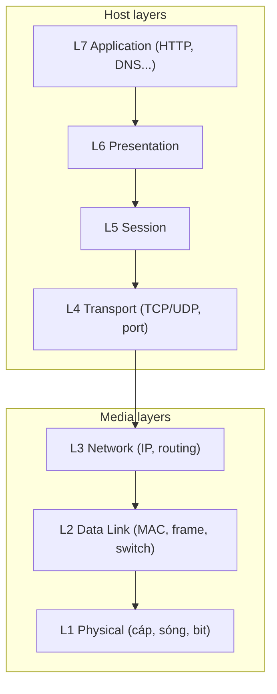

# OSI Model

> **TL;DR:** Mô hình OSI 7 tầng là **khung khái niệm** chia networking thành 7 thành phần, từ Physical (L1) tới Application (L7). Nó không phải lúc nào cũng khớp cách phần mềm mạng thực sự được cài đặt, nhưng là nền tảng tốt nhất để hiểu mọi thứ trong AWS dùng mạng ra sao — VPC, subnet, Security Group, NACL, load balancer, VPN, Direct Connect...

## 🖼️ Sơ đồ
![[OSI Model.excalidraw]]
*Mở bằng plugin Excalidraw để chỉnh sửa · ảnh tĩnh: [[OSI Model.svg]]*

## Khái niệm cốt lõi
- Mọi tương tác với AWS — gọi API, kết nối on-prem với AWS, traffic giữa các dịch vụ — đều dùng networking. Kiến trúc sư, developer hay sysadmin đều cần hiểu nền tảng này.
- Chuỗi bài "Network Starter Pack" đi từ **local networking** (dữ liệu đi giữa thiết bị trong mạng cục bộ) → **routing** (dữ liệu đi qua internet, qua nhiều mạng nối nhau) → cách dữ liệu được chia nhỏ để truyền tin cậy, **port**, **session**.
- **7 tầng** (dưới lên): Physical → Data Link → Network → Transport → Session → Presentation → Application.
- **Networking stack**: phần mềm thực hiện chức năng các tầng. Laptop, điện thoại, router Wi-Fi, web server... đều có networking stack.
- **Hai nhóm tầng**:
  - **Media layers** (L1–L3): dữ liệu **di chuyển từ điểm A tới điểm B** — cùng mạng LAN hay ở hai đầu Trái Đất.
  - **Host layers** (L4–L7): dữ liệu được **chia nhỏ, ráp lại** để truyền, và được **định dạng** để hai đầu hiểu nhau.
- Luồng khái niệm: ứng dụng L7 (ví dụ Firefox) → dữ liệu đi **xuống** các tầng ở máy gửi → qua môi trường vật lý (L1, card mạng) → đi **lên** các tầng ở máy nhận → web server L7.
- **Quy ước "thiết bị Layer X"**: thiết bị có chức năng của tầng X **và mọi tầng bên dưới**. Ví dụ thiết bị Layer 3 hiểu L1, L2, L3. (Nêu trong bài Layer 1.)

## Cách hoạt động / Kiến trúc

## Bảng so sánh / số liệu
| Tầng | Tên | Đơn vị dữ liệu | Định danh / chức năng chính | Thiết bị/khái niệm tiêu biểu | Note chi tiết |
|---|---|---|---|---|---|
| L1 | Physical | bit | Chuẩn truyền/nhận bit trên môi trường chung | Cáp đồng, fiber, Wi-Fi, **hub** | [[Layer 1 Physical]] |
| L2 | Data Link | frame | **MAC address**, CSMA/CD, encapsulation | **Switch**, Ethernet | [[Layer 2 Data Link]] |
| L3 | Network | packet | **IP address**, routing giữa các mạng | **Router**, ARP, route table | [[Layer 3 Network]] |
| L4 | Transport | segment | **Port**, TCP (tin cậy, có thứ tự) / UDP | Firewall L4 | [[Layer 4 Transport]] |
| L5 | Session | — | Phiên hội thoại, stateful | Stateful firewall | [[Layer 4 Transport]], [[Stateful vs Stateless Firewalls]] |
| L6 | Presentation | — | Định dạng, mã hóa (TLS thường xếp ở đây/L5-6) | TLS | [[SSL and TLS]] |
| L7 | Application | — | Giao thức ứng dụng | HTTP, DNS, ALB, WAF | [[Layer 7 Firewall]], [[DNS Fundamentals]] |

### Ánh xạ sang AWS (để định hướng)
- L3/L4: [[NACL]] (stateless, lọc IP/port/protocol), [[Security Groups]] (stateful), [[Compare - ALB vs NLB|NLB]] (L4).
- L7: ALB ([[Elastic Load Balancer]]), [[WAF]], [[CloudFront Architecture|CloudFront]].
- L2 không lộ ra cho khách hàng trong VPC (AWS trừu tượng hóa), nhưng [[Direct Connect]] dùng VLAN 802.1Q ở L2.

## 🎯 Mẹo thi SAA-C03
- Đề hay nói "Layer 4 load balancing", "Layer 7 firewall", "inspect HTTP headers" → cần biết dịch vụ nào hoạt động ở tầng nào: NLB = L4 (TCP/UDP/TLS), ALB = L7 (HTTP/HTTPS, đọc path/host/header), WAF = L7, NACL/SG = L3–L4.
- Nhớ nguyên tắc "thiết bị Layer X hiểu mọi tầng ≤ X": thiết bị L7 có thể ra quyết định dựa trên thông tin mọi tầng bên dưới.

## Liên kết
- Chuỗi bài: [[Layer 1 Physical]] → [[Layer 2 Data Link]] → [[Layer 3 Network]] → [[Layer 4 Transport]] → [[NAT Fundamentals]] → [[Subnetting]]
- Bổ trợ: [[Decimal and Binary Conversion]]
- Ứng dụng trong AWS: [[VPC Sizing and Structure]], [[Stateful vs Stateless Firewalls]], [[Elastic Load Balancer]], [[Layer 7 Firewall]]
