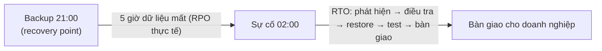
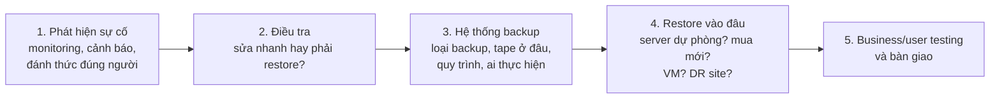

# RPO and RTO

> **TL;DR:** **RPO (Recovery Point Objective)** = lượng dữ liệu tối đa (tính bằng thời gian) doanh nghiệp chấp nhận mất khi có sự cố — trường hợp xấu nhất bằng **khoảng cách giữa hai lần backup thành công**. **RTO (Recovery Time Objective)** = thời gian tối đa hệ thống được phép ngừng hoạt động, tính **end-to-end từ lúc sự cố xảy ra tới khi bàn giao lại cho doanh nghiệp** đã kiểm thử. Giá trị càng thấp càng khắt khe và càng tốn kém; kiến trúc sư phải tìm điểm "Goldilocks" sát nhu cầu thật.

## 🖼️ Sơ đồ
![[RPO and RTO.excalidraw]]
*Mở bằng plugin Excalidraw để chỉnh sửa · ảnh tĩnh: [[RPO and RTO.svg]]*

## Khái niệm cốt lõi
- Hai giá trị này thường do **doanh nghiệp đưa ra**, hoặc kiến trúc sư phải cùng stakeholder xác định. Sai giá trị có thể gây hậu quả rất lớn.
- Mỗi doanh nghiệp, thậm chí **mỗi hệ thống trong cùng doanh nghiệp**, có RPO/RTO khác nhau: ngân hàng gần như không chấp nhận mất dữ liệu cho hệ thống tài chính nhưng chấp nhận RPO cao hơn cho website; cửa hàng online có thể chấp nhận mất một ít đơn hàng; quán cà phê chấp nhận website ngừng lâu.
- Hệ thống càng quan trọng → RPO/RTO càng **thấp** (khắt khe). Hệ thống ít quan trọng, dữ liệu ít thay đổi → chấp nhận giá trị cao hơn.

### RPO — Recovery Point Objective
- **Định nghĩa**: lượng dữ liệu tối đa, biểu diễn bằng thời gian (phút/giờ), có thể mất trong tình huống DR trước khi vượt mức chịu đựng của tổ chức. "RPO 6 giờ" = không chấp nhận mất quá 6 giờ dữ liệu.
- **Recovery point** = một bản backup thành công có thể restore.
  - Với full backup: mỗi backup thành công = một recovery point.
  - Với full + incremental: để restore một recovery point có thể cần **bản full gần nhất + mọi incremental** giữa bản full đó và incremental tốt gần nhất → một recovery point có thể cần nhiều backup.
- Dữ liệu mất = thời gian từ **recovery point gần nhất** tới **lúc sự cố**.
- Quy tắc: backup **ít nhất bằng tần suất RPO**, tốt hơn là **thường xuyên hơn** để dự phòng backup lỗi (RPO 6h → backup mỗi 3h hoặc mỗi giờ).
- RPO thấp → backup thường xuyên hơn → chi phí cao hơn (media, licensing, quản trị...).

### RTO — Recovery Time Objective
- **Định nghĩa**: thời gian tối đa chấp nhận được mà hệ thống ngừng hoạt động sau sự cố.
- **Đồng hồ bắt đầu chạy lúc sự cố xảy ra**, và **chỉ dừng khi hệ thống được bàn giao lại cho doanh nghiệp ở trạng thái đã kiểm thử đầy đủ** — không phải lúc kỹ thuật "sửa xong".
- RTO không chỉ là chuyện kỹ thuật: các yếu tố phi kỹ thuật thường ảnh hưởng nhiều nhất.

## Cách hoạt động / Kiến trúc

### Ví dụ RPO (trung tâm cứu hộ động vật, 1 server, không redundancy)
- Full backup mỗi 6 giờ: 15:00, 21:00, 03:00, 09:00.
- Server hỏng lúc **02:00** → recovery point gần nhất 21:00 → mất **5 giờ** dữ liệu.
- Hỏng ngay sau backup 21:00 → mất gần 0; hỏng lúc 03:00 ngay trước khi backup chạy xong → mất **6 giờ**.
- Mất mát tối đa = **khoảng cách giữa hai backup thành công** (0 → 6 giờ).

### Ví dụ RTO
- Sự cố lúc **22:00**, backup gần nhất 21:00 (mất 1 giờ dữ liệu). RTO = **13 giờ** → phải bàn giao hệ thống hoạt động đầy đủ trước **11:00** hôm sau.
- Các giai đoạn tiêu tốn thời gian trong RTO:

1. **Phát hiện**: phải biết hệ thống hỏng mới bắt đầu khôi phục được. Có monitoring không, có tin cậy không (quá nhiều false positive → người ta phớt lờ cảnh báo), thông báo thế nào, có đánh thức **đúng người có quyền quyết định** không? Ngay cả ứng dụng Internet lớn thường mất **15–30 phút** sau sự cố mới bắt đầu điều tra.
2. **Điều tra**: có thể sửa nhanh hoặc server "đang cháy"; cần người ra quyết định restore.
3. **Backup system**: loại backup nào (một số restore lâu hơn), tape ở đâu, tape drive/loader ở đâu, có quy trình được tài liệu hóa và kiểm thử không, người thực hiện có sẵn và tỉnh táo không. Thiếu quy trình + căng thẳng ban đêm = dễ sai sót.
4. **Restore vào đâu**: có máy dự phòng không, phải đặt mua phần cứng mới (có thể **thêm nhiều ngày**), server vật lý hay ảo, hay phải chuyển sang DR site vì cả phòng server cũng hỏng. Quy trình kém hay thông báo chậm thêm vài giờ; đặt phần cứng mới thêm vài ngày.
5. **Testing và bàn giao**: business test, user test, bàn giao cuối — không nhanh và bắt buộc trước khi coi là khôi phục xong.

### Cách giảm RTO
Lập kế hoạch trước, monitoring, notification, quy trình chính thức, **phần cứng dự phòng**, đào tạo, và hệ thống hiệu quả hơn như **máy ảo hoặc AWS**.

## Bảng so sánh / số liệu

| | RPO | RTO |
|---|---|---|
| Đo cái gì | Lượng **dữ liệu** mất tối đa (tính bằng thời gian) | **Thời gian** ngừng hoạt động tối đa |
| Câu hỏi | "Chấp nhận mất bao nhiêu dữ liệu?" | "Chấp nhận ngừng bao lâu?" |
| Trường hợp xấu nhất | Thời gian giữa 2 backup thành công | Toàn bộ quy trình phát hiện → bàn giao |
| Giảm bằng cách | Backup/replication thường xuyên hơn | Planning, monitoring, process, spare hardware, training, ảo hóa/AWS |
| Chi phí | RPO thấp → tốn hơn | RTO thấp → tốn hơn |

## 🎯 Mẹo thi SAA-C03
- Từ khóa: "mất tối đa X phút dữ liệu" → **RPO**; "phải khôi phục trong X phút/giờ" → **RTO**. Đề thường cho cả hai và yêu cầu chọn giải pháp **rẻ nhất vẫn đáp ứng**.
- Thứ tự chiến lược DR trên AWS (kiến thức ngoài bài này, rất hay gặp): **Backup & Restore** (RPO/RTO giờ, rẻ nhất) → **Pilot Light** (chục phút) → **Warm Standby** (phút) → **Multi-site Active/Active** (gần 0, đắt nhất).
- Liên hệ dịch vụ: snapshot/backup định kỳ ([[EBS Snapshots]], [[RDS Backups and Restore]] — PITR tới ~5 phút, [[AWS Backup]]) quyết định RPO; replication liên tục ([[RDS Multi-AZ]], [[Aurora Global Database]] — RPO ~1 giây, RTO < 1 phút, [[DynamoDB Global Tables]], [[S3 Replication]] với RTC 15 phút) cho RPO rất thấp.
- RTO thấp cần hạ tầng sẵn sàng/tự động: [[Auto Scaling Groups]], [[R53 Failover Routing]], AMI dựng sẵn ([[AMI]]), IaC ([[CloudFormation Basics]]).
- Phân biệt với khái niệm HA/FT/DR: xem [[HA vs FT vs DR]].

## Liên kết
- Liên quan: [[HA vs FT vs DR]], [[Regional and Global Architecture]]
- Dịch vụ ảnh hưởng RPO: [[EBS Snapshots]], [[RDS Backups and Restore]], [[AWS Backup]], [[S3 Replication]], [[Aurora Global Database]], [[DynamoDB Global Tables]]
- Dịch vụ ảnh hưởng RTO: [[RDS Multi-AZ]], [[R53 Failover Routing]], [[Auto Scaling Groups]], [[AMI]], [[CloudFormation Basics]], [[CloudWatch Basics]] (monitoring/cảnh báo)
