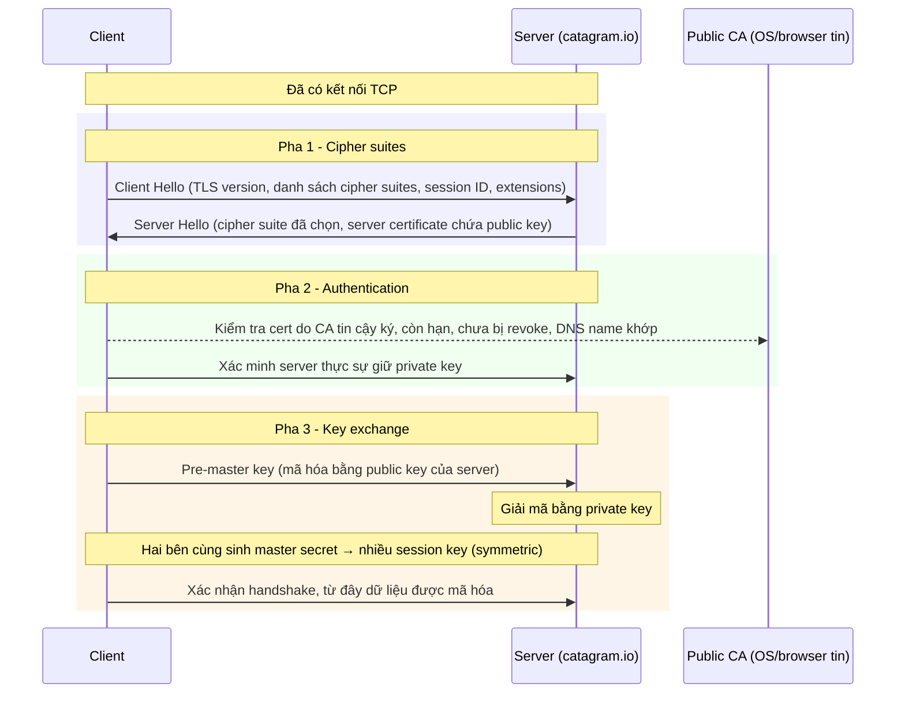

# SSL and TLS

> **TL;DR:** SSL (Secure Sockets Layer) và TLS (Transport Layer Security) cung cấp **privacy** (mã hóa), **identity verification** (xác thực server qua certificate do CA ký) và **data integrity** giữa client và server. TLS là phiên bản mới, an toàn hơn của SSL. Handshake gồm 3 pha trên một kết nối TCP sẵn có: **thỏa thuận cipher suite → xác thực → trao đổi khóa**, chuyển từ asymmetric sang symmetric encryption. Đây là nền tảng của HTTPS và của [[ACM]], [[CloudFront and SSL]], [[SSL Offload and Session Stickiness]].

## 🖼️ Sơ đồ
![[SSL and TLS.excalidraw]]
*Mở bằng plugin Excalidraw để chỉnh sửa · ảnh tĩnh: [[SSL and TLS.svg]]*

## Khái niệm cốt lõi
TLS thực hiện ba chức năng, thường đi cùng nhau:
1. **Privacy (bảo mật)**: dữ liệu giữa client và server được mã hóa; chỉ hai bên đọc được.
   - Bắt đầu bằng **asymmetric encryption**: server công bố public key, client dùng nó để mã hóa dữ liệu mà chỉ server (có private key) giải được → không cần trao khóa qua kênh an toàn khác.
   - Asymmetric tốn tài nguyên tính toán → TLS chuyển sang **symmetric encryption** càng sớm càng tốt cho phần truyền dữ liệu lâu dài (xem [[Encryption Fundamentals]]).
2. **Identity verification**: xác minh server bạn kết nối đúng là `netflix.com` chứ không phải kẻ giả mạo. TLS hỗ trợ xác thực **hai chiều** (mutual TLS), nhưng phổ biến nhất là **client xác thực server**.
3. **Reliable connection / integrity**: phát hiện dữ liệu bị sửa đổi trên đường truyền.

### Các thành phần
- **Cipher suite**: bộ thuật toán TLS sử dụng, gồm **key exchange algorithm**, **bulk encryption algorithm** và **MAC (Message Authentication Code) algorithm**. Client và server phải dùng chung một cipher suite.
- **Certificate**: "tài liệu" chứa **public key**, **DNS name** và thông tin tổ chức của server.
- **Public Certificate Authority (CA)**: bên thứ ba độc lập; hệ điều hành và trình duyệt tin tưởng một danh sách CA (do vendor OS/browser quản lý).
- **CSR (Certificate Signing Request)**: server tạo cặp khóa public/private, sinh CSR gửi CA → CA trả về **signed certificate**. Vì OS/browser tin CA, chúng tin certificate do CA đó ký (cơ chế ký: [[Digital Signatures]]).

## Cách hoạt động / Kiến trúc
TLS bắt đầu khi **đã có kết nối TCP** (Layer 4, xem [[Layer 4 Transport]]). Kết thúc 3 pha là một kênh truyền được mã hóa.

### Pha 1 — Cipher suites
- **Client Hello**: phiên bản SSL/TLS, danh sách cipher suite client hỗ trợ, session ID, extensions.
- Nếu server không hỗ trợ cipher suite nào trong danh sách → kết nối **thất bại**. Nếu có, server chọn một và gửi lại trong **Server Hello**, kèm **server certificate** (chứa public key).

### Pha 2 — Authentication
Nếu client mặc nhiên tin public key nhận được, ai cũng có thể dựng server giả `netflix.com`. Vì vậy client kiểm tra:
- Certificate được ký bởi **một CA mà OS/browser tin tưởng**.
- Certificate **chưa hết hạn** và **chưa bị thu hồi (revoked)**.
- **DNS name** đang truy cập khớp với tên (hoặc một trong các tên) trên certificate.
- Server thực sự **có private key** tương ứng (khóa học mô tả là client mã hóa dữ liệu ngẫu nhiên bằng public key rồi xem server có xử lý được không; trong TLS hiện đại việc này thể hiện qua key exchange/chữ ký của server — bản chất vẫn là chứng minh sở hữu private key).

### Pha 3 — Key exchange
- Client sinh **pre-master key**, mã hóa bằng public key của server, gửi đi; server giải mã bằng private key → hai bên có cùng pre-master key.
- Theo cipher suite, cả hai cùng biến pre-master key thành **master secret** giống nhau.
- Master secret sinh ra nhiều **session key** (symmetric) dùng suốt vòng đời kết nối để mã hóa/giải mã.
- Hai bên xác nhận handshake → mọi giao tiếp sau đó được mã hóa.

Quy trình này diễn ra **mỗi lần** bạn kết nối HTTPS.

## Bảng so sánh / số liệu

| Pha | Mục đích | Kết quả |
|---|---|---|
| 1. Cipher suites | Thống nhất cách giao tiếp | Client có certificate + public key của server |
| 2. Authentication | Chứng minh server là thật | Client tin danh tính server |
| 3. Key exchange | Chuyển asymmetric → symmetric an toàn | Session key chung, kênh mã hóa |

## 🎯 Mẹo thi SAA-C03
- "Encryption in transit" trên AWS = TLS/HTTPS. Certificate public miễn phí và tự gia hạn → [[ACM]]. ACM cert dùng được với [[Elastic Load Balancer|ELB]], [[CloudFront and SSL|CloudFront]] (cert phải ở **us-east-1**), [[API Gateway]] — không export ra EC2 được (cert public).
- **SSL termination/offload tại ALB** vs **SSL passthrough qua NLB** (end-to-end encryption tới instance): xem [[SSL Offload and Session Stickiness]] và [[Compare - ALB vs NLB]].
- Certificate phải khớp **DNS name** → lý do cần cert cho custom domain trên CloudFront/ALB; SNI cho phép nhiều cert trên một IP.
- SSL là tên cũ, mọi thứ hiện đại thực chất dùng TLS (khuyến nghị TLS 1.2+); đề vẫn hay viết "SSL/TLS".

## Liên kết
- Tiên quyết: [[Encryption Fundamentals]], [[Layer 4 Transport]], [[Hashing]], [[Digital Signatures]]
- Ứng dụng AWS: [[ACM]], [[CloudFront and SSL]], [[SSL Offload and Session Stickiness]], [[Elastic Load Balancer]], [[KMS]]
- Liên quan: [[DNS Fundamentals]] (DNS name trên cert), [[DNSSEC]] (chuỗi tin cậy tương tự CA)
- Phân biệt với: [[Compare - ALB vs NLB]] (nơi kết thúc TLS)
