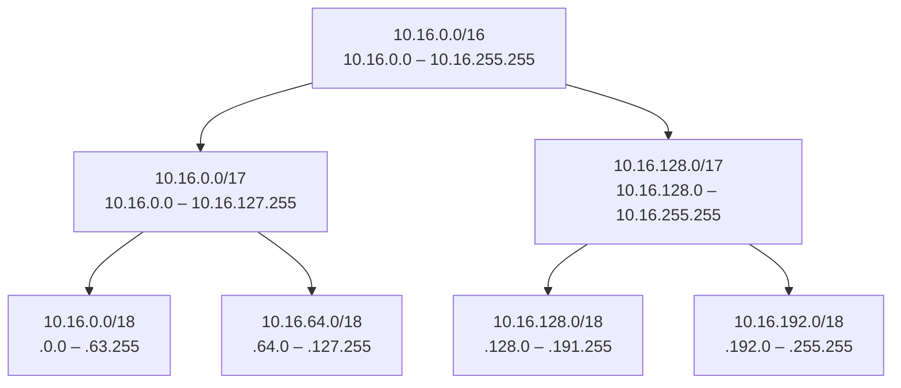

# Subnetting

> **TL;DR:** Không gian IPv4 (~4,29 tỷ địa chỉ) từng được chia theo class A/B/C; ngày nay dùng **CIDR** với prefix (`/16`, `/24`...) để chia mạng linh hoạt. **Subnetting** là chia đôi liên tục một dải lớn thành các mạng con có prefix lớn hơn (nhỏ hơn). Đây là kỹ năng nền để thiết kế dải IP cho [[VPC Sizing and Structure|VPC]] và [[VPC Subnets|subnet]] trên AWS mà không bị chồng lấn.

## 🖼️ Sơ đồ
![[Subnetting.excalidraw]]
*Mở bằng plugin Excalidraw để chỉnh sửa · ảnh tĩnh: [[Subnetting.svg]]*

## Khái niệm cốt lõi

### Không gian địa chỉ IPv4
- Chuẩn hóa năm **1981** trong **RFC 791**; vẫn là giao thức Layer 3 phổ biến nhất.
- Dải `0.0.0.0` → `255.255.255.255` = **4.294.967.296** địa chỉ — ít hơn một địa chỉ/người (dân số ~8 tỷ). Nguồn cung IPv4 về cơ bản **đã cạn**.
- Quản lý bởi **IANA**, một phần ủy quyền cho các cơ quan khu vực (**RIPE, ARIN, APNIC**...). IP public phải **được cấp phát**, không được tự chọn.

### Các class (lịch sử)

| Class | Dải | Số mạng | IP mỗi mạng | Phần network | Dùng cho |
|---|---|---|---|---|---|
| A | 0.0.0.0 – 127.255.255.255 | 128 (0.x reserved) | 16.777.216 | Octet 1 (= `/8`) | Tổ chức khổng lồ thời đầu Internet (Apple, Ford, US Postal, quân đội Mỹ) |
| B | 128.0.0.0 – 191.255.255.255 | 16.384 | 65.536 | 2 octet (= `/16`) | Doanh nghiệp lớn |
| C | 192.0.0.0 – 223.255.255.255 | 2.097.152 | 256 | 3 octet (= `/24`) | Doanh nghiệp nhỏ |
| D | — | — | — | — | Multicast |
| E | — | — | — | — | Reserved |

Nhiều dải class A/B cũ đã được trả lại và nay do các cơ quan khu vực cấp phát.

### Private IPv4 — RFC 1918
Dùng tự do, tái sử dụng bao nhiêu lần cũng được, nhưng **không route được trên Internet** → cần [[NAT Fundamentals|NAT]] để ra Internet.

| Dải | Cấu trúc | Số địa chỉ | Hay dùng ở |
|---|---|---|---|
| `10.0.0.0/8` (10.0.0.0 – 10.255.255.255) | 1 mạng class A | 16,7 triệu | Môi trường cloud, chia nhỏ thành nhiều subnet |
| `172.16.0.0/12` (172.16.0.0 – 172.31.255.255) | 16 mạng class B | 65.536 mỗi mạng | AWS **[[Default VPC]] dùng `172.31.0.0/16`** |
| `192.168.0.0/16` (192.168.0.0 – 192.168.255.255) | 256 mạng class C | 256 mỗi mạng | Mạng gia đình, văn phòng nhỏ |

- Nguyên tắc vàng: **tránh dùng trùng (overlap) dải** giữa các mạng, kể cả khi là private. Nếu sau này cần kết nối các mạng với nhau (VPN, peering...) mà dải trùng nhau thì rất khó hoặc không thể cấu hình.

### IPv6
- Không gian IPv6 ≈ **3,4 × 10^38** địa chỉ (340 undecillion; khóa học gọi là "340 sextillion"). Để hình dung: ~670 quadrillion địa chỉ mỗi mm² bề mặt Trái Đất, ~50 octillion mỗi người, tương đương ~7,9 × 10^28 "Internet IPv4".
- Địa chỉ IP không còn là tài nguyên khan hiếm → gần như không cần quản lý IP chi tiết, không cần private addressing/NAT.

### CIDR và prefix
- **CIDR (Classless Inter-Domain Routing)** cho phép chia mạng không theo class, biểu diễn kích thước bằng **prefix**: `10.16.0.0/16` → 16 bit đầu (10.16) là network, phần còn lại là host.
- `/8` ≈ class A, `/16` ≈ class B, `/24` ≈ class C, `/32` = một IP duy nhất, `/0` (`0.0.0.0/0`) = toàn bộ Internet (dùng làm **default route**).
- **Prefix càng lớn → mạng càng nhỏ.** Mỗi lần tăng prefix 1 đơn vị, mạng giảm một nửa.
- `10.16.0.0/16` là một mạng con nằm trong `10.0.0.0/8` (dải private class A).

## Cách hoạt động / Kiến trúc

### Quy trình subnetting (chia đôi)
1. Tính **điểm đầu và điểm cuối** của mạng gốc.
2. Chia đôi, **tăng prefix thêm 1**: subnet 1 bắt đầu ở đầu dải gốc, subnet 2 bắt đầu ở **điểm giữa** phần host.
3. Lặp lại cho tới khi đủ số subnet cần.

Ví dụ cần 4 subnet từ `10.16.0.0/16`:

- Thường chia thành 2, 4, 8... subnet, nhưng **số lẻ vẫn hợp lệ**: ví dụ giữ nguyên một `/17` và chỉ chia nửa kia thành hai `/18` → 3 subnet.
- Để thành thạo cần nắm [[Decimal and Binary Conversion]] và cách subnet mask/prefix hoạt động (xem [[Layer 3 Network]]); luyện nhiều sẽ thành phản xạ.

### Bảng nhanh kích thước theo prefix

| Prefix | Số địa chỉ | Ghi chú |
|---|---|---|
| /8 | 16.777.216 | Class A |
| /16 | 65.536 | Class B; kích thước VPC lớn nhất trên AWS |
| /17 | 32.768 | Nửa /16 |
| /18 | 16.384 | Một phần tư /16 |
| /24 | 256 | Class C |
| /28 | 16 | Subnet/VPC nhỏ nhất trên AWS |
| /32 | 1 | Một host (hay gặp trong rule SG/NACL) |

## 🎯 Mẹo thi SAA-C03
- Nhớ 3 dải **RFC 1918**: `10.0.0.0/8`, `172.16.0.0/12`, `192.168.0.0/16`. Default VPC luôn là **`172.31.0.0/16`**.
- Đề có kịch bản kết nối nhiều VPC/on-premises (peering, VPN, Transit Gateway) → dải CIDR **không được overlap**; "chọn CIDR nào" thì loại đáp án trùng dải đã có (xem [[VPC Peering]], [[Transit Gateway]]).
- Prefix lớn hơn = ít IP hơn. AWS VPC IPv4 cho phép từ **/28 tới /16**; mỗi subnet AWS giữ lại **5 IP** (chi tiết ở [[VPC Sizing and Structure]] và [[VPC Subnets]], không thuộc bài này).
- `0.0.0.0/0` = default route (mọi đích) — gặp trong route table trỏ tới IGW/NAT Gateway; với IPv6 là `::/0`.
- IPv6 không cần NAT, mọi địa chỉ IPv6 trên AWS là public-routable (kiểm soát outbound-only bằng [[Egress-Only Internet Gateway]]).

## Liên kết
- Tiên quyết: [[Layer 3 Network]], [[Decimal and Binary Conversion]]
- Liên quan: [[NAT Fundamentals]], [[VPC Sizing and Structure]], [[VPC Subnets]], [[Custom VPC]], [[Default VPC]]
- Ứng dụng: [[VPC Peering]], [[Transit Gateway]], [[Site-to-Site VPN]], [[Egress-Only Internet Gateway]]
