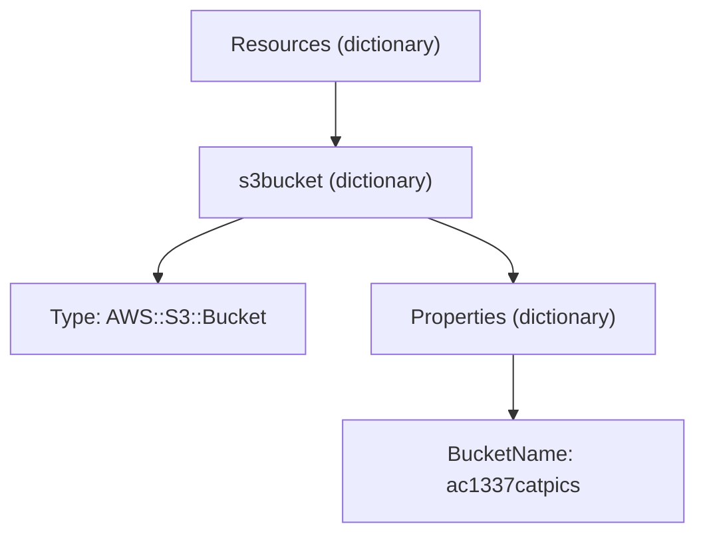

# YAML

> **TL;DR:** YAML ("YAML Ain't Markup Language" — acronym đệ quy) là ngôn ngữ **serialize dữ liệu/cấu hình, dễ đọc cho người**, dùng **thụt lề bằng dấu cách** để thể hiện cấu trúc. Trong AWS, YAML là một trong hai định dạng viết template [[CloudFormation Basics|CloudFormation]] (cùng với [[JSON]]).

## 🖼️ Sơ đồ
![[YAML.excalidraw]]
*Mở bằng plugin Excalidraw để chỉnh sửa · ảnh tĩnh: [[YAML.svg]]*

## Khái niệm cốt lõi
- Một tài liệu YAML ở top level là **tập hợp key: value không có thứ tự** (unordered) — một **dictionary**. YAML không áp đặt thứ tự; quy ước/thứ tự (nếu có) là do tool/chuẩn khác đặt ra.
- **Kiểu dữ liệu của value**: string, number (`1`, `2`), float (`1.337`), boolean (`true`/`false`), `null`, **list**, **dictionary** — và lồng nhau tùy ý.
- **String**: dấu nháy là tùy chọn (`penny` hay `"penny"` đều hợp lệ), nhưng đặt trong nháy thường an toàn và rõ ràng hơn.
- **List** (array): tập giá trị **có thứ tự**. Hai cách viết tương đương:
  ```yaml
  # inline
  adrianscats: ["roffle", "truffles", penny, winkie]
  # block: mỗi phần tử một dòng, bắt đầu bằng gạch ngang, cùng mức thụt lề
  adrianscats:
    - roffle
    - truffles
    - penny
    - winkie
  ```
- **Dictionary**: tập key: value **không thứ tự**. Phần tử của list có thể là dictionary:
  ```yaml
  adrianscats:
    - name: roffle
      color: [black, white]   # value là list
    - name: truffles
      color: "mixed"
    - name: winkie
      color: "white"
      numofeyes: 1            # dictionary có thể có thêm key
  ```
  → `adrianscats` là một **list các dictionary**; mỗi dictionary có `name`, `color`, riêng `winkie` có thêm `numofeyes`.
- **Thụt lề là cú pháp**:
  - Luôn dùng **dấu cách** (không dùng tab).
  - Cùng mức thụt lề = cùng một cấu trúc; thụt sâu hơn = **nằm bên trong** cái thụt nông hơn.
- YAML được ứng dụng đọc vào / ghi ra, thường dùng để **lưu và truyền cấu hình**.

## Cách hoạt động / Kiến trúc
Ví dụ template CloudFormation tối giản tạo một S3 bucket:
```yaml
Resources:                 # mức 1: key top-level (template còn có Parameters, Outputs, Conditions...)
  s3bucket:                # mức 2: logical resource, là dictionary trong Resources
    Type: "AWS::S3::Bucket"  # mức 3: loại resource sẽ tạo
    Properties:            # mức 3: cùng cấp với Type, cùng nằm trong s3bucket
      BucketName: "ac1337catpics"   # mức 4: tên vật lý của bucket
```

- Quy tắc đọc: số mức thụt lề **cao hơn nằm trong** mức thấp hơn; **bằng nhau** = cùng cấu trúc cha.

## Bảng so sánh / số liệu
| Khái niệm | YAML | JSON |
|---|---|---|
| Tập key-value không thứ tự | dictionary | object `{}` |
| Tập giá trị có thứ tự | list (`-` hoặc `[]`) | array `[]` |
| Cấu trúc thể hiện bằng | **thụt lề (spaces)** | dấu ngoặc `{}` `[]` (thụt lề không bắt buộc) |
| Dùng trong AWS (theo khóa học) | CloudFormation | CloudFormation **và** IAM policy |

## 🎯 Mẹo thi SAA-C03
- SAA-C03 không bắt viết YAML, nhưng cần **đọc hiểu** đoạn template CloudFormation trong đề (Resources → logical ID → Type/Properties).
- CloudFormation chấp nhận cả YAML và JSON; **IAM/resource policy chỉ JSON**.
- Khóa học nói "YAML chỉ dùng cho CloudFormation"; thực tế hiện nay YAML còn xuất hiện ở vài chỗ khác (ví dụ AWS SAM, SSM documents, CodeBuild buildspec), nhưng policy quyền vẫn là JSON.

## Liên kết
- So sánh với: [[JSON]]
- Dùng trong: [[CloudFormation Basics]], [[CFN Physical and Logical Resources]], [[CFN Template and Pseudo Parameters]], [[CFN Intrinsic Functions]]
- Liên quan: [[S3 Basics]] (resource trong ví dụ)
