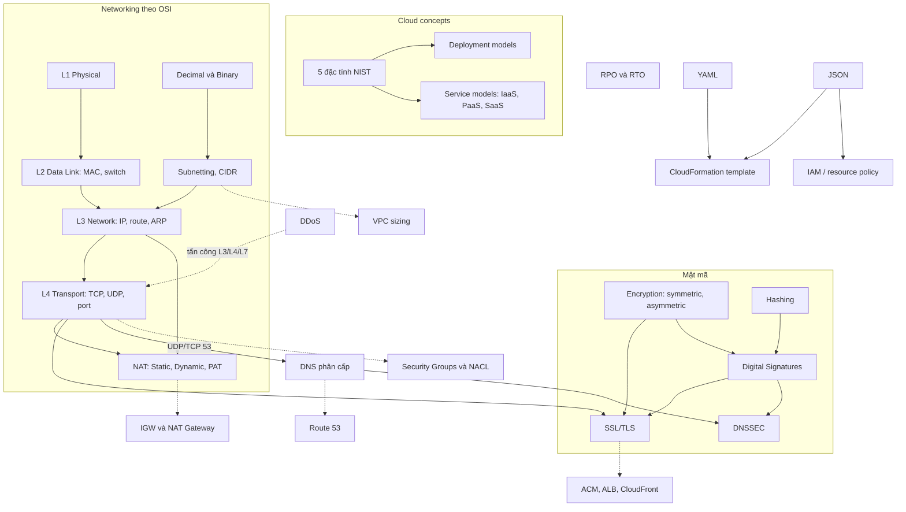

# 02 Tech Fundamentals

Section kiến thức nền không riêng AWS: định nghĩa cloud, YAML/JSON, mật mã (encryption, hashing, chữ ký số, TLS), mạng theo mô hình OSI từ Layer 1 tới Layer 4, NAT, subnetting, DNS/DNSSEC, DDoS và RPO/RTO. Đề không hỏi trực tiếp lý thuyết này, nhưng hầu hết các section VPC, Route 53, load balancing, hybrid và security sau này đều dựa vào nó. Người đã có nền mạng/bảo mật có thể đọc nhanh, tập trung vào mục Mẹo thi để thấy chỗ nó ánh xạ sang AWS.

← [[00 Home]] · Section trước: [[_MOC 01 Accounts and Basics]] · Section tiếp theo: [[_MOC 03 AWS Fundamentals]] →

## Lộ trình học
1. [[Cloud Computing Definition]]: theo NIST SP 800-145, cloud phải thỏa đủ 5 đặc tính: on-demand self-service, broad network access, resource pooling, rapid elasticity, measured service.
2. [[Cloud Deployment Models]]: public, private, multi-cloud, hybrid cloud; public cloud + on-prem truyền thống chỉ là hybrid environment, không phải hybrid cloud.
3. [[Cloud Service Models]]: On-prem, IaaS, PaaS, SaaS khác nhau ở phần vendor quản lý; ranh giới là unit of consumption.
4. [[YAML]]: định dạng dữ liệu dễ đọc, thụt lề bằng dấu cách; một trong hai định dạng template CloudFormation.
5. [[JSON]]: định dạng trao đổi dữ liệu nhẹ, dùng cho cả CloudFormation template lẫn mọi policy document.
6. [[Encryption Fundamentals]]: at rest vs in transit, symmetric vs asymmetric, signing và steganography.
7. [[OSI Model]]: khung 7 tầng từ Physical tới Application để hiểu dịch vụ AWS nào hoạt động ở tầng nào.
8. [[Layer 1 Physical]]: truyền bit thô trên môi trường dùng chung; không địa chỉ, không phát hiện collision; hub.
9. [[Layer 2 Data Link]]: frame, MAC address, CSMA/CD; switch học MAC theo port, tách collision domain.
10. [[Decimal and Binary Conversion]]: đổi IPv4 dotted decimal ↔ 32 bit nhị phân, nền để đọc prefix và CIDR.
11. [[Layer 3 Network]]: IP bắc qua nhiều mạng L2; IP address, subnet mask, route table, router, ARP; packet đi từng hop.
12. [[Layer 4 Transport]]: TCP (tin cậy, có thứ tự) và UDP (nhanh); port well-known vs ephemeral; stateless vs stateful firewall.
13. [[NAT Fundamentals]]: Static NAT (cách IGW hoạt động), Dynamic NAT, PAT many:1 (cách NAT Gateway hoạt động).
14. [[Subnetting]]: class → CIDR, RFC 1918, chia đôi dải lớn thành subnet; nền để thiết kế VPC không chồng lấn.
15. [[DDoS]]: ba nhóm tấn công L7 (HTTP flood), protocol (SYN flood), volumetric (DNS amplification); cần Shield, WAF, CloudFront.
16. [[SSL and TLS]]: privacy, xác thực server qua certificate CA, integrity; handshake 3 pha chuyển từ asymmetric sang symmetric.
17. [[Hashing]]: hàm một chiều cho giá trị độ dài cố định; dùng cho mật khẩu, kiểm tra toàn vẹn; MD5 có collision.
18. [[Digital Signatures]]: ký hash bằng private key, verify bằng public key → integrity (what) + authenticity (who).
19. [[DNS Fundamentals]]: DNS phân cấp root → TLD → domain, resolver "walk the tree" tới name server authoritative; registrar vs DNS hosting.
20. [[DNSSEC]]: thêm origin authentication và integrity cho DNS bằng chữ ký số; ZSK, KSK, RRSIG, DS và chain of trust từ root.
21. [[RPO and RTO]]: RPO = lượng dữ liệu tối đa được mất, RTO = thời gian ngừng tối đa; càng thấp càng đắt.

## Bản đồ khái niệm

## Liên kết sang section khác
- [[VPC Sizing and Structure]]: áp dụng trực tiếp subnetting, CIDR, 5 IP AWS giữ lại.
- [[VPC Routing and Internet Gateway]]: route table, default route, IGW là static NAT.
- [[NAT Gateway]]: PAT many:1 cho private subnet.
- [[Compare - Security Groups vs NACL]]: stateful vs stateless, ephemeral ports.
- [[Compare - ALB vs NLB]]: Layer 7 vs Layer 4 load balancing, SSL offload vs passthrough.
- [[Route 53 Fundamentals]]: DNS trên AWS, registrar và hosted zone.
- [[KMS]]: quản lý key cho encryption at rest.
- [[ACM]]: certificate TLS miễn phí cho ELB, CloudFront, API Gateway.
- [[Shield]]: sản phẩm chống DDoS (kèm WAF cho Layer 7).
- [[Direct Connect]]: kết nối vật lý L1, VLAN 802.1Q, BGP.

## 🎯 Top mẹo thi của section
- "Chạy dịch vụ AWS ngay trong data center của mình" → **AWS Outposts**; "kết nối VPC với on-prem" là hybrid networking, không phải private cloud ([[Cloud Deployment Models]]).
- "Giảm operational overhead / không muốn patch OS" → dịch vụ managed tầng cao hơn (RDS, Lambda, Fargate) thay vì tự chạy trên EC2 ([[Cloud Service Models]]).
- IAM, bucket policy, SCP, key policy **luôn là JSON**; CloudFormation nhận cả YAML và JSON ([[JSON]], [[YAML]]).
- Phân biệt yêu cầu **at rest** (KMS, EBS/S3/RDS encryption) và **in transit** (TLS, VPN); đề hay đòi cả hai ([[Encryption Fundamentals]]).
- "Chứng minh dữ liệu không bị sửa và đến từ ai" → hash + chữ ký số (ví dụ CloudTrail log file integrity validation), không phải encryption ([[Digital Signatures]], [[Hashing]]).
- NLB = Layer 4 (TCP/UDP/TLS), ALB và WAF = Layer 7, SG/NACL = Layer 3–4 ([[OSI Model]]).
- **NACL stateless** → cần rule hai chiều và mở ephemeral ports; **Security Group stateful** → response tự đi ra ([[Layer 4 Transport]]).
- **Longest prefix match** áp dụng trong VPC route table; default gateway của subnet là VPC Router tại network + 1 ([[Layer 3 Network]]).
- **IGW = static NAT 1:1**, **NAT Gateway = PAT many:1**; IPv6 không dùng NAT → outbound-only dùng Egress-Only IGW ([[NAT Fundamentals]]).
- Thuộc 3 dải RFC 1918; default VPC là `172.31.0.0/16`; VPC cho phép /16 tới /28; kết nối nhiều mạng thì CIDR **không được overlap** ([[Subnetting]]).
- Không chặn DDoS bằng NACL/SG; HTTP flood → WAF rate-based + Shield Advanced; SYN/UDP reflection → Shield Standard ([[DDoS]]).
- Certificate public miễn phí, tự gia hạn → ACM; cert cho CloudFront phải ở **us-east-1** ([[SSL and TLS]]).
- Domain mua ở registrar khác muốn dùng Route 53 → tạo hosted zone rồi đổi NS records tại registrar ([[DNS Fundamentals]]).
- DNSSEC = integrity + origin authentication, **không mã hóa**; ZSK ký record, KSK ký key, DS ở zone cha ([[DNSSEC]]).
- "Mất tối đa X phút dữ liệu" → RPO; "khôi phục trong X giờ" → RTO; chọn giải pháp rẻ nhất vẫn đáp ứng (Backup & Restore → Pilot Light → Warm Standby → Active/Active) ([[RPO and RTO]]).
