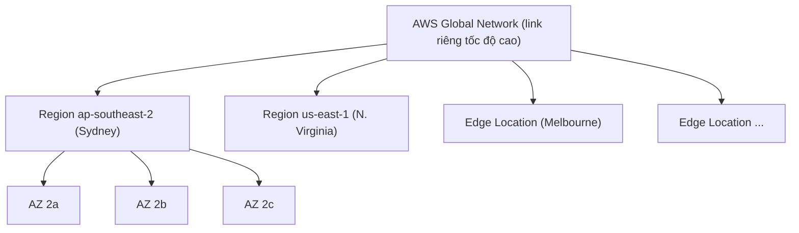

# AWS Global Infrastructure

> **TL;DR:** AWS là tập hợp các khối hạ tầng (**Region**, **Availability Zone**, **Edge Location**) nối với nhau bằng mạng toàn cầu tốc độ cao. Hiểu ba khối này và ba mức độ resilience của dịch vụ (**global / region / AZ**) là nền tảng để thiết kế hệ thống chịu lỗi và trả lời rất nhiều câu hỏi thi.

## 🖼️ Sơ đồ
![[AWS Global Infrastructure.excalidraw]]
*Mở bằng plugin Excalidraw để chỉnh sửa · ảnh tĩnh: [[AWS Global Infrastructure.svg]]*

![[AWS Global Infrastructure - resilience.excalidraw]]
*Mở bằng plugin Excalidraw để chỉnh sửa · ảnh tĩnh: [[AWS Global Infrastructure - resilience.svg]]*

## Khái niệm cốt lõi
### Region
- Một khu vực trên thế giới do AWS tự chọn, chứa **bản triển khai đầy đủ** hạ tầng AWS: compute, storage, database, AI, analytics...
- Region **không** tương ứng 1:1 với quốc gia hay châu lục: có nước một region, nước lớn có nhiều (ví dụ Mỹ có N. Virginia, Ohio, N. California, Oregon; châu Âu có Frankfurt, Ireland, London, Paris...; Nam Mỹ có São Paulo).
- Dùng phần lớn dịch vụ tức là dùng dịch vụ **trong một region cụ thể**: EC2 ở N. Virginia **tách biệt** với EC2 ở Sydney.
- Hai cách gọi tên:
  - **Region code**, ví dụ `ap-southeast-2`, dùng trong CLI/API.
  - **Region name**, ví dụ *Asia Pacific (Sydney)*, dùng trong console UI.
- **Ba lợi ích của region:**
  1. **Geographic separation**: mỗi region là một **fault domain cô lập**. Thảm họa thiên nhiên hay tấn công ở một region không ảnh hưởng region khác. AWS thiết kế các region **cô lập 100%**.
  2. **Geopolitical separation**: dữ liệu chịu luật và quy định của nơi đặt region (governance khác nhau). AWS cam kết dữ liệu **không rời region** nếu bạn không chủ động cấu hình (phải nói rõ là cho phép dữ liệu đi giữa các region).
  3. **Location control**: đặt hạ tầng gần khách hàng để tối ưu hiệu năng, hoặc nhân bản sang region khác khi có nhu cầu.

### Edge Location
- Nhỏ hơn region rất nhiều, thường chỉ có **dịch vụ phân phối nội dung** (CDN, ví dụ [[CloudFront Architecture|CloudFront]]) và một số loại **edge computing**.
- Số lượng **nhiều hơn region rất nhiều**, gần người dùng hơn → **latency thấp**, tải nhanh.
- Ví dụ: Sydney có region, Melbourne không có region nhưng có edge location. Netflix chạy hạ tầng ở nhiều region và cache phim ở edge location gần người xem.
- Region và edge location thường dùng chung trong cùng một kiến trúc.

### Availability Zone (AZ)
- Mỗi region có **nhiều AZ**: 2, 3, 4, 5 hoặc 6 (Sydney lúc quay bài có 3: `ap-southeast-2a`, `2b`, `2c`; N. Virginia có 6, 1a→1f).
- AZ = phần **compute, storage, networking, power và facilities cô lập** bên trong region. Sự cố cục bộ (mất điện, nổ gas...) ở một AZ thường không ảnh hưởng các AZ còn lại.
- AZ là khái niệm **logic**: **không phải** "một data center". Một AZ có thể là một data center, hoặc một phần của nhiều data center. AWS không cho biết cấu trúc vật lý, chỉ đảm bảo các AZ cô lập với nhau và được nối bằng **mạng dự phòng, tốc độ cao**.
- Phân tán thành phần qua nhiều AZ để có resilience: 6 server ở Sydney → đặt 2 server/AZ; mất 1 AZ thì còn 4/6 server chạy.
- Một số dịch vụ như **VPC** trải rộng nhiều AZ để có resilience (subnet nằm trong một AZ, xem [[Default VPC]]).

## Cách hoạt động / Kiến trúc

## Bảng so sánh / số liệu
### Ba mức resilience của dịch vụ
| Mức | Cách hoạt động | Hỏng khi nào | Ví dụ |
|---|---|---|---|
| **Globally resilient** | Một sản phẩm, **một database toàn cục**, dữ liệu replicate qua nhiều region. Không chọn region. | Gần như chỉ khi "cả thế giới" sập. Chịu được mất **nhiều region**. | **IAM**, **Route 53** |
| **Region resilient** | Chạy riêng ở từng region, mỗi region một bộ dữ liệu. Thường replicate dữ liệu qua **nhiều AZ** trong region. | Mất một AZ: vẫn chạy. Mất **cả region**: hỏng. | RDS (DB ở Sydney và N. Virginia là hai thứ khác nhau), VPC |
| **AZ resilient** | Chạy trong **một AZ**. | AZ đó sự cố thì dịch vụ hỏng (dù trong AZ vẫn có phần cứng dự phòng). | EC2 instance, EBS volume, subnet |

| Khối | Kích thước | Mục đích chính |
|---|---|---|
| Region | Lớn, đầy đủ dịch vụ | Fault domain cô lập, governance, đặt gần người dùng |
| AZ | Bên trong region | Cô lập sự cố cục bộ, HA trong region |
| Edge location | Nhỏ, rất nhiều | Phân phối nội dung, edge compute, latency thấp |

## Demo / Lab
- Trang **infrastructure.aws** hiển thị region, AZ, Local Zone, Points of Presence và mạng backbone. Edge location nhiều hơn region rất nhiều, các region nối bằng link riêng tốc độ cao.
- Trong console: EC2 bắt buộc chọn region (dropdown góc trên phải). Mở IAM hoặc Route 53 thì phần chọn region hiển thị "Global" vì đây là dịch vụ global.

## 🎯 Mẹo thi SAA-C03
- Với mỗi dịch vụ, luôn hỏi: **global, regional hay AZ resilient?** Adrian nhấn mạnh biết điều này giúp trả lời rất nhiều câu hỏi. Ví dụ: EC2/EBS là AZ, S3/VPC/RDS là region, IAM/Route 53/CloudFront là global.
- Kịch bản "chịu được mất một AZ" → trải tài nguyên **qua nhiều AZ** trong region. "Chịu được mất cả region / thảm họa diện rộng" → **multi-region**.
- "Dữ liệu phải ở trong quốc gia/khu vực X (data sovereignty, compliance)" → chọn **region** ở đó; dữ liệu mặc định không rời region.
- "Phân phối nội dung latency thấp cho người dùng toàn cầu" → **edge location** (CloudFront). Đừng nhầm edge location với region.
- AZ **không bằng** data center. Đừng chọn đáp án nói vậy.
- Tên AZ như `us-east-1a` được ánh xạ khác nhau giữa các account; muốn định danh chính xác giữa nhiều account thì dùng **AZ ID** (ví dụ `use1-az1`). (Bổ sung ngoài bài giảng.)

## Liên kết
- Tiên quyết: [[Cloud Computing Definition]]
- Liên quan: [[AWS Public vs Private Services]], [[Default VPC]], [[HA vs FT vs DR]], [[Regional and Global Architecture]], [[AWS Local Zones]], [[EC2 Architecture and Resilience]]
- Dịch vụ global: [[IAM Basics]], [[Route 53 Fundamentals]], [[CloudFront Architecture]]
- MOC: [[_MOC 03 AWS Fundamentals]]
