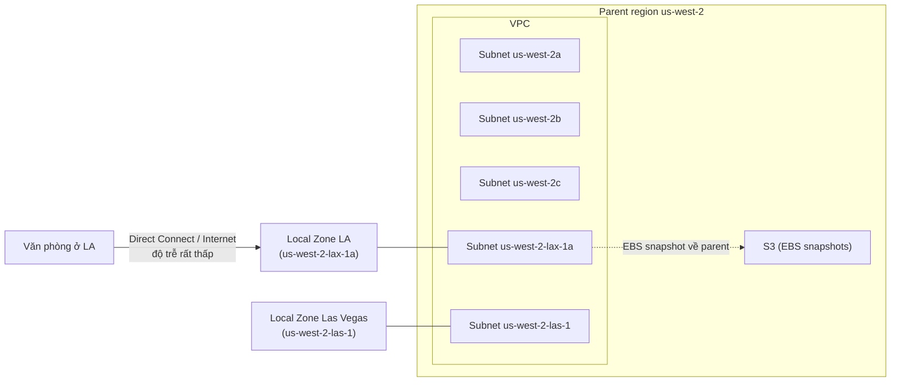

# AWS Local Zones

> **TL;DR:** Local Zone là một "AZ đặt gần bạn" — hạ tầng AWS ở một thành phố, gắn với một **parent region**, để chạy tài nguyên với **độ trễ cực thấp** tới người dùng/văn phòng ở đó. Đổi lại nó chỉ là **một zone**, không có resilience sẵn, và không phải dịch vụ nào cũng hỗ trợ.

## 🖼️ Sơ đồ
![[AWS Local Zones.excalidraw]]
*Mở bằng plugin Excalidraw để chỉnh sửa · ảnh tĩnh: [[AWS Local Zones.svg]]*

## Khái niệm cốt lõi
- **Vấn đề giải quyết:** kiến trúc region + AZ thông thường scale tốt và chịu lỗi AZ tốt, nhưng các AZ có thể cách văn phòng/người dùng **hàng trăm km**. Dù đi cáp quang, kể cả qua [[Direct Connect]], khoảng cách vật lý vẫn gây độ trễ vài ms — đáng kể với ứng dụng nhạy độ trễ (ví dụ giao dịch tài chính).
- **Parent region:** mỗi Local Zone gắn với một region "cha" trong cùng vùng địa lý.
- **Cách đặt tên:** `<tên region>-<mã thành phố quốc tế>-<số>`:
  - `us-west-2-las-1` → Las Vegas, parent là `us-west-2` (Oregon).
  - `us-west-2-lax-1a`, `us-west-2-lax-1b` → **hai** Local Zone cùng ở Los Angeles (một thành phố có thể có nhiều Local Zone).
  - Nhìn tên là biết parent region.
- Mỗi Local Zone là **điểm hạ tầng độc lập**: có kết nối Internet riêng và thường **hỗ trợ Direct Connect** → kết nối riêng, hiệu năng cao từ văn phòng tới Local Zone.
- **Private networking với parent region**: subnet trong Local Zone hoạt động như subnet bình thường, có kết nối private với phần còn lại của VPC.

## Cách hoạt động / Kiến trúc
- Với **EC2 và VPC**: VPC của parent region được **mở rộng** bằng cách tạo **subnet trong Local Zone**; sau đó chạy EC2 và tài nguyên khác trong subnet đó như bình thường, hưởng độ trễ cực thấp (xem [[VPC Subnets]]).
- Một số thứ **vẫn dựa vào parent region**. Ví dụ điển hình: **[[EBS Snapshots]]** của volume trong Local Zone được lưu vào **S3 ở parent region** → snapshot vẫn hưởng replication qua nhiều AZ của region như bình thường.

## Bảng so sánh / số liệu

| | AZ trong region | Local Zone |
|---|---|---|
| Vị trí | Trong region, có thể xa người dùng hàng trăm km | Ở thành phố gần người dùng/văn phòng |
| Resilience | Nhiều AZ → thiết kế HA được trong region | **"1" zone**, không có resilience sẵn (như một AZ đơn) |
| Độ trễ | Thấp | **Thấp nhất có thể** |
| Hỗ trợ dịch vụ | Đầy đủ | Hạn chế; nhiều dịch vụ phải **opt-in**, có giới hạn |
| Phụ thuộc | — | Dùng parent region cho một số chức năng (ví dụ EBS snapshot) |

## 🎯 Mẹo thi SAA-C03
- Từ khóa **"lowest possible latency"/"highest performance" cho người dùng ở một thành phố/văn phòng cụ thể** → nghĩ tới **Local Zones**.
- Local Zone = **một zone**, **không có resilience sẵn**; cần HA thì vẫn phải thiết kế thêm (nhiều zone/region) — xem [[HA vs FT vs DR]].
- Nghĩ về nó như **một AZ nhưng gần bạn**. Giống [[CloudFront Architecture|CloudFront edge location]] ở chỗ nằm gần người dùng hơn region, nhưng Local Zone chạy được compute/subnet của VPC.
- **Direct Connect tới Local Zone được hỗ trợ** — dùng cho nhu cầu hiệu năng cực cao.
- **EBS snapshot đi về parent region** (lưu trên S3 của region cha).
- Không phải dịch vụ nào cũng có ở Local Zone; nhiều cái opt-in → luôn kiểm tra tài liệu AWS cho khu vực cụ thể.

## Liên kết
- Tiên quyết: [[AWS Global Infrastructure]], [[EC2 Architecture and Resilience]], [[VPC Sizing and Structure]]
- Liên quan: [[VPC Subnets]], [[EBS Snapshots]], [[Direct Connect]], [[HA vs FT vs DR]]
- Phân biệt với: [[CloudFront Architecture]], [[Global Accelerator]]
- Section: [[_MOC 03 AWS Fundamentals]]
