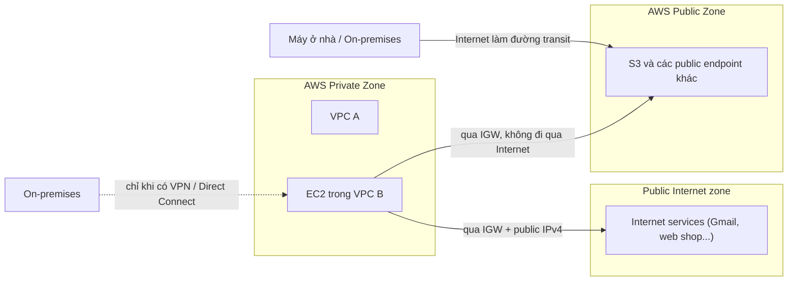

# AWS Public vs Private Services

> **TL;DR:** "Public" và "private" service trong AWS là khái niệm **thuần networking** (dịch vụ được truy cập qua đâu), không phải về quyền. AWS có **ba network zone**: Public Internet, **AWS Public Zone** (nơi các dịch vụ có public endpoint như S3 chạy) và **AWS Private Zone** (các VPC).

## 🖼️ Sơ đồ
![[AWS Public vs Private Services.excalidraw]]
*Mở bằng plugin Excalidraw để chỉnh sửa · ảnh tĩnh: [[AWS Public vs Private Services.svg]]*

## Khái niệm cốt lõi
- **Public service**: truy cập qua **public endpoint**, ví dụ [[S3 Basics|S3]]. Bất kỳ đâu có kết nối Internet đều tới được endpoint (về mặt mạng).
- **Private service**: chạy **bên trong một VPC**, ví dụ [[EC2 Basics|EC2]]. Chỉ những gì trong VPC đó, hoặc mạng được kết nối với VPC đó, mới tới được.
- **Networking ≠ permissions**: S3 là public service nhưng mặc định không identity nào (ngoài account root user) được phép truy cập. Truy cập = (đường mạng tới được) **và** (được authorize). Hai chuyện tách biệt. Xem [[IAM Basics]], [[S3 Security]].
- Ba network zone:
  1. **Public Internet zone**: nơi các dịch vụ Internet bình thường hoạt động (Gmail, cửa hàng online, game online). Nhà bạn đi ra đây qua ISP.
  2. **AWS Public Zone**: mạng của AWS **nối với** Internet nhưng **không phải là một phần** của Internet. Đây là nơi các AWS public service (S3, endpoint của các service có public API...) chạy.
  3. **AWS Private Zone**: các **VPC**. Mỗi VPC cô lập, không nói chuyện với VPC khác, Internet hay AWS Public Zone, trừ khi bạn cấu hình cho phép.
- Giống mạng gia đình: chỉ thiết bị cắm vào mạng hoặc biết mật khẩu Wi‑Fi mới vào được "private zone" của bạn.

## Cách hoạt động / Kiến trúc

- **Truy cập public service từ Internet**: gói tin đi trên Internet tới AWS Public Zone rồi quay về. Vì vậy ở đâu có Internet là gọi được S3.
- **Internet Gateway (IGW)** gắn vào VPC cho phép:
  - Tài nguyên trong private zone (EC2) **ra Internet**, với điều kiện có **public IPv4**.
  - Tài nguyên trong VPC gọi **AWS public service** (như S3) qua IGW. Lưu lượng này đi trong **AWS Public Zone**, **không chạm Public Internet**.
- **Gán public IP cho EC2** về kiến trúc là "chiếu" (project) instance đó ra AWS Public Zone để Internet có thể kết nối vào. Slide ghi rõ: public IP được **IGW dịch 1:1** sang private IP của instance (instance không tự biết public IP của mình). Chi tiết ở [[VPC Routing and Internet Gateway]].
- **On-premises → VPC**: chỉ khi cấu hình kết nối riêng (ảo hoặc vật lý), tức [[Site-to-Site VPN]] hoặc [[Direct Connect]].

## 🎯 Mẹo thi SAA-C03
- Nắm chắc **ba zone**: phần lớn các chủ đề networking nâng cao (VPC endpoint, Direct Connect public VIF, NAT) đều dựa trên ranh giới giữa AWS Public Zone và VPC.
- "Public service" không có nghĩa là ai cũng truy cập được dữ liệu. Vẫn phải có quyền (IAM policy, bucket policy).
- Lưu lượng từ EC2 (qua IGW) tới S3 **không đi qua Public Internet**, nó nằm trên mạng AWS. Nếu đề muốn VPC truy cập S3 mà **không cần IGW/NAT** (subnet private) → dùng [[Gateway VPC Endpoints]] (S3, DynamoDB) hoặc [[Interface VPC Endpoints]].
- On-premises muốn vào VPC một cách private → [[Site-to-Site VPN]] hoặc [[Direct Connect]]; muốn vào AWS public service qua đường riêng → [[Direct Connect Public VIF and VPN|Direct Connect public VIF]].

## Liên kết
- Tiên quyết: [[Layer 3 Network]], [[NAT Fundamentals]]
- Liên quan: [[AWS Global Infrastructure]], [[Default VPC]], [[EC2 Basics]], [[S3 Basics]], [[VPC Routing and Internet Gateway]], [[NAT Gateway]]
- Phân biệt với: [[Gateway VPC Endpoints]], [[Interface VPC Endpoints]]
- MOC: [[_MOC 03 AWS Fundamentals]]
