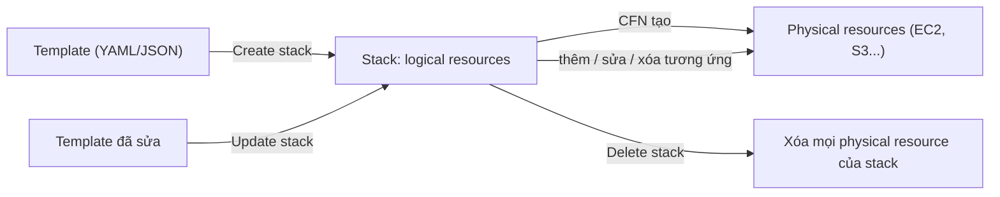

# CloudFormation Basics

> **TL;DR:** CloudFormation (CFN) là công cụ **Infrastructure as Code** của AWS: viết **template** (YAML hoặc JSON) mô tả tài nguyên, CFN tạo một **stack** chứa các **logical resource** và tạo/cập nhật/xóa các **physical resource** tương ứng sao cho luôn khớp. Tạo hạ tầng **tự động, nhất quán, lặp lại được, mang sang region khác được**.

## 🖼️ Sơ đồ
![[CloudFormation Basics.excalidraw]]
*Mở bằng plugin Excalidraw để chỉnh sửa · ảnh tĩnh: [[CloudFormation Basics.svg]]*

## Khái niệm cốt lõi
- Template viết bằng **YAML** hoặc **JSON** ([[YAML]], [[JSON]]). Hai định dạng làm được cùng việc, chuyển đổi qua lại dễ. YAML gọn và nhiều tính năng hơn nhưng dễ sai vì thụt lề bằng khoảng trắng. Adrian ưu tiên YAML.
- **Cấu trúc template** (các section cấp cao nhất):

| Section | Bắt buộc? | Vai trò |
|---|---|---|
| `AWSTemplateFormatVersion` | Không | Phiên bản định dạng template, cách AWS mở rộng chuẩn theo thời gian. Bỏ trống thì CFN tự giả định (giá trị hợp lệ duy nhất hiện nay là `"2010-09-09"`). |
| `Description` | Không | Mô tả tự do: template làm gì, tài nguyên nào, chi phí... **Nếu có cả hai thì Description phải đứng ngay sau AWSTemplateFormatVersion.** |
| `Metadata` | Không | Nhiều công dụng; một trong số đó là điều khiển **cách console UI hiển thị** template (nhóm, thứ tự, nhãn, mô tả tham số). |
| `Parameters` | Không | Trường nhập liệu cho người dùng (kích thước instance, tên, số AZ...). Có `Type`, `Default`, `AllowedValues`, `Description`, ràng buộc giá trị. Xem [[CFN Template and Pseudo Parameters]]. |
| `Mappings` | Không | **Bảng tra cứu**, ví dụ region + môi trường (test/prod) → AMI ID. Xem [[CFN Mappings]]. |
| `Conditions` | Không | Ra quyết định: tài nguyên chỉ được tạo nếu điều kiện đúng. Xem [[CFN Conditions]]. |
| `Transform` | Không | Áp macro/transform cho template (ví dụ SAM). Có trên slide, bài này không giảng. |
| **`Resources`** | **Bắt buộc (duy nhất)** | Danh sách tài nguyên (ít nhất một). Thêm vào thì CFN tạo, sửa thì CFN cập nhật, xóa khỏi template rồi áp lại thì CFN xóa physical resource. |
| `Outputs` | Không | Giá trị trả ra khi stack hoàn tất: instance ID, URL trang admin WordPress... Xem [[CFN Outputs]]. |

- **Conditions là quy trình hai bước** (ví dụ trên slide):
  1. Tạo điều kiện: `CreateProdResources: !Equals [ !Ref EnvType, prod ]` (parameter `EnvType` có `AllowedValues: [prod, test]`, mặc định `test`).
  2. Dùng điều kiện trong resource: `ProdCatGifServer` (type `AWS::EC2::Instance`) có `Condition: CreateProdResources`, nên chỉ được tạo khi `EnvType = prod`.

### Logical vs Physical resource, Stack
- Resource trong template là **logical resource**: có **tên logic** (ví dụ `Instance`), **Type** (ví dụ `AWS::EC2::Instance`, CFN dựa vào đây để biết tạo gì) và **Properties** (cấu hình).
- Đưa template cho CFN → tạo **stack**: biểu diễn "sống" của template, chứa mọi logical resource. Một template có thể tạo **một, mười hoặc nhiều stack**.
- Với mỗi logical resource trong stack, CFN tạo **physical resource** tương ứng trong account (EC2 instance thật). **Nhiệm vụ của CFN là giữ logical và physical đồng bộ.** Chi tiết: [[CFN Physical and Logical Resources]].

- **Create stack**: tạo logical rồi physical resource. **Update stack** (áp template đã sửa): thêm, cập nhật hoặc xóa physical resource theo thay đổi logical. **Delete stack**: xóa logical resource → CFN xóa physical resource tương ứng (CFN tự dọn dẹp).

### Ứng dụng
- Tự động hóa: một template triển khai 1, 10 hay 100 blog WordPress giống hệt nhau.
- **Change management**: lưu template trong source control, review/duyệt thay đổi rồi mới áp dụng.
- Dựng nhanh môi trường dùng một lần (khóa học dùng CFN để dựng hạ tầng nền cho các demo).

## Demo / Lab
Template `ec2instance.yaml` tạo EC2 instance giống bài [[EC2 Basics]] nhưng tự động:
- **Parameters**:
  - `KeyName`: key pair trong region (phải tạo `A4L` trước).
  - `LatestAmiId`: kiểu parameter đặc biệt đọc **SSM Parameter Store public parameter**, tự lấy **AMI Amazon Linux 2 mới nhất** của region đang deploy → template **portable** giữa các region. Xem [[SSM Parameter Store]].
  - `SSHandWebLocation`: dải IP được phép truy cập (có default).
- **Resources**: Security Group mở **22 (SSH)** và **80 (HTTP)**; EC2 instance (`AWS::EC2::Instance`, `t2.micro`, `KeyName`/`ImageId` dùng `!Ref` parameter, SG tham chiếu logical resource SG); thêm **IAM Role + Instance Profile** để dùng Session Manager.
- **Outputs**: InstanceId, AZ, PublicDNS, PublicIP, lấy bằng hàm `Ref` (giá trị mặc định của resource, với EC2 là instance ID) và `Fn::GetAtt` (lấy thuộc tính khác như AZ, PublicDnsName, PublicIp). Xem [[CFN Intrinsic Functions]].
- Các bước: CloudFormation console → Create stack → **Upload a template file**. CFN tự lưu template vào một bucket S3 có tên bắt đầu bằng `cf-templates-...` (đó là nguồn gốc các bucket lạ này).
  - Đặt tên stack `cfndemo1`, parameters hiện thành ô nhập trên UI (có sẵn default).
  - Phải tick **capabilities** (`CAPABILITY_IAM`) vì template tạo **IAM resource**. CFN coi đây là thay đổi rủi ro cao, cần xác nhận rõ.
  - Tab **Events**: mỗi resource có `CREATE_IN_PROGRESS` → `CREATE_COMPLETE`; lỗi hiển thị chữ đỏ. Stack chuyển `CREATE_COMPLETE`.
  - Tab **Outputs** khớp với template; tab **Resources** liệt kê logical ID ↔ physical ID (bấm vào để mở tài nguyên thật).
- Áp lại cùng template thì có thêm một instance y hệt; áp ở region khác vẫn chạy.
- **Session Manager**: connect không cần key pair/SSH, nhờ instance role. Adrian gọi đây là cách tốt hơn. Xem [[EC2 Instance Roles]].
- **Delete stack**: CFN terminate instance và xóa mọi resource đã tạo, rồi xóa stack.

## 🎯 Mẹo thi SAA-C03
- **`Resources` là section bắt buộc duy nhất.**
- Bẫy hay gặp: nếu có `AWSTemplateFormatVersion` và `Description` thì **Description phải đứng ngay sau** format version.
- Đề nói "triển khai hạ tầng **nhất quán, lặp lại**, nhiều môi trường/region, IaC" → **CloudFormation**. Nhiều account/region cùng lúc → [[CFN StackSets]].
- Template muốn **portable giữa region** → không hard-code AMI ID; dùng **SSM parameter** cho AMI mới nhất hoặc **Mappings**.
- Template tạo IAM resource → phải xác nhận **CAPABILITY_IAM / CAPABILITY_NAMED_IAM**.
- Xóa stack sẽ xóa physical resource; muốn giữ dữ liệu khi xóa stack → [[CFN Deletion Policy]].

## Liên kết
- Tiên quyết: [[YAML]], [[JSON]]
- Liên quan: [[EC2 Basics]], [[IAM Roles]], [[SSM Parameter Store]], [[EC2 Instance Roles]]
- Học sâu hơn: [[CFN Physical and Logical Resources]], [[CFN Template and Pseudo Parameters]], [[CFN Intrinsic Functions]], [[CFN Mappings]], [[CFN Conditions]], [[CFN Outputs]], [[CFN Change Sets]]
- MOC: [[_MOC 03 AWS Fundamentals]]
