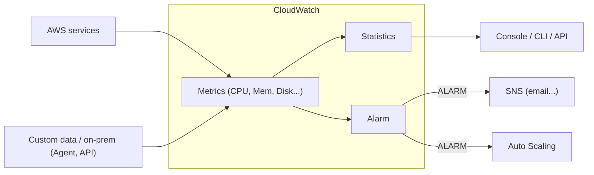
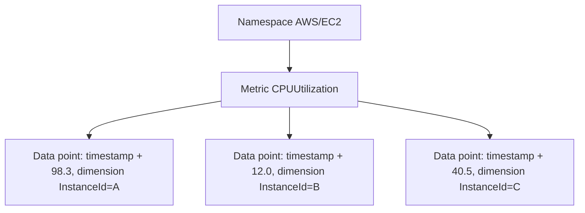

# CloudWatch Basics

> **TL;DR:** CloudWatch là dịch vụ hỗ trợ cốt lõi, thu thập và quản lý **dữ liệu vận hành** (metric, log, event) cho gần như mọi dịch vụ AWS, cho on-premises và cloud khác. Gồm ba phần: **CloudWatch (metrics + alarms)**, **CloudWatch Logs**, **CloudWatch Events** (nay là EventBridge). Các khái niệm chính: **namespace → metric → data point**, **dimension** để tách dữ liệu, **alarm** (OK / ALARM / INSUFFICIENT_DATA) để kích hoạt hành động.

## 🖼️ Sơ đồ
![[CloudWatch Basics.excalidraw]]
*Mở bằng plugin Excalidraw để chỉnh sửa · ảnh tĩnh: [[CloudWatch Basics.svg]]*

![[CloudWatch Basics - metric model.excalidraw]]
*Mở bằng plugin Excalidraw để chỉnh sửa · ảnh tĩnh: [[CloudWatch Basics - metric model.svg]]*

## Khái niệm cốt lõi
### Ba sản phẩm trong một
| Thành phần | Làm gì | Ví dụ |
|---|---|---|
| **CloudWatch (Metrics)** | Thu thập, giám sát và **hành động dựa trên metric** | CPU EC2, dung lượng đĩa server on-prem, số visitor/giây của website |
| **CloudWatch Logs** | Thu thập, giám sát và hành động dựa trên **log** | Windows Event Log, log web server, firewall, Linux. Xem [[CloudWatch Logs]] |
| **CloudWatch Events** | **Event hub**: (1) sinh event khi dịch vụ AWS làm gì đó (EC2 start/stop/terminate) để kích hoạt hành động khác; (2) **lịch**: sinh event vào giờ/ngày nhất định | Nay là [[EventBridge]] |

- **Public service**: dùng được từ trong AWS, on-premises hay cloud khác, miễn có kết nối Internet và **quyền** ghi dữ liệu vào CloudWatch.
- **Native vs Agent**:
  - Metric **thấy được từ bên ngoài** instance (CPU utilization của EC2, network, disk I/O ở mức hypervisor) được thu **mặc định**.
  - Cần **CloudWatch Agent** khi: thu metric/log từ **on-premises** hoặc cloud khác; metric **bên trong OS** mà AWS không thấy (**memory utilization**, danh sách process, dung lượng đĩa đã dùng); log tùy chỉnh. Xem [[CloudWatch Agent]].
- Truy cập dữ liệu qua **console UI, CLI, API**.
- Bạn đã dùng CloudWatch từ đầu khóa: **billing alarm** (ước tính hóa đơn tháng > $10 → SNS → email). Xem [[AWS Budgets]].

### Namespace, Metric, Data point, Dimension
- **Namespace**: "container" cho dữ liệu monitoring, giúp tách bạch. Tên tự đặt theo quy tắc (ví dụ `Catagram`), **trừ** dạng `AWS/<service>` là **dành riêng cho AWS** (ví dụ `AWS/EC2`).
- **Metric**: tập hợp **data point có thứ tự thời gian**, ví dụ `CPUUtilization`, `NetworkIn/Out`, `DiskWriteBytes`. Lưu ý: metric **không gắn với một server cụ thể**. `CPUUtilization` nhận dữ liệu từ nhiều instance.
- **Data point**: mỗi lần gửi đo đạc gồm **timestamp** (năm, tháng, ngày, giờ, phút, giây, timezone) và **value** (ví dụ `98.3` = 98.3% CPU).
- **Dimension**: cặp **name/value** gửi kèm data point để tách hoặc nhìn dữ liệu theo góc khác. Với EC2, AWS gửi kèm `InstanceId`, `InstanceType`... → lọc được CPU của **một instance cụ thể** trong metric chung.
- **Alarm**: gắn với **một metric** + tiêu chí. Trạng thái:
  - **OK**: theo tiêu chí bạn đặt, không có vấn đề.
  - **ALARM**: metric vi phạm tiêu chí → thực thi **action** (gửi [[SNS]] notification, **Auto Scaling** action, EC2 action, Systems Manager action).
  - **INSUFFICIENT_DATA**: chưa đủ dữ liệu để đánh giá (thường là lúc mới tạo). Không phải lỗi.

## Cách hoạt động / Kiến trúc

## Demo / Lab
1. Launch EC2 `CloudWatch test`: Amazon Linux 2, t2.micro, **không key pair** (dùng EC2 Instance Connect), default VPC, auto-assign public IP, SG `CloudWatchSG` (SSH từ anywhere), 8 GiB gp2.
   - Bật **Detailed CloudWatch monitoring** (Advanced details): **có phí thêm**, metric chi tiết hơn và cập nhật nhanh hơn. Không bật thì miễn phí nhưng phải chờ lâu hơn. (Basic monitoring: chu kỳ **5 phút**; detailed: **1 phút**.)
2. CloudWatch → Alarms → Create alarm → Select metric → **EC2 → Per-Instance Metrics** → chọn `CPUUtilization` của đúng instance ID.
3. Điều kiện **Static**, `>= 15%`. Bỏ SNS notification (có thể chọn Auto Scaling, EC2, Systems Manager action). Tên `CloudWatchTest-HighCPU`. Trạng thái đầu là **Insufficient data**, sau đó **OK**.
4. Vào instance, cài `stress`: `sudo amazon-linux-extras install epel -y`, rồi `sudo yum install stress -y`; chạy `stress -c 1 -t 3600` (t2.micro có **1 vCPU**).
5. Vài phút sau CPU vượt đường ngưỡng đỏ (ví dụ 9.62% → 35.76%), alarm chuyển **OK → In alarm**. Ctrl+C dừng stress, CPU giảm, vài phút sau alarm về **OK**.
6. Dọn: xóa alarm, terminate instance, xóa SG `CloudWatchSG`.

## 🎯 Mẹo thi SAA-C03
- Nhớ **ba mảng**: Metrics, Logs, Events.
- **Memory utilization, dung lượng đĩa đã dùng, process trong OS** của EC2 **không** có sẵn → cần **CloudWatch Agent** (kèm quyền IAM). Rất hay ra đề.
- Giám sát **server on-premises** bằng CloudWatch → cài **CloudWatch Agent**.
- "Gửi thông báo khi metric vượt ngưỡng" → **CloudWatch Alarm + SNS**. "Tự động scale khi CPU cao" → **Alarm + Auto Scaling** (xem [[ASG Scaling Policies]]).
- "Chạy tác vụ theo lịch / phản ứng khi trạng thái tài nguyên thay đổi" → **EventBridge** (trước là CloudWatch Events).
- `AWS/...` là namespace dành riêng; custom metric dùng namespace của bạn.
- Cần metric chi tiết hơn 5 phút cho EC2 → bật **detailed monitoring** (1 phút, có phí).
- CloudWatch = **hiệu năng/vận hành**. **Ai gọi API gì** → [[CloudTrail]], không phải CloudWatch.

## Liên kết
- Tiên quyết: [[EC2 Basics]], [[AWS Public vs Private Services]]
- Liên quan: [[CloudWatch Logs]], [[CloudWatch Agent]], [[EventBridge]], [[SNS]], [[Auto Scaling Groups]], [[AWS Budgets]]
- Phân biệt với: [[CloudTrail]], [[AWS Config]]
- MOC: [[_MOC 03 AWS Fundamentals]]
