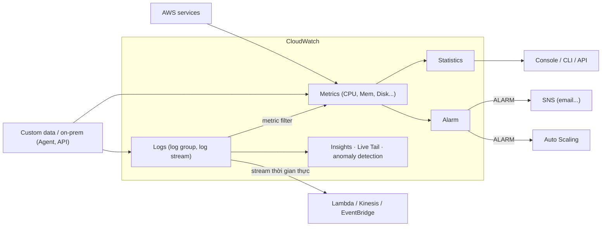
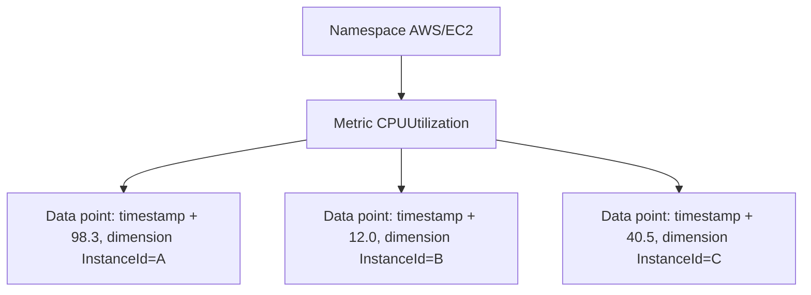

# CloudWatch Basics

> **TL;DR:** CloudWatch là **nền tảng observability** cốt lõi của AWS, thu thập và quản lý **dữ liệu vận hành** (metric, log, event) cho gần như mọi dịch vụ AWS, cho on-premises và cloud khác. Là "chiếc ô" gồm nhiều tính năng: **Metrics**, **Alarms**, **Logs** (Logs Insights, Live Tail, anomaly detection), dashboard; **EventBridge** (trước là CloudWatch Events) nay là dịch vụ riêng hay dùng kèm. Các khái niệm chính: **namespace → metric → data point**, **dimension** để tách dữ liệu, **alarm** (OK / ALARM / INSUFFICIENT_DATA) đánh giá theo **period, evaluation periods, datapoints to alarm** để kích hoạt hành động.

## 🖼️ Sơ đồ
![[CloudWatch Basics.excalidraw]]
*Mở bằng plugin Excalidraw để chỉnh sửa · ảnh tĩnh: [[CloudWatch Basics.svg]]*

![[CloudWatch Basics - metric model.excalidraw]]
*Mở bằng plugin Excalidraw để chỉnh sửa · ảnh tĩnh: [[CloudWatch Basics - metric model.svg]]*

## Khái niệm cốt lõi
### Nhiều tính năng dưới một cái tên
CloudWatch là **nền tảng observability** của AWS, **fully managed** (không phải tự dựng server, storage, mạng cho hệ thống monitoring). "CloudWatch" là tên chung cho cả nhóm tính năng; nhiều người nói "CloudWatch" nhưng ý chỉ phần Metrics.

| Thành phần | Làm gì | Ví dụ |
|---|---|---|
| **CloudWatch Metrics** | Thu thập, giám sát metric và **hành động tự động** dựa trên metric | CPU EC2, dung lượng đĩa server on-prem, số visitor/giây của website |
| **CloudWatch Alarms** | Đánh giá metric theo điều kiện; thỏa điều kiện thì đổi trạng thái và chạy action, từ cảnh báo đơn giản tới action tự động (SNS, Auto Scaling, Lambda...) | CPU EC2 cao, sắp hết dung lượng đĩa |
| **CloudWatch Logs** | Thu thập, phân tích và hành động dựa trên **log** (log group, log stream). **Logs Insights** để tìm kiếm/phân tích, **Live Tail** xem log theo thời gian thực, **anomaly detection** phát hiện bất thường; **trích metric từ log** (metric filter) để tạo alarm; **stream** log theo thời gian thực sang Lambda, Kinesis, EventBridge | Windows Event Log, log web server, firewall, Linux. Xem [[CloudWatch Logs]] |
| **Dashboard / báo cáo** | Xem đồ thị metric, trạng thái alarm trên toàn môi trường | |
| **EventBridge** (trước là **CloudWatch Events**) | Nay là **dịch vụ riêng**, hay dùng kèm CloudWatch nhưng không bắt buộc: (1) sinh event khi dịch vụ AWS làm gì đó (EC2 start/stop/terminate) để kích hoạt hành động khác; (2) **lịch**: sinh event vào giờ/ngày nhất định | Xem [[EventBridge]] |

- **Metric** là dữ liệu hiệu năng có cấu trúc (CPU utilization...); **log** là bản ghi sự kiện, nhiều chữ hơn hẳn.

- **Public service**: dùng được từ trong AWS, on-premises hay cloud khác, miễn có kết nối Internet và **quyền** ghi dữ liệu vào CloudWatch.
- **Native vs Agent**:
  - Metric **thấy được từ bên ngoài** instance (CPU utilization của EC2, network, disk I/O ở mức hypervisor) được thu **mặc định**.
  - Cần **unified CloudWatch Agent** khi: thu metric/log từ **on-premises** hoặc cloud khác; metric **bên trong OS** mà AWS không thấy (**memory utilization**, danh sách process, dung lượng đĩa đã dùng); log tùy chỉnh. Xem [[CloudWatch Agent]].
- Truy cập dữ liệu qua **console UI, CLI, API**.
- Bản khóa cũ dùng CloudWatch từ đầu khóa qua **billing alarm** (ước tính hóa đơn tháng > $10 → SNS → email). Khóa mới cảnh báo chi phí bằng **budget** (billing preferences vẫn có tùy chọn bật CloudWatch billing alerts). Xem [[AWS Budgets]].

### Namespace, Metric, Data point, Dimension
- **Namespace**: "container" cho dữ liệu monitoring, giúp tách bạch. Tên tự đặt theo quy tắc (ví dụ `Catagram`), **trừ** dạng `AWS/<service>` là **dành riêng cho AWS** (ví dụ `AWS/EC2`).
- **Metric**: tập hợp **data point có thứ tự thời gian**, ví dụ `CPUUtilization`, `NetworkIn/Out`, `DiskWriteBytes`. Lưu ý: metric **không gắn với một server cụ thể**. `CPUUtilization` nhận dữ liệu từ nhiều instance.
- **Data point**: mỗi lần gửi đo đạc gồm **timestamp** (năm, tháng, ngày, giờ, phút, giây, timezone) và **value** (ví dụ `98.3` = 98.3% CPU).
- **Dimension**: cặp **name/value** gửi kèm data point để tách hoặc nhìn dữ liệu theo góc khác. Với EC2, AWS gửi kèm `InstanceId`, `InstanceType`... → lọc được CPU của **một instance cụ thể** trong metric chung.
- **Alarm**: gắn với **một metric** + tiêu chí. Trạng thái:
  - **OK**: theo tiêu chí bạn đặt, không có vấn đề.
  - **ALARM**: metric vi phạm tiêu chí → thực thi **action** (gửi [[SNS]] notification, **Auto Scaling** action, EC2 action, Systems Manager action).
  - **INSUFFICIENT_DATA**: chưa đủ dữ liệu để đánh giá (thường là lúc mới tạo). Không phải lỗi.
- **Cấu hình đánh giá của alarm** (ba thông số đi cùng nhau):
  - **Period**: khoảng thời gian của metric được gộp thành **một điểm dữ liệu của alarm**. Ví dụ period 60 giây với CPUUtilization: mỗi 60 giây metric thành một điểm. Period càng ngắn alarm càng nhạy.
  - **Evaluation periods**: số period gần nhất được xét theo kiểu cửa sổ trượt (N).
  - **Datapoints to alarm**: cần bao nhiêu điểm trong số đó vi phạm thì mới vào ALARM (M). Ví dụ: trong **10** period 60 giây gần nhất, có **từ 5** điểm CPU > 25% thì báo động. Cấu hình "M of N" giúp **bỏ qua spike ngắn** không đáng lo.

## Cách hoạt động / Kiến trúc

- Bên trái là **nguồn dữ liệu** (dịch vụ AWS, hệ thống và ứng dụng của bạn), ở giữa là CloudWatch lưu metric và log, bên phải là **action/tích hợp**. Dữ liệu xem qua console, CLI, API hoặc truy vấn.
- Log không chỉ để lưu: stream sang dịch vụ khác để xử lý tiếp, nên Logs là một phần của luồng tự động hóa và observability.

## Demo / Lab
1. Launch EC2 `CloudWatchTest`: **Amazon Linux** (bản mới nhất, 2023), **t2.nano** vì EC2 **không còn free tier**, **không key pair** (dùng EC2 Instance Connect), default VPC, auto-assign public IP, SG `CloudWatchTestSG` (SSH từ anywhere), storage mặc định theo AMI.
   - Bật **Detailed CloudWatch monitoring** (Advanced details): metric thu thường xuyên hơn (**1 phút** thay vì **5 phút** của basic monitoring), **có phí thêm**. Không bắt buộc; bật để alarm có dữ liệu nhanh hơn.
2. CloudWatch → Alarms → Create alarm → Select metric → **EC2 → Per-Instance Metrics** → chọn `CPUUtilization` của đúng instance (namespace EC2, metric CPUUtilization, một instance). Có sẵn nhiều metric mặc định: đọc/ghi storage, network, CPU, CPU credits.
3. Statistic **Average**, period **1 phút** (nhạy để demo; production thường không muốn quá nhạy vì spike ngắn). Kiểu ngưỡng: **Static** (còn có **Anomaly detection** dựa trên dải giá trị "bình thường" theo độ lệch chuẩn), điều kiện `>= 15%`. Phần *Additional configuration* (datapoints to alarm...) để mặc định.
4. Action: bỏ SNS notification (có thể chọn Lambda, Auto Scaling, EC2, Systems Manager action). Tên `CloudWatchTestHighCPU`, description hỗ trợ markdown. Trạng thái đầu là **Insufficient data**, sau đó **OK**.
5. Connect bằng **EC2 Instance Connect**, cài `stress`: `sudo yum install stress -y`; chạy `stress -c 1 -t 3600` (instance có **1 vCPU**).
6. CPU vượt 15%, alarm chuyển **OK → In alarm** (với period 1 phút thì gần như ngay lập tức). Ctrl+C dừng stress, CPU giảm, sau một lúc alarm về **OK**.
7. Dọn: xóa alarm, terminate instance, chờ terminated rồi xóa SG `CloudWatchTestSG`.

## 🎯 Mẹo thi SAA-C03
- Nhớ các mảng chính: **Metrics, Alarms, Logs**; phản ứng theo event/lịch là **EventBridge** (trước là CloudWatch Events).
- Alarm báo động vì **spike ngắn** không đáng lo → tăng **evaluation periods** và đặt **datapoints to alarm** (M of N) hoặc period dài hơn; cần alarm phản ứng nhanh → period ngắn (kèm detailed monitoring cho EC2).
- Tìm kiếm/phân tích log → **CloudWatch Logs Insights**; xử lý log theo thời gian thực bằng dịch vụ khác → stream sang **Lambda / Kinesis**.
- **Memory utilization, dung lượng đĩa đã dùng, process trong OS** của EC2 **không** có sẵn → cần **CloudWatch Agent** (kèm quyền IAM). Rất hay ra đề.
- Giám sát **server on-premises** bằng CloudWatch → cài **CloudWatch Agent**.
- "Gửi thông báo khi metric vượt ngưỡng" → **CloudWatch Alarm + SNS**. "Tự động scale khi CPU cao" → **Alarm + Auto Scaling** (xem [[ASG Scaling Policies]]).
- "Chạy tác vụ theo lịch / phản ứng khi trạng thái tài nguyên thay đổi" → **EventBridge** (trước là CloudWatch Events).
- `AWS/...` là namespace dành riêng; custom metric dùng namespace của bạn.
- Cần metric chi tiết hơn 5 phút cho EC2 → bật **detailed monitoring** (1 phút, có phí).
- CloudWatch = **hiệu năng/vận hành**. **Ai gọi API gì** → [[CloudTrail]], không phải CloudWatch.

## Liên kết
- Tiên quyết: [[EC2 Basics]], [[AWS Public vs Private Services]]
- Liên quan: [[CloudWatch Logs]], [[CloudWatch Agent]], [[EventBridge]], [[SNS]], [[Auto Scaling Groups]], [[AWS Budgets]]
- Phân biệt với: [[CloudTrail]], [[AWS Config]]
- MOC: [[_MOC 03 AWS Fundamentals]]
