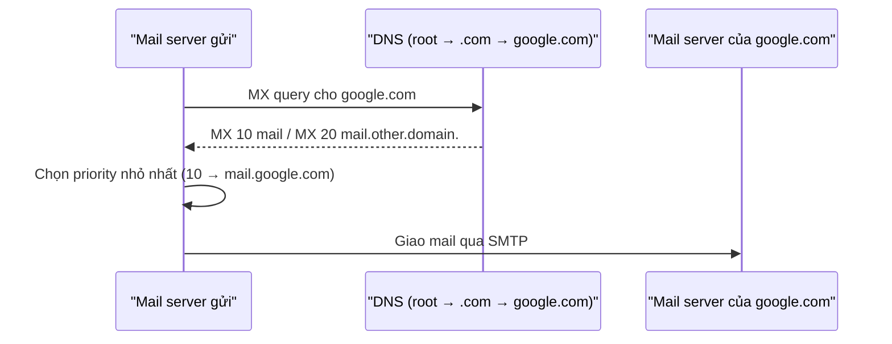
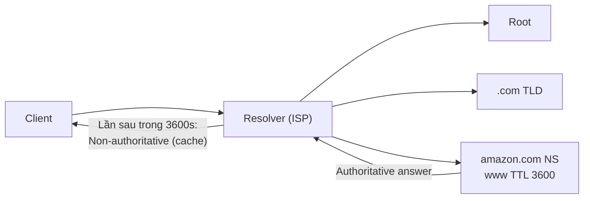

# DNS Record Types

> **TL;DR:** Các loại record DNS hay gặp — **NS** (delegation), **A/AAAA** (tên → IPv4/IPv6), **CNAME** (tên → tên khác), **MX** (tìm mail server của domain), **TXT** (text tùy ý, ví dụ chứng minh quyền sở hữu domain) — cùng khái niệm **TTL** quyết định record được cache bao lâu ở resolver.

## 🖼️ Sơ đồ
![[DNS Record Types.excalidraw]]
*Mở bằng plugin Excalidraw để chỉnh sửa · ảnh tĩnh: [[DNS Record Types.svg]]*

![[DNS Record Types - TTL.excalidraw]]
*Mở bằng plugin Excalidraw để chỉnh sửa · ảnh tĩnh: [[DNS Record Types - TTL.svg]]*

## Khái niệm cốt lõi

### NS – Name Server
- Là cơ chế **delegation** của DNS. Ví dụ: zone `.com` (do VeriSign quản lý) chứa nhiều NS record cho `amazon.com`, trỏ tới các server do đội Amazon quản lý; các server này host zone `amazon.com` (trong đó có `www`...).
- Tương tự ở tầng trên: root zone có NS record trỏ tới các server host zone `.com`. → NS là "xương sống" của chuỗi root → TLD → domain (xem [[DNS Fundamentals]]). Route 53 dùng đúng cơ chế này khi đăng ký domain ([[Route 53 Fundamentals]]).

### A và AAAA
- Cả hai map **hostname → IP address**, khác nhau ở loại IP:
  - **A** → IPv4.
  - **AAAA** → IPv6.
- Thường tạo **cả hai record cùng tên** (ví dụ `www`); hệ điều hành/DNS client tự chọn: hỗ trợ IPv6 thì dùng AAAA, không thì dùng A.

### CNAME – Canonical Name
- Tạo "shortcut" **host → host** trong DNS.
- Ví dụ: A record `server` → một IPv4. Server làm FTP, mail, web → tạo 3 CNAME `ftp`, `mail`, `www` cùng trỏ về `server`. Khi IP đổi chỉ cần sửa **một** A record, các CNAME tự đúng theo → giảm công quản trị.
- **CNAME không thể trỏ trực tiếp tới IP**, chỉ trỏ tới tên khác — Adrian nhấn mạnh đây là câu bẫy trong đề thi.
- Hạn chế của CNAME ở zone apex và giải pháp *Alias* của Route 53: xem [[CNAME vs Alias]].

### MX – Mail Exchange
- Cách để một server tìm **mail server của một domain**. Dùng liên tục mỗi khi gửi email.
- Mỗi MX record có 2 phần: **priority** và **value**.
  - Value **không có dấu chấm cuối** (ví dụ `mail`) → hiểu là host trong cùng zone → `mail.google.com`. Tên A record của mail server không quan trọng (gọi là `mail`, `rabbits` hay gì cũng được).
  - Value **có dấu chấm cuối** (ví dụ `mail.other.domain.`) → là **FQDN**, có thể trỏ ra ngoài zone (ví dụ dùng Office 365).
  - **Priority: số càng nhỏ = ưu tiên càng cao.** Record ưu tiên thấp hơn chỉ dùng khi record trước không hoạt động; nếu priority bằng nhau thì chọn bất kỳ.
- Luồng gửi mail tới `hi@google.com`:

### TXT – Text
- Cho phép gắn **text tùy ý** vào domain → mở rộng chức năng của DNS.
- Use case phổ biến nhất: **chứng minh quyền sở hữu domain**. Ví dụ khi thêm domain vào Google Workspace / Office 365 / Amazon WorkMail, nhà cung cấp yêu cầu thêm một TXT record chứa chuỗi ngẫu nhiên; họ query lại, khớp giá trị → xác nhận bạn kiểm soát domain.
- Use case khác: **chống spam** — công bố những server nào được phép gửi email thay mặt domain (SPF); mail đến từ server khác nhiều khả năng là spam/giả mạo.

## TTL – Time To Live
- Giá trị số (đơn vị **giây**) đặt trên mỗi record, cho biết resolver được **cache** kết quả bao lâu.
- Truy vấn lần đầu: client → resolver (thường ở ISP) → root → `.com` → name server của `amazon.com` → nhận **authoritative answer** (từ nguồn đáng tin duy nhất, luôn chính xác). Quá trình "walking the tree" này tốn thời gian.
- Với TTL = **3600** (1 giờ), resolver giữ kết quả 1 giờ. Client khác hỏi cùng tên trong khoảng đó nhận **non-authoritative answer** — trả ngay từ cache, nhanh hơn nhiều.

- Bình thường record ít đổi nên authoritative và non-authoritative như nhau; TTL quan trọng **khi có thay đổi**.
- **Đánh đổi:**

| TTL | Ưu | Nhược |
|---|---|---|
| Thấp | Thay đổi có hiệu lực nhanh, kiểm soát tốt | Nhiều query hơn tới name server của bạn |
| Cao | Ít query, nhanh cho người dùng | Đổi record chậm có hiệu lực (cache cũ) |

- Ví dụ rủi ro: MX record có TTL cao, chuyển sang nhà cung cấp email có IP khác → email giao chậm/đi nhầm vì resolver còn cache địa chỉ cũ.
- Resolver **nên** tuân thủ TTL nhưng không bắt buộc — admin resolver có thể cấu hình bỏ qua.
- DNS/TTL là nguyên nhân hay gặp làm hỏng dự án. **Thực hành tốt:** hạ TTL **trước** đợt thay đổi (vài ngày đến vài tuần), hoặc giữ TTL thấp thường trực.

## Bảng so sánh / số liệu

| Record | Map từ → tới | Dùng để |
|---|---|---|
| NS | zone → name server | Delegation giữa các tầng DNS |
| A | tên → IPv4 | Phân giải host |
| AAAA | tên → IPv6 | Phân giải host IPv6 |
| CNAME | tên → tên | Alias/shortcut, giảm công quản trị; **không trỏ tới IP** |
| MX | domain → mail host (+priority) | Tìm mail server, priority nhỏ = ưu tiên cao |
| TXT | domain → text | Xác minh sở hữu domain, chống spam (SPF) |

## 🎯 Mẹo thi SAA-C03
- **CNAME chỉ trỏ tới tên, không bao giờ tới IP** — câu bẫy kinh điển. Trên AWS, khi cần trỏ apex domain tới ELB/CloudFront/S3 → dùng **Alias** ([[CNAME vs Alias]]).
- A = IPv4, **AAAA = IPv6**.
- MX: **priority thấp hơn = được dùng trước**.
- TXT = "chứng minh sở hữu domain" / chống spam.
- TTL: chuẩn bị migration/đổi DNS → **hạ TTL trước**. Câu hỏi "thay đổi DNS mãi chưa có hiệu lực" → nghĩ tới TTL/caching.
- Authoritative answer = từ name server của zone; non-authoritative = từ cache của resolver.

## Liên kết
- Tiên quyết: [[DNS Fundamentals]], [[Layer 3 Network]]
- Liên quan: [[Route 53 Fundamentals]], [[R53 Public Hosted Zones]], [[R53 Private Hosted Zones]], [[R53 Simple Routing]], [[R53 Routing Policies]], [[DNSSEC]]
- Phân biệt với: [[CNAME vs Alias]]
- Section: [[_MOC 03 AWS Fundamentals]]
