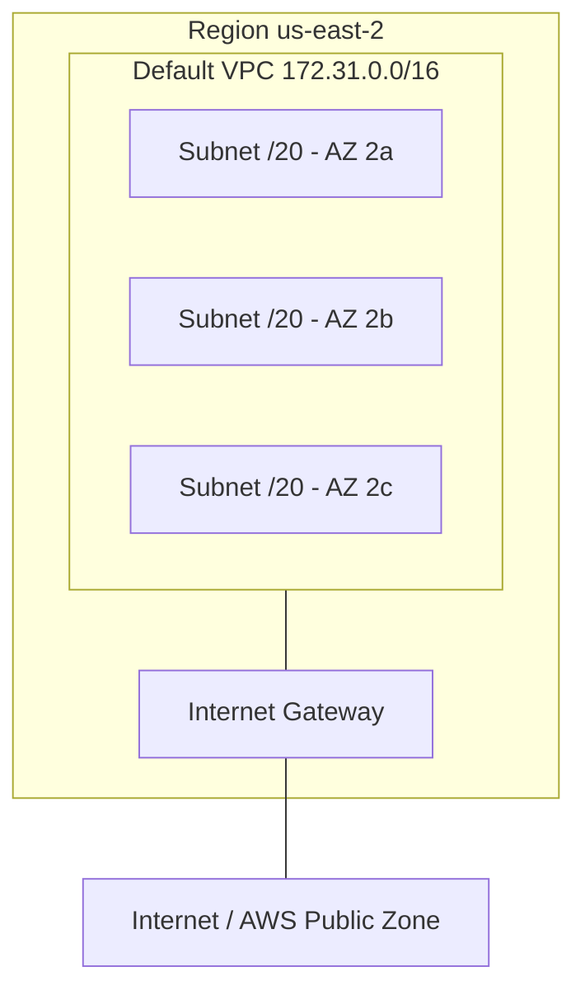

# Default VPC

> **TL;DR:** VPC (Virtual Private Cloud) là mạng ảo riêng trong một account và một region, mặc định private và cô lập. Mỗi region có **tối đa một Default VPC** do AWS tạo sẵn với cấu trúc cố định (`172.31.0.0/16`, một subnet `/20` mỗi AZ, có IGW, subnet tự gán public IPv4). Dễ dùng nhưng thiếu linh hoạt, nên production dùng **custom VPC**.

## 🖼️ Sơ đồ
![[Default VPC.excalidraw]]
*Mở bằng plugin Excalidraw để chỉnh sửa · ảnh tĩnh: [[Default VPC.svg]]*

## Khái niệm cốt lõi
### VPC nói chung
- VPC là **mạng ảo** trong AWS, tạo trong **một account** và **một region**. Đây là **regional service** (regionally resilient), trải qua nhiều AZ của region.
- Ứng dụng: chạy private service (EC2...), nối mạng AWS với **on-premises** (hybrid), hoặc nối với cloud khác (multi-cloud).
- Mặc định VPC **private và cô lập**: tài nguyên trong cùng VPC nói chuyện được với nhau; VPC tách biệt với VPC khác, với AWS Public Zone và Internet, trừ khi bạn cấu hình. Có một "ranh giới" quanh VPC mà không traffic nào vượt qua nếu không được cho phép.
- **VPC CIDR**: dải IP của VPC, xác định IP đầu và cuối. Mọi thứ trong VPC dùng IP trong dải này; traffic vào/ra cũng đến/đi từ dải này. Custom VPC có thể có **nhiều CIDR**; Default VPC chỉ có **một** và luôn giống nhau.
- **Subnet** = mạng con, là phần chia nhỏ của CIDR VPC (như cắt bánh). Mỗi subnet nằm trong **đúng một AZ**, đặt khi tạo và **không đổi được**. Dải IP các subnet **không được trùng/chồng lấn** nhau.
- Resilience của VPC đến từ subnet: mất một AZ thì subnet ở AZ đó hỏng, subnet ở AZ khác vẫn chạy.

### Hai loại VPC
| | **Default VPC** | **Custom VPC** |
|---|---|---|
| Số lượng | **Tối đa 1/region** | Nhiều/region |
| Tạo bởi | AWS (sẵn trong account mới) | Bạn |
| Cấu hình | Cố định, AWS lo hết networking | Tự cấu hình end‑to‑end, mọi kích thước/cấu trúc |
| Mặc định | Có IGW, subnet tự gán **public IPv4** | **100% private** |
| Kết nối hybrid/peering | Hạn chế | Đầy đủ |
| Dùng cho production | Không nên | **Có** (best practice) |

### Default VPC facts (slide)
- **Một per region**, có thể **xóa và tạo lại** (nên một region có thể có 0 default VPC).
- CIDR **luôn là `172.31.0.0/16`**, ở mọi region.
- Một subnet **`/20` trong mỗi AZ** của region (3 AZ thì 3 subnet, 6 AZ thì 6 subnet).
- Có sẵn **Internet Gateway (IGW)**, **default Security Group (SG)** và **default NACL**.
- **Subnet tự gán public IPv4** cho mọi thứ deploy vào, tức là "chiếu" tài nguyên ra AWS Public Zone (xem [[AWS Public vs Private Services]]). Đây là điểm chỉ Default VPC có.

### Phép tính CIDR
- Số sau `/` càng lớn thì mạng càng nhỏ: một `/17` bằng nửa `/16`, hai `/17` vừa một `/16`.
- `/16` chứa được **16 subnet `/20`** → đủ cho tối đa 16 AZ, region nào cũng thừa chỗ.
- Mỗi `/20` có 4096 IP; console hiển thị **4091 available** vì AWS giữ **5 IP mỗi subnet** (chi tiết ở [[VPC Subnets]]).
- Ví dụ us-east-1: `172.31.0.0/20` (1a), `172.31.80.0/20` (1b), `172.31.16.0/20` (1c), `172.31.32.0/20` (1d), `172.31.48.0/20` (1e), `172.31.64.0/20` (1f). Thứ tự gán không theo AZ, nhưng luôn là các khối /20 trong 172.31.0.0/16.

## Cách hoạt động / Kiến trúc

## Demo / Lab
- Account mới: VPC console → **Your VPCs** có đúng một VPC, cột *Default VPC = Yes*, CIDR `172.31.0.0/16`.
- **Subnets**: us-east-1 có 6 subnet (6 AZ, 1a–1f); đổi sang us-east-2 thì thấy 3 subnet (3 AZ).
- Kèm theo: một IGW, một default NACL, một default SG.
- **Xóa default VPC**: phải xác nhận (gõ *delete default vpc*), xóa luôn IGW, subnet, SG, NACL. Cảnh báo: nếu không còn default VPC thì không launch instance được ở region đó trừ khi chỉ định subnet của VPC khác.
- **Tạo lại**: *Actions → Create default VPC*. Không hỏi cấu hình gì, tạo lại đúng CIDR `172.31.0.0/16` và một subnet mỗi AZ. (Trước đây phải mở support ticket, nay tự làm trên console được.)

## 🎯 Mẹo thi SAA-C03
- Adrian nhấn mạnh: **chỉ một default VPC mỗi region** (tối đa), nhưng **nhiều custom VPC**.
- Thuộc lòng: default VPC CIDR **172.31.0.0/16**, subnet **/20 mỗi AZ**, có **IGW + SG + NACL**, subnet **tự gán public IPv4**.
- Default VPC xóa được và tạo lại được. Một số dịch vụ giả định default VPC tồn tại, nên Adrian để nguyên nhưng **không dùng cho production**.
- Câu hỏi về kiến trúc nghiêm túc, hybrid, IP không trùng với on-prem... → **custom VPC** (default VPC cứng nhắc, CIDR cố định dễ trùng với mạng khác).
- Subnet là **AZ resilient**, VPC là **region resilient**.

## Liên kết
- Tiên quyết: [[AWS Global Infrastructure]], [[AWS Public vs Private Services]], [[Subnetting]]
- Liên quan: [[EC2 Basics]], [[VPC Routing and Internet Gateway]], [[Security Groups]], [[NACL]]
- Học sâu hơn: [[VPC Sizing and Structure]], [[Custom VPC]], [[VPC Subnets]]
- MOC: [[_MOC 03 AWS Fundamentals]]
