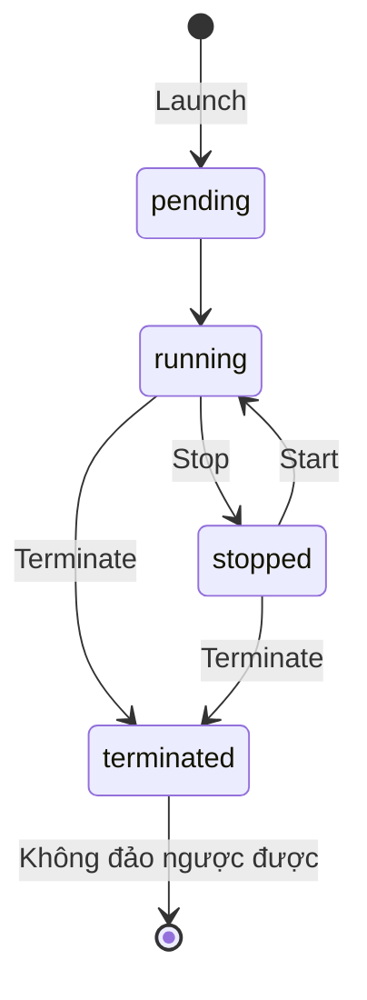

# EC2 Basics

> **TL;DR:** EC2 (Elastic Compute Cloud) là dịch vụ **IaaS** cung cấp máy ảo gọi là **instance**. Đây là điểm khởi đầu mặc định cho mọi nhu cầu compute cần OS và runtime riêng. EC2 là **private service**, launch vào **một subnet** nên **AZ resilient**. Cần nắm ba trạng thái running / stopped / terminated và chi phí của từng trạng thái, AMI, và cách kết nối (SSH/RDP với key pair).

## 🖼️ Sơ đồ
![[EC2 Basics.excalidraw]]
*Mở bằng plugin Excalidraw để chỉnh sửa · ảnh tĩnh: [[EC2 Basics.svg]]*

![[EC2 Basics - connect.excalidraw]]
*Mở bằng plugin Excalidraw để chỉnh sửa · ảnh tĩnh: [[EC2 Basics - connect.svg]]*

## Khái niệm cốt lõi
- **IaaS** (xem [[Cloud Service Models]]): đơn vị tiêu thụ là **instance**, tức một OS được cấu hình theo cách nhất định với lượng tài nguyên nhất định. Bạn quản lý từ **OS trở lên**; AWS lo virtualization, phần cứng, mạng vật lý, storage vật lý, facilities.
- **Private service**: chạy trong AWS Private Zone (xem [[AWS Public vs Private Services]]). Instance launch vào **một subnet** của VPC, chọn lúc launch. Muốn public access thì phải cấu hình, và VPC phải hỗ trợ (Default VPC làm sẵn; custom VPC phải tự làm).
- **AZ resilient**: subnet nằm trong một AZ, nên AZ hỏng thì instance nhiều khả năng hỏng theo. Adrian dặn nhớ ngay từ đầu.
- **Instance type/size** quyết định CPU, memory, network, và các khả năng thêm (GPU, storage/networking nâng cao, chip chuyên dụng). Một số thông số đổi được sau khi launch. Xem [[EC2 Instance Types]].
- **Billing on-demand**: tính **theo giây hoặc theo giờ** tùy phần mềm chạy trên instance. Gồm ba phần: tiền chạy instance (CPU + memory), tiền **storage**, và tiền **license phần mềm thương mại** (nếu có). Xem [[EC2 Purchase Options]].
- **Storage**: hai loại phổ biến là **local host storage** (đĩa trên EC2 host, xem [[Instance Store]]) và **EBS** (network storage, xem [[EBS]]).

### Instance states và chi phí
Ba trạng thái chính: **running**, **stopped**, **terminated** (trạng thái trung gian: pending, stopping, shutting-down).

| Thành phần | Running | Stopped | Terminated |
|---|---|---|---|
| CPU | Tính tiền (kể cả khi idle) | Không | Không |
| Memory | Tính tiền | Không | Không |
| Network | Thường có phí | Không | Không |
| **Storage (EBS)** | Tính tiền | **Vẫn tính tiền** | Không (đĩa bị xóa) |

- **Stopped vẫn bị tính phí storage**: EBS chứa OS và dữ liệu vẫn được cấp phát. Đây là chỗ đề thi hay gài.
- Muốn **không còn chi phí EC2** cho một instance thì phải **terminate**. Terminate là **một chiều**: instance bị xóa hoàn toàn cùng storage được cấp phát (với cấu hình mặc định của root volume).

### AMI (Amazon Machine Image)
- Image của EC2 instance: dùng AMI để **tạo instance**, và có thể **tạo AMI từ instance**. Giống server image hay USB cài OS.
- AMI chứa:
  1. **Permissions**: **Public** (ai cũng launch được, như các AMI Linux/Windows của AWS), **Owner** (chủ sở hữu luôn được dùng ngầm định), hoặc **explicit** cho các AWS account cụ thể. Không chia sẻ thì AMI là private, chỉ owner dùng.
  2. **Boot volume** (ổ C: trên Windows, root volume trên Linux), có thể kèm thêm data volume. Luôn có ít nhất boot volume.
  3. **Block device mapping**: ánh xạ volume nào gắn với device ID nào mà OS thấy, tức volume nào là boot, volume nào là data.
- Chi tiết ở [[AMI]].

### Kết nối tới instance
| OS | Giao thức | Port | Xác thực |
|---|---|---|---|
| Linux | **SSH** | **22** | SSH key pair: private key trực tiếp xác thực |
| Windows | **RDP** | **3389** | Dùng private key để **giải mã mật khẩu local Administrator**, rồi RDP bằng user/password đó |

- **Key pair** gồm public key và private key. **Private key chỉ tải về được một lần** (giữ cẩn thận). AWS giữ **public key** và đặt nó lên instance khi launch. Có private key khớp thì đăng nhập được.
- Định dạng private key: `.pem` (macOS/Linux/Windows hiện đại có OpenSSH) hoặc `.ppk` (PuTTY).

## Demo / Lab
1. Region **us-east-1**, EC2 console → **Key pairs** → Create key pair tên `A4L`, định dạng `.pem` → tải private key.
2. **Launch instance** "My First EC2 Instance": AMI **Amazon Linux 2** (free tier, 64-bit x86), instance type **t2.micro** (free tier), chọn key pair `A4L`.
3. Network: **default VPC**, subnet *No preference* (chọn subnet = chọn AZ), **Auto-assign public IP = Enable**. Tạo Security Group mới cho phép **SSH (22) từ 0.0.0.0/0** (chấp nhận được trong demo vì chỉ người có private key mới đăng nhập được).
4. Storage mặc định do AMI quy định: root volume **8 GiB gp2**. Phần *Advanced details* (user data...) dùng ở bài sau.
5. Instance đi từ **pending → running**, status check *initializing* → **2/2 checks passed** (mất khoảng 3 phút). Instance có private IP, public IPv4 và public DNS. Các tab: Details, Security, Networking, Storage, Status checks, Monitoring (metric CloudWatch).
6. **Connect** có ba cách: **EC2 Instance Connect** (terminal qua trình duyệt), **Session Manager** (cần cấu hình thêm), **SSH client**: `ssh -i "A4L.pem" ec2-user@<public-DNS>`.
   - Lỗi **"unprotected private key file"** nếu file key quá mở quyền → `chmod 400 A4L.pem` (macOS/Linux; Windows chỉnh quyền file theo cách khác).
7. Dọn dẹp: **Terminate** instance, chờ terminated rồi xóa Security Group (nếu xóa sớm sẽ lỗi vì SG còn gắn với instance). Không động vào default VPC và default SG.

## 🎯 Mẹo thi SAA-C03
- EC2 là **AZ resilient**. Muốn chịu lỗi AZ thì chạy nhiều instance ở **nhiều AZ** (thường cùng [[Auto Scaling Groups]] + [[Elastic Load Balancer]]).
- "Instance đã stop mà vẫn bị tính tiền" → chi phí **EBS storage**. Muốn hết sạch chi phí → **terminate** (và xóa snapshot/EIP liên quan).
- Nhớ port: **SSH 22**, **RDP 3389**.
- Windows instance: private key dùng để **lấy mật khẩu Administrator**, không phải để đăng nhập trực tiếp.
- Mất private key thì không tải lại được từ AWS.
- EC2 là **IaaS**: bạn chịu trách nhiệm patch OS (xem [[Shared Responsibility Model]]).

## Liên kết
- Tiên quyết: [[Cloud Service Models]], [[Default VPC]], [[AWS Global Infrastructure]]
- Liên quan: [[AMI]], [[EBS]], [[Instance Store]], [[Security Groups]], [[EC2 Instance Connect and SSH]], [[CloudWatch Basics]]
- Học sâu hơn: [[EC2 Architecture and Resilience]], [[EC2 Instance Types]], [[EC2 Purchase Options]], [[EC2 Shutdown Terminate and Termination Protection]]
- MOC: [[_MOC 03 AWS Fundamentals]]
