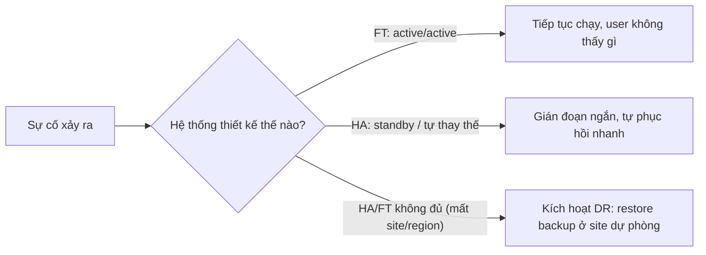

# HA vs FT vs DR

> **TL;DR:** **High Availability (HA)** = tối đa hóa thời gian online, **giảm thiểu outage**, chấp nhận gián đoạn ngắn. **Fault Tolerance (FT)** = **hoạt động xuyên qua lỗi**, không gây gián đoạn cho người dùng; phức tạp và đắt hơn nhiều. **Disaster Recovery (DR)** = chính sách, công cụ, quy trình để **khôi phục** khi HA và FT không cứu được hệ thống.

## 🖼️ Sơ đồ
![[HA vs FT vs DR.excalidraw]]
*Mở bằng plugin Excalidraw để chỉnh sửa · ảnh tĩnh: [[HA vs FT vs DR.svg]]*

## Khái niệm cốt lõi
### High Availability (HA)
- Định nghĩa: nhằm **đảm bảo** một mức **hiệu năng vận hành** đã thỏa thuận, thường là **uptime**, trong thời gian **cao hơn bình thường**.
- HA **không** nhằm ngăn lỗi xảy ra và **không** đảm bảo người dùng không bị gián đoạn. Hệ thống HA được thiết kế để khi hỏng thì thành phần được **thay thế/sửa nhanh nhất có thể**, thường bằng **tự động hóa**.
- Gián đoạn vài giây khi chuyển đổi (người dùng phải đăng nhập lại...) **vẫn được coi là HA**.
- Uptime thường biểu diễn bằng %:

| Mức | Downtime cho phép/năm |
|---|---|
| **99.9%** ("three 9s") | **8.77 giờ** (dưới 1 giờ/tháng) |
| **99.999%** ("five 9s") | **5.26 phút** (gồm cả phát hiện, chẩn đoán, sửa) |

- Ví dụ: Winnie (data scientist) dùng ứng dụng phân tích chạy trên **một server**. Server hỏng thì outage. Cải thiện HA: có quy trình (tự động) **thay server** thay vì ngồi chẩn đoán; hoặc **active/standby** (failover sang standby, gần như 0 downtime nhưng có thể phải login lại).
- Ví von: **xe 4x4 trong sa mạc mang theo lốp dự phòng và đồ nghề**. Vẫn phải dừng để thay lốp (gián đoạn), nhưng thời gian "chết" được giảm tối đa.
- Chi phí HA: cần thiết kế trước, tự động hóa, đôi khi cần hạ tầng dự phòng (redundant) sẵn sàng.

### Fault Tolerance (FT)
- Định nghĩa: thuộc tính cho phép hệ thống **tiếp tục hoạt động đúng** khi **một số thành phần hỏng** (một hoặc nhiều lỗi bên trong).
- Phải **hoạt động xuyên qua lỗi** (operate through failure) **mà không ảnh hưởng khách hàng**, kể cả trong lúc lỗi đang được sửa.
- Ví dụ: bệnh nhân Mike gây mê trong phòng mổ, máy monitor điều chỉnh thuốc mê, **bất kỳ gián đoạn nào cũng nguy hiểm tính mạng** → HA (thay server, active/standby) **không đủ**.
  - Giải pháp FT: monitor kết nối **đồng thời tới hai server (active/active)**, mất một server vẫn chạy với server còn lại.
  - Thêm **monitor thứ hai** nối với cả hai server → chịu được mất một monitor và một server.
  - Thậm chí loại bỏ điểm lỗi con người: thêm bác sĩ thứ hai (người song sinh của Dr. Abbie).
- Ví von: **máy bay đang bay**: không thể tấp vào lề để sửa, nên có **thừa động cơ**, hệ thống điện tử và thủy lực **nhân đôi**, tiếp tục bay tới khi hạ cánh an toàn.
- FT = HA (giảm outage) **cộng** thiết kế chịu lỗi: **nhiều tầng redundancy** và thành phần có thể **định tuyến lưu lượng vòng qua** thành phần hỏng.

### Disaster Recovery (DR)
- Định nghĩa: tập hợp **chính sách, công cụ và quy trình** để **khôi phục hoặc duy trì** hạ tầng và hệ thống công nghệ quan trọng sau **thảm họa tự nhiên hoặc do con người**.
- HA/FT là thiết kế để **chịu** sự cố; DR là **làm gì khi sự cố đã đánh sập hệ thống** (cháy, lụt, nổ tòa nhà...).
- Hai giai đoạn: **pre-planning** (trước thảm họa) và **DR process** (sau thảm họa). Lúc thảm họa là lúc dễ ra quyết định sai (sốc, thiếu ngủ, sợ hãi), nên phải **lên kế hoạch mọi thứ từ trước**:
  - **Standby premises/location** sẵn sàng cho nhân viên (hoặc dùng cloud như AWS làm site dự phòng).
  - Hạ tầng dự phòng: phần cứng sẵn ở site backup, hoặc VM/instance trên cloud sẵn sàng.
  - **Backup định kỳ**, lưu **off-site**, **không** lưu cùng site với hệ thống chính (cháy site chính là mất cả dữ liệu lẫn backup).
  - **Kiến thức**: tài liệu quy trình, **thông tin đăng nhập** các hệ thống quan trọng phải sẵn có ở site dự phòng; nhân viên biết vị trí và cách truy cập backup.
  - **Diễn tập DR định kỳ**, phát hiện thiếu sót, cải tiến, test lại.
- Ví von: nếu HA là xe 4x4, FT là hệ thống dự phòng trên máy bay, thì DR là **ghế phóng/dù thoát hiểm**: bảo vệ phần **quan trọng, không thay thế được** để có thể xây lại sau thảm họa.
- Trước đây DR rất thủ công; nhờ cloud và tự động hóa, DR có thể tự động phần lớn, giảm thời gian khôi phục và lỗi. Mục tiêu đo bằng [[RPO and RTO]].

## Bảng so sánh / số liệu
| Tiêu chí | **HA** | **FT** | **DR** |
|---|---|---|---|
| Mục tiêu | **Giảm thiểu outage**, tối đa uptime | **Hoạt động xuyên qua lỗi** | **Khôi phục** khi HA/FT thất bại |
| Người dùng bị gián đoạn? | Có thể (ngắn) | **Không** | Có (đến khi khôi phục xong) |
| Mô hình điển hình | Thay thế tự động, active/standby | **Active/active**, redundancy nhiều tầng | Backup off-site, standby site, runbook |
| Độ phức tạp / chi phí | Trung bình | **Cao nhất** | Tùy chiến lược |
| Ví von | Xe 4x4 + lốp dự phòng | Máy bay nhiều động cơ | Ghế phóng / dù |

## 🎯 Mẹo thi SAA-C03
- **Đừng nhầm HA với FT**: nhiều kiến trúc sư giỏi vẫn nhầm. HA = giảm outage; FT = vận hành xuyên lỗi.
  - Làm FT khi chỉ cần HA → **lãng phí tiền** và thời gian.
  - Làm HA khi cần FT → có thể **nguy hiểm tính mạng** ("máy bay chỉ HA" là thảm họa).
- Từ khóa trong đề: "minimize downtime", "highly available", "recover quickly" → HA. "**No interruption**", "**without impact to users**", "**continue operating if a component fails**", mission/life-critical → **FT**. "Recover after region/site disaster", "backup", "RPO/RTO" → **DR**.
- Khách hàng có thể nói "cần HA" hoặc "cần FT" mà không hiểu khác biệt; kiến trúc sư phải xác định nhu cầu thực.
- Đề thi kiểm tra khả năng chọn cách **khôi phục nhanh nhất / tốt nhất** với từng sản phẩm, gắn với [[RPO and RTO]].
- Trong AWS: HA thường là nhiều AZ + tự động thay thế (ví dụ [[RDS Multi-AZ]], [[Auto Scaling Groups]]); FT cần active/active và dư thừa năng lực; DR thường là backup/replication sang region khác ([[AWS Backup]], [[S3 Replication]]).

## Liên kết
- Tiên quyết: [[RPO and RTO]], [[AWS Global Infrastructure]]
- Liên quan: [[Regional and Global Architecture]], [[Elastic Load Balancer]], [[Auto Scaling Groups]], [[RDS Multi-AZ]], [[AWS Backup]], [[EC2 Architecture and Resilience]], [[R53 Failover Routing]]
- MOC: [[_MOC 03 AWS Fundamentals]]
