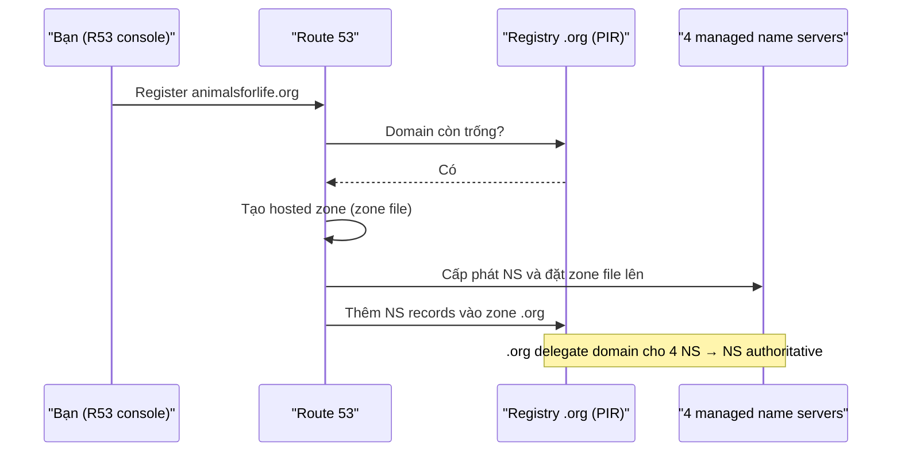

# Route 53 Fundamentals

> **TL;DR:** Route 53 (R53) là dịch vụ DNS managed của AWS, làm hai việc tách biệt: **đăng ký domain** (làm việc với các TLD registry) và **host zone file** trên các name server do AWS quản lý (gọi là *hosted zone*). Đây là dịch vụ **global**, một database duy nhất, replicate giữa các region nên **globally resilient**.

## 🖼️ Sơ đồ
![[Route 53 Fundamentals.excalidraw]]
*Mở bằng plugin Excalidraw để chỉnh sửa · ảnh tĩnh: [[Route 53 Fundamentals.svg]]*

![[Route 53 Fundamentals - hosted zones.excalidraw]]
*Mở bằng plugin Excalidraw để chỉnh sửa · ảnh tĩnh: [[Route 53 Fundamentals - hosted zones.svg]]*

## Khái niệm cốt lõi
- **Global service**: một trong số rất ít dịch vụ AWS chạy như một dịch vụ toàn cầu duy nhất → trên console không cần chọn region. Dữ liệu được phân tán toàn cầu như một tập duy nhất và replicate giữa các region; R53 vẫn chạy được khi một hoặc nhiều region hỏng (so sánh mức resilience ở [[AWS Global Infrastructure]]).
- **Hai chức năng chính** (độc lập nhau):
  1. **Register domains** – R53 có quan hệ với các registry quản lý TLD (`.com` – VeriSign, `.org` – PIR, `.io`, các ccTLD...). Registry được IANA ủy quyền từ root zone (xem [[DNS Fundamentals]]).
  2. **Host zone files** – "DNS as a service": tạo, quản lý zone file và phục vụ chúng trên **managed name servers**.
- **Hosted zone** = thuật ngữ R53 cho một zone file được host trên name server do AWS quản lý. Khi tạo hosted zone, R53 cấp phát và gắn với nó một bộ name server — thường là **4 name server** cho mỗi zone, rải ở nhiều nơi trên thế giới. Từ góc nhìn R53, hosted zone và bộ name server của nó gần như là một.
- **Public hosted zone**: dữ liệu truy cập được từ Internet công cộng; name server nằm logic trong **AWS public zone** (xem [[AWS Public vs Private Services]]) → là một phần của hệ thống DNS công cộng. Chi tiết: [[R53 Public Hosted Zones]].
- **Private hosted zone**: gắn (associate) với một hoặc nhiều VPC, chỉ resolve được từ bên trong các VPC đó → dùng cho record nhạy cảm không muốn lộ ra ngoài. Chi tiết: [[R53 Private Hosted Zones]].
- Trong R53, record thường được gọi là **record set**. Có khác biệt nhỏ (record set = tập các record cùng tên + cùng type) nhưng ở mức cơ bản coi như nhau. Các loại record: [[DNS Record Types]].

## Cách hoạt động / Kiến trúc

### Quy trình đăng ký domain (ví dụ `animalsforlife.org`)
1. R53 hỏi registry của TLD (`.org` → PIR) xem domain còn trống không.
2. R53 tạo **zone file** (hosted zone) cho domain.
3. R53 cấp phát **4 managed name server** và đặt zone file lên đó.
4. R53 làm việc với registry để thêm **NS record** vào zone `.org`, trỏ về 4 name server trên → registry **ủy quyền (delegate)** quản trị domain cho bạn; 4 server này trở thành **authoritative** cho domain.

DNS bản chất là một chuỗi **delegation**: root → `.org` (PIR) → name server của bạn → record trong hosted zone.

### Domain registration và DNS hosting là hai thứ tách rời
- Domain record ở registry chỉ chứa danh sách name server (NS) — đó là thứ DNS dùng để tìm ai authoritative cho domain.
- Vì tách rời nên có các tổ hợp:
  - Đăng ký **và** host zone đều ở R53 (trường hợp mặc định – R53 tự tạo hosted zone và gắn NS).
  - Đăng ký ở R53, nhưng sửa NS trong domain record để trỏ tới **name server bên ngoài** AWS.
  - Đăng ký ở registrar khác, tạo hosted zone trong R53 rồi cập nhật NS ở registrar ngoài trỏ về 4 name server R53 cấp.
- Các kịch bản phối hợp này được đào sâu ở [[R53 Interoperability]].

## Demo / Lab
Demo đăng ký `animalsforlife.org` trong account GENERAL (kịch bản [[Animals4life Scenario]]):
- Route 53 console → *Registered domains* → *Register domain*; nhập tên, kiểm tra tính khả dụng (tra cơ sở dữ liệu của registry `.org`). Giá khác nhau theo TLD; có gợi ý tên thay thế nếu tên đã bị lấy. Thời hạn mặc định 1 năm.
- Registry thường yêu cầu **3 contact**: *registrant* (người đăng ký), *technical*, *admin* (billing/gia hạn). Có thể dùng chung một người; bật **privacy protection** để ẩn thông tin liên hệ khỏi WHOIS.
- Tùy chọn **auto-renew** — nên bật cho domain production.
- Sau khi đặt, domain ở trạng thái *pending* (đang chờ PIR thêm vào zone `.org`, có thể nhận vài email xác nhận). Khi xong, domain chuyển sang *Registered domains* và hiển thị **4 name server** AWS đã cấp, đã được ghi vào zone `.org`.
- Song song, R53 đã tạo **hosted zone** `animalsforlife.org` (giao diện GUI của zone file) — nơi tạo các record DNS.
- Đăng ký domain tốn tiền (không bắt buộc cho khóa học). Ngoài ra mỗi hosted zone có phí hàng tháng (hiện ~0,50 USD/zone/tháng — số liệu theo bảng giá AWS, không nêu trong bài).

## 🎯 Mẹo thi SAA-C03
- R53 là **global service**, globally resilient, không gắn với region — nếu đề hỏi dịch vụ nào chịu được lỗi cả region cho DNS thì đó là R53.
- Hai việc tách bạch: **registrar** (đăng ký domain) vs **DNS hosting** (hosted zone). Domain đăng ký nơi khác vẫn dùng R53 hosted zone được, chỉ cần đổi NS ở registrar.
- Delegation domain → hosted zone được thực hiện bằng **NS records** trong zone của TLD.
- Mỗi hosted zone được cấp **4 name server**.
- **Public** hosted zone: truy cập từ Internet; **Private** hosted zone: chỉ trong các VPC được associate — dùng cho DNS nội bộ/nhạy cảm (split-view sẽ học ở [[R53 Private Hosted Zones]]).

## Liên kết
- Tiên quyết: [[DNS Fundamentals]], [[AWS Public vs Private Services]], [[AWS Global Infrastructure]]
- Liên quan: [[DNS Record Types]], [[R53 Public Hosted Zones]], [[R53 Private Hosted Zones]], [[R53 Routing Policies]], [[CNAME vs Alias]], [[R53 Interoperability]], [[R53 DNSSEC]]
- Bối cảnh: [[Animals4life Scenario]], [[_MOC 03 AWS Fundamentals]]
