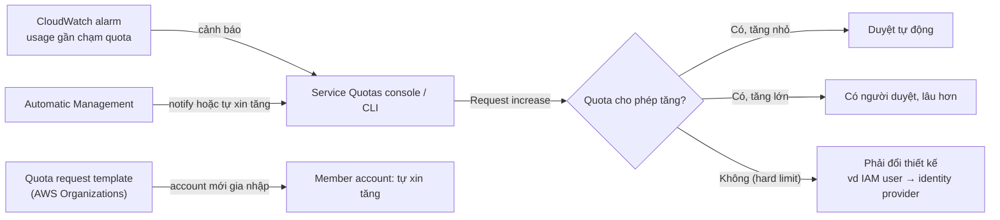

# Service Quotas

> **TL;DR:** Mọi AWS account đều bị giới hạn bởi **service quota**: mỗi dịch vụ được dùng tối đa bao nhiêu "thứ" (số vCPU EC2 đang chạy, số IAM user...). Quota mặc định thường **theo region**, dịch vụ global thì **theo account**. Phần lớn là **soft limit**, xin tăng qua **Service Quotas console**/CLI (trước đây phải mở support ticket); một số là **hard limit** không tăng được, ví dụ **5.000 IAM user mỗi account**, và điều này ảnh hưởng tới thiết kế. Có thể đặt **CloudWatch alarm** khi sắp chạm quota, bật **Automatic Management** để báo hoặc tự xin tăng, và dùng **quota request template** cho account mới trong AWS Organizations.

## 🖼️ Sơ đồ
![[Service Quotas.excalidraw]]
*Mở bằng plugin Excalidraw để chỉnh sửa · ảnh tĩnh: [[Service Quotas.svg]]*

## Khái niệm cốt lõi
- **Service quota** quy định **bạn được dùng bao nhiêu một thứ** trong AWS account. **Mọi account** đều chịu quota, kể cả account lớn.
- **Phạm vi của quota**:
  - Phần lớn dịch vụ có quota mặc định **theo region**. Ví dụ: số **vCPU** của các EC2 instance thuộc một nhóm instance (On-Demand Standard) được chạy cùng lúc trong `us-east-1`.
  - Một số dịch vụ, thường là dịch vụ **global**, có quota **theo account**, áp cho mọi region. Ví dụ: số **IAM user** được tạo trong account.
- **Vì sao có quota**: để **bảo vệ AWS và các khách hàng khác**. Account mới có quota đặt **rất thấp**, để khách mới không thể tạo hàng nghìn instance cùng lúc làm ảnh hưởng người khác trong region. Đây là **soft limit**: hệ thống càng lớn thì càng hay phải xin tăng.
- **Xin tăng (request increase)**:
  - Dùng **Service Quotas console** hoặc **CLI**: xem usage hiện tại, giá trị mặc định (AWS default) và giá trị đang áp dụng (applied), rồi bấm **Request increase** nếu quota cho phép.
  - Trước đây phải mở **support request**; nay quy trình gần như tự động. Tăng nhỏ thường **được duyệt tự động**; tăng lớn hoặc một số dịch vụ cần quy trình chặt hơn, có **người duyệt** và mất thời gian hơn. Vài dịch vụ vẫn cần support request.
- **Hard limit**: một số quota **không thay đổi được**. Ví dụ kinh điển: **5.000 IAM user mỗi account**, giới hạn này có từ lâu và không có nút xin tăng. Hard limit **ảnh hưởng tới thiết kế** và việc chọn dịch vụ: ứng dụng có hơn 5.000 người dùng phải dùng identity provider khác thay vì IAM user (xem [[IAM Users and ARNs]]).
- **Ba tính năng nên biết**:
  1. **CloudWatch alarm** để cảnh báo khi usage **sắp chạm quota** (xem [[CloudWatch Basics]]).
  2. **Automatic Management**: không chỉ **thông báo** mà còn có thể **tự xin tăng quota** thay bạn. Chọn chế độ chỉ notify hoặc tự adjust, chọn region áp dụng và các ngoại lệ.
  3. **Quota request template** (với [[AWS Organizations]]): khai báo sẵn các quota cần tăng; **member account mới** gia nhập organization sẽ được **tự động xin tăng** theo template.

## Cách hoạt động / Kiến trúc

- Quota theo region nghĩa là **mỗi region một giá trị riêng**: tăng ở `us-east-1` không làm thay đổi `ap-southeast-1`. Region chưa dùng vẫn ở mức mặc định.
- Nên xin tăng **trước khi cần**, ví dụ khi chuẩn bị đưa region mới vào dùng hoặc chuẩn bị region DR/region phụ, thay vì đợi tới lúc hệ thống báo lỗi vì chạm quota.

## Bảng so sánh / số liệu
| | **Soft limit (adjustable)** | **Hard limit** |
|---|---|---|
| Tăng được không | **Có**: Request increase qua console/CLI (hoặc support request) | **Không**: không có nút Request increase |
| Ví dụ trong bài | EC2 Running On-Demand Standard instances: mặc định **5 vCPU** mỗi region, demo đã tăng lên 64 ở `us-east-1` | IAM: **5.000 user mỗi account** |
| Ảnh hưởng | Phải xin tăng trước khi mở rộng | Phải chọn giải pháp khác (federation, identity provider) |

| Phạm vi quota | Ví dụ |
|---|---|
| **Theo region** (phần lớn) | Số vCPU EC2 On-Demand chạy cùng lúc trong một region |
| **Theo account** (một số, thường là dịch vụ global) | Số IAM user trong account |

## Demo / Lab
1. Account General, region `us-east-1`, đăng nhập `iamadmin`. Mở **Service Quotas**; **Dashboard** cho cái nhìn tổng quan (quota hiện có, quota adjustable, lịch sử request).
2. **AWS services** → tìm **Amazon Elastic Compute Cloud (Amazon EC2)** → tìm quota "on-demand" → **Running On-Demand Standard (A, C, D, H, I, M, R, T, Z) instances**: số vCPU tối đa cho nhóm instance này. Trang chi tiết có quota code, Quota ARN, **Utilization**, **Applied account-level quota value**, **AWS default quota value** và **Adjustability**. Ở `us-east-1` applied đã được tăng (64) so với default **5**.
3. Đổi sang region **Singapore** (chưa dùng EC2): cùng quota nhưng applied vẫn là **5** → quota là **theo region**. Bấm **Request increase** để chuẩn bị trước cho region mới hoặc region DR; nhiều quota được duyệt gần như tự động.
4. Quay về `us-east-1`, xem **IAM** → **Users per account** = **5.000** (current = default) và **không có tùy chọn thay đổi**: ví dụ hard limit.
5. **Automatic Management**: bật để nhận thông báo hoặc cho phép tự điều chỉnh; cấu hình kênh thông báo, region áp dụng, ngoại lệ (demo bấm Cancel, không bật).
6. **Quota request template** (mục Organization): thêm quota cần tăng, ví dụ On-Demand Standard instances ở `us-east-1` với giá trị cao hơn, để mọi member account mới của organization được tự xin tăng.

## 🎯 Mẹo thi SAA-C03
- Lỗi kiểu "không launch thêm được instance" / "đạt giới hạn" khi mở rộng → nghĩ tới **service quota**; giải pháp là **Request increase qua Service Quotas** (không phải đổi instance type hay mở account mới ngay).
- Nhớ quota thường **theo region**: mở rộng sang **region mới / region DR** thì phải xin tăng quota ở **region đó**, nên làm **trước**.
- **Cảnh báo trước khi chạm quota** → **CloudWatch alarm** trên usage của Service Quotas; muốn AWS **tự xin tăng** → **Automatic Management**.
- Nhiều account trong **AWS Organizations** cần cùng mức quota ngay khi tạo → **quota request template**.
- **5.000 IAM user/account là hard limit**: đáp án "xin tăng quota IAM user" cho ứng dụng hàng triệu người dùng là **sai**; chọn federation / [[Cognito]].

## Liên kết
- Liên quan: [[IAM Users and ARNs]] (5.000 user), [[IAM Groups]], [[EC2 Basics]], [[CloudWatch Basics]], [[AWS Organizations]], [[AWS Global Infrastructure]] (region)
- Ví dụ quota khác trong khóa: [[S3 Basics]] (số bucket mỗi account)
- MOC: [[_MOC 03 AWS Fundamentals]]
