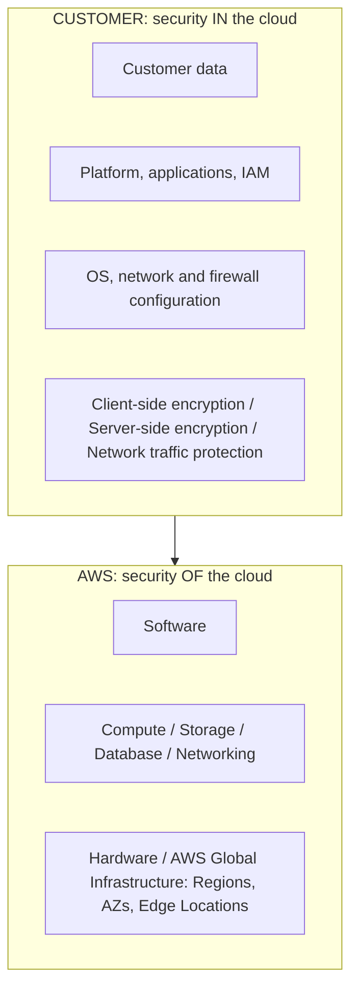

# Shared Responsibility Model

> **TL;DR:** Mô hình phân chia trách nhiệm **bảo mật** giữa AWS và khách hàng: **AWS chịu trách nhiệm bảo mật "OF" the cloud** (hạ tầng toàn cầu, phần cứng, dịch vụ nền và phần mềm vận hành dịch vụ), **khách hàng chịu trách nhiệm bảo mật "IN" the cloud** (OS trở lên, cấu hình mạng/firewall, ứng dụng, IAM, mã hóa, dữ liệu). Ranh giới dịch chuyển theo loại dịch vụ (IaaS, PaaS, SaaS).

## 🖼️ Sơ đồ
![[Shared Responsibility Model.excalidraw]]
*Mở bằng plugin Excalidraw để chỉnh sửa · ảnh tĩnh: [[Shared Responsibility Model.svg]]*

![[Shared Responsibility Model - service models.excalidraw]]
*Mở bằng plugin Excalidraw để chỉnh sửa · ảnh tĩnh: [[Shared Responsibility Model - service models.svg]]*

## Khái niệm cốt lõi
- Ý tưởng mở rộng từ [[Cloud Service Models]]: ở mỗi mô hình, một phần của infrastructure stack do nhà cung cấp quản lý, phần còn lại do khách hàng quản lý.

### Phân chia theo cloud service model (slide)
| Lớp trong stack | On-premises | DC hosted | **IaaS** | PaaS | SaaS |
|---|---|---|---|---|---|
| Interface, Application, Data | Khách | Khách | Khách | Khách | Nhà cung cấp |
| Runtime, Container | Khách | Khách | Khách | Nhà cung cấp | Nhà cung cấp |
| O/S | Khách | Khách | **Khách** | Nhà cung cấp | Nhà cung cấp |
| Hypervisor, Servers, Infrastructure | Khách | Khách | **Nhà cung cấp** | Nhà cung cấp | Nhà cung cấp |
| Facilities | Khách | Nhà cung cấp | Nhà cung cấp | Nhà cung cấp | Nhà cung cấp |

- Ví dụ IaaS = **EC2**: AWS lo facilities (data center), infrastructure (storage, networking), servers (EC2 host) và **hypervisor**. Bạn lo **OS**, container, runtime, data, application, interface.

### AWS: security "OF" the cloud
- **Hardware / AWS Global Infrastructure**: **Regions**, **Availability Zones**, **Edge Locations** (xem [[AWS Global Infrastructure]]).
- Các dịch vụ nền: **Compute, Storage, Database, Networking**.
- **Software** vận hành các dịch vụ đó (giao diện quản trị, hypervisor...).
- Bạn **không kiểm soát** và **không cần lo** phần này.

### Khách hàng: security "IN" the cloud
- **Customer data**: quản lý, bảo mật, **backup**.
- **Platform, applications, Identity & Access Management** (IAM do bạn thiết kế, triển khai, kiểm soát).
- **Operating system, network & firewall configuration** (patch OS, cấu hình mạng, firewall cục bộ, [[Security Groups]]...).
- **Client-side data encryption**, integrity và authentication.
- **Server-side encryption** (file system và/hoặc dữ liệu).
- **Network traffic protection**: encryption, integrity, identity (chứng chỉ SSL/TLS trên server, mã hóa server-to-server).

## Bảng so sánh / số liệu
Ví dụ áp dụng (tổng hợp, ranh giới dịch chuyển theo mức "managed" của dịch vụ):

| Dịch vụ | AWS lo | Khách hàng lo |
|---|---|---|
| [[EC2 Basics\|EC2]] (IaaS) | Host, hypervisor, mạng vật lý, region/AZ | Patch OS, phần mềm, SG, IAM, dữ liệu, mã hóa EBS |
| [[RDS Architecture\|RDS]] (managed DB) | Host, OS, cài/patch DB engine, backup tự động theo cấu hình | Cấu hình DB, user DB, SG, bật mã hóa, dữ liệu |
| [[S3 Basics\|S3]] | Hạ tầng lưu trữ, độ bền dữ liệu | Bucket policy, Block Public Access, mã hóa, dữ liệu |
| [[Lambda]] (serverless) | Runtime, OS, scale | Code, IAM role của function, dữ liệu |

## 🎯 Mẹo thi SAA-C03
- Câu hỏi "ai chịu trách nhiệm X?":
  - **Patch OS của EC2** → **khách hàng**. Patch OS/engine của **RDS** → **AWS** (managed service).
  - **Bảo mật vật lý data center**, phần cứng, hypervisor, mạng toàn cầu → **AWS**.
  - **Cấu hình Security Group / NACL / IAM / mã hóa / dữ liệu** → **khách hàng**.
- Adrian khuyên **in mô hình ra và để trên bàn** khi học. Với mỗi dịch vụ mới, tự hỏi phần nào AWS quản lý, phần nào mình quản lý. Điều này giúp trả lời nhiều câu, đặc biệt khi so sánh EC2 tự quản lý với dịch vụ managed (ví dụ [[Databases on EC2]] vs RDS).
- Dịch vụ càng "managed" (IaaS → PaaS → SaaS/serverless), phần trách nhiệm của khách càng ít, nhưng **dữ liệu và quyền truy cập (IAM)** luôn là trách nhiệm của khách.

## Liên kết
- Tiên quyết: [[Cloud Service Models]], [[AWS Global Infrastructure]]
- Liên quan: [[EC2 Basics]], [[IAM Basics]], [[Encryption Fundamentals]], [[Security Groups]], [[RDS Architecture]], [[Databases on EC2]]
- MOC: [[_MOC 03 AWS Fundamentals]]
