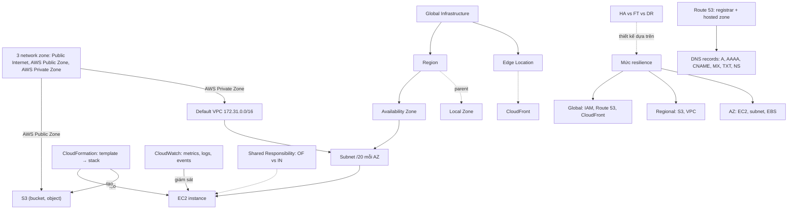

# 03 AWS Fundamentals

Section giới thiệu "khung xương" của AWS: các network zone (public vs private service), hạ tầng toàn cầu (Region, AZ, Edge, Local Zone) và ba mức resilience, cùng bản xem trước của các dịch vụ cốt lõi (Default VPC, EC2, S3, CloudFormation, CloudWatch, Route 53). Section cũng đặt các khung tư duy dùng suốt khóa: Shared Responsibility Model và HA vs FT vs DR. Mỗi dịch vụ ở đây sẽ được đào sâu trong section riêng của nó.

← [[00 Home]] · Section trước: [[_MOC 02 Tech Fundamentals]] · Section tiếp theo: [[_MOC 04 IAM Accounts and Organizations]] →

## Lộ trình học
1. [[AWS Public vs Private Services]]: public/private là khái niệm networking; ba zone: Public Internet, AWS Public Zone (S3...) và AWS Private Zone (VPC).
2. [[AWS Global Infrastructure]]: Region, Availability Zone, Edge Location và ba mức resilience global / region / AZ.
3. [[Default VPC]]: tối đa một default VPC mỗi region, `172.31.0.0/16`, subnet /20 mỗi AZ, có IGW; production dùng custom VPC.
4. [[EC2 Basics]]: máy ảo IaaS, private service, AZ resilient; trạng thái running/stopped/terminated và chi phí; AMI; SSH/RDP bằng key pair.
5. [[S3 Basics]]: object storage public service, bucket tên duy nhất toàn cầu, object 0 B – 5 TB, regionally resilient.
6. [[CloudFormation Basics]]: Infrastructure as Code; template YAML/JSON → stack → logical và physical resource luôn khớp nhau.
7. [[CloudWatch Basics]]: metrics + alarms, Logs, Events; namespace → metric → data point, dimension; alarm có 3 trạng thái.
8. [[Shared Responsibility Model]]: AWS lo security "OF" the cloud, khách hàng lo security "IN" the cloud; ranh giới đổi theo IaaS/PaaS/SaaS.
9. [[HA vs FT vs DR]]: HA giảm outage, FT vận hành xuyên lỗi không gián đoạn, DR khôi phục khi HA/FT thất bại.
10. [[Route 53 Fundamentals]]: DNS managed, global; hai việc tách biệt là đăng ký domain và host zone (hosted zone, 4 name server).
11. [[DNS Record Types]]: NS, A/AAAA, CNAME, MX, TXT và TTL quyết định thời gian cache.
12. [[AWS Local Zones]]: "AZ đặt gần bạn" gắn với parent region cho độ trễ cực thấp; chỉ một zone, không có resilience sẵn.

## Bản đồ khái niệm

## Liên kết sang section khác
- [[VPC Sizing and Structure]]: thiết kế custom VPC thay thế default VPC cho production.
- [[EC2 Architecture and Resilience]]: EC2 chi tiết, gắn với host và AZ.
- [[S3 Security]]: S3 private mặc định, bucket policy, Block Public Access.
- [[CFN Physical and Logical Resources]]: CloudFormation đầy đủ ở section 19.
- [[CloudWatch Agent]]: memory, disk, log trong OS và server on-prem.
- [[CloudTrail]]: "ai gọi API gì", phân biệt với CloudWatch.
- [[R53 Routing Policies]]: Route 53 chuyên sâu (simple, failover, weighted, latency...).
- [[Gateway VPC Endpoints]]: subnet private truy cập S3/DynamoDB không cần IGW/NAT.
- [[RPO and RTO]]: đi cùng HA/FT/DR khi chọn chiến lược khôi phục.
- [[Regional and Global Architecture]]: ghép region, AZ, edge thành kiến trúc thực tế.

## 🎯 Top mẹo thi của section
- Với mỗi dịch vụ luôn hỏi: **global, regional hay AZ resilient?** EC2/EBS = AZ, S3/VPC/RDS = region, IAM/Route 53/CloudFront = global ([[AWS Global Infrastructure]]).
- "Chịu được mất một AZ" → trải qua nhiều AZ; "mất cả region" → multi-region; "dữ liệu phải ở quốc gia X" → chọn region đó ([[AWS Global Infrastructure]]).
- "Public service" không có nghĩa ai cũng truy cập được dữ liệu; subnet private cần vào S3 mà không IGW/NAT → Gateway VPC Endpoint ([[AWS Public vs Private Services]]).
- Thuộc default VPC: **172.31.0.0/16**, subnet **/20 mỗi AZ**, có IGW, tự gán public IPv4; không dùng cho production ([[Default VPC]]).
- Instance stopped vẫn tốn tiền **EBS**; muốn hết chi phí thì terminate. SSH 22, RDP 3389 ([[EC2 Basics]]).
- **Tên bucket duy nhất toàn cầu**; hàng nghìn user cần vùng riêng → **một bucket chia prefix**, không phải mỗi user một bucket ([[S3 Basics]]).
- Cần mount hoặc file share → **không phải S3** ([[S3 Basics]]).
- `Resources` là section bắt buộc duy nhất của template; template tạo IAM resource cần **CAPABILITY_IAM** ([[CloudFormation Basics]]).
- Memory, disk usage, process trong OS của EC2 **không có sẵn** → CloudWatch Agent ([[CloudWatch Basics]]).
- Metric vượt ngưỡng → **CloudWatch Alarm + SNS**; theo lịch/khi trạng thái đổi → **EventBridge**; "ai gọi API" → CloudTrail ([[CloudWatch Basics]]).
- Patch OS của EC2 → khách hàng; patch OS/engine của RDS → AWS; SG/NACL/IAM/dữ liệu luôn là của khách hàng ([[Shared Responsibility Model]]).
- "Minimize downtime" → HA; "**no interruption**, without impact to users" → **FT**; "recover after disaster", RPO/RTO → DR ([[HA vs FT vs DR]]).
- Domain đăng ký nơi khác vẫn dùng hosted zone Route 53 được bằng cách đổi NS ở registrar; mỗi hosted zone có **4 name server** ([[Route 53 Fundamentals]]).
- **CNAME không trỏ tới IP** và không dùng ở apex → dùng **Alias**; chuẩn bị đổi DNS thì **hạ TTL trước** ([[DNS Record Types]]).
- "Lowest latency cho người dùng ở một thành phố cụ thể" → **Local Zones**; nhưng chỉ một zone, phải tự thiết kế HA ([[AWS Local Zones]]).
