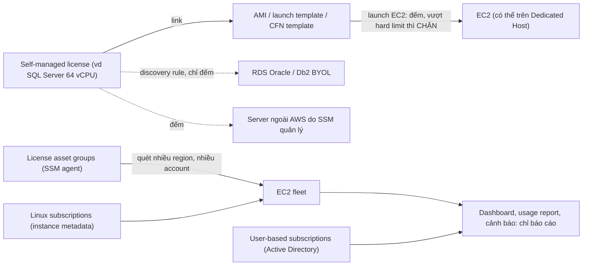

# AWS Artifact and License Manager

> **TL;DR:** Hai dịch vụ về **compliance**, gộp chung một bài vì bài Artifact rất ngắn. **AWS Artifact** là **cổng self-service** để tải **báo cáo compliance của AWS** (ISO, PCI, FedRAMP, SOC…) và xem các **agreement** của bạn với AWS, on-demand, phục vụ **due diligence / audit**. **AWS License Manager** quản lý **license phần mềm của bạn** ở một chỗ: dashboard, báo cáo cho audit, cảnh báo SNS, và với **self-managed license** gắn vào AMI / launch template thì **chặn được** việc launch EC2 vượt số license (tính năng duy nhất chặn được). Các tính năng khác (**license asset groups**, **Linux subscriptions**, **user-based subscriptions**) chỉ **báo cáo**. License Manager **miễn phí**.

## 🖼️ Sơ đồ
![[AWS Artifact and License Manager.excalidraw]]
*Mở bằng plugin Excalidraw để chỉnh sửa · ảnh tĩnh: [[AWS Artifact and License Manager.svg]]*

## Khái niệm cốt lõi

### AWS Artifact
- **Self-service portal** để truy cập **báo cáo compliance của AWS** và nhiều **agreement** với AWS mà bạn cần xem lại.
- Báo cáo chứng minh AWS tuân thủ các chuẩn như **ISO, PCI, FedRAMP, SOC**, nói rõ AWS tuân thủ thế nào và các bước kiểm tra họ phải làm.
- Dùng để làm **due diligence** của chính bạn khi đưa AWS vào môi trường của mình. Nếu điều khoản của từng báo cáo cho phép, bạn có thể **chia sẻ** báo cáo cho **khách hàng** của mình.
- Hầu hết báo cáo và agreement có **on-demand**; Artifact là điểm trung tâm thể hiện sự **minh bạch** của AWS về compliance.
- Bài giảng chỉ yêu cầu **nhận biết** dịch vụ ở mức cơ bản (khoảng 2 phút).

### AWS License Manager
- **Một chỗ duy nhất** quản lý mọi việc liên quan tới **license**: **dashboard**, **usage report** dùng cho **audit**, **control** để **chặn** launch EC2 vượt số license đang sở hữu, **cảnh báo** (qua **SNS**) khi chạm giới hạn hoặc **trước khi license hết hạn**.
- License có nhiều kiểu tính: theo **vCPU**, **core**, **socket**, theo **máy**, theo **người dùng**. License Manager hỗ trợ:
  - **Microsoft**: Windows Server, SQL Server.
  - **Linux thương mại**: Red Hat Enterprise Linux (RHEL), SUSE, Ubuntu Pro.
  - **Custom license**: bất cứ thứ gì tính theo vCPU, core, socket hoặc máy.
  - **User-based subscriptions**: phần mềm **thuê từ AWS** theo **người dùng mỗi tháng**.
  - License mua qua **Marketplace** (hiện ra dưới dạng granted license).
- Nơi dùng: **EC2** là ví dụ chính (hỗ trợ gần như mọi tính năng); **RDS** khi dùng **BYOL** cho **Oracle** hoặc **Db2**; **server ngoài AWS** do **SSM** quản lý (hybrid) cũng được đếm.
- **Miễn phí**: chỉ trả tiền tài nguyên bên dưới.
- Không phải tạo "instance License Manager": đây là **tập hợp tính năng**; lần đầu dùng tính năng nào thì cấp cho License Manager quyền cần thiết để truy cập dịch vụ khác.

## Cách hoạt động / Kiến trúc

### 1. Self-managed licenses (tính năng "kinh điển")
- Tạo một **self-managed license** mô tả **thứ bạn đang sở hữu**, ví dụ Aus-E-Mart có **SQL Server cho 64 vCPU**: đặt tên, đơn vị tính, số lượng. Có thể có nhiều license, theo sản phẩm hoặc theo hợp đồng.
- Tự license **không làm gì**, chỉ là một bản ghi. Phải **gắn (link)** nó vào **AMI**, **launch template** hoặc **CloudFormation template** (xem [[AMI]], [[Launch Templates]]).
- Mỗi lần launch instance từ AMI đó, license được **đếm tự động**: launch thì tăng, terminate hoặc stop thì giảm.
- Đặt **hard limit** → ai launch vượt số license sẽ bị **chặn**. Đây là **tính năng duy nhất** của License Manager **chặn được** việc sử dụng, giúp **ép tuân thủ license**.
- License tính theo **phần cứng vật lý** (per core, per socket) → dùng self-managed license với **Dedicated Host tenancy** (xem [[Dedicated Hosts]]); đây là cách rất phổ biến để quản lý compliance kiểu này.
- **RDS**: không có AMI, dùng **discovery rule** cho **Oracle** và **Db2** BYOL trên RDS → chỉ **đếm, báo cáo**, **không chặn**.
- Server **ngoài AWS** do **SSM** quản lý cũng được tính vào usage.
- Phạm vi: **cross-account được**, **không cross-region**.

### 2. License asset groups (tính năng mới hơn)
- Thay vì khai báo "tôi được chạy gì" như self-managed license, tính năng này **đi tìm cái gì đang chạy**: quét EC2 instance để tìm **Windows Server, SQL Server, RHEL…**, báo cáo cả **BYOL** lẫn license **đã bao gồm** trong dịch vụ (ví dụ AMI Ubuntu Pro).
- Cần **SSM agent** trên EC2: chính agent nhìn vào bên trong instance.
- Cấu hình ở **một region** (nơi gom kết quả, ví dụ `ap-southeast-2`), chọn thêm **source regions** để quét (ví dụ `us-east-1`); làm việc được **cross-region và cross-account**.
- Có thể mất **tới 24 giờ** mới báo về; cung cấp **dashboard, usage report, cảnh báo hết hạn**, nhưng **không bao giờ chặn**.

### 3. Subscriptions
- **Linux subscriptions**: giống license asset groups (cấu hình một region + source regions, **cross-region và cross-account**), chỉ tìm **Linux trả phí** (RHEL, SUSE, Ubuntu Pro) trên **EC2**. **Không cần agent**: lấy thông tin từ **instance metadata**. Không phải tạo gì, chỉ báo cáo, không chặn.
- **User-based subscriptions**: tính license **theo người**, không theo máy: **Office, Visual Studio, Remote Desktop** thuê từ AWS theo người dùng mỗi tháng. Cần **tích hợp Active Directory** (nguồn dữ liệu báo cáo theo user). Theo dõi phần mềm chạy từ **image do AWS cung cấp**; gán user vào instance launch từ image đó, chỉ user được gán mới đăng nhập được. **Cross-account được**, **không cross-region**.

## Bảng so sánh / số liệu

| Tính năng License Manager | Làm gì | Chặn được? | Cross-account | Cross-region | Yêu cầu |
|---|---|---|---|---|---|
| **Self-managed licenses** | Khai báo license sở hữu, gắn AMI / launch template / CFN, đếm tự động | **Có** (với EC2, hard limit) | Có | **Không** | Gắn vào AMI…; RDS dùng discovery rule (chỉ đếm) |
| **License asset groups** | Tìm phần mềm có license đang chạy | Không | Có | Có | **SSM agent**; tới 24 giờ |
| **Linux subscriptions** | Tìm Linux trả phí trên EC2 | Không | Có | Có | **Không cần agent** (instance metadata) |
| **User-based subscriptions** | License theo người (Office, Visual Studio, Remote Desktop) | Không | Có | **Không** | **Active Directory** |

| | **AWS Artifact** | **AWS License Manager** |
|---|---|---|
| Compliance của ai | **Của AWS** (báo cáo, chứng nhận) | **Của bạn** (license phần mềm bạn dùng) |
| Dùng để | Due diligence, audit, chia sẻ report cho khách | Theo dõi, báo cáo, chặn vượt license |
| Chi phí | (Bài không nói) | **Miễn phí** |

## 🎯 Mẹo thi SAA-C03
- "Cần **báo cáo compliance của AWS** (SOC, PCI, ISO, FedRAMP) cho auditor / khách hàng" hoặc "xem **agreement** với AWS" → **AWS Artifact**.
- "Theo dõi và **ép tuân thủ license** (Windows Server, SQL Server, Oracle BYOL…), **ngăn launch** vượt số license" → **AWS License Manager** với **self-managed license** gắn AMI / launch template.
- Chỉ **self-managed license (với EC2)** mới **chặn** được; asset groups, Linux subscriptions, user-based subscriptions và discovery rule cho RDS chỉ **báo cáo**.
- License tính theo **core / socket** → **Dedicated Host** + License Manager.
- Quét license đang chạy cần **SSM agent** (license asset groups); Linux subscriptions **không cần agent**.
- Self-managed license và user-based subscriptions **không cross-region**; asset groups và Linux subscriptions thì có.

## Liên kết
- Liên quan: [[Dedicated Hosts]], [[AMI]], [[Launch Templates]], [[EC2 Purchase Options]], [[RDS Architecture]], [[SNS]], [[Directory Service]], [[AWS Organizations]], [[AWS Config]] (compliance cấu hình tài nguyên của bạn)
- MOC: [[_MOC 04 IAM Accounts and Organizations]]
